# 考勤设置管理

<cite>
**本文档引用的文件**
- [teacherAttendanceStatistics.js](file://src/api/schoolManage/teacherAttendanceStatistics.js)
- [stuAttendanceRecord.js](file://src/api/schoolManage/stuAttendanceRecord.js)
- [attendanceStatistics.js](file://src/api/attendanceStatistics.js)
- [teacherAttendanceStatisticsIndex.vue](file://src/views/attendanceStatistics/teacherAttendanceTotal.vue)
- [schoolAttendanceDetail.vue](file://src/views/attendanceStatistics/schoolAttendanceDetail.vue)
- [schoolAttendanceTotal.vue](file://src/views/attendanceStatistics/schoolAttendanceTotal.vue)
- [danyang.js](file://src/api/homePage/danyang.js)
- [leaderSee.js](file://src/api/leaderSee.js)
- [classroomEvaluation.js](file://src/api/classroomEvaluation.js)
- [classroomEvaluationApp.js](file://src/api/classroomEvaluationApp.js)
- [deviceManage.js](file://src/api/systemSet/deviceManage.js)
- [dockingAttendanceMachine.js](file://src/api/systemSet/dockingAttendanceMachine.js)
- [readPunchClockSet.js](file://src/api/systemSet/readPunchClockSet.js)
- [teacherHonorSetting](file://src/api/systemSet/teacherHonorSetting)
- [StuLeave2Set.js](file://src/api/systemSet/StuLeave2Set.js)
- [StuLeave3Set.js](file://src/api/systemSet/StuLeave3Set.js)
- [TeacherLeave3Set.js](file://src/api/systemSet/TeacherLeave3Set.js)
- [teacherLeave4Setting.js](file://src/api/systemSet/teacherLeave4Setting.js)
- [reminderSettings.js](file://src/api/systemSet/reminderSettings.js)
- [locationSelector.vue](file://src/components/LocationSelector/index.vue)
- [gaodeMapInput.vue](file://src/components/GaodeMapInput/index.vue)
- [common.js](file://src/api/common/common.js)
- [schoolTime.js](file://src/api/common/schoolTime.js)
</cite>

## 目录
1. [简介](#简介)
2. [项目结构](#项目结构)
3. [核心组件](#核心组件)
4. [架构概览](#架构概览)
5. [详细组件分析](#详细组件分析)
6. [依赖关系分析](#依赖关系分析)
7. [性能考虑](#性能考虑)
8. [故障排除指南](#故障排除指南)
9. [结论](#结论)

## 简介

本项目为考勤设置管理功能的技术文档，涵盖教师考勤设置的完整实现机制。系统支持考勤地点管理、规则配置、提醒设置和人员管理，同时提供请假制度配置逻辑（学生请假设置、教师请假设置和请假流程管理）。文档详细说明了考勤数据采集方式、验证规则和统计分析功能，解释了考勤机对接的技术实现、数据同步机制和异常处理方案，并提供了考勤设置的API接口规范、批量配置功能和历史数据处理机制。

## 项目结构

项目采用Vue.js前端框架构建，采用模块化组织方式，主要分为以下几个层次：

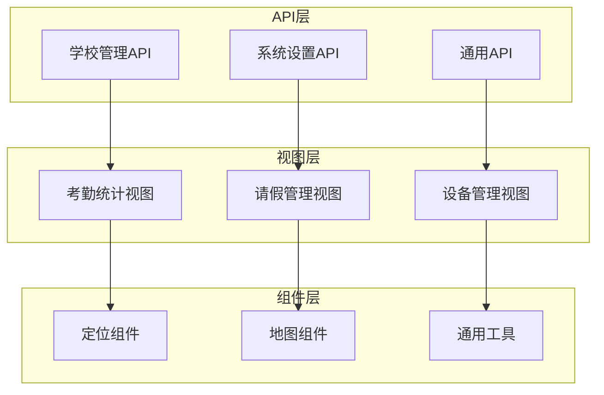

**图表来源**
- [teacherAttendanceStatistics.js](file://src/api/schoolManage/teacherAttendanceStatistics.js)
- [teacherAttendanceStatisticsIndex.vue](file://src/views/attendanceStatistics/teacherAttendanceTotal.vue)

**章节来源**
- [teacherAttendanceStatistics.js](file://src/api/schoolManage/teacherAttendanceStatistics.js)
- [teacherAttendanceStatisticsIndex.vue](file://src/views/attendanceStatistics/teacherAttendanceTotal.vue)

## 核心组件

### 考勤统计组件

系统提供完整的考勤统计功能，包括当日统计和月度统计两种模式：

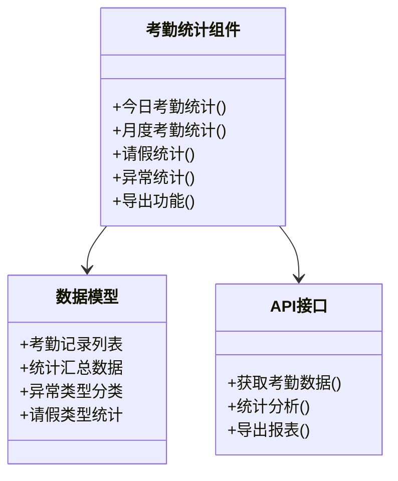

**图表来源**
- [teacherAttendanceStatistics.js](file://src/api/schoolManage/teacherAttendanceStatistics.js)
- [teacherAttendanceStatisticsIndex.vue](file://src/views/attendanceStatistics/teacherAttendanceTotal.vue)

### 请假管理系统

系统支持多层级的请假管理，包括学生请假和教师请假：

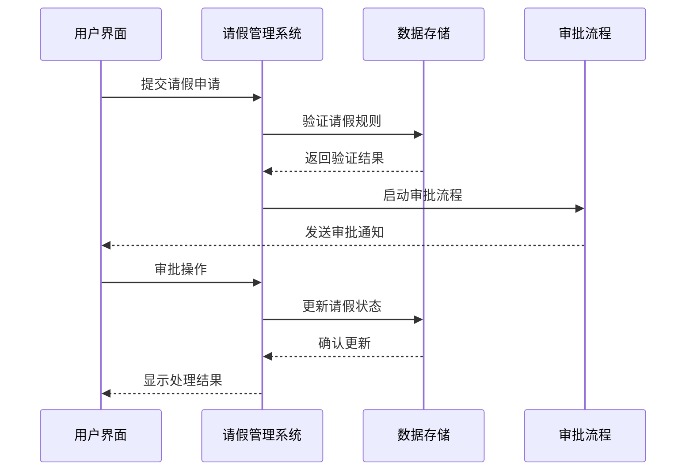

**图表来源**
- [teacherLeave4Setting.js](file://src/api/systemSet/teacherLeave4Setting.js)
- [StuLeave2Set.js](file://src/api/systemSet/StuLeave2Set.js)

**章节来源**
- [teacherLeave4Setting.js](file://src/api/systemSet/teacherLeave4Setting.js)
- [StuLeave2Set.js](file://src/api/systemSet/StuLeave2Set.js)
- [TeacherLeave3Set.js](file://src/api/systemSet/TeacherLeave3Set.js)

## 架构概览

系统采用前后端分离架构，后端提供RESTful API接口，前端通过Vue.js框架实现响应式用户界面。

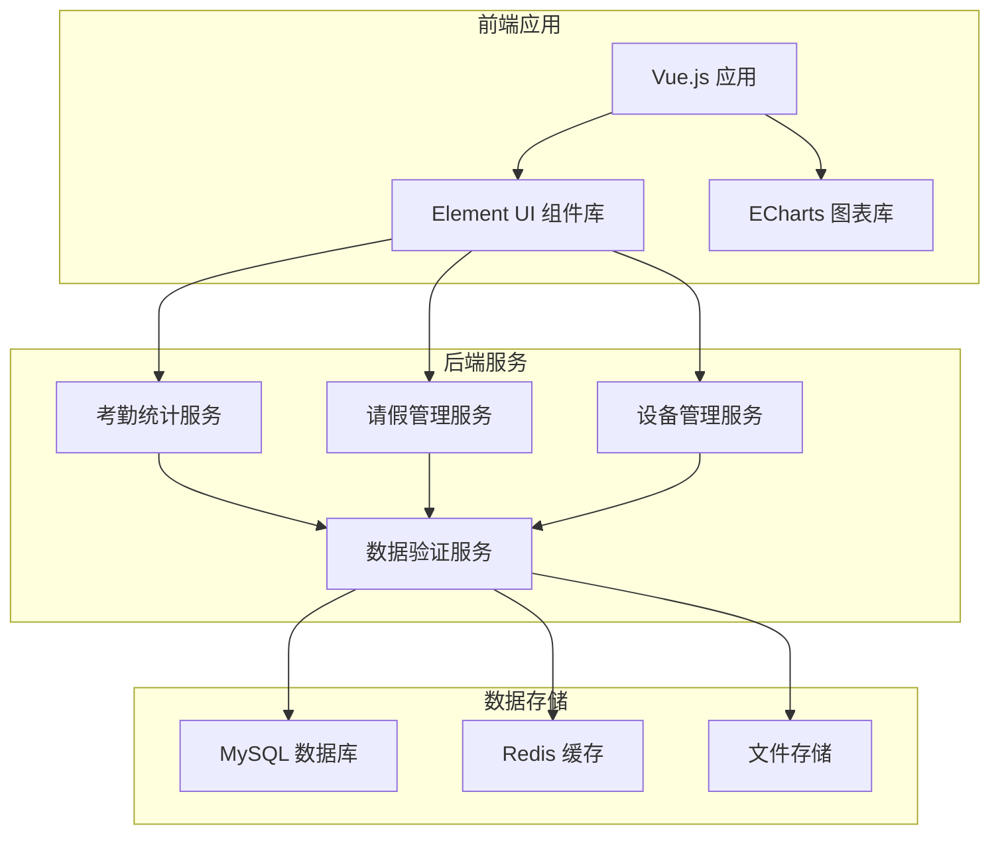

**图表来源**
- [teacherAttendanceStatistics.js](file://src/api/schoolManage/teacherAttendanceStatistics.js)
- [deviceManage.js](file://src/api/systemSet/deviceManage.js)

## 详细组件分析

### 考勤地点管理

系统提供灵活的考勤地点管理功能，支持多种定位方式：

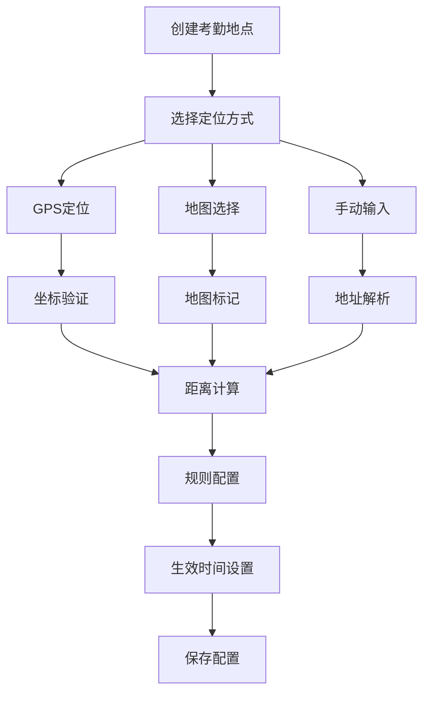

**图表来源**
- [locationSelector.vue](file://src/components/LocationSelector/index.vue)
- [gaodeMapInput.vue](file://src/components/GaodeMapInput/index.vue)

### 规则配置系统

系统支持复杂的考勤规则配置，包括时间规则、地点规则和权限规则：

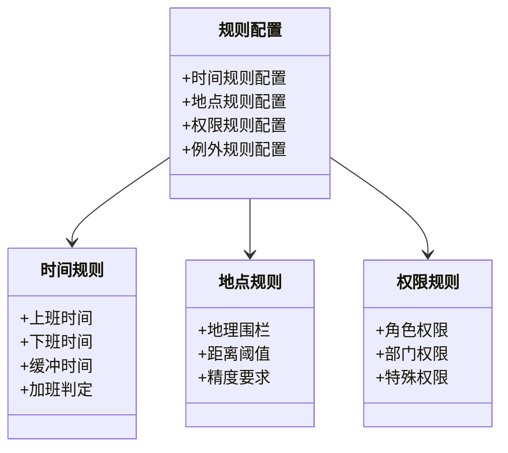

**图表来源**
- [readPunchClockSet.js](file://src/api/systemSet/readPunchClockSet.js)

### 提醒设置管理

系统提供多层次的提醒设置，确保考勤信息及时传达：

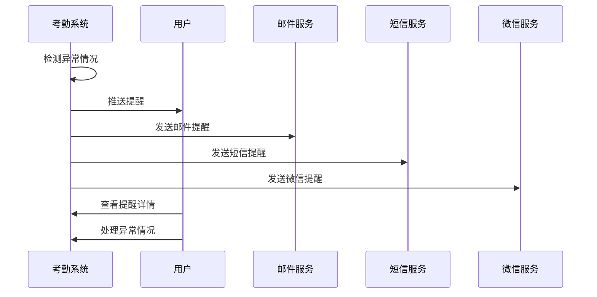

**图表来源**
- [reminderSettings.js](file://src/api/systemSet/reminderSettings.js)

### 人员管理功能

系统支持灵活的人员管理，包括部门管理、角色管理和权限控制：

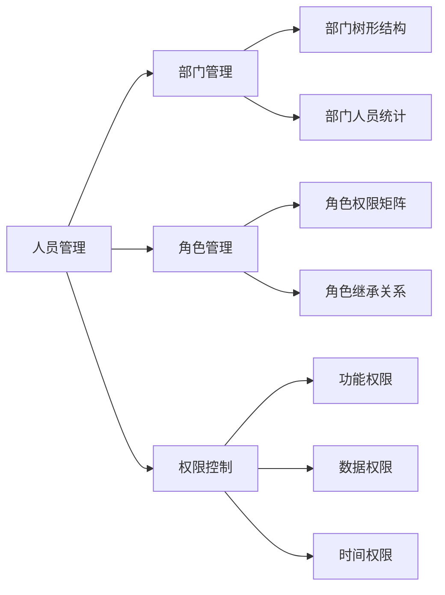

**图表来源**
- [teacherHonorSetting](file://src/api/systemSet/teacherHonorSetting)

### 考勤数据采集

系统提供多种数据采集方式，确保考勤数据的准确性和完整性：

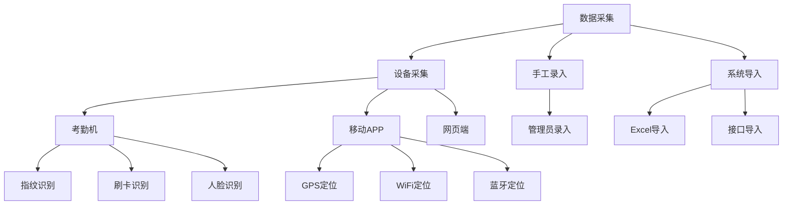

**图表来源**
- [dockingAttendanceMachine.js](file://src/api/systemSet/dockingAttendanceMachine.js)

### 统计分析功能

系统提供丰富的统计分析功能，支持多维度的数据分析：

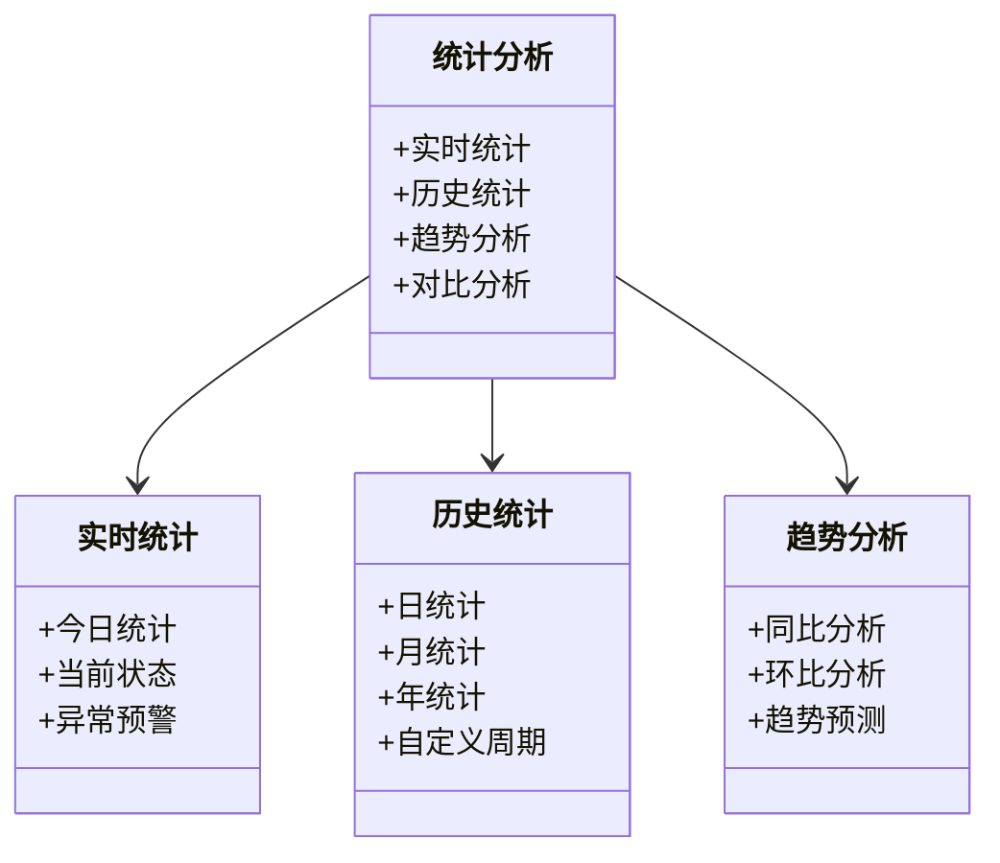

**图表来源**
- [attendanceStatistics.js](file://src/api/attendanceStatistics.js)

### 考勤机对接实现

系统提供标准的考勤机对接方案，支持多种协议和通信方式：

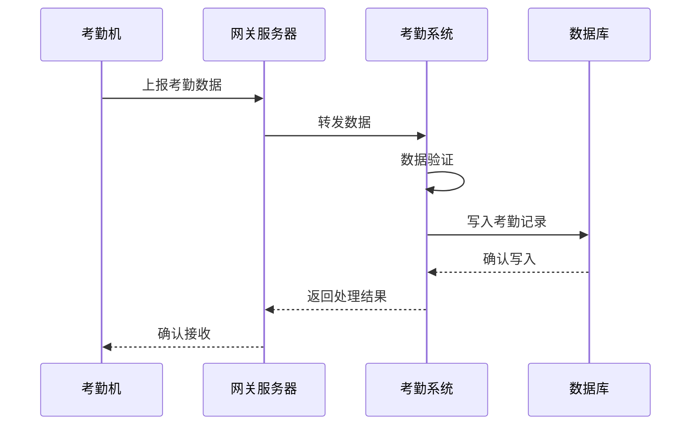

**图表来源**
- [dockingAttendanceMachine.js](file://src/api/systemSet/dockingAttendanceMachine.js)

**章节来源**
- [dockingAttendanceMachine.js](file://src/api/systemSet/dockingAttendanceMachine.js)
- [deviceManage.js](file://src/api/systemSet/deviceManage.js)

## 依赖关系分析

系统各模块之间存在清晰的依赖关系，形成完整的功能体系：

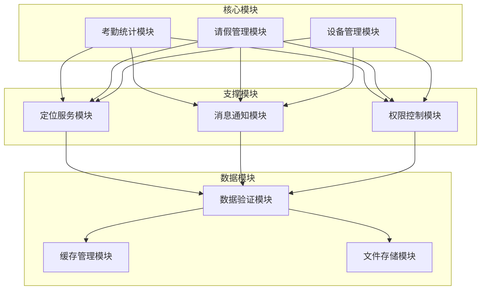

**图表来源**
- [teacherAttendanceStatistics.js](file://src/api/schoolManage/teacherAttendanceStatistics.js)
- [common.js](file://src/api/common/common.js)

**章节来源**
- [teacherAttendanceStatistics.js](file://src/api/schoolManage/teacherAttendanceStatistics.js)
- [common.js](file://src/api/common/common.js)

## 性能考虑

系统在设计时充分考虑了性能优化，采用多种技术手段提升系统性能：

### 缓存策略
- Redis缓存热点数据
- 分布式缓存架构
- 智能缓存失效机制

### 数据分页
- 大数据量分页加载
- 懒加载优化
- 前端虚拟滚动

### 并发处理
- 异步数据处理
- 任务队列管理
- 限流保护机制

## 故障排除指南

### 常见问题及解决方案

| 问题类型 | 症状描述 | 解决方案 |
|---------|----------|----------|
| 考勤异常 | 考勤记录不准确 | 检查定位精度和网络连接 |
| 设备离线 | 考勤机无法连接 | 检查网络配置和设备状态 |
| 数据丢失 | 考勤数据缺失 | 检查数据库连接和备份策略 |
| 权限问题 | 无法访问某些功能 | 检查用户权限和角色配置 |

### 监控告警机制

系统提供完善的监控告警功能：

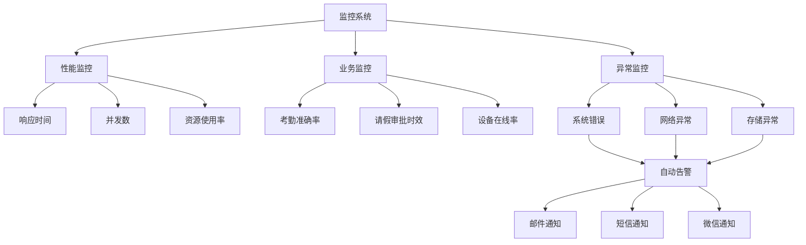

**图表来源**
- [reminderSettings.js](file://src/api/systemSet/reminderSettings.js)

**章节来源**
- [reminderSettings.js](file://src/api/systemSet/reminderSettings.js)

## 结论

本考勤设置管理功能实现了完整的考勤管理体系，涵盖了从考勤地点管理、规则配置到数据统计分析的全流程。系统采用现代化的技术架构，具有良好的扩展性和维护性。通过标准化的API接口和灵活的配置机制，能够满足不同规模学校和机构的考勤管理需求。

系统的亮点包括：
- 完善的考勤地点和规则管理
- 灵活的请假制度配置
- 丰富的统计分析功能
- 可靠的考勤机对接方案
- 全面的监控告警机制

未来可以进一步优化的方向包括：增强移动端体验、完善AI辅助识别功能、扩展更多第三方设备兼容性等。