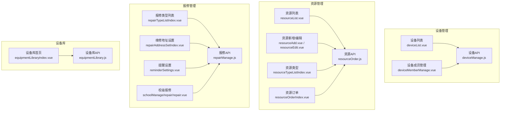
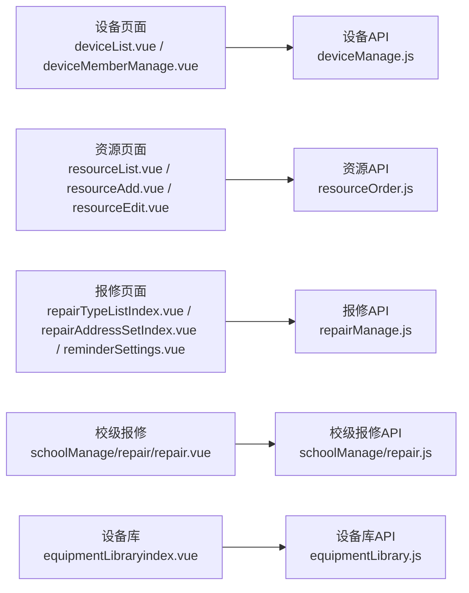
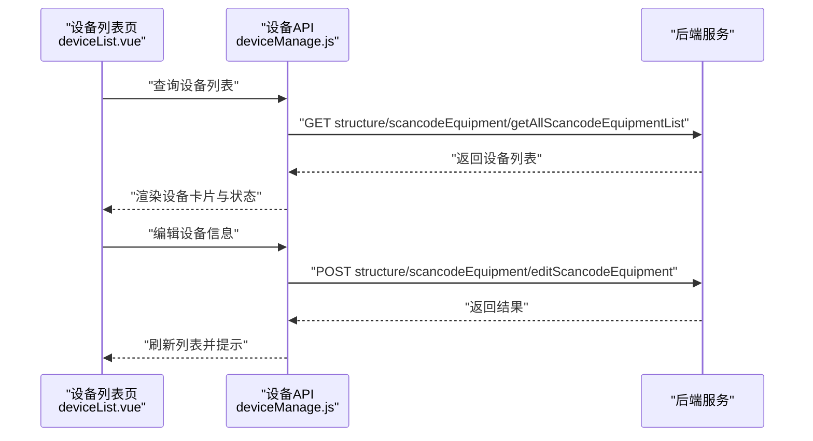
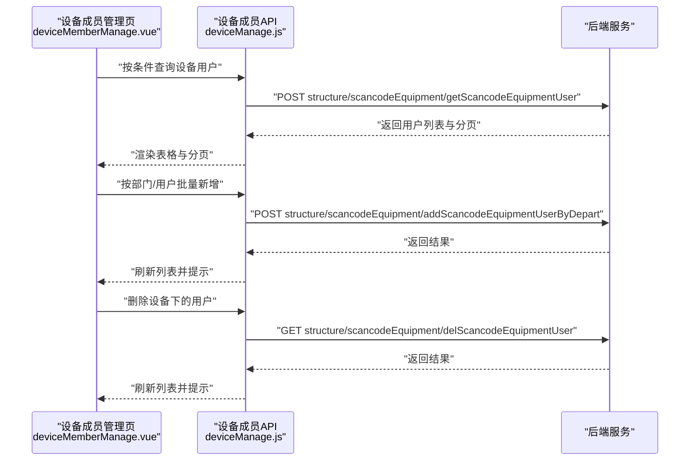
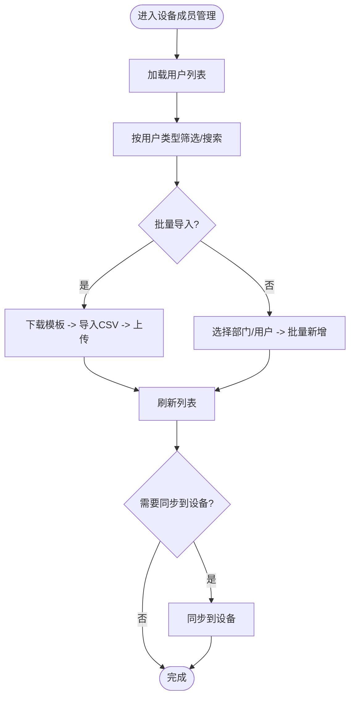
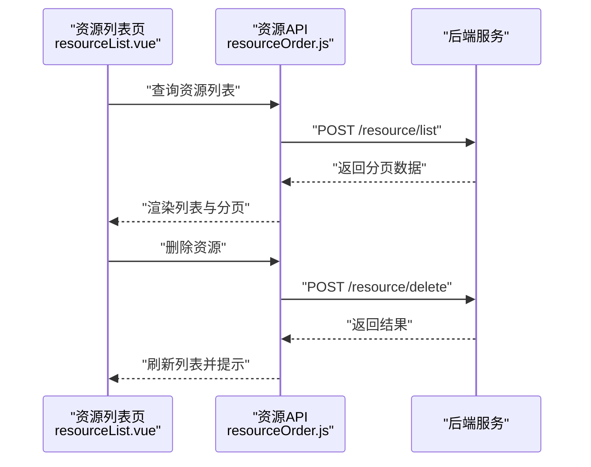
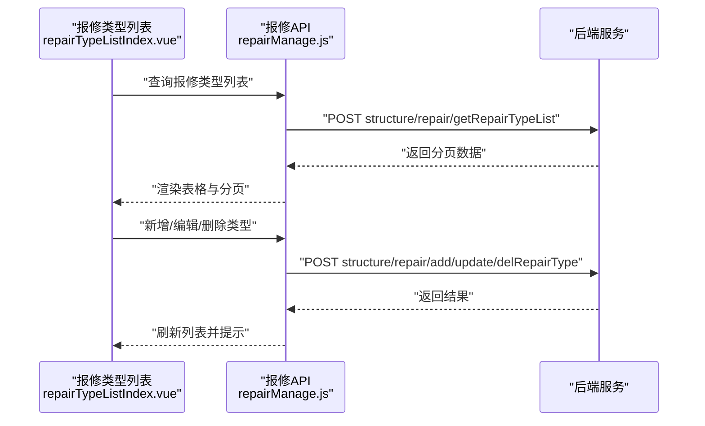
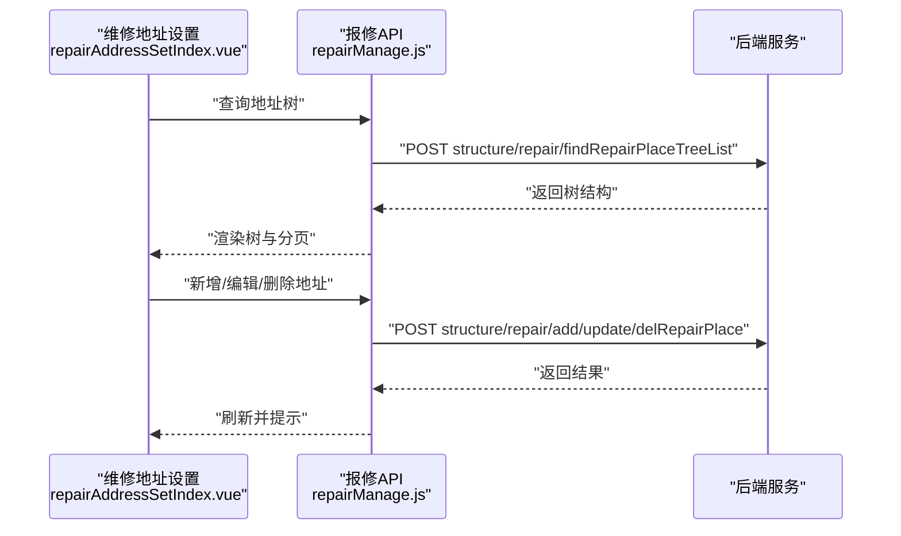
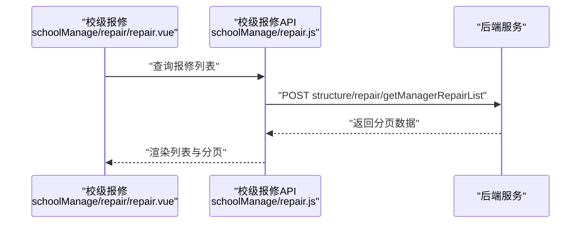
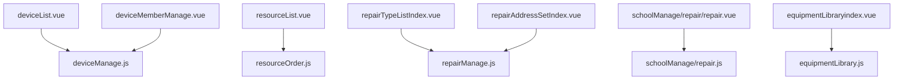

# 设施资源设置

<cite>
**本文引用的文件**   
- [src/api/systemSet/deviceManage.js](file://src/api/systemSet/deviceManage.js)
- [src/views/sysSet/deviceManage/deviceList.vue](file://src/views/sysSet/deviceManage/deviceList.vue)
- [src/views/sysSet/deviceManage/deviceMemberManage.vue](file://src/views/sysSet/deviceManage/deviceMemberManage.vue)
- [src/api/equipmentLibrary.js](file://src/api/equipmentLibrary.js)
- [src/views/equipmentLibrary/equipmentLibraryindex.vue](file://src/views/equipmentLibrary/equipmentLibraryindex.vue)
- [src/api/repairManage.js](file://src/api/repairManage.js)
- [src/views/sysSet/repairSet/repairTypeListIndex.vue](file://src/views/sysSet/repairSet/repairTypeListIndex.vue)
- [src/views/sysSet/repairAddressSet/repairAddressSetIndex.vue](file://src/views/sysSet/repairAddressSet/repairAddressSetIndex.vue)
- [src/views/sysSet/repairSet/reminderSettings.vue](file://src/views/sysSet/repairSet/reminderSettings.vue)
- [src/api/schoolManage/repair.js](file://src/api/schoolManage/repair.js)
- [src/views/schoolManage/repair/repair.vue](file://src/views/schoolManage/repair/repair.vue)
- [src/api/resourceOrder.js](file://src/api/resourceOrder.js)
- [src/views/sysSet/resourceSet/resourceList.vue](file://src/views/sysSet/resourceSet/resourceList.vue)
- [src/views/sysSet/resourceSet/resourceAdd.vue](file://src/views/sysSet/resourceSet/resourceAdd.vue)
- [src/views/sysSet/resourceSet/resourceEdit.vue](file://src/views/sysSet/resourceSet/resourceEdit.vue)
- [src/views/sysSet/resourceSet/resourceTypeListIndex.vue](file://src/views/sysSet/resourceSet/resourceTypeListIndex.vue)
- [src/views/resourceOrder/resourceOrderIndex.vue](file://src/views/resourceOrder/resourceOrderIndex.vue)
- [src/views/resourceOrder/resourceOrderDetail.vue](file://src/views/resourceOrder/resourceOrderDetail.vue)
- [src/views/resourceOrder/resourceOrderSummary.vue](file://src/views/resourceOrder/resourceOrderSummary.vue)
- [src/views/resourceExamine/resourceExamineIndex.vue](file://src/views/resourceExamine/resourceExamineIndex.vue)
- [src/views/resourceExamine/resourceExamineDetail.vue](file://src/views/resourceExamine/resourceExamineDetail.vue)
- [src/views/resourceExamine/resourceExamineApproval.vue](file://src/views/resourceExamine/resourceExamineApproval.vue)
</cite>

## 目录
1. [简介](#简介)
2. [项目结构](#项目结构)
3. [核心组件](#核心组件)
4. [架构总览](#架构总览)
5. [详细组件分析](#详细组件分析)
6. [依赖分析](#依赖分析)
7. [性能考虑](#性能考虑)
8. [故障排查指南](#故障排查指南)
9. [结论](#结论)
10. [附录](#附录)

## 简介
本技术文档围绕“设施资源设置”功能，系统化阐述设备管理、资源管理与报修管理的实现原理与使用方式。重点覆盖以下方面：
- 设备管理：设备清单管理、设备成员管理、设备状态监控与初始化、设备用户同步与提醒
- 资源管理：资源类型设置、资源分配与使用统计、资源订单与审批流程
- 报修管理：报修类型配置、维修地址设置、维修流程管理与处理
- 数据存储与查询：数据模型、关联关系与查询优化建议
- API 接口规范：REST 风格接口定义、参数与响应约定
- 批量导入导出与数据同步：模板下载、批量导入、数据一致性保障
- 统计分析与预警：使用统计、预警机制与维护提醒

## 项目结构
本功能涉及前端模块主要分布在以下目录：
- 设备管理：API 层位于 systemSet，页面层位于 sysSet/deviceManage
- 资源管理：API 层位于 resourceOrder，页面层位于 sysSet/resourceSet 与 resourceOrder
- 报修管理：API 层位于 repairManage，页面层位于 sysSet/repairSet、repairAddressSet 与 schoolManage/repair
- 设备库：equipmentLibrary 页面与 API

图表来源
- [src/api/systemSet/deviceManage.js:1-189](file://src/api/systemSet/deviceManage.js#L1-L189)
- [src/views/sysSet/deviceManage/deviceList.vue:1-712](file://src/views/sysSet/deviceManage/deviceList.vue#L1-L712)
- [src/views/sysSet/deviceManage/deviceMemberManage.vue:1-381](file://src/views/sysSet/deviceManage/deviceMemberManage.vue#L1-L381)
- [src/api/resourceOrder.js](file://src/api/resourceOrder.js)
- [src/views/sysSet/resourceSet/resourceList.vue:1-223](file://src/views/sysSet/resourceSet/resourceList.vue#L1-L223)
- [src/views/sysSet/resourceSet/resourceAdd.vue](file://src/views/sysSet/resourceSet/resourceAdd.vue)
- [src/views/sysSet/resourceSet/resourceEdit.vue](file://src/views/sysSet/resourceSet/resourceEdit.vue)
- [src/views/sysSet/resourceSet/resourceTypeListIndex.vue](file://src/views/sysSet/resourceSet/resourceTypeListIndex.vue)
- [src/views/resourceOrder/resourceOrderIndex.vue](file://src/views/resourceOrder/resourceOrderIndex.vue)
- [src/api/repairManage.js:1-464](file://src/api/repairManage.js#L1-L464)
- [src/views/sysSet/repairSet/repairTypeListIndex.vue:1-345](file://src/views/sysSet/repairSet/repairTypeListIndex.vue#L1-L345)
- [src/views/sysSet/repairAddressSet/repairAddressSetIndex.vue](file://src/views/sysSet/repairAddressSet/repairAddressSetIndex.vue)
- [src/views/sysSet/repairSet/reminderSettings.vue](file://src/views/sysSet/repairSet/reminderSettings.vue)
- [src/views/schoolManage/repair/repair.vue](file://src/views/schoolManage/repair/repair.vue)
- [src/api/equipmentLibrary.js:1-25](file://src/api/equipmentLibrary.js#L1-L25)
- [src/views/equipmentLibrary/equipmentLibraryindex.vue](file://src/views/equipmentLibrary/equipmentLibraryindex.vue)

章节来源
- [src/api/systemSet/deviceManage.js:1-189](file://src/api/systemSet/deviceManage.js#L1-L189)
- [src/views/sysSet/deviceManage/deviceList.vue:1-712](file://src/views/sysSet/deviceManage/deviceList.vue#L1-L712)
- [src/views/sysSet/deviceManage/deviceMemberManage.vue:1-381](file://src/views/sysSet/deviceManage/deviceMemberManage.vue#L1-L381)
- [src/api/resourceOrder.js](file://src/api/resourceOrder.js)
- [src/views/sysSet/resourceSet/resourceList.vue:1-223](file://src/views/sysSet/resourceSet/resourceList.vue#L1-L223)
- [src/views/sysSet/resourceSet/resourceAdd.vue](file://src/views/sysSet/resourceSet/resourceAdd.vue)
- [src/views/sysSet/resourceSet/resourceEdit.vue](file://src/views/sysSet/resourceSet/resourceEdit.vue)
- [src/views/sysSet/resourceSet/resourceTypeListIndex.vue](file://src/views/sysSet/resourceSet/resourceTypeListIndex.vue)
- [src/views/resourceOrder/resourceOrderIndex.vue](file://src/views/resourceOrder/resourceOrderIndex.vue)
- [src/api/repairManage.js:1-464](file://src/api/repairManage.js#L1-L464)
- [src/views/sysSet/repairSet/repairTypeListIndex.vue:1-345](file://src/views/sysSet/repairSet/repairTypeListIndex.vue#L1-L345)
- [src/views/sysSet/repairAddressSet/repairAddressSetIndex.vue](file://src/views/sysSet/repairAddressSet/repairAddressSetIndex.vue)
- [src/views/sysSet/repairSet/reminderSettings.vue](file://src/views/sysSet/repairSet/reminderSettings.vue)
- [src/views/schoolManage/repair/repair.vue](file://src/views/schoolManage/repair/repair.vue)
- [src/api/equipmentLibrary.js:1-25](file://src/api/equipmentLibrary.js#L1-L25)
- [src/views/equipmentLibrary/equipmentLibraryindex.vue](file://src/views/equipmentLibrary/equipmentLibraryindex.vue)

## 核心组件
- 设备管理 API：提供设备全量查询、新增、编辑、批量删除、设备用户查询、新增用户、按部门批量新增用户、删除用户、同步设备用户、提醒未上传照片用户、AI 初始化等能力
- 设备管理页面：设备列表展示与筛选、设备信息编辑、设备成员管理入口、同步到设备、初始化、提醒
- 资源管理 API：资源列表、新增、编辑、删除、资源类型管理、资源订单与审批
- 资源管理页面：资源列表、资源新增/编辑、资源类型列表、资源订单与审批详情
- 报修管理 API：报修列表、详情、处理、报修类型与地址管理、处理人列表、批量删除等
- 报修管理页面：报修类型列表、维修地址设置、提醒设置、校级报修列表
- 设备库 API：设备库列表与查询、字典查询设备类型

章节来源
- [src/api/systemSet/deviceManage.js:1-189](file://src/api/systemSet/deviceManage.js#L1-L189)
- [src/views/sysSet/deviceManage/deviceList.vue:1-712](file://src/views/sysSet/deviceManage/deviceList.vue#L1-L712)
- [src/views/sysSet/deviceManage/deviceMemberManage.vue:1-381](file://src/views/sysSet/deviceManage/deviceMemberManage.vue#L1-L381)
- [src/api/resourceOrder.js](file://src/api/resourceOrder.js)
- [src/views/sysSet/resourceSet/resourceList.vue:1-223](file://src/views/sysSet/resourceSet/resourceList.vue#L1-L223)
- [src/api/repairManage.js:1-464](file://src/api/repairManage.js#L1-L464)
- [src/views/sysSet/repairSet/repairTypeListIndex.vue:1-345](file://src/views/sysSet/repairSet/repairTypeListIndex.vue#L1-L345)
- [src/api/equipmentLibrary.js:1-25](file://src/api/equipmentLibrary.js#L1-L25)

## 架构总览
前端通过 API 层调用后端服务，页面层负责交互与数据展示；设备管理、资源管理、报修管理分别独立成块，但共享统一的工具与组件。

图表来源
- [src/views/sysSet/deviceManage/deviceList.vue:1-712](file://src/views/sysSet/deviceManage/deviceList.vue#L1-L712)
- [src/views/sysSet/deviceManage/deviceMemberManage.vue:1-381](file://src/views/sysSet/deviceManage/deviceMemberManage.vue#L1-L381)
- [src/api/systemSet/deviceManage.js:1-189](file://src/api/systemSet/deviceManage.js#L1-L189)
- [src/views/sysSet/resourceSet/resourceList.vue:1-223](file://src/views/sysSet/resourceSet/resourceList.vue#L1-L223)
- [src/views/sysSet/resourceSet/resourceAdd.vue](file://src/views/sysSet/resourceSet/resourceAdd.vue)
- [src/views/sysSet/resourceSet/resourceEdit.vue](file://src/views/sysSet/resourceSet/resourceEdit.vue)
- [src/api/resourceOrder.js](file://src/api/resourceOrder.js)
- [src/views/sysSet/repairSet/repairTypeListIndex.vue:1-345](file://src/views/sysSet/repairSet/repairTypeListIndex.vue#L1-L345)
- [src/views/sysSet/repairAddressSet/repairAddressSetIndex.vue](file://src/views/sysSet/repairAddressSet/repairAddressSetIndex.vue)
- [src/views/sysSet/repairSet/reminderSettings.vue](file://src/views/sysSet/repairSet/reminderSettings.vue)
- [src/api/repairManage.js:1-464](file://src/api/repairManage.js#L1-L464)
- [src/views/schoolManage/repair/repair.vue](file://src/views/schoolManage/repair/repair.vue)
- [src/api/schoolManage/repair.js:1-19](file://src/api/schoolManage/repair.js#L1-L19)
- [src/views/equipmentLibrary/equipmentLibraryindex.vue](file://src/views/equipmentLibrary/equipmentLibraryindex.vue)
- [src/api/equipmentLibrary.js:1-25](file://src/api/equipmentLibrary.js#L1-L25)

## 详细组件分析

### 设备管理
- 设备清单管理
  - 全量查询、按设备类型筛选、按名称搜索、编辑设备信息（名称、使用场景）
  - 支持初始化（如晨检设备）、同步到设备、提醒未上传照片用户
- 设备成员管理
  - 支持按用户类型筛选（教师、学生、家长），支持批量导入模板下载
  - 支持按部门或用户批量新增，支持删除设备下的用户
- 设备状态监控
  - 设备在线/离线状态展示，支持初始化与同步

图表来源
- [src/views/sysSet/deviceManage/deviceList.vue:470-565](file://src/views/sysSet/deviceManage/deviceList.vue#L470-L565)
- [src/api/systemSet/deviceManage.js:8-40](file://src/api/systemSet/deviceManage.js#L8-L40)

图表来源
- [src/views/sysSet/deviceManage/deviceMemberManage.vue:183-261](file://src/views/sysSet/deviceManage/deviceMemberManage.vue#L183-L261)
- [src/api/systemSet/deviceManage.js:64-119](file://src/api/systemSet/deviceManage.js#L64-L119)

图表来源
- [src/views/sysSet/deviceManage/deviceMemberManage.vue:100-113](file://src/views/sysSet/deviceManage/deviceMemberManage.vue#L100-L113)
- [src/api/systemSet/deviceManage.js:93-102](file://src/api/systemSet/deviceManage.js#L93-L102)

章节来源
- [src/views/sysSet/deviceManage/deviceList.vue:1-712](file://src/views/sysSet/deviceManage/deviceList.vue#L1-L712)
- [src/views/sysSet/deviceManage/deviceMemberManage.vue:1-381](file://src/views/sysSet/deviceManage/deviceMemberManage.vue#L1-L381)
- [src/api/systemSet/deviceManage.js:1-189](file://src/api/systemSet/deviceManage.js#L1-L189)

### 资源管理
- 资源类型设置
  - 资源类型列表、新增、编辑、删除、排序与筛选
- 资源分配与使用统计
  - 资源列表、新增/编辑、删除、二维码查看、状态标签（可用/维护中/损坏）
  - 资源订单与审批流程：订单列表、详情、汇总统计、审批流程

图表来源
- [src/views/sysSet/resourceSet/resourceList.vue:130-191](file://src/views/sysSet/resourceSet/resourceList.vue#L130-L191)
- [src/api/resourceOrder.js](file://src/api/resourceOrder.js)

章节来源
- [src/views/sysSet/resourceSet/resourceList.vue:1-223](file://src/views/sysSet/resourceSet/resourceList.vue#L1-L223)
- [src/views/sysSet/resourceSet/resourceAdd.vue](file://src/views/sysSet/resourceSet/resourceAdd.vue)
- [src/views/sysSet/resourceSet/resourceEdit.vue](file://src/views/sysSet/resourceSet/resourceEdit.vue)
- [src/views/sysSet/resourceSet/resourceTypeListIndex.vue](file://src/views/sysSet/resourceSet/resourceTypeListIndex.vue)
- [src/views/resourceOrder/resourceOrderIndex.vue](file://src/views/resourceOrder/resourceOrderIndex.vue)
- [src/views/resourceOrder/resourceOrderDetail.vue](file://src/views/resourceOrder/resourceOrderDetail.vue)
- [src/views/resourceOrder/resourceOrderSummary.vue](file://src/views/resourceOrder/resourceOrderSummary.vue)
- [src/views/resourceExamine/resourceExamineIndex.vue](file://src/views/resourceExamine/resourceExamineIndex.vue)
- [src/views/resourceExamine/resourceExamineDetail.vue](file://src/views/resourceExamine/resourceExamineDetail.vue)
- [src/views/resourceExamine/resourceExamineApproval.vue](file://src/views/resourceExamine/resourceExamineApproval.vue)

### 报修管理
- 报修类型配置
  - 类型列表、新增/编辑/删除、是否需要反馈、排序、上级类型联动
- 维修地址设置
  - 地址树形结构、新增/编辑/删除、按模型查询
- 维修流程管理
  - 报修列表、详情、处理、批量删除、处理人列表

图表来源
- [src/views/sysSet/repairSet/repairTypeListIndex.vue:210-273](file://src/views/sysSet/repairSet/repairTypeListIndex.vue#L210-L273)
- [src/api/repairManage.js:162-242](file://src/api/repairManage.js#L162-L242)

图表来源
- [src/views/sysSet/repairAddressSet/repairAddressSetIndex.vue](file://src/views/sysSet/repairAddressSet/repairAddressSetIndex.vue)
- [src/api/repairManage.js:251-415](file://src/api/repairManage.js#L251-L415)

图表来源
- [src/views/schoolManage/repair/repair.vue](file://src/views/schoolManage/repair/repair.vue)
- [src/api/schoolManage/repair.js:1-19](file://src/api/schoolManage/repair.js#L1-L19)
- [src/api/repairManage.js:19-89](file://src/api/repairManage.js#L19-L89)

章节来源
- [src/views/sysSet/repairSet/repairTypeListIndex.vue:1-345](file://src/views/sysSet/repairSet/repairTypeListIndex.vue#L1-L345)
- [src/views/sysSet/repairAddressSet/repairAddressSetIndex.vue](file://src/views/sysSet/repairAddressSet/repairAddressSetIndex.vue)
- [src/views/sysSet/repairSet/reminderSettings.vue](file://src/views/sysSet/repairSet/reminderSettings.vue)
- [src/views/schoolManage/repair/repair.vue](file://src/views/schoolManage/repair/repair.vue)
- [src/api/repairManage.js:1-464](file://src/api/repairManage.js#L1-L464)
- [src/api/schoolManage/repair.js:1-19](file://src/api/schoolManage/repair.js#L1-L19)

### 设备库
- 设备库列表与查询：按设备类型、设备ID、模块、学校名、状态、用途过滤
- 字典查询设备类型：用于设备类型选择与校验

章节来源
- [src/api/equipmentLibrary.js:1-25](file://src/api/equipmentLibrary.js#L1-L25)
- [src/views/equipmentLibrary/equipmentLibraryindex.vue](file://src/views/equipmentLibrary/equipmentLibraryindex.vue)

## 依赖分析
- 组件耦合
  - 页面与 API：各页面通过对应 API 文件发起请求，职责清晰
  - 共享组件：BackTool、AddressBook、ImportFile 等在多个页面复用
- 外部依赖
  - Element UI 表格、分页、弹窗等组件
  - 工具函数：URLSearchParams、lodash 防抖等
- 可能的循环依赖
  - 当前结构以 API 为中介，页面仅依赖 API，未见直接循环依赖

图表来源
- [src/views/sysSet/deviceManage/deviceList.vue:1-712](file://src/views/sysSet/deviceManage/deviceList.vue#L1-L712)
- [src/views/sysSet/deviceManage/deviceMemberManage.vue:1-381](file://src/views/sysSet/deviceManage/deviceMemberManage.vue#L1-L381)
- [src/api/systemSet/deviceManage.js:1-189](file://src/api/systemSet/deviceManage.js#L1-L189)
- [src/views/sysSet/resourceSet/resourceList.vue:1-223](file://src/views/sysSet/resourceSet/resourceList.vue#L1-L223)
- [src/api/resourceOrder.js](file://src/api/resourceOrder.js)
- [src/views/sysSet/repairSet/repairTypeListIndex.vue:1-345](file://src/views/sysSet/repairSet/repairTypeListIndex.vue#L1-L345)
- [src/views/sysSet/repairAddressSet/repairAddressSetIndex.vue](file://src/views/sysSet/repairAddressSet/repairAddressSetIndex.vue)
- [src/api/repairManage.js:1-464](file://src/api/repairManage.js#L1-L464)
- [src/views/schoolManage/repair/repair.vue](file://src/views/schoolManage/repair/repair.vue)
- [src/api/schoolManage/repair.js:1-19](file://src/api/schoolManage/repair.js#L1-L19)
- [src/views/equipmentLibrary/equipmentLibraryindex.vue](file://src/views/equipmentLibrary/equipmentLibraryindex.vue)
- [src/api/equipmentLibrary.js:1-25](file://src/api/equipmentLibrary.js#L1-L25)

## 性能考虑
- 列表分页与防抖
  - 使用分页参数控制每页数量，减少一次性传输数据量
  - 对搜索输入采用防抖策略，降低频繁请求
- 图片与二维码
  - 注册照片按需展示，避免大图加载；二维码链接外链，减少本地渲染压力
- 请求合并与缓存
  - 对常用字典（设备类型）可做本地缓存，减少重复请求
- 异步处理
  - 同步到设备、初始化等耗时操作应设置超时与进度提示，避免阻塞 UI

## 故障排查指南
- 设备初始化失败
  - 检查设备 ID 是否正确、设备状态是否允许初始化
  - 关注超时设置与后端日志
- 同步到设备失败
  - 确认设备在线状态与网络连通性
  - 查看返回错误码与消息提示
- 成员导入失败
  - 校验模板格式与字段映射
  - 检查上传接口参数与权限
- 报修处理异常
  - 确认处理人列表与权限
  - 检查流程状态流转与必填项

章节来源
- [src/views/sysSet/deviceManage/deviceList.vue:397-422](file://src/views/sysSet/deviceManage/deviceList.vue#L397-L422)
- [src/views/sysSet/deviceManage/deviceMemberManage.vue:262-299](file://src/views/sysSet/deviceManage/deviceMemberManage.vue#L262-L299)
- [src/api/repairManage.js:137-151](file://src/api/repairManage.js#L137-L151)

## 结论
本功能通过清晰的模块划分与标准化的 API 接口，实现了设备、资源与报修的全生命周期管理。页面层以组件化方式复用通用控件，提升开发效率与一致性。建议后续进一步完善数据模型与查询优化、增强统计分析与预警能力，并持续优化导入导出与同步机制。

## 附录

### API 接口规范（示例）
- 设备管理
  - GET structure/scancodeEquipment/getAllScancodeEquipmentList：获取设备列表
  - POST structure/scancodeEquipment/addScancodeEquipment：新增设备
  - POST structure/scancodeEquipment/editScancodeEquipment：编辑设备
  - POST structure/scancodeEquipment/batchDeleteScancodeEquipment：批量删除设备
  - POST structure/scancodeEquipment/getScancodeEquipmentUser：查询设备用户
  - POST structure/scancodeEquipment/addScancodeEquipmentUser：新增设备用户
  - POST structure/scancodeEquipment/addScancodeEquipmentUserByDepart：按部门批量新增用户
  - GET structure/scancodeEquipment/delScancodeEquipmentUser：删除设备用户
  - GET structure/scancodeEquipment/synchronousScancodeEquipmentUser：同步到设备
  - GET structure/scancodeEquipment/remindScancodeEquipmentUser：提醒未上传照片用户
  - GET common/aiNuoDa/morningCheckInit：AI 初始化
  - GET structure/scancodeEquipment/getEquipmentLibraryList：设备库列表
  - GET structure/scancodeEquipment/getEquipmentLibrary：设备库查询

- 资源管理
  - POST /resource/list：资源列表
  - POST /resource/add：新增资源
  - POST /resource/edit：编辑资源
  - POST /resource/delete：删除资源
  - POST /resource/type/list：资源类型列表
  - POST /resource/order/list：资源订单列表
  - POST /resource/examine/index：资源审批列表
  - POST /resource/examine/detail：资源审批详情
  - POST /resource/examine/approve：资源审批操作

- 报修管理
  - POST structure/repair/getManagerRepairList：报修列表
  - POST structure/repair/getAllRepairList：全校报修列表
  - POST structure/repair/getUserRepairList：用户报修列表
  - POST structure/repair/getRepairInfo：报修详情
  - POST structure/repair/updateDealRepair：处理报修
  - POST structure/repair/getRepairTypeList：报修类型列表
  - POST structure/repair/getRepairTypeInfo：报修类型详情
  - POST structure/repair/updateRepairType：更新报修类型
  - POST structure/repair/delRepairTypeList：删除报修类型
  - POST structure/repair/findRepairPlaceListByModel：按模型查询报修地点
  - POST structure/repair/findParentRepairPlaceList：上级报修地点
  - POST structure/repair/getRepairPlaceTreeList：报修地点树
  - POST structure/repair/addRepairType：新增报修类型
  - POST structure/repair/getRepairPlaceList：报修地点列表
  - POST structure/repair/addRepairPlace：新增报修地点
  - POST structure/repair/updateRepairPlace：编辑报修地点
  - POST structure/repair/delRepairPlaceById：删除报修地点
  - POST structure/repair/delRepairPlaceByIds：批量删除报修地点
  - POST structure/repair/getRepairTypeAllList：所有报修类型
  - GET structure/repair/repairListAll：报修列表（GET）
  - GET structure/repair/getDealUserList：处理人列表

章节来源
- [src/api/systemSet/deviceManage.js:1-189](file://src/api/systemSet/deviceManage.js#L1-L189)
- [src/api/resourceOrder.js](file://src/api/resourceOrder.js)
- [src/api/repairManage.js:1-464](file://src/api/repairManage.js#L1-L464)
- [src/api/schoolManage/repair.js:1-19](file://src/api/schoolManage/repair.js#L1-L19)