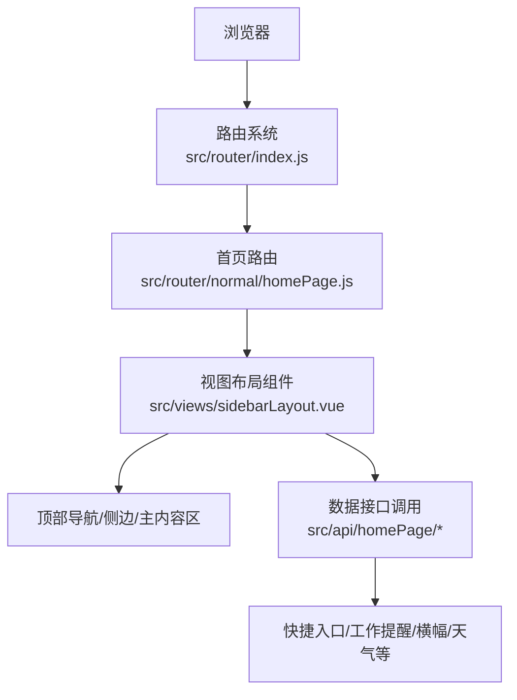
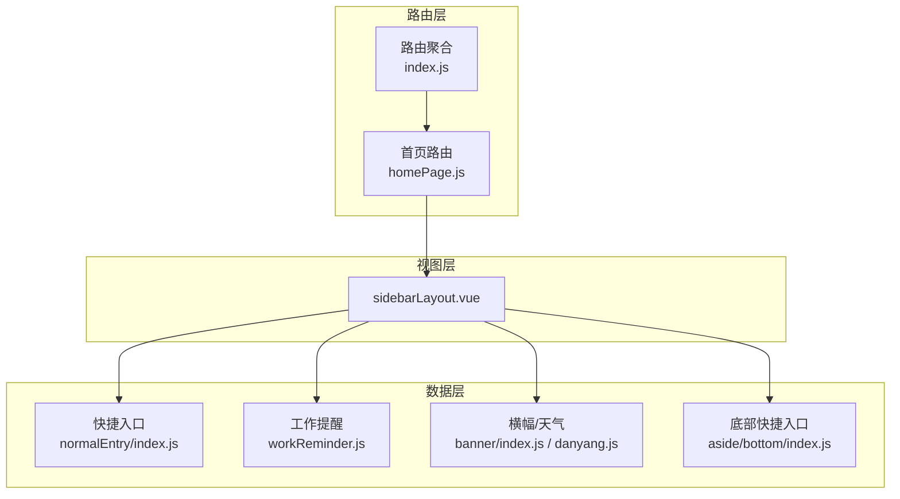
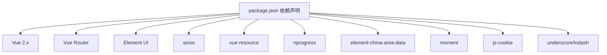

# 首页模块

<cite>
**本文引用的文件**
- [main.js](file://src/main.js)
- [homePage.js（路由）](file://src/router/normal/homePage.js)
- [index.js（路由聚合）](file://src/router/index.js)
- [aside-bottom-index.js](file://src/api/homePage/aside/bottom/index.js)
- [workReminder.js](file://src/api/homePage/aside/middle/workReminder.js)
- [danyang.js](file://src/api/homePage/danyang.js)
- [banner-index.js](file://src/api/homePage/main/banner/index.js)
- [normalEntry-index.js](file://src/api/homePage/main/normalEntry/index.js)
- [sidebarLayout.vue](file://src/views/sidebarLayout.vue)
- [index.html](file://index.html)
- [package.json](file://package.json)
</cite>

## 目录
1. [简介](#简介)
2. [项目结构](#项目结构)
3. [核心组件](#核心组件)
4. [架构总览](#架构总览)
5. [详细组件分析](#详细组件分析)
6. [依赖分析](#依赖分析)
7. [性能考虑](#性能考虑)
8. [故障排查指南](#故障排查指南)
9. [结论](#结论)
10. [附录](#附录)

## 简介
本文件面向“首页模块”的功能与实现进行系统化技术文档化，覆盖以下方面：
- 首页门户设计理念与布局形态（顶部导航、左侧边栏、主内容区）
- 工作台功能与区域划分（快捷入口、工作提醒、天气信息等）
- 数据获取流程、组件间通信与状态管理策略
- 个性化配置、主题定制与响应式设计要点
- 与系统其他模块的集成与数据流转路径

说明：仓库中首页相关视图文件未直接呈现于 src/views 下，但通过路由与 API 文件可定位首页功能的组织方式与数据来源。

## 项目结构
首页模块由“路由配置 + 视图布局 + API 数据源”三部分协同构成：
- 路由层：定义首页入口、省丹中首页以及工作提醒页面的访问路径与懒加载视图
- 视图层：采用统一布局组件承载头部、侧边与主内容区
- 数据层：通过 API 目录下的模块化接口提供快捷入口、工作提醒、横幅与天气等数据

**图示来源**
- [index.js（路由聚合）](file://src/router/index.js)
- [homePage.js（路由）](file://src/router/normal/homePage.js)
- [sidebarLayout.vue](file://src/views/sidebarLayout.vue)

**章节来源**
- [homePage.js（路由）:1-18](file://src/router/normal/homePage.js#L1-L18)
- [index.js（路由聚合）:128-139](file://src/router/index.js#L128-L139)

## 核心组件
- 路由与入口
  - 首页入口：/main/homePage/index
  - 省丹中首页：/main/homePage/danyangHome
  - 工作提醒：/main/homePage/workReminder/index
- 视图布局
  - 统一使用 sidebarLayout.vue 承载头部、侧边与主内容区
- 数据接口
  - 快捷入口：normalEntry/index.js
  - 工作提醒：aside/middle/workReminder.js
  - 横幅/天气：main/banner/index.js 与 danyang.js
  - 底部快捷入口：aside/bottom/index.js

上述组件共同构成首页的数据流与交互闭环。

**章节来源**
- [homePage.js（路由）:3-16](file://src/router/normal/homePage.js#L3-L16)
- [sidebarLayout.vue](file://src/views/sidebarLayout.vue)

## 架构总览
首页模块采用“路由驱动 + 布局组件 + API 模块化”的分层架构：
- 路由层负责页面级导航与权限控制
- 布局层负责页面骨架与区域划分
- 数据层以模块化 API 提供首页所需数据

**图示来源**
- [homePage.js（路由）:1-18](file://src/router/normal/homePage.js#L1-L18)
- [index.js（路由聚合）:128-139](file://src/router/index.js#L128-L139)
- [aside-bottom-index.js](file://src/api/homePage/aside/bottom/index.js)
- [workReminder.js](file://src/api/homePage/aside/middle/workReminder.js)
- [danyang.js](file://src/api/homePage/danyang.js)
- [banner-index.js](file://src/api/homePage/main/banner/index.js)
- [normalEntry-index.js](file://src/api/homePage/main/normalEntry/index.js)

## 详细组件分析

### 顶部导航
- 设计理念
  - 以简洁清晰的信息层级承载用户身份、系统提示与全局操作
  - 与侧边栏联动，支持在移动端场景下的折叠与展开
- 实现要点
  - 顶部导航作为布局组件的一部分，随 sidebarLayout.vue 渲染
  - 与路由守卫配合，依据登录态与权限动态显示菜单项
- 交互逻辑
  - 登录态校验与权限拦截由路由前置守卫完成
  - 导航点击后通过路由跳转至对应模块页面

**章节来源**
- [sidebarLayout.vue](file://src/views/sidebarLayout.vue)
- [main.js（路由守卫）:73-198](file://src/main.js#L73-L198)

### 左侧边栏
- 设计理念
  - 以模块化图标与标题组织功能入口，支持收起/展开
  - 与主内容区形成“导航-内容”的双栏布局
- 实现要点
  - 侧边栏作为布局组件的一部分，随 sidebarLayout.vue 渲染
  - 功能入口来源于快捷入口 API 模块
- 交互逻辑
  - 点击侧边栏项触发路由跳转
  - 展开/收起状态可通过本地存储或全局状态持久化

**章节来源**
- [sidebarLayout.vue](file://src/views/sidebarLayout.vue)
- [normalEntry-index.js](file://src/api/homePage/main/normalEntry/index.js)

### 主内容区
- 设计理念
  - 以卡片化与模块化布局承载横幅、快捷入口、工作提醒与天气等信息
  - 支持响应式适配，保证在不同分辨率下的可用性
- 实现要点
  - 横幅与天气信息来自 danyang.js 与 banner/index.js
  - 快捷入口与底部快捷入口分别来自 normalEntry 与 aside/bottom
  - 工作提醒来自 workReminder.js
- 交互逻辑
  - 用户点击快捷入口或工作提醒项触发相应业务页面跳转
  - 天气信息按时间段切换头像背景与图标

**章节来源**
- [danyang.js](file://src/api/homePage/danyang.js)
- [banner-index.js](file://src/api/homePage/main/banner/index.js)
- [normalEntry-index.js](file://src/api/homePage/main/normalEntry/index.js)
- [aside-bottom-index.js](file://src/api/homePage/aside/bottom/index.js)
- [workReminder.js](file://src/api/homePage/aside/middle/workReminder.js)

### 快捷入口管理
- 数据来源
  - normalEntry/index.js 提供快捷入口列表
- 实现原理
  - 通过 API 获取入口配置，渲染为侧边栏或主内容区的卡片/列表
  - 支持排序、分组与权限过滤
- 交互逻辑
  - 点击入口项触发路由跳转至目标模块

**章节来源**
- [normalEntry-index.js](file://src/api/homePage/main/normalEntry/index.js)

### 工作提醒机制
- 数据来源
  - workReminder.js 提供工作提醒列表
- 实现原理
  - 通过 API 获取提醒事项，按优先级与时间排序展示
  - 支持标记完成、查看详情与跳转到相关页面
- 交互逻辑
  - 点击提醒项进入详情或执行相关操作

**章节来源**
- [workReminder.js](file://src/api/homePage/aside/middle/workReminder.js)

### 天气信息展示
- 数据来源
  - danyang.js 与 banner/index.js 提供天气与横幅信息
- 实现原理
  - 根据时间段选择头像背景与天气图标
  - 横幅用于展示重要通知或活动信息
- 交互逻辑
  - 点击横幅项进入公告或活动详情页

**章节来源**
- [danyang.js](file://src/api/homePage/danyang.js)
- [banner-index.js](file://src/api/homePage/main/banner/index.js)

### 个性化配置、主题定制与响应式设计
- 个性化配置
  - 通过 API 返回的入口与提醒配置实现模块化展示
  - 可结合用户偏好与角色权限进行过滤与排序
- 主题定制
  - 通过全局样式与 Element UI 主题变量实现统一风格
  - 支持按学校或校区切换主题色系
- 响应式设计
  - 侧边栏支持折叠/展开，移动端适配良好
  - 主内容区卡片布局在小屏设备上自动换行

**章节来源**
- [package.json:12-42](file://package.json#L12-L42)

## 依赖分析
首页模块的关键依赖关系如下：
- 路由系统依赖 Element UI 与 Vue Router
- 视图层依赖布局组件与全局样式
- 数据层依赖 axios 与 vue-resource 进行网络请求
- 项目构建工具链支持 SCSS 与主题打包

**图示来源**
- [package.json:12-42](file://package.json#L12-L42)

**章节来源**
- [package.json:12-42](file://package.json#L12-L42)

## 性能考虑
- 路由懒加载
  - 首页与工作提醒页面均采用异步组件加载，减少首屏体积
- 请求合并与缓存
  - 对常用数据（如快捷入口、天气）建议增加本地缓存与过期策略
- 图片与图标
  - 使用 SVG 与按需加载的图片资源，降低带宽占用
- 进度条与错误日志
  - 使用 NProgress 提升用户感知；生产环境启用错误日志上报

**章节来源**
- [homePage.js（路由）:4-15](file://src/router/normal/homePage.js#L4-L15)
- [main.js（进度条与错误日志）:10-20](file://src/main.js#L10-L20)
- [main.js（错误日志注册）:205-214](file://src/main.js#L205-L214)

## 故障排查指南
- 登录态与权限问题
  - 若出现 401 或无法进入首页，检查路由守卫中的白名单与权限判断逻辑
- 页面空白或组件未渲染
  - 确认路由是否正确挂载到聚合路由中，且视图组件路径有效
- 数据不更新
  - 检查 API 接口返回结构与前端数据绑定是否一致
- 移动端显示异常
  - 检查侧边栏折叠逻辑与媒体查询断点

**章节来源**
- [main.js（路由守卫）:73-198](file://src/main.js#L73-L198)
- [index.js（路由聚合）:128-139](file://src/router/index.js#L128-L139)

## 结论
首页模块通过“路由 + 布局 + API 模块化”的架构实现了清晰的职责分离与良好的扩展性。顶部导航、左侧边栏与主内容区的组合提供了稳定的工作台体验；快捷入口、工作提醒与天气信息等模块化数据提升了信息密度与可用性。建议在后续迭代中进一步完善数据缓存、主题切换与移动端交互细节，以提升整体性能与用户体验。

## 附录
- 首页入口与工作提醒页面的路由定义
  - 首页：/main/homePage/index
  - 省丹中首页：/main/homePage/danyangHome
  - 工作提醒：/main/homePage/workReminder/index

**章节来源**
- [homePage.js（路由）:3-16](file://src/router/normal/homePage.js#L3-L16)