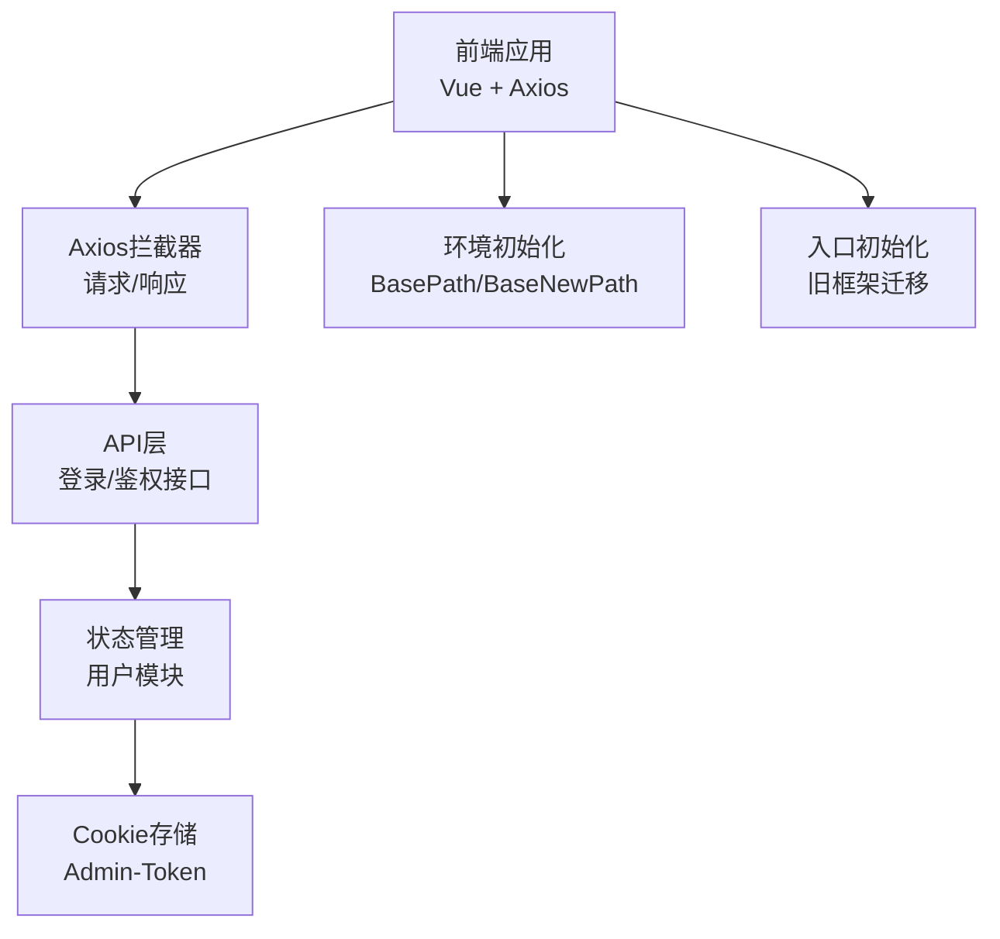
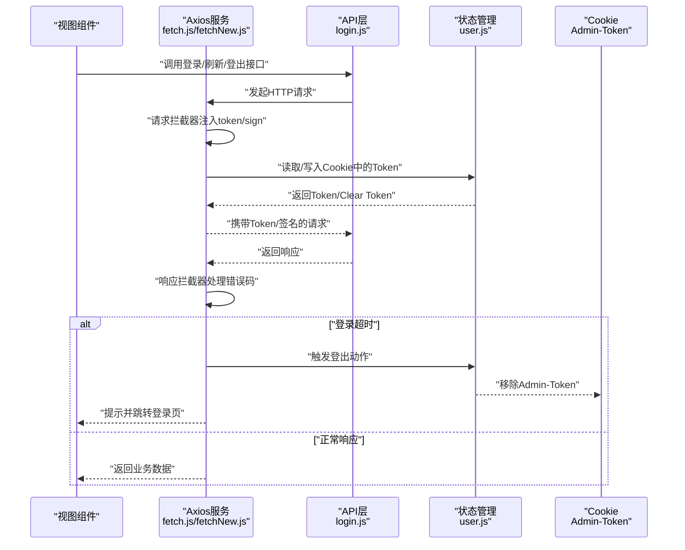
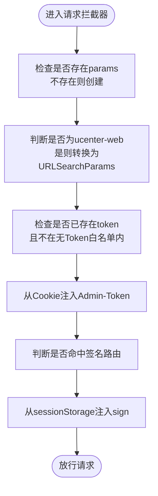
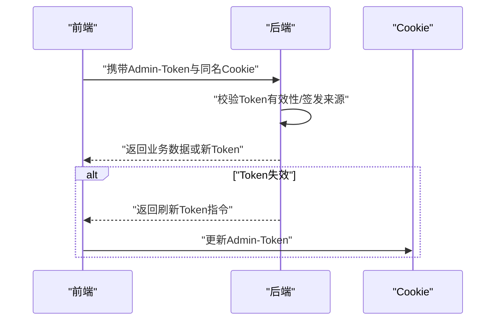
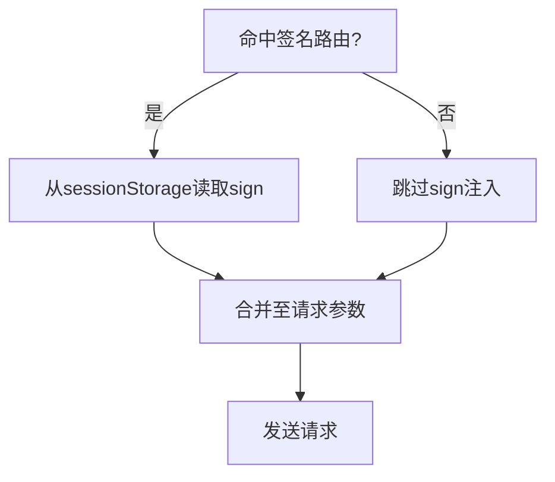
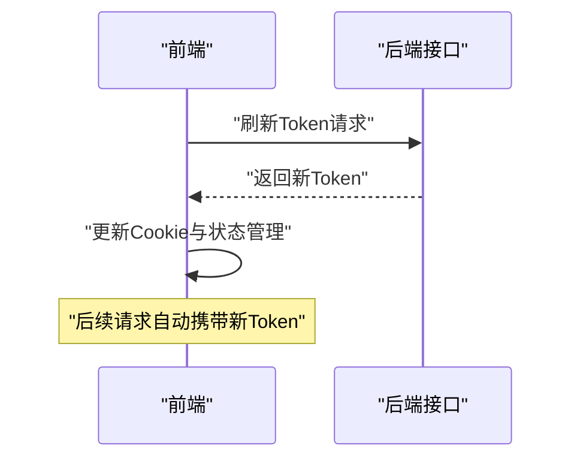
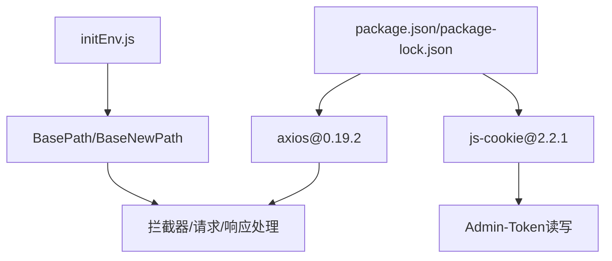

# CSRF防护机制

<cite>
**本文引用的文件**
- [src/utils/fetch.js](file://src/utils/fetch.js)
- [src/utils/fetchNew.js](file://src/utils/fetchNew.js)
- [src/utils/initEnv.js](file://src/utils/initEnv.js)
- [src/api/login.js](file://src/api/login.js)
- [src/store/modules/user.js](file://src/store/modules/user.js)
- [src/main.js](file://src/main.js)
- [config/index.js](file://config/index.js)
- [package-lock.json](file://package-lock.json)
</cite>

## 目录
1. [引言](#引言)
2. [项目结构](#项目结构)
3. [核心组件](#核心组件)
4. [架构总览](#架构总览)
5. [详细组件分析](#详细组件分析)
6. [依赖关系分析](#依赖关系分析)
7. [性能考量](#性能考量)
8. [故障排查指南](#故障排查指南)
9. [结论](#结论)
10. [附录](#附录)

## 引言
本文件系统性梳理本Vue.js前端工程在CSRF（跨站请求伪造）防护方面的实现与建议。通过对Axios拦截器、Token注入、请求签名、双重提交Cookie模式、SameSite Cookie设置与Referer头验证等机制的分析，帮助开发者在前后端协同下构建安全可靠的认证与授权体系。同时提供CSRF攻击模拟与防护效果验证方法，确保在真实业务场景中具备可落地的安全实践。

## 项目结构
本项目采用典型的Vue单页应用结构，CSRF相关能力主要集中在工具层（Axios封装）、API层（登录与鉴权接口）、状态管理（Token持久化）与入口初始化（环境变量与Cookie写入）。关键文件分布如下：
- 工具层：Axios封装与拦截器（fetch.js、fetchNew.js）
- API层：登录与鉴权接口（login.js）
- 状态管理：用户模块（user.js），负责Token读取与持久化
- 入口与环境：主入口（main.js）、环境初始化（initEnv.js）
- 构建配置：开发/生产路径与静态资源路径（config/index.js）

图表来源
- [src/utils/fetch.js:13-171](file://src/utils/fetch.js#L13-L171)
- [src/utils/fetchNew.js:8-78](file://src/utils/fetchNew.js#L8-L78)
- [src/api/login.js:1-259](file://src/api/login.js#L1-L259)
- [src/store/modules/user.js:20-447](file://src/store/modules/user.js#L20-L447)
- [src/utils/initEnv.js:1-33](file://src/utils/initEnv.js#L1-L33)
- [src/main.js:104-131](file://src/main.js#L104-L131)

章节来源
- [src/utils/fetch.js:13-171](file://src/utils/fetch.js#L13-L171)
- [src/utils/fetchNew.js:8-78](file://src/utils/fetchNew.js#L8-L78)
- [src/api/login.js:1-259](file://src/api/login.js#L1-L259)
- [src/store/modules/user.js:20-447](file://src/store/modules/user.js#L20-L447)
- [src/utils/initEnv.js:1-33](file://src/utils/initEnv.js#L1-L33)
- [src/main.js:104-131](file://src/main.js#L104-L131)
- [config/index.js:1-72](file://config/index.js#L1-L72)

## 核心组件
- Axios拦截器（请求/响应）
  - 请求阶段：统一注入token与sign参数；对特定路由启用签名校验；对ucenter-web特殊处理表单参数。
  - 响应阶段：统一错误码处理与登出逻辑；对登录超时进行重定向。
- API层（登录/鉴权）
  - 提供登录、刷新、登出、权限查询等接口，配合后端完成Token发放与校验。
- 状态管理（用户模块）
  - 统一读取与写入Cookie中的Admin-Token；在登录成功后持久化Token；登出时清除。
- 环境初始化（BasePath/BaseNewPath）
  - 根据环境变量设置不同域名，确保请求域一致性，降低跨域CSRF风险。
- 入口初始化（旧框架迁移）
  - 在旧框架迁移场景下写入User-Token并触发从旧系统拉取用户信息。

章节来源
- [src/utils/fetch.js:65-101](file://src/utils/fetch.js#L65-L101)
- [src/utils/fetch.js:103-169](file://src/utils/fetch.js#L103-L169)
- [src/utils/fetchNew.js:35-78](file://src/utils/fetchNew.js#L35-L78)
- [src/api/login.js:1-259](file://src/api/login.js#L1-L259)
- [src/store/modules/user.js:20-447](file://src/store/modules/user.js#L20-L447)
- [src/utils/initEnv.js:1-33](file://src/utils/initEnv.js#L1-L33)
- [src/main.js:104-131](file://src/main.js#L104-L131)

## 架构总览
下图展示CSRF防护在前端的整体流程：请求经由Axios拦截器注入Token与签名，后端校验通过后返回数据；若登录超时则触发登出与跳转。

图表来源
- [src/utils/fetch.js:65-101](file://src/utils/fetch.js#L65-L101)
- [src/utils/fetch.js:103-169](file://src/utils/fetch.js#L103-L169)
- [src/utils/fetchNew.js:35-78](file://src/utils/fetchNew.js#L35-L78)
- [src/api/login.js:1-259](file://src/api/login.js#L1-L259)
- [src/store/modules/user.js:20-447](file://src/store/modules/user.js#L20-L447)

## 详细组件分析

### Axios拦截器与CSRF防护要点
- Token注入
  - 在请求参数中统一追加token字段，避免硬编码在URL中；对特定无需Token的接口（如登录、旧框架迁移）进行白名单过滤。
- 请求签名（sign）
  - 对指定路由（如教育类接口）自动注入sign参数；sign来源于sessionStorage，便于后端校验请求合法性。
- 特殊表单处理
  - 对ucenter-web域名下的表单参数进行URLSearchParams转换，减少参数污染风险。
- 错误码与登出
  - 对登录超时等错误码触发登出与页面跳转，防止Token泄露导致的持续攻击。

图表来源
- [src/utils/fetch.js:65-101](file://src/utils/fetch.js#L65-L101)
- [src/utils/fetchNew.js:35-78](file://src/utils/fetchNew.js#L35-L78)

章节来源
- [src/utils/fetch.js:24-34](file://src/utils/fetch.js#L24-L34)
- [src/utils/fetch.js:83-92](file://src/utils/fetch.js#L83-L92)
- [src/utils/fetch.js:65-101](file://src/utils/fetch.js#L65-L101)
- [src/utils/fetchNew.js:49-70](file://src/utils/fetchNew.js#L49-L70)
- [src/utils/fetchNew.js:35-78](file://src/utils/fetchNew.js#L35-L78)

### Token验证机制与双重提交Cookie模式
- Token验证
  - 前端通过Cookie存储Admin-Token，并在每次请求中注入；后端需校验该Token的有效性与签发来源。
- 双重提交Cookie模式
  - 建议在后端同时校验请求参数中的token与同名Cookie中的token，确保两者一致，有效抵御CSRF。
- Token刷新
  - 前端提供刷新接口，后端在Token即将过期或异常时下发新Token，前端更新Cookie与状态管理。

图表来源
- [src/store/modules/user.js:130](file://src/store/modules/user.js#L130)
- [src/api/login.js:16-24](file://src/api/login.js#L16-L24)

章节来源
- [src/store/modules/user.js:120-173](file://src/store/modules/user.js#L120-L173)
- [src/api/login.js:16-24](file://src/api/login.js#L16-L24)

### SameSite Cookie设置与Referer头验证
- SameSite Cookie
  - 建议将Admin-Token等敏感Cookie设置为SameSite=Strict或SameSite=Lax，阻止第三方站点携带Cookie发起请求。
- Referer头验证
  - 后端可校验Referer头与允许的来源列表，拒绝来自不受信任来源的请求，降低跨站风险。

章节来源
- [src/utils/fetch.js:83-92](file://src/utils/fetch.js#L83-L92)
- [src/utils/fetchNew.js:55-70](file://src/utils/fetchNew.js#L55-L70)

### Axios拦截器中的CSRF Token注入与请求签名验证
- CSRF Token注入
  - 通过请求拦截器统一注入token参数，避免手动拼接URL带来的遗漏。
- 请求签名验证
  - 对命中签名路由的请求自动注入sign参数，后端据此生成与校验签名，确保请求未被篡改。

图表来源
- [src/utils/fetch.js:87-92](file://src/utils/fetch.js#L87-L92)
- [src/utils/fetchNew.js:65-70](file://src/utils/fetchNew.js#L65-L70)

章节来源
- [src/utils/fetch.js:87-92](file://src/utils/fetch.js#L87-L92)
- [src/utils/fetchNew.js:65-70](file://src/utils/fetchNew.js#L65-L70)

### 后端配合的防护措施、Token刷新与异常处理
- 后端配合
  - 必须严格校验请求来源（Origin/Referer）、Cookie与请求参数的一致性；对敏感操作强制要求签名与双因子校验。
- Token刷新
  - 前端调用刷新接口后，后端返回新Token并更新Cookie；前端同步更新状态管理。
- 异常处理
  - 登录超时统一触发登出与跳转；对其他错误码进行提示与阻断，避免继续发起危险请求。

图表来源
- [src/api/login.js:16-24](file://src/api/login.js#L16-L24)
- [src/store/modules/user.js:326-362](file://src/store/modules/user.js#L326-L362)

章节来源
- [src/api/login.js:16-24](file://src/api/login.js#L16-L24)
- [src/store/modules/user.js:326-362](file://src/store/modules/user.js#L326-L362)
- [src/utils/fetch.js:124-152](file://src/utils/fetch.js#L124-L152)

### CSRF攻击模拟测试与防护效果验证
- 攻击模拟
  - 使用受控页面构造恶意表单或脚本，尝试向后端发起POST请求（无token或sign缺失）。
- 防护验证
  - 后端应拒绝无Token或签名不匹配的请求；前端拦截器应确保所有请求均携带token/sign；登录超时应触发登出与跳转。
- 日志与监控
  - 记录被拒绝的请求来源与原因，定期审计异常流量，及时调整白名单与签名规则。

章节来源
- [src/utils/fetch.js:83-92](file://src/utils/fetch.js#L83-L92)
- [src/utils/fetch.js:124-152](file://src/utils/fetch.js#L124-L152)

## 依赖关系分析
- Axios版本与依赖
  - 项目使用axios 0.19.2，具备拦截器能力，满足CSRF防护需求。
- Cookie库
  - 使用js-cookie 2.2.1，用于读写Admin-Token，确保Token注入与清理的可靠性。
- 环境变量
  - initEnv根据ENV_TAREGT切换不同域名，保证请求域一致性，降低跨域CSRF风险。

图表来源
- [package-lock.json:739-746](file://package-lock.json#L739-L746)
- [package-lock.json:6981-6985](file://package-lock.json#L6981-L6985)
- [src/utils/initEnv.js:1-33](file://src/utils/initEnv.js#L1-L33)

章节来源
- [package-lock.json:739-746](file://package-lock.json#L739-L746)
- [package-lock.json:6981-6985](file://package-lock.json#L6981-L6985)
- [src/utils/initEnv.js:1-33](file://src/utils/initEnv.js#L1-L33)

## 性能考量
- 请求拦截器的参数转换与白名单判断开销较小，对整体性能影响有限。
- 建议对频繁请求的接口开启缓存与合理的超时设置，避免因网络波动引发重复请求。
- 对签名计算与校验尽量采用轻量算法，避免在移动端造成明显卡顿。

## 故障排查指南
- 症状：请求未携带token
  - 排查点：确认请求拦截器是否生效；检查白名单配置；核对Cookie中Admin-Token是否存在。
- 症状：登录超时后仍可继续操作
  - 排查点：响应拦截器是否正确识别登录超时码；登出动作是否执行；路由跳转是否触发。
- 症状：签名校验失败
  - 排查点：确认sign来源与生成规则；检查sessionStorage中sign是否正确；核对后端签名算法。

章节来源
- [src/utils/fetch.js:83-92](file://src/utils/fetch.js#L83-L92)
- [src/utils/fetch.js:124-152](file://src/utils/fetch.js#L124-L152)
- [src/utils/fetchNew.js:65-70](file://src/utils/fetchNew.js#L65-L70)

## 结论
本项目通过Axios拦截器统一注入Token与签名、结合状态管理持久化与登出机制，形成了较为完善的CSRF防护基础。建议在后端进一步强化SameSite Cookie设置与Referer校验，并完善签名算法与双因子校验，以提升整体安全性。同时，建立完善的测试与监控体系，确保防护策略在真实环境中持续有效。

## 附录
- 关键实现位置参考
  - 请求拦截器注入token/sign：[src/utils/fetch.js:65-101](file://src/utils/fetch.js#L65-L101)、[src/utils/fetchNew.js:35-78](file://src/utils/fetchNew.js#L35-L78)
  - 登录/刷新/登出接口：[src/api/login.js:1-259](file://src/api/login.js#L1-L259)
  - Token持久化与登出：[src/store/modules/user.js:120-173](file://src/store/modules/user.js#L120-L173)
  - 环境初始化与域名切换：[src/utils/initEnv.js:1-33](file://src/utils/initEnv.js#L1-L33)
  - 旧框架迁移写入Cookie：[src/main.js:104-131](file://src/main.js#L104-L131)