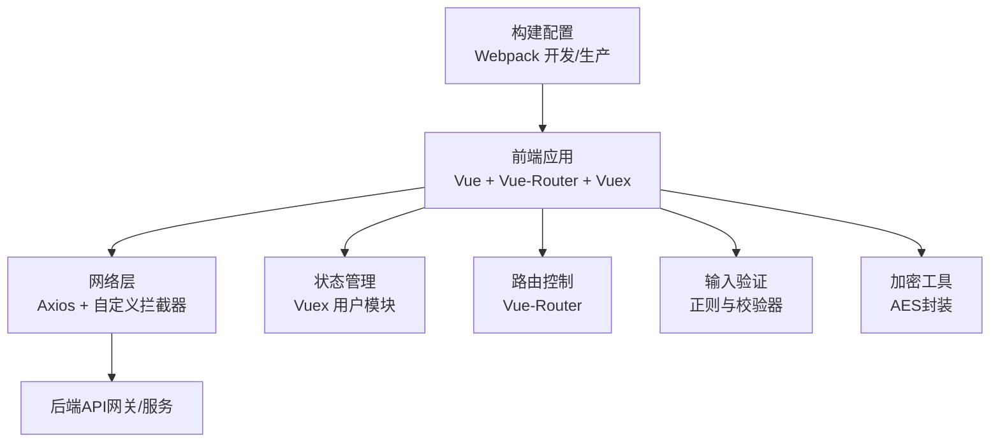
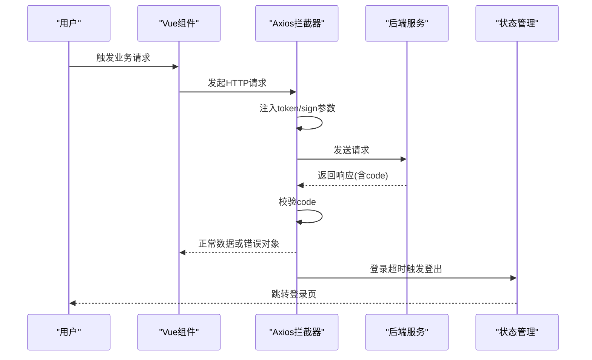
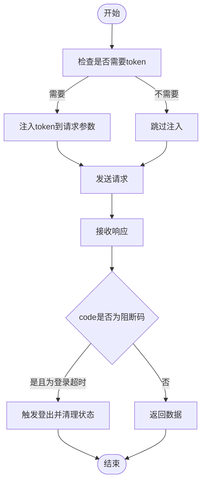
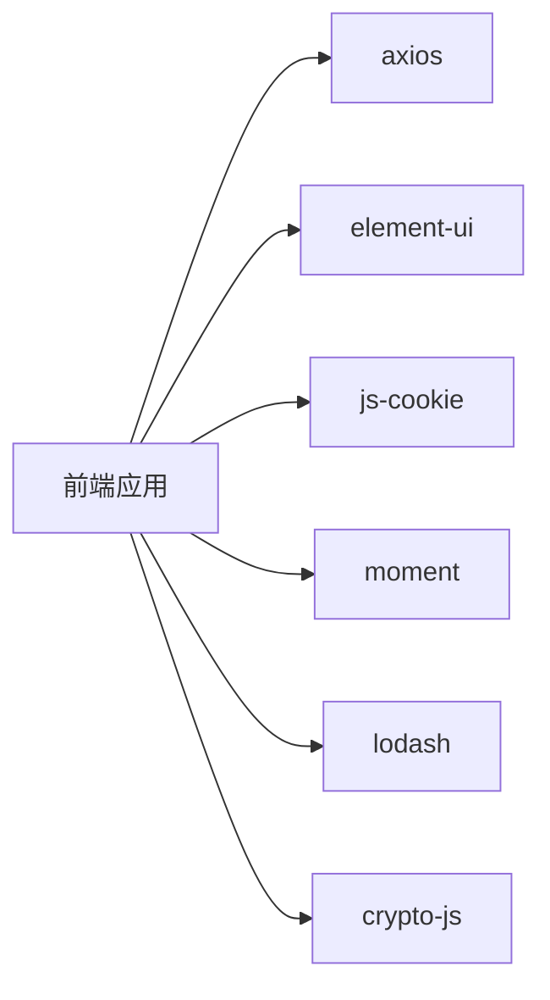

# 安全实践

<cite>
**本文引用的文件**
- [fetch.js](file://src/utils/fetch.js)
- [fetchNew.js](file://src/utils/fetchNew.js)
- [user.js](file://src/store/modules/user.js)
- [login.js](file://src/api/login.js)
- [validate.js](file://src/utils/validate.js)
- [index.js](file://src/router/index.js)
- [index.js](file://config/index.js)
- [package.json](file://package.json)
- [README.md](file://README.md)
- [crypto-js.js](file://src/utils/aesEncryptor/crypto-js.js)
- [index.js](file://src/utils/aesEncryptor/index.js)
</cite>

## 目录
1. [引言](#引言)
2. [项目结构](#项目结构)
3. [核心组件](#核心组件)
4. [架构总览](#架构总览)
5. [详细组件分析](#详细组件分析)
6. [依赖分析](#依赖分析)
7. [性能考虑](#性能考虑)
8. [故障排查指南](#故障排查指南)
9. [结论](#结论)
10. [附录](#附录)

## 引言
本文件面向校园管理系统前端侧的安全实践，聚焦Web应用安全的关键领域：身份认证与会话、权限控制、数据传输与存储安全、输入验证与内容安全策略（CSP）、敏感数据加密、日志与审计、漏洞检测与修复流程、隐私保护与数据备份/灾备策略等。文档以仓库现有实现为依据，结合最佳实践给出可落地的安全建议与改进方向，帮助系统满足教育行业安全与合规要求。

## 项目结构
本项目采用Vue 2 + Vue-Router + Vuex + Axios 的前端技术栈，核心安全相关模块分布如下：
- 网络层与拦截器：统一请求/响应拦截，自动注入令牌与签名参数，集中处理错误码与登出逻辑
- 用户状态与权限：基于Vuex的用户模块，负责登录态维护、角色与权限列表、学校学年切换
- 路由与页面访问控制：路由常量定义与页面入口，配合后端权限进行访问控制
- 输入验证与正则工具：通用校验器与规则，辅助前端输入清洗
- 加密工具：AES加/解密封装，用于特定场景的数据保护
- 构建配置：开发/生产环境构建参数与资源路径

图表来源
- [fetch.js:13-171](file://src/utils/fetch.js#L13-L171)
- [user.js:20-447](file://src/store/modules/user.js#L20-L447)
- [index.js:40-200](file://src/router/index.js#L40-L200)
- [validate.js:10-72](file://src/utils/validate.js#L10-L72)
- [index.js:24-117](file://src/utils/aesEncryptor/index.js#L24-L117)
- [index.js:7-72](file://config/index.js#L7-L72)

章节来源
- [README.md:1-24](file://README.md#L1-L24)
- [package.json:1-98](file://package.json#L1-L98)

## 核心组件
- 统一请求服务与拦截器：在请求前自动附加令牌与签名参数；在响应中根据后端返回码执行登出与提示
- 用户状态与权限：登录、刷新、权限拉取、学校学年选择、第三方登录等
- 路由与页面访问控制：定义常量路由与模块化路由，承载页面级访问控制
- 输入验证与正则：提供手机号、身份证、URL、IP等常用规则
- 加密工具：基于CryptoJS的AES封装，支持自定义密钥、IV、模式与填充
- 构建配置：区分开发与生产环境，控制资源路径与SourceMap

章节来源
- [fetch.js:13-171](file://src/utils/fetch.js#L13-L171)
- [user.js:120-447](file://src/store/modules/user.js#L120-L447)
- [index.js:40-200](file://src/router/index.js#L40-L200)
- [validate.js:10-72](file://src/utils/validate.js#L10-L72)
- [index.js:24-117](file://src/utils/aesEncryptor/index.js#L24-L117)
- [index.js:7-72](file://config/index.js#L7-L72)

## 架构总览
下图展示从前端到后端的典型请求链路，以及安全相关的关键节点（令牌注入、签名参数、错误码处理、登出）。

图表来源
- [fetch.js:66-169](file://src/utils/fetch.js#L66-L169)
- [user.js:408-434](file://src/store/modules/user.js#L408-L434)

## 详细组件分析

### 身份认证与会话管理
- 令牌注入：请求拦截器自动从Cookie读取令牌并附加到查询参数；对特定接口（如旧框架登录、卡务接口）豁免令牌
- 登录与刷新：登录成功写入Cookie/Admin-Token；刷新接口用于维持会话；第三方登录与微信登录流程
- 登出与超时：当后端返回“登录超时”等特定code时，前端触发登出并清理本地状态
- 权限拉取：登录后拉取当前模块权限列表，形成权限白名单

图表来源
- [fetch.js:81-96](file://src/utils/fetch.js#L81-L96)
- [fetch.js:124-159](file://src/utils/fetch.js#L124-L159)
- [user.js:408-434](file://src/store/modules/user.js#L408-L434)

章节来源
- [login.js:5-24](file://src/api/login.js#L5-L24)
- [user.js:120-325](file://src/store/modules/user.js#L120-L325)

### 权限控制策略
- 页面级访问控制：路由常量定义了多个入口与模块路由，页面加载时应结合后端权限进行二次校验
- 功能级访问控制：权限列表来自后端，前端以权限白名单形式缓存，避免硬编码
- 学年切换：支持选择当前学年，配合后端接口进行数据隔离

章节来源
- [index.js:40-200](file://src/router/index.js#L40-L200)
- [user.js:87-110](file://src/store/modules/user.js#L87-L110)

### 数据安全与传输保护
- 令牌与签名：对特定接口自动附加签名参数；令牌通过Cookie传递
- 加密工具：提供AES封装，支持CBC/ZeroPadding等配置，可用于敏感字段的前端加/解密
- 构建配置：生产环境关闭SourceMap，降低泄露风险

章节来源
- [fetch.js:87-92](file://src/utils/fetch.js#L87-L92)
- [index.js:24-117](file://src/utils/aesEncryptor/index.js#L24-L117)
- [index.js:54-56](file://config/index.js#L54-L56)

### 输入验证与内容安全
- 正则规则：提供手机号、身份证、URL、IP等常用规则，便于表单校验
- 建议：结合CSP、X-XSS-Protection、X-Content-Type-Options等响应头强化前端安全基线

章节来源
- [validate.js:10-72](file://src/utils/validate.js#L10-L72)

### 日志与审计
- 响应拦截器：对后端返回的错误码进行统一提示与记录
- 建议：在拦截器中增加错误上报与埋点，便于审计与问题追踪

章节来源
- [fetch.js:104-169](file://src/utils/fetch.js#L104-L169)

## 依赖分析
- Axios：统一HTTP请求与拦截器
- Element-UI：消息提示组件，用于错误展示
- js-cookie：令牌存储与读取
- CryptoJS：AES加密算法库
- moment、lodash：日期与工具函数

图表来源
- [package.json:12-43](file://package.json#L12-L43)

章节来源
- [package.json:12-43](file://package.json#L12-L43)

## 性能考虑
- 请求拦截器对参数进行URLSearchParams转换，避免无效值参与请求
- 生产环境关闭SourceMap，减少资源体积与信息泄露风险
- 建议：对高频接口启用缓存策略，减少重复请求

章节来源
- [fetch.js:40-62](file://src/utils/fetch.js#L40-L62)
- [index.js:54-56](file://config/index.js#L54-L56)

## 故障排查指南
- 登录超时自动跳转：当后端返回登录超时码时，前端触发登出并跳转登录页
- 错误码阻断：对常见阻断码（如401/403/500等）进行统一处理
- 提示与重试：错误提示通过Element-UI消息组件展示，建议在拦截器中记录错误上下文

章节来源
- [fetch.js:124-159](file://src/utils/fetch.js#L124-L159)
- [user.js:426-434](file://src/store/modules/user.js#L426-L434)

## 结论
本项目在前端侧已具备基础的身份认证与会话管理、统一的请求/响应拦截、权限拉取与路由入口控制能力。建议进一步完善以下方面以提升整体安全性与合规性：
- 后端配合：完善CSRF防护、CSP策略、HTTPS强制、敏感字段加密与脱敏
- 前端加固：引入XSRF Token、CSP响应头、X-Content-Type-Options、X-Frame-Options等；对敏感字段在传输前进行加密
- 审计与监控：在拦截器中增加错误上报与埋点，建立日志审计机制
- 合规与培训：制定安全编码规范、输入验证规则、漏洞扫描与渗透测试流程，并定期开展安全培训

## 附录

### 安全编码规范（建议）
- 输入校验：所有用户输入必须经过前端与后端双重校验，使用白名单与严格正则
- 输出转义：模板渲染与DOM操作需进行HTML/JS/CSS转义
- 令牌管理：仅通过HttpOnly Cookie存储令牌；避免明文传输与持久化存储
- 加密策略：对敏感字段（如身份证、手机号）在传输前进行对称加密
- 路由与权限：页面级与功能级权限双控，权限变更即时生效

### 输入验证规则（建议）
- 手机号：11位数字，以1开头
- 身份证：18位数字或X/x结尾
- URL/IP：严格正则匹配
- 邮箱：标准邮箱格式

### 日志与审计机制（建议）
- 请求/响应日志：记录关键请求参数与响应状态，排除敏感字段
- 错误日志：统一错误码映射与堆栈收集
- 审计事件：登录、权限变更、敏感操作均需记录

### 安全漏洞检测与渗透测试（建议）
- 工具：OWASP ZAP、Burp Suite、SAST（ESLint规则）与DAST
- 流程：测试计划、测试执行、缺陷修复、回归验证、报告归档

### 用户隐私保护与数据备份/灾备（建议）
- 隐私保护：最小化采集原则，明确用途与期限，提供删除与导出权利
- 数据备份：定期全量/增量备份，异地容灾
- 灾难恢复：RTO/RPO目标明确，演练与验证常态化