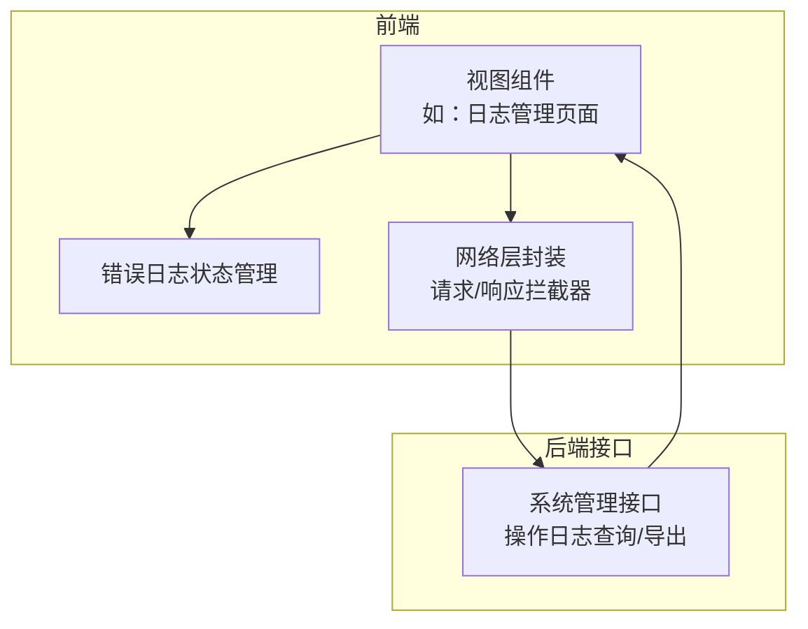
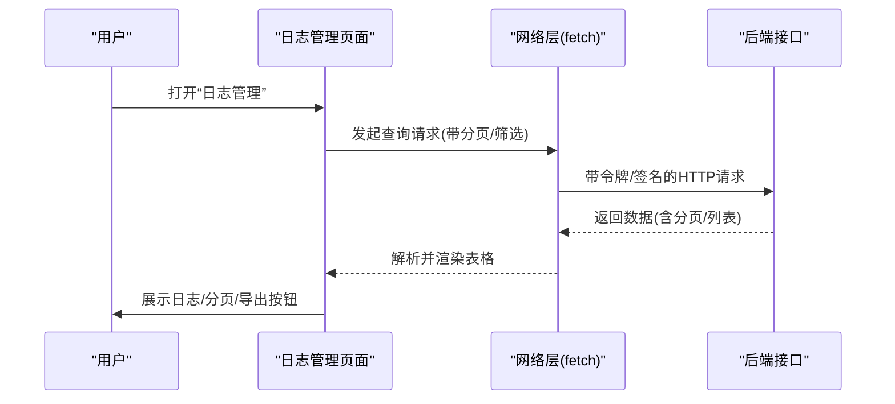
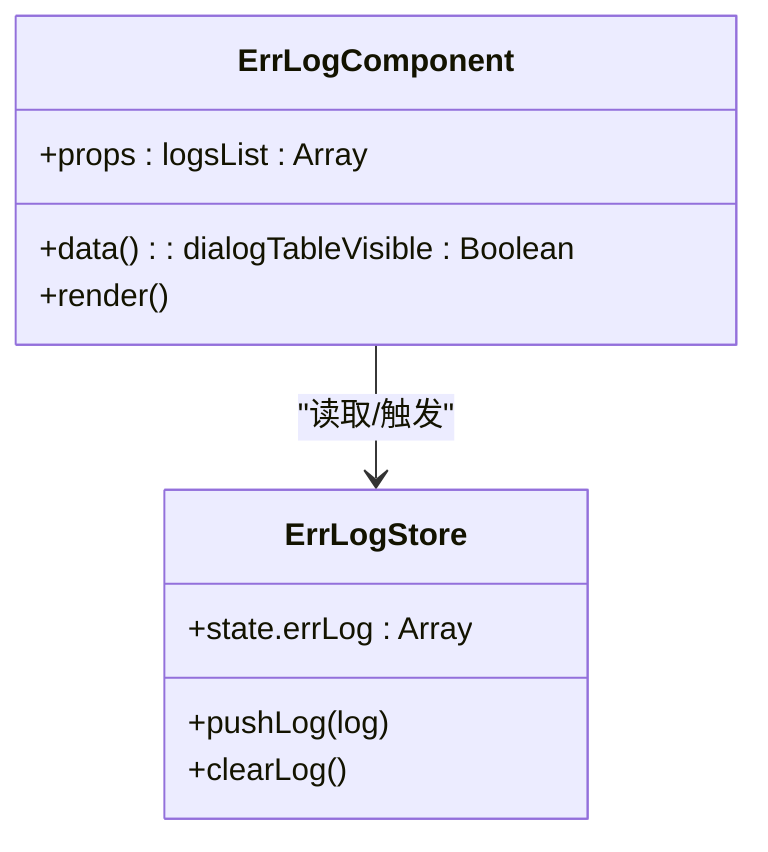
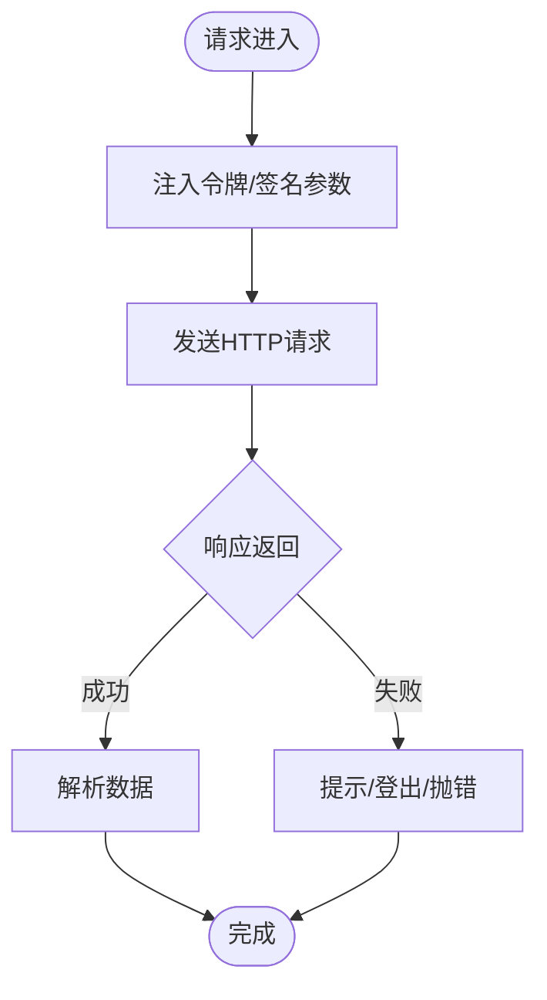
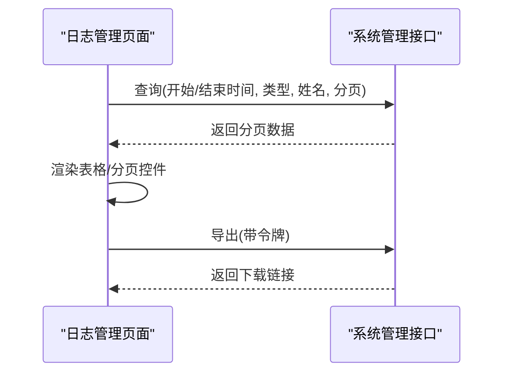
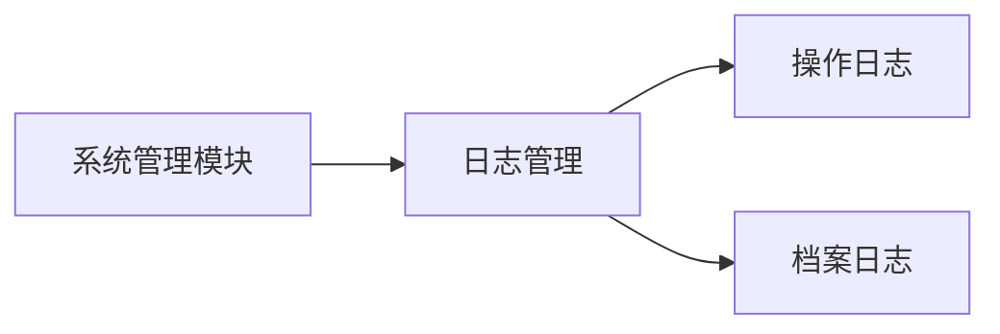
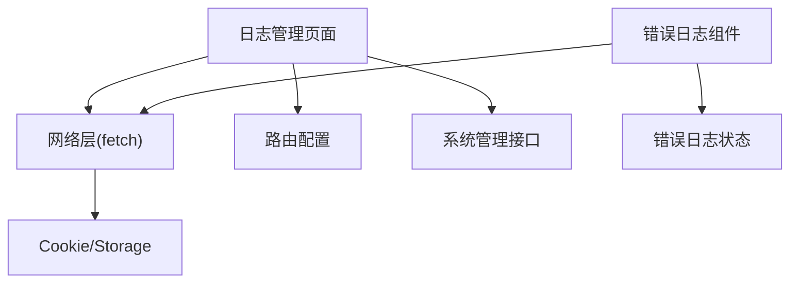
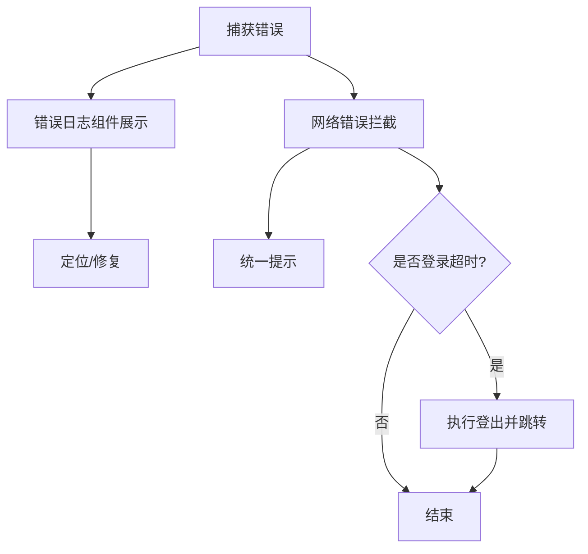

# 安全审计与监控

<cite>
**本文引用的文件**
- [src/store/errLog.js](file://src/store/errLog.js)
- [src/components/ErrLog/index.vue](file://src/components/ErrLog/index.vue)
- [src/utils/fetch.js](file://src/utils/fetch.js)
- [src/utils/fetchNew.js](file://src/utils/fetchNew.js)
- [src/views/sysSet/operation/index.vue](file://src/views/sysSet/operation/index.vue)
- [src/router/moduleList.js](file://src/router/moduleList.js)
- [src/router/normal/sysManage.js](file://src/router/normal/sysManage.js)
- [src/views/sysSet/debug.log](file://src/views/sysSet/debug.log)
- [src/utils/utils.js](file://src/utils/utils.js)
- [src/utils/validate.js](file://src/utils/validate.js)
</cite>

## 目录
1. [引言](#引言)
2. [项目结构](#项目结构)
3. [核心组件](#核心组件)
4. [架构总览](#架构总览)
5. [详细组件分析](#详细组件分析)
6. [依赖关系分析](#依赖关系分析)
7. [性能考量](#性能考量)
8. [故障排查指南](#故障排查指南)
9. [结论](#结论)
10. [附录](#附录)

## 引言
本实施文档面向前端安全审计与监控，聚焦于日志记录策略（用户行为日志、系统访问日志、安全事件日志）、错误日志收集与异常监控、实时告警机制、安全事件检测与入侵检测思路、日志分析工具与审计报告生成、合规性检查以及日志存储与隐私保护。结合仓库现有代码，明确当前实现与可扩展点，并给出落地建议。

## 项目结构
本项目采用 Vue 单页应用架构，前端通过统一的网络层封装进行请求与响应拦截，系统设置模块中包含“日志管理”入口，便于集中查看与导出操作日志；同时存在错误日志状态管理与可视化组件，用于展示与调试。

**图表来源**
- [src/views/sysSet/operation/index.vue:1-235](file://src/views/sysSet/operation/index.vue#L1-L235)
- [src/utils/fetch.js:13-171](file://src/utils/fetch.js#L13-L171)
- [src/store/errLog.js:1-14](file://src/store/errLog.js#L1-L14)

**章节来源**
- [src/views/sysSet/operation/index.vue:1-235](file://src/views/sysSet/operation/index.vue#L1-L235)
- [src/utils/fetch.js:13-171](file://src/utils/fetch.js#L13-L171)
- [src/store/errLog.js:1-14](file://src/store/errLog.js#L1-L14)

## 核心组件
- 错误日志状态管理：维护前端运行期错误队列，支持入队与清空。
- 错误日志可视化组件：弹窗展示错误信息与堆栈，辅助定位问题。
- 网络层拦截器：统一注入令牌与签名参数，处理服务端返回码与异常提示，捕获网络错误。
- 日志管理页面：筛选条件（类型、日期范围、姓名）、分页、导出能力，对接后端操作日志接口。

**章节来源**
- [src/store/errLog.js:1-14](file://src/store/errLog.js#L1-L14)
- [src/components/ErrLog/index.vue:1-52](file://src/components/ErrLog/index.vue#L1-L52)
- [src/utils/fetch.js:65-169](file://src/utils/fetch.js#L65-L169)
- [src/views/sysSet/operation/index.vue:84-225](file://src/views/sysSet/operation/index.vue#L84-L225)

## 架构总览
前端通过网络层拦截器对请求与响应进行统一处理，错误信息在组件中展示，同时支持将操作日志导出到后端。系统设置中的“日志管理”路由提供操作日志的查询与导出界面。

**图表来源**
- [src/views/sysSet/operation/index.vue:180-198](file://src/views/sysSet/operation/index.vue#L180-L198)
- [src/utils/fetch.js:65-169](file://src/utils/fetch.js#L65-L169)

## 详细组件分析

### 组件A：错误日志状态管理与可视化
- 状态管理：维护错误数组，支持头部插入与清空。
- 可视化组件：点击徽标弹窗展示错误消息与堆栈，便于快速定位问题。
- 适用场景：开发调试、生产问题回溯。

**图表来源**
- [src/store/errLog.js:1-14](file://src/store/errLog.js#L1-L14)
- [src/components/ErrLog/index.vue:28-41](file://src/components/ErrLog/index.vue#L28-L41)

**章节来源**
- [src/store/errLog.js:1-14](file://src/store/errLog.js#L1-L14)
- [src/components/ErrLog/index.vue:1-52](file://src/components/ErrLog/index.vue#L1-L52)

### 组件B：网络层拦截器与异常监控
- 请求拦截：自动注入令牌与签名参数，适配不同子系统基地址。
- 响应拦截：根据返回码进行提示与登出处理，捕获网络错误并统一提示。
- 作用：统一错误处理、降低重复逻辑、提升可观测性。

**图表来源**
- [src/utils/fetch.js:65-169](file://src/utils/fetch.js#L65-L169)

**章节来源**
- [src/utils/fetch.js:13-171](file://src/utils/fetch.js#L13-L171)
- [src/utils/fetchNew.js:35-133](file://src/utils/fetchNew.js#L35-L133)

### 组件C：日志管理页面（操作日志）
- 功能：按类型、日期范围、姓名筛选；分页加载；导出到后端。
- 数据来源：调用系统管理接口获取操作日志列表。
- 合规：导出链接拼接令牌参数，便于后端鉴权与审计。

**图表来源**
- [src/views/sysSet/operation/index.vue:87-198](file://src/views/sysSet/operation/index.vue#L87-L198)

**章节来源**
- [src/views/sysSet/operation/index.vue:84-225](file://src/views/sysSet/operation/index.vue#L84-L225)
- [src/router/moduleList.js:2384-2393](file://src/router/moduleList.js#L2384-L2393)
- [src/router/normal/sysManage.js:514-517](file://src/router/normal/sysManage.js#L514-L517)

### 组件D：系统设置与路由集成
- 路由：系统管理模块包含“日志管理”，下设“操作日志”“档案日志”等子项。
- 页面：日志管理页面提供筛选、分页、导出能力。
- 作用：集中化入口，便于管理员查看与审计。

**图表来源**
- [src/router/moduleList.js:2384-2393](file://src/router/moduleList.js#L2384-L2393)
- [src/router/normal/sysManage.js:514-517](file://src/router/normal/sysManage.js#L514-L517)

**章节来源**
- [src/router/moduleList.js:2287-2402](file://src/router/moduleList.js#L2287-L2402)
- [src/router/normal/sysManage.js:483-517](file://src/router/normal/sysManage.js#L483-L517)

## 依赖关系分析
- 视图组件依赖网络层封装进行数据交互。
- 错误日志组件依赖状态管理模块。
- 日志管理页面依赖路由配置与系统管理接口。
- 网络层拦截器依赖 Cookie 与会话存储，用于注入令牌与签名。

**图表来源**
- [src/views/sysSet/operation/index.vue:87-198](file://src/views/sysSet/operation/index.vue#L87-L198)
- [src/utils/fetch.js:65-169](file://src/utils/fetch.js#L65-L169)
- [src/store/errLog.js:1-14](file://src/store/errLog.js#L1-L14)

**章节来源**
- [src/utils/fetch.js:13-171](file://src/utils/fetch.js#L13-L171)
- [src/store/errLog.js:1-14](file://src/store/errLog.js#L1-L14)

## 性能考量
- 请求参数序列化与去空值：减少无效参数传输，降低后端处理负担。
- 超时控制与重试策略：在网络层统一设置超时，避免长时间阻塞。
- 分页与防抖：日志页面使用分页与输入防抖，降低频繁请求压力。
- 导出链接直连后端：避免前端大对象处理，提高导出效率。

**章节来源**
- [src/utils/fetch.js:13-171](file://src/utils/fetch.js#L13-L171)
- [src/views/sysSet/operation/index.vue:161-206](file://src/views/sysSet/operation/index.vue#L161-L206)

## 故障排查指南
- 错误日志展示：通过错误日志组件查看错误消息与堆栈，定位问题。
- 网络错误提示：响应拦截器统一提示错误信息，便于快速反馈。
- 登录超时处理：当返回码指示登录超时，触发登出流程并跳转登录页。
- 调试日志：系统设置目录下的调试日志文件可用于辅助定位环境问题。

**图表来源**
- [src/components/ErrLog/index.vue:1-52](file://src/components/ErrLog/index.vue#L1-L52)
- [src/utils/fetch.js:104-169](file://src/utils/fetch.js#L104-L169)
- [src/views/sysSet/debug.log:1-2](file://src/views/sysSet/debug.log#L1-L2)

**章节来源**
- [src/components/ErrLog/index.vue:1-52](file://src/components/ErrLog/index.vue#L1-L52)
- [src/utils/fetch.js:104-169](file://src/utils/fetch.js#L104-L169)
- [src/views/sysSet/debug.log:1-2](file://src/views/sysSet/debug.log#L1-L2)

## 结论
本项目已具备基础的日志与错误监控能力：统一的网络层拦截器、错误日志状态管理与可视化组件、系统设置中的日志管理页面。建议在此基础上进一步完善安全事件检测与入侵检测思路、异常行为分析模型、实时告警机制与合规性检查流程，并制定日志存储策略与隐私保护方案，以满足更全面的安全审计需求。

## 附录

### 日志记录策略与实施要点
- 用户行为日志：在关键业务操作处埋点，记录用户、IP、业务名称、操作类型、描述、时间等字段。
- 系统访问日志：记录接口访问次数、成功率、耗时分布、异常占比等指标。
- 安全事件日志：记录登录失败、越权访问、敏感操作、异常IP等高风险事件。
- 实时告警：基于阈值与规则触发告警（邮件/IM），并联动封禁策略。
- 合规性检查：确保日志不可抵赖、可追溯，满足最小留存与脱敏要求。

### 日志分析工具与审计报告
- 前端侧：导出 CSV/Excel，结合后端报表系统生成趋势图与统计表。
- 后端侧：建立日志聚合平台，支持检索、聚合与可视化。

### 日志存储策略与隐私保护
- 存储：按天/月切分，设定保留周期（如180天/365天）。
- 加密：传输加密（TLS）、静态加密（可选）。
- 脱敏：对敏感字段（如手机号、身份证号）进行哈希或掩码处理。
- 访问控制：仅授权人员可访问日志，审计访问行为。