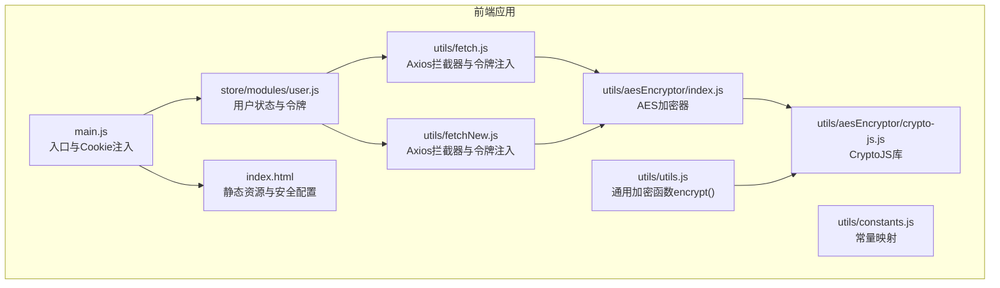
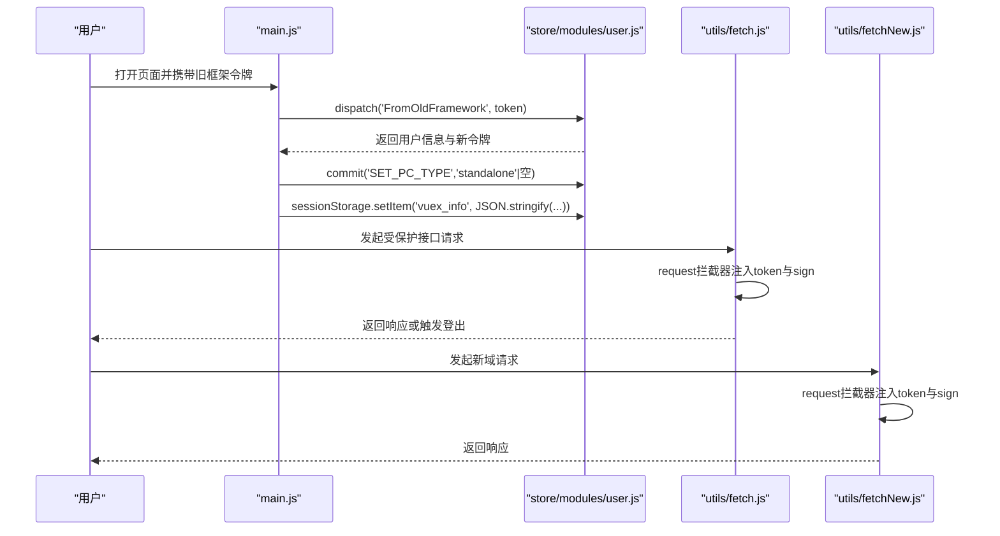
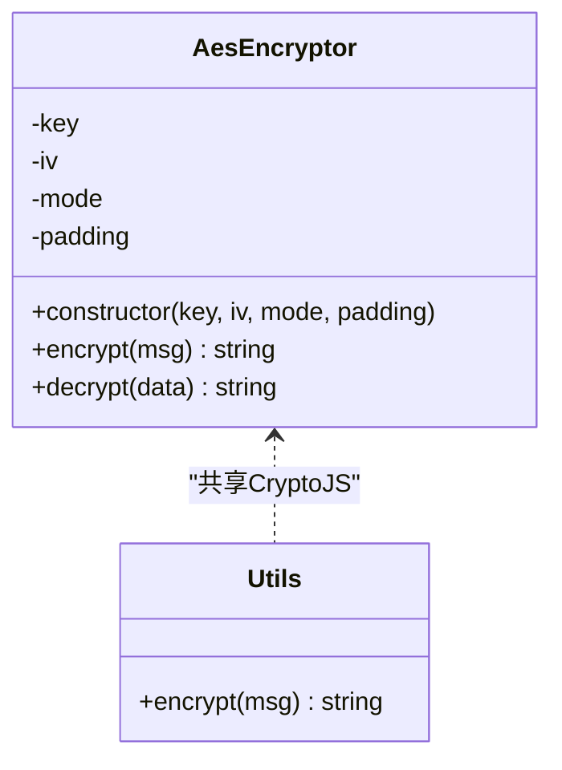
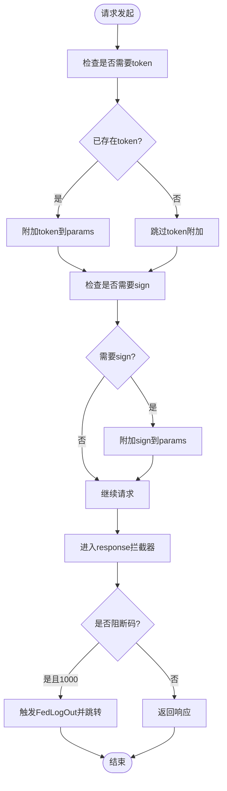
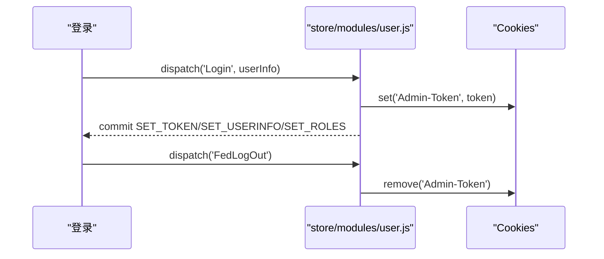
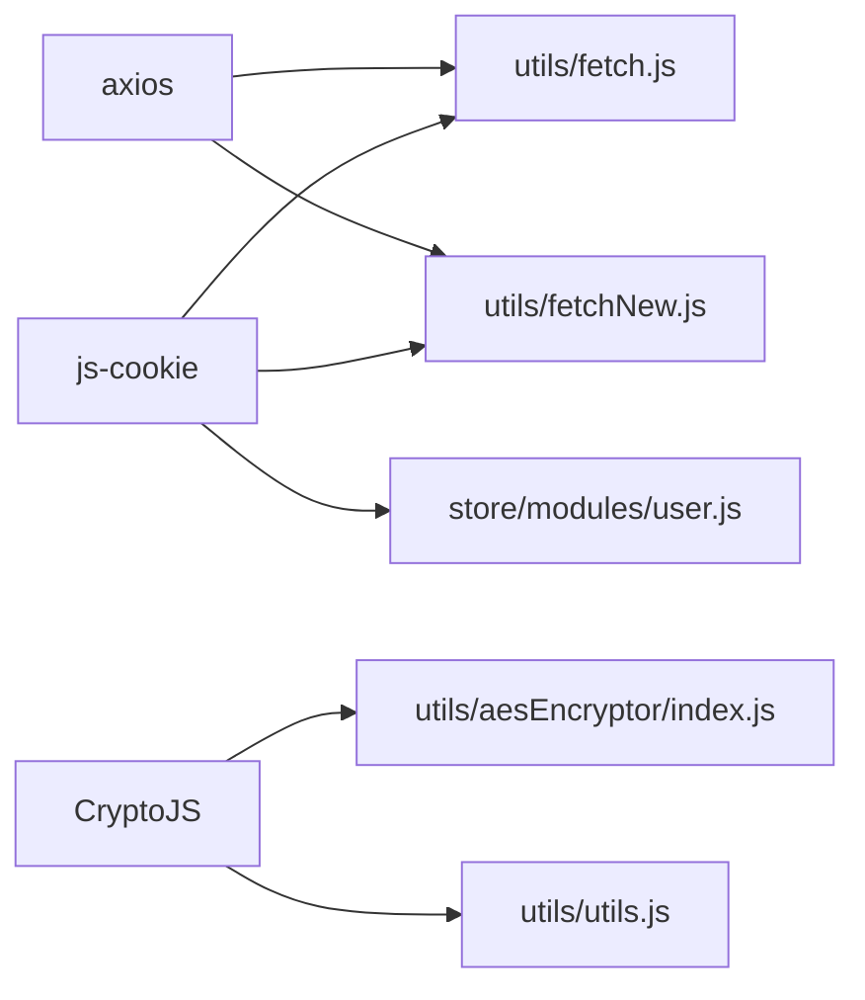

# 数据保护与加密

<cite>
**本文引用的文件**
- [index.js](file://src/utils/aesEncryptor/index.js)
- [crypto-js.js](file://src/utils/aesEncryptor/crypto-js.js)
- [utils.js](file://src/utils/utils.js)
- [fetch.js](file://src/utils/fetch.js)
- [fetchNew.js](file://src/utils/fetchNew.js)
- [user.js](file://src/store/modules/user.js)
- [main.js](file://src/main.js)
- [index.html](file://index.html)
- [package.json](file://package.json)
- [constants.js](file://src/utils/constants.js)
</cite>

## 目录
1. [简介](#简介)
2. [项目结构](#项目结构)
3. [核心组件](#核心组件)
4. [架构总览](#架构总览)
5. [详细组件分析](#详细组件分析)
6. [依赖关系分析](#依赖关系分析)
7. [性能考虑](#性能考虑)
8. [故障排查指南](#故障排查指南)
9. [结论](#结论)
10. [附录](#附录)

## 简介
本文件面向前端数据保护与加密主题，基于仓库中的现有实现进行系统化梳理，覆盖以下方面：
- 敏感数据的加密存储与传输：AES 加密、密钥与初始化向量（IV）使用策略
- 密码哈希与令牌加密：当前实现与建议改进方向
- 本地存储安全：Cookie、SessionStorage、LocalStorage 的使用边界
- Cookie 安全设置与会话安全配置：HttpOnly、Secure、SameSite 等
- 数据脱敏与隐私：常量映射、字段脱敏策略与 PII 管理
- 性能优化：加密算法选择、批量处理与缓存策略
- 安全审计与合规：日志记录、访问控制与最小权限原则

## 项目结构
本项目在前端侧通过工具模块封装通用能力，主要涉及：
- 加密工具：AES 加密器与通用加密函数
- 网络层：统一请求拦截器与令牌注入
- 状态管理：用户令牌与会话信息的持久化
- 页面入口：Cookie 注入与旧框架迁移逻辑

**图表来源**
- [main.js:104-131](file://src/main.js#L104-L131)
- [user.js:17-447](file://src/store/modules/user.js#L17-L447)
- [fetch.js:13-171](file://src/utils/fetch.js#L13-L171)
- [fetchNew.js:8-136](file://src/utils/fetchNew.js#L8-L136)
- [index.js:24-117](file://src/utils/aesEncryptor/index.js#L24-L117)
- [utils.js:183-194](file://src/utils/utils.js#L183-L194)
- [index.html:33-38](file://index.html#L33-L38)

**章节来源**
- [main.js:104-131](file://src/main.js#L104-L131)
- [user.js:17-447](file://src/store/modules/user.js#L17-L447)
- [fetch.js:13-171](file://src/utils/fetch.js#L13-L171)
- [fetchNew.js:8-136](file://src/utils/fetchNew.js#L8-L136)
- [index.js:24-117](file://src/utils/aesEncryptor/index.js#L24-L117)
- [utils.js:183-194](file://src/utils/utils.js#L183-L194)
- [index.html:33-38](file://index.html#L33-L38)

## 核心组件
- AES 加密器：提供可配置模式与填充的 AES 加密/解密能力，支持 CBC 模式与 PKCS7 填充
- 通用加密函数：在工具模块中提供基于 CBC/PKCS7 的加密方法
- Axios 统一拦截器：自动注入令牌与签名参数，统一错误处理与登出逻辑
- 用户状态管理：集中管理令牌、用户信息与会话数据
- 常量映射：用于字段值到显示文本的映射，便于脱敏展示

**章节来源**
- [index.js:24-117](file://src/utils/aesEncryptor/index.js#L24-L117)
- [utils.js:183-194](file://src/utils/utils.js#L183-L194)
- [fetch.js:13-171](file://src/utils/fetch.js#L13-L171)
- [user.js:17-447](file://src/store/modules/user.js#L17-L447)
- [constants.js:1-275](file://src/utils/constants.js#L1-L275)

## 架构总览
前端数据保护的关键流程如下：
- 入口阶段：从旧框架迁移时写入 Cookie，并在会话中持久化必要信息
- 状态阶段：登录成功后将令牌写入 Cookie 并同步到 Vuex；后续请求由拦截器自动附加令牌
- 加密阶段：对敏感字段采用 AES 加密（CBC/PKCS7），并在页面渲染时使用常量映射进行脱敏展示
- 安全阶段：通过 HTTPS、Cookie 安全属性与会话控制降低泄露风险

**图表来源**
- [main.js:104-131](file://src/main.js#L104-L131)
- [user.js:239-286](file://src/store/modules/user.js#L239-L286)
- [fetch.js:66-171](file://src/utils/fetch.js#L66-L171)
- [fetchNew.js:36-136](file://src/utils/fetchNew.js#L36-L136)

## 详细组件分析

### AES 加密器与通用加密函数
- 设计要点
  - 支持 CBC 模式与 PKCS7 填充
  - 密钥、IV、模式与填充可通过十六进制字符串配置
  - 提供加/解密方法，返回十六进制密文
- 使用场景
  - 对敏感字段进行本地加密存储或传输前加密
  - 与常量映射配合，实现字段值的脱敏展示
- 安全建议
  - 密钥与 IV 应来自安全随机源，避免硬编码
  - 同步更新密钥轮换策略与版本控制
  - 在网络层统一加密/解密，避免重复实现

**图表来源**
- [index.js:24-117](file://src/utils/aesEncryptor/index.js#L24-L117)
- [utils.js:183-194](file://src/utils/utils.js#L183-L194)
- [crypto-js.js:1-800](file://src/utils/aesEncryptor/crypto-js.js#L1-L800)

**章节来源**
- [index.js:24-117](file://src/utils/aesEncryptor/index.js#L24-L117)
- [utils.js:183-194](file://src/utils/utils.js#L183-L194)
- [crypto-js.js:1-800](file://src/utils/aesEncryptor/crypto-js.js#L1-L800)

### Axios 统一拦截器与令牌注入
- 设计要点
  - 自动为请求附加令牌与签名参数
  - 统一处理错误码，登录超时触发前端登出与跳转
  - 支持多域名与归档场景的差异化配置
- 安全要点
  - 令牌来源于 Cookie，需确保 Cookie 的 Secure、SameSite 属性
  - 对特定路由启用签名参数，提升请求完整性
- 建议
  - 将令牌注入逻辑集中于拦截器，避免分散实现
  - 对敏感接口开启 HTTPS 强制策略

**图表来源**
- [fetch.js:66-171](file://src/utils/fetch.js#L66-L171)
- [fetchNew.js:36-136](file://src/utils/fetchNew.js#L36-L136)

**章节来源**
- [fetch.js:66-171](file://src/utils/fetch.js#L66-L171)
- [fetchNew.js:36-136](file://src/utils/fetchNew.js#L36-L136)

### 用户状态管理与会话安全
- 设计要点
  - 登录成功后将令牌写入 Cookie，并同步到 Vuex
  - 旧框架迁移时写入 User-Token，并在会话中持久化用户信息
  - 登出时移除 Cookie 并清空状态
- 安全要点
  - Cookie 应设置 HttpOnly、Secure、SameSite=Lax 或 Strict
  - 令牌有效期与刷新策略需结合后端实现
- 建议
  - 将令牌与用户信息分离存储，减少一次性泄露面
  - 对关键操作二次确认或二次验证

**图表来源**
- [user.js:120-173](file://src/store/modules/user.js#L120-L173)
- [user.js:408-434](file://src/store/modules/user.js#L408-L434)
- [main.js:104-131](file://src/main.js#L104-L131)

**章节来源**
- [user.js:120-173](file://src/store/modules/user.js#L120-L173)
- [user.js:408-434](file://src/store/modules/user.js#L408-L434)
- [main.js:104-131](file://src/main.js#L104-L131)

### 数据脱敏与隐私保护
- 常量映射：通过 constants.js 中的 Map 实现字段值到显示文本的映射，便于脱敏展示
- 字段脱敏：对身份证、电话等敏感字段采用掩码或映射方式显示
- 建议
  - 明确 PII 数据范围与处理规则
  - 在前端仅展示脱敏后的信息，避免原始敏感数据暴露

**章节来源**
- [constants.js:1-275](file://src/utils/constants.js#L1-L275)

### Cookie 安全与会话配置
- 当前实现
  - 通过 js-cookie 写入与读取令牌
  - 页面加载时注入高德地图安全配置
- 安全建议
  - 设置 Cookie 的 Secure、HttpOnly、SameSite
  - 对跨站请求启用 CSRF Token 或 SameSite=Strict
  - 限制 Cookie 作用域与路径

**章节来源**
- [user.js:17-447](file://src/store/modules/user.js#L17-L447)
- [index.html:33-38](file://index.html#L33-L38)

## 依赖关系分析
- 外部依赖
  - axios：HTTP 客户端，提供拦截器能力
  - js-cookie：Cookie 操作库
  - CryptoJS：加密算法库
- 内部依赖
  - 加密工具依赖 CryptoJS
  - 网络层依赖 Cookie 与 Vuex 状态
  - 页面入口依赖 Cookie 注入与旧框架迁移逻辑

**图表来源**
- [package.json:12-43](file://package.json#L12-L43)
- [fetch.js:1-10](file://src/utils/fetch.js#L1-L10)
- [fetchNew.js:1-8](file://src/utils/fetchNew.js#L1-L8)
- [user.js:17](file://src/store/modules/user.js#L17)
- [index.js:3](file://src/utils/aesEncryptor/index.js#L3)
- [utils.js:184](file://src/utils/utils.js#L184)

**章节来源**
- [package.json:12-43](file://package.json#L12-L43)
- [fetch.js:1-10](file://src/utils/fetch.js#L1-L10)
- [fetchNew.js:1-8](file://src/utils/fetchNew.js#L1-L8)
- [user.js:17](file://src/store/modules/user.js#L17)
- [index.js:3](file://src/utils/aesEncryptor/index.js#L3)
- [utils.js:184](file://src/utils/utils.js#L184)

## 性能考虑
- 加密性能
  - AES-CBC/PKCS7 在浏览器端性能稳定，建议批量处理时合并请求以减少握手成本
  - 对大对象加密时注意内存占用，避免频繁创建临时对象
- 网络性能
  - 统一拦截器减少重复代码，提高维护效率
  - 合理设置超时与重试策略，避免阻塞主线程
- 缓存策略
  - 对只读常量映射进行缓存，减少重复解析
  - 对令牌与会话信息采用轻量存储，避免过度序列化

## 故障排查指南
- 登录超时或 401
  - 检查拦截器中的错误码处理与登出逻辑
  - 确认 Cookie 是否正确写入与读取
- 加密异常
  - 核对密钥、IV、模式与填充配置是否一致
  - 确认 CryptoJS 库加载顺序与版本兼容
- 令牌缺失
  - 检查拦截器是否正确附加 token 参数
  - 确认路由白名单与签名参数是否按预期生效

**章节来源**
- [fetch.js:104-171](file://src/utils/fetch.js#L104-L171)
- [fetchNew.js:80-136](file://src/utils/fetchNew.js#L80-L136)
- [index.js:24-117](file://src/utils/aesEncryptor/index.js#L24-L117)

## 结论
本项目在前端侧已具备基础的数据保护能力：统一的令牌注入、AES 加密与常量映射脱敏。为进一步强化安全，建议：
- 引入更强的密码哈希与令牌加密方案（如 PBKDF2/HMAC）
- 强化 Cookie 安全属性与跨站防护
- 建立密钥轮换与审计日志机制
- 明确 PII 处理规范与最小化原则

## 附录
- 关键实现路径
  - AES 加密器：[index.js:24-117](file://src/utils/aesEncryptor/index.js#L24-L117)
  - 通用加密函数：[utils.js:183-194](file://src/utils/utils.js#L183-L194)
  - Axios 拦截器：[fetch.js:66-171](file://src/utils/fetch.js#L66-L171)、[fetchNew.js:36-136](file://src/utils/fetchNew.js#L36-L136)
  - 用户状态与会话：[user.js:120-173](file://src/store/modules/user.js#L120-L173)、[main.js:104-131](file://src/main.js#L104-L131)
  - 常量映射与脱敏：[constants.js:1-275](file://src/utils/constants.js#L1-L275)
  - Cookie 安全与注入：[index.html:33-38](file://index.html#L33-L38)