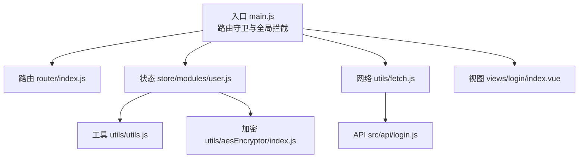
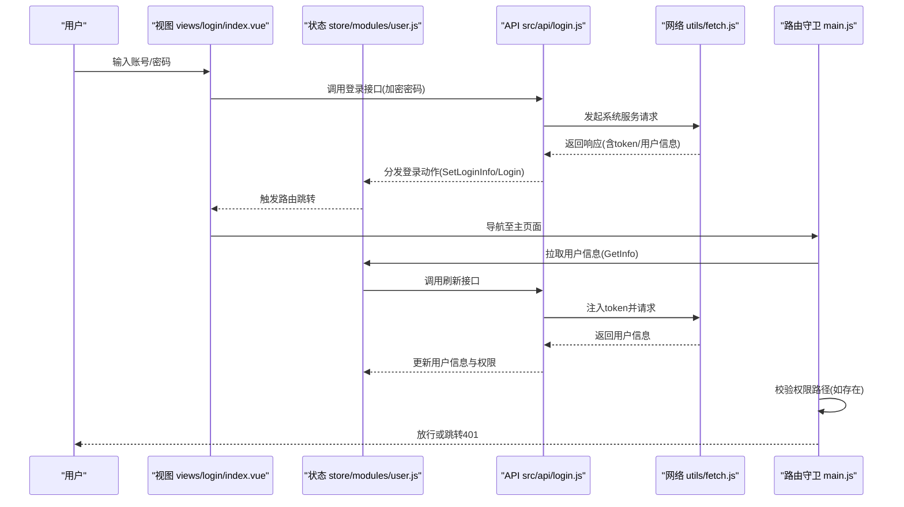
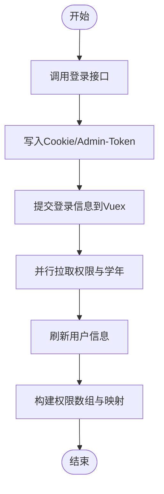
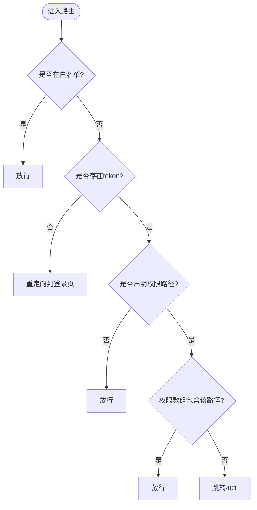
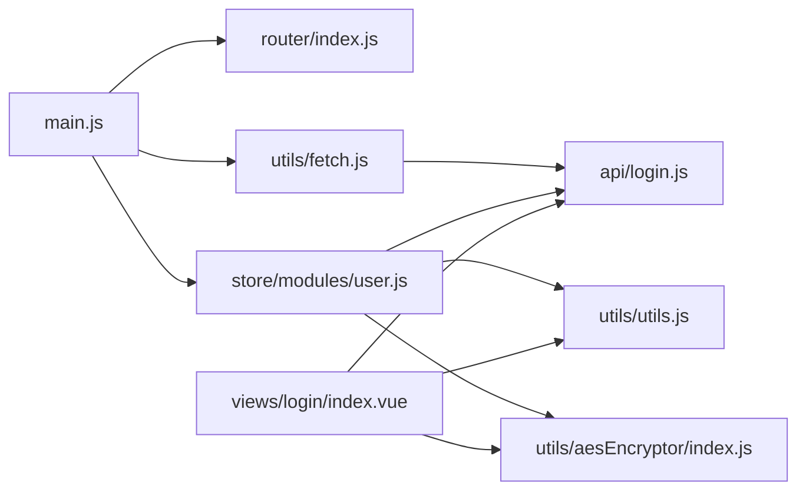

# 身份认证与权限控制

<cite>
**本文引用的文件**
- [src/store/modules/user.js](file://src/store/modules/user.js)
- [src/router/index.js](file://src/router/index.js)
- [src/utils/fetch.js](file://src/utils/fetch.js)
- [src/api/login.js](file://src/api/login.js)
- [src/store/getters.js](file://src/store/getters.js)
- [src/main.js](file://src/main.js)
- [src/views/login/index.vue](file://src/views/login/index.vue)
- [src/utils/utils.js](file://src/utils/utils.js)
- [src/utils/aesEncryptor/index.js](file://src/utils/aesEncryptor/index.js)
</cite>

## 目录
1. [简介](#简介)
2. [项目结构](#项目结构)
3. [核心组件](#核心组件)
4. [架构总览](#架构总览)
5. [详细组件分析](#详细组件分析)
6. [依赖关系分析](#依赖关系分析)
7. [性能考量](#性能考量)
8. [故障排查指南](#故障排查指南)
9. [结论](#结论)
10. [附录](#附录)

## 简介
本文件面向前端身份认证与权限控制体系，围绕以下目标展开：
- 基于 Cookie 的 Token 管理与会话保持
- 用户登录流程与密码加密传输
- 动态权限模型与菜单生成
- 路由级权限校验与按钮级权限控制
- 多角色切换与权限缓存机制
- 安全最佳实践与常见问题排查

## 项目结构
本项目采用典型的 Vue 单页应用结构，认证与权限相关的关键模块分布如下：
- 路由与守卫：在入口处统一拦截与放行，结合白名单与权限路径进行校验
- 状态管理：集中维护用户信息、角色、权限列表与学校信息等
- 网络层：统一注入 token、签名与错误处理
- API 层：封装登录、刷新、权限查询等接口
- 工具层：提供权限判断、AES 加密等通用能力

图表来源
- [src/main.js:73-198](file://src/main.js#L73-L198)
- [src/router/index.js:40-200](file://src/router/index.js#L40-L200)
- [src/store/modules/user.js:20-447](file://src/store/modules/user.js#L20-L447)
- [src/utils/fetch.js:13-171](file://src/utils/fetch.js#L13-L171)
- [src/api/login.js:1-259](file://src/api/login.js#L1-L259)
- [src/utils/utils.js:30-62](file://src/utils/utils.js#L30-L62)
- [src/utils/aesEncryptor/index.js:24-61](file://src/utils/aesEncryptor/index.js#L24-L61)
- [src/views/login/index.vue:313-443](file://src/views/login/index.vue#L313-L443)

章节来源
- [src/main.js:73-198](file://src/main.js#L73-L198)
- [src/router/index.js:40-200](file://src/router/index.js#L40-L200)
- [src/store/modules/user.js:20-447](file://src/store/modules/user.js#L20-L447)
- [src/utils/fetch.js:13-171](file://src/utils/fetch.js#L13-L171)
- [src/api/login.js:1-259](file://src/api/login.js#L1-L259)
- [src/utils/utils.js:30-62](file://src/utils/utils.js#L30-L62)
- [src/utils/aesEncryptor/index.js:24-61](file://src/utils/aesEncryptor/index.js#L24-L61)
- [src/views/login/index.vue:313-443](file://src/views/login/index.vue#L313-L443)

## 核心组件
- 用户状态模块（Vuex）：负责登录、登出、刷新、权限拉取与缓存、学校信息与学年切换等
- 路由守卫：在进入任意页面前进行白名单放行、token 校验、权限路径校验与跳转
- 网络拦截器：统一注入 token、签名参数、错误码处理与登出逻辑
- 登录视图：支持账号登录、扫码登录、多学校选择、首次登录修改密码、微信绑定等
- 权限工具：提供权限路径匹配、按钮级权限判断、权限列表索引判断等
- 加密工具：提供 AES 加密与解密能力，保障密码传输安全

章节来源
- [src/store/modules/user.js:120-443](file://src/store/modules/user.js#L120-L443)
- [src/main.js:73-198](file://src/main.js#L73-L198)
- [src/utils/fetch.js:65-169](file://src/utils/fetch.js#L65-L169)
- [src/views/login/index.vue:313-443](file://src/views/login/index.vue#L313-L443)
- [src/utils/utils.js:30-62](file://src/utils/utils.js#L30-L62)
- [src/utils/aesEncryptor/index.js:24-61](file://src/utils/aesEncryptor/index.js#L24-L61)

## 架构总览
整体认证与权限控制流程如下：
- 登录阶段：前端加密密码，提交登录；后端返回 token 与用户信息；前端写入 Cookie 并同步到 Vuex
- 会话阶段：每次请求自动注入 token；路由守卫根据 token 与权限路径进行校验
- 权限阶段：后端返回权限列表，前端构建权限数组与映射，供按钮与菜单使用
- 刷新阶段：通过刷新接口维持会话有效性；错误码触发登出与跳转

图表来源
- [src/views/login/index.vue:313-443](file://src/views/login/index.vue#L313-L443)
- [src/store/modules/user.js:120-362](file://src/store/modules/user.js#L120-L362)
- [src/api/login.js:16-37](file://src/api/login.js#L16-L37)
- [src/utils/fetch.js:65-169](file://src/utils/fetch.js#L65-L169)
- [src/main.js:73-198](file://src/main.js#L73-L198)

## 详细组件分析

### 用户状态模块（登录/权限/会话）
- 登录流程
  - 账号登录：调用登录接口，写入 Cookie 与 Vuex，并并行拉取权限与学年信息
  - 设置登录信息：在多学校/首次登录场景下，完成验证后设置登录信息
  - 刷新信息：通过刷新接口拉取最新用户信息
  - 权限拉取：按模块编码拉取权限列表，构建权限数组与名称映射
  - 学年切换：维护学年列表与当前选择，支持重置为当前学年
- 会话与登出
  - 登出：调用登出接口，清除本地 token 与 Vuex 状态
  - 前端登出：仅清除本地 token，不调后端登出
- 多角色/多学校
  - 提供切换能力接口，支持能力查询、列表查询与登录切换

图表来源
- [src/store/modules/user.js:120-362](file://src/store/modules/user.js#L120-L362)
- [src/api/login.js:16-37](file://src/api/login.js#L16-L37)

章节来源
- [src/store/modules/user.js:20-447](file://src/store/modules/user.js#L20-L447)
- [src/api/login.js:16-37](file://src/api/login.js#L16-L37)

### 路由守卫与权限校验
- 白名单：预设无需登录即可访问的路径
- Token 校验：若存在 token 则放行；否则重定向到登录页
- 权限路径校验：若路由 meta 中声明 permissionPath，则检查当前权限数组是否包含该路径
- 特殊场景：支持从 URL 参数或第三方框架携带 token 的场景，自动注入并完成校验
- 错误处理：当后端返回特定错误码时，触发前端登出并跳转

图表来源
- [src/main.js:73-198](file://src/main.js#L73-L198)

章节来源
- [src/main.js:73-198](file://src/main.js#L73-L198)

### 网络拦截器与错误处理
- 自动注入 token：除指定接口外，统一在请求参数中附加 token
- 签名参数：对特定接口自动附加签名参数
- 错误码处理：对特定错误码触发消息提示与登出逻辑，必要时跳转登录页
- 学年归档：在归档场景下自动附加学年参数

章节来源
- [src/utils/fetch.js:13-171](file://src/utils/fetch.js#L13-L171)

### 登录视图与密码加密
- 登录视图：支持扫码登录、账号登录、多学校选择、首次登录修改密码、微信绑定等
- 密码加密：登录时对密码进行加密后再提交，避免明文传输
- 微信登录：支持微信授权登录与绑定流程

章节来源
- [src/views/login/index.vue:313-443](file://src/views/login/index.vue#L313-L443)
- [src/utils/aesEncryptor/index.js:24-61](file://src/utils/aesEncryptor/index.js#L24-L61)

### 权限工具与按钮级控制
- 权限路径匹配：支持树形权限结构的路径查找
- 权限数组索引：提供对权限数组的快速判断
- 按钮级权限：根据当前权限数组判断按钮显示与可用性
- 权限列表组合判断：支持“或/且”组合判断

章节来源
- [src/utils/utils.js:30-62](file://src/utils/utils.js#L30-L62)
- [src/store/getters.js:14-18](file://src/store/getters.js#L14-L18)

### 多角色切换与权限缓存
- 多角色/多学校：提供能力查询、列表查询与登录切换接口
- 权限缓存：前端将权限列表转换为数组与映射，减少重复计算与判断

章节来源
- [src/api/login.js:238-259](file://src/api/login.js#L238-L259)
- [src/store/modules/user.js:87-96](file://src/store/modules/user.js#L87-L96)

## 依赖关系分析
- 入口依赖：main.js 依赖路由、状态、网络与进度条
- 路由依赖：router/index.js 组织常量路由与模块化路由
- 状态依赖：user.js 依赖 API、Cookies、moment、地图初始化等
- 网络依赖：fetch.js 依赖 axios、element-ui Message、store、router、Cookies
- 工具依赖：utils.js 依赖 store、constants、api/common、moment、CryptoJS
- 加密依赖：aesEncryptor 依赖 CryptoJS

图表来源
- [src/main.js:1-221](file://src/main.js#L1-L221)
- [src/router/index.js:1-207](file://src/router/index.js#L1-L207)
- [src/store/modules/user.js:1-447](file://src/store/modules/user.js#L1-L447)
- [src/utils/fetch.js:1-240](file://src/utils/fetch.js#L1-L240)
- [src/api/login.js:1-259](file://src/api/login.js#L1-L259)
- [src/utils/utils.js:1-320](file://src/utils/utils.js#L1-L320)
- [src/utils/aesEncryptor/index.js:1-117](file://src/utils/aesEncryptor/index.js#L1-L117)
- [src/views/login/index.vue:1-769](file://src/views/login/index.vue#L1-L769)

章节来源
- [src/main.js:1-221](file://src/main.js#L1-L221)
- [src/router/index.js:1-207](file://src/router/index.js#L1-L207)
- [src/store/modules/user.js:1-447](file://src/store/modules/user.js#L1-L447)
- [src/utils/fetch.js:1-240](file://src/utils/fetch.js#L1-L240)
- [src/api/login.js:1-259](file://src/api/login.js#L1-L259)
- [src/utils/utils.js:1-320](file://src/utils/utils.js#L1-L320)
- [src/utils/aesEncryptor/index.js:1-117](file://src/utils/aesEncryptor/index.js#L1-L117)
- [src/views/login/index.vue:1-769](file://src/views/login/index.vue#L1-L769)

## 性能考量
- 权限缓存：将权限列表转换为数组与映射，避免重复遍历与字符串匹配
- 并行拉取：登录后并行拉取权限与学年，缩短首屏等待
- 请求拦截：统一注入 token 与签名参数，减少重复代码与错误
- 登录加密：前端加密密码，降低明文泄露风险

## 故障排查指南
- 登录失败/账号密码错误
  - 检查登录视图中的账号与密码输入，确认加密流程是否正常
  - 查看网络拦截器返回的错误码与提示
- 401/403 未授权
  - 确认路由是否声明权限路径，以及当前权限数组是否包含该路径
  - 若为第三方 token 场景，确认 token 是否正确注入
- 登录后权限无效
  - 确认权限拉取动作是否执行，以及权限数组与映射是否更新
  - 检查权限路径是否与后端返回一致
- 会话过期
  - 网络拦截器对特定错误码会触发登出与跳转，确认逻辑是否生效
  - 检查 Cookie 中的 Admin-Token 是否存在

章节来源
- [src/views/login/index.vue:313-443](file://src/views/login/index.vue#L313-L443)
- [src/utils/fetch.js:104-169](file://src/utils/fetch.js#L104-L169)
- [src/main.js:73-198](file://src/main.js#L73-L198)
- [src/store/modules/user.js:87-96](file://src/store/modules/user.js#L87-L96)

## 结论
本项目通过统一的路由守卫、状态管理与网络拦截器，实现了基于 Token 的会话管理与权限控制。登录阶段采用前端加密与多场景适配，运行阶段通过权限数组与映射实现高效判断。建议在生产环境中进一步强化安全措施（如 HTTPS、安全 Cookie、CSRF 防护），并持续优化权限缓存与批量拉取策略以提升用户体验。

## 附录
- 权限配置示例
  - 路由声明权限路径：在路由 meta 中设置 permissionPath，守卫将据此校验
  - 按钮级控制：通过工具函数判断当前权限数组是否包含所需路径
  - 动态菜单：后端返回权限列表后，前端构建菜单树并按权限过滤
- 安全最佳实践
  - 强制 HTTPS 传输
  - 使用 HttpOnly 与 SameSite 的安全 Cookie
  - 对敏感操作二次确认与二次验证
  - 定期轮换密钥与限制密码复杂度
- 常见问题
  - 权限路径不一致：确保前端与后端路径约定一致
  - 多学校/多角色切换：确认切换接口调用与权限刷新
  - 登录后跳转异常：检查白名单与路由守卫逻辑