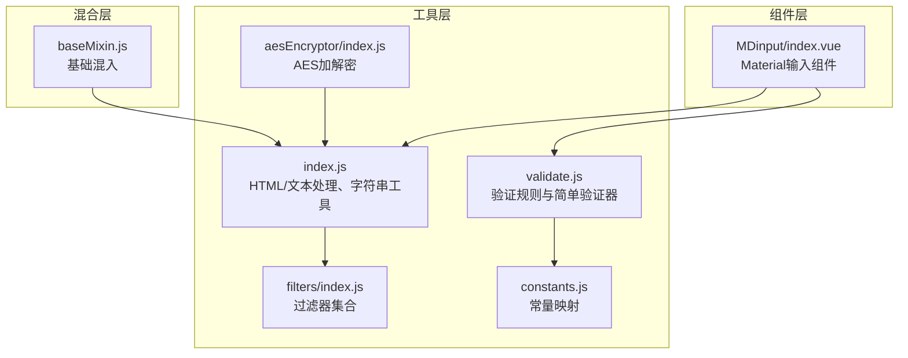
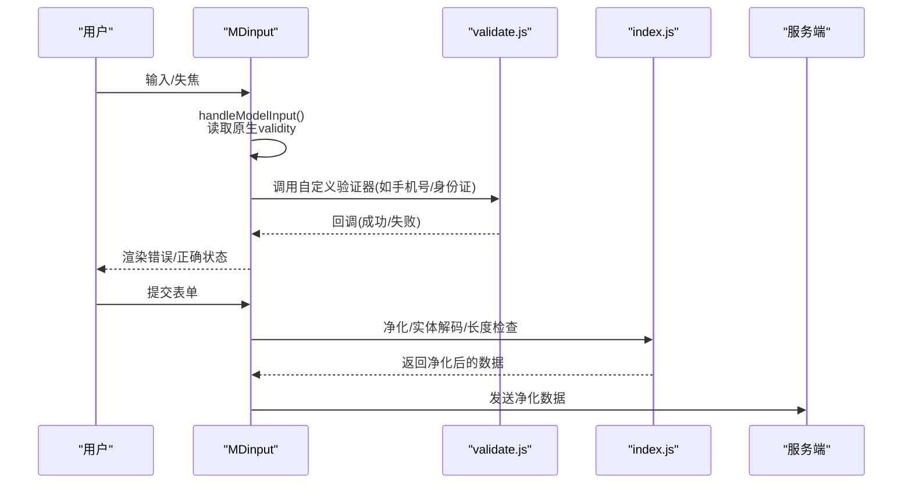
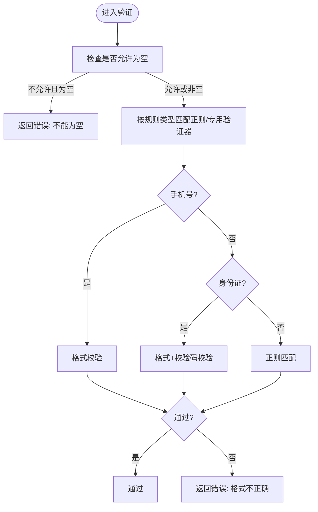
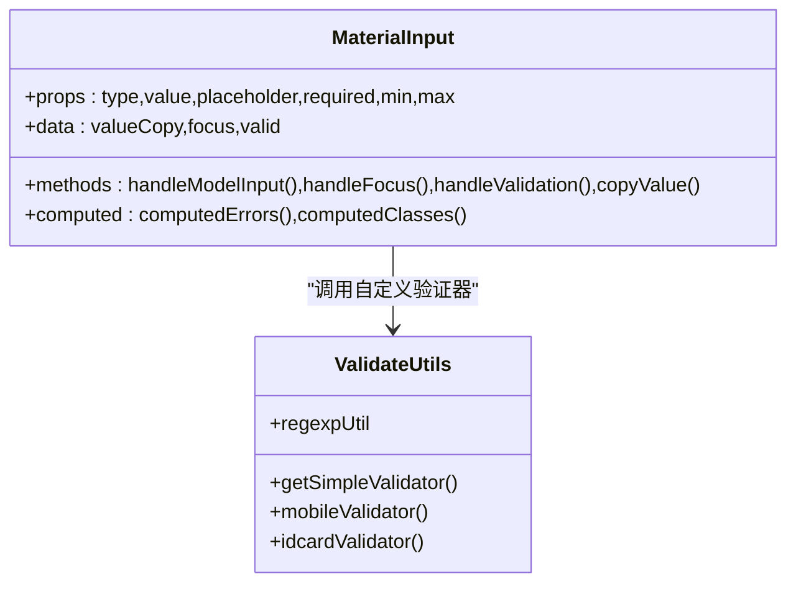
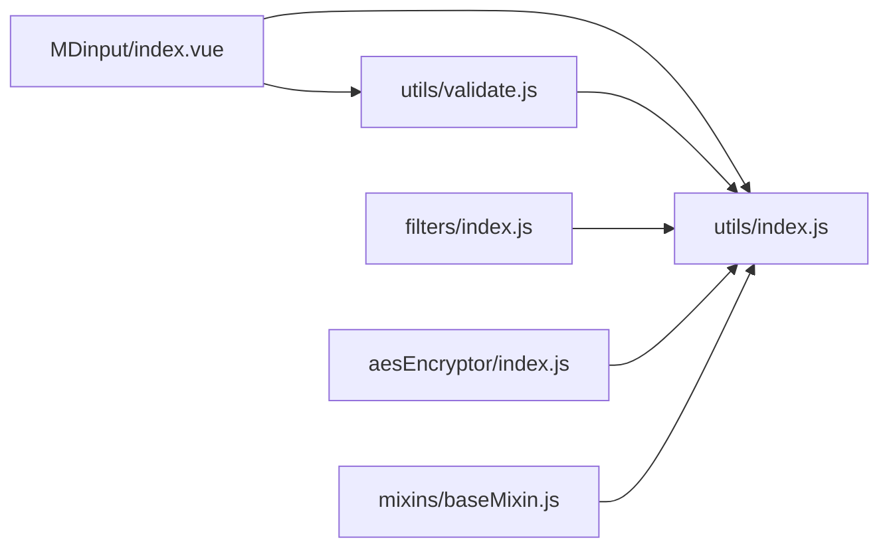

# 输入验证与数据净化

<cite>
**本文引用的文件**
- [validate.js](file://src/utils/validate.js)
- [index.js](file://src/utils/index.js)
- [index.vue](file://src/components/MDinput/index.vue)
- [index.js](file://src/utils/aesEncryptor/index.js)
- [index.js](file://src/filters/index.js)
- [baseMixin.js](file://src/mixins/baseMixin.js)
</cite>

## 目录
1. [引言](#引言)
2. [项目结构](#项目结构)
3. [核心组件](#核心组件)
4. [架构总览](#架构总览)
5. [详细组件分析](#详细组件分析)
6. [依赖关系分析](#依赖关系分析)
7. [性能考量](#性能考量)
8. [故障排查指南](#故障排查指南)
9. [结论](#结论)
10. [附录](#附录)

## 引言
本文件聚焦于前端输入验证与数据净化的安全实践，覆盖手机号、身份证号、邮箱、URL 等常用字段的验证规则与实现；阐述正则表达式、自定义验证器与错误提示机制；给出 XSS 防护、HTML 标签过滤与恶意脚本检测策略；总结数据净化、特殊字符处理与 SQL 注入防范建议，并提供验证规则扩展方法与安全编码规范。

## 项目结构
围绕输入验证与数据净化的关键模块分布如下：
- 工具层：通用验证工具、字符串与HTML处理工具、常量映射、AES 加解密工具
- 组件层：Material Design 风格输入组件，内置浏览器原生验证联动
- 混合层：基础混入，提供导出、日期等辅助能力

**图表来源**
- [validate.js:1-72](file://src/utils/validate.js#L1-L72)
- [index.js:1-385](file://src/utils/index.js#L1-L385)
- [index.vue:1-298](file://src/components/MDinput/index.vue#L1-L298)
- [index.js:1-117](file://src/utils/aesEncryptor/index.js#L1-L117)
- [index.js:1-121](file://src/filters/index.js#L1-L121)
- [baseMixin.js:1-103](file://src/mixins/baseMixin.js#L1-L103)

**章节来源**
- [validate.js:1-72](file://src/utils/validate.js#L1-L72)
- [index.js:1-385](file://src/utils/index.js#L1-L385)
- [index.vue:1-298](file://src/components/MDinput/index.vue#L1-L298)
- [index.js:1-117](file://src/utils/aesEncryptor/index.js#L1-L117)
- [index.js:1-121](file://src/filters/index.js#L1-L121)
- [baseMixin.js:1-103](file://src/mixins/baseMixin.js#L1-L103)

## 核心组件
- 验证工具与规则
  - 提供常用正则集合与简单验证器工厂，支持必填、格式校验与错误回调
  - 提供手机号、身份证号专用验证器
- HTML/文本处理工具
  - 提供 HTML 转纯文本、HTML 实体解码、字节长度计算等能力
- Material 输入组件
  - 基于浏览器原生 validity 接口进行实时校验状态联动
- 过滤器
  - 提供时间、数字、HTML 文本过滤等
- AES 加解密
  - 提供对称加密/解密能力，可用于敏感字段的本地存储或传输前处理

**章节来源**
- [validate.js:10-72](file://src/utils/validate.js#L10-L72)
- [index.js:120-124](file://src/utils/index.js#L120-L124)
- [index.js:254-290](file://src/utils/index.js#L254-L290)
- [index.js:86-94](file://src/utils/index.js#L86-L94)
- [index.vue:67-76](file://src/components/MDinput/index.vue#L67-L76)
- [index.js:101-105](file://src/filters/index.js#L101-L105)
- [index.js:24-61](file://src/utils/aesEncryptor/index.js#L24-L61)

## 架构总览
前端验证与净化的整体流程：
- 表单输入阶段：组件触发输入事件，联动浏览器原生校验与自定义验证器
- 规则匹配阶段：根据字段类型选择对应正则或专用验证器
- 错误提示阶段：通过回调返回错误消息，组件渲染错误状态
- 数据净化阶段：在提交前执行 HTML 实体解码、特殊字符处理与长度/格式检查
- 安全处理阶段：对敏感字段采用对称加密，避免明文泄露

**图表来源**
- [index.vue:67-80](file://src/components/MDinput/index.vue#L67-L80)
- [validate.js:30-72](file://src/utils/validate.js#L30-L72)
- [index.js:120-124](file://src/utils/index.js#L120-L124)
- [index.js:254-290](file://src/utils/index.js#L254-L290)

## 详细组件分析

### 验证规则与自定义验证器
- 正则集合
  - 无符号整数、无符号浮点数、整数、浮点数、中文、拼音、手机号、身份证、邮箱、图片/附件扩展名、IP、URL、域名、大小写
- 简单验证器工厂
  - 支持必填判断、按规则类型匹配正则、统一错误回调
- 专用验证器
  - 手机号：空值与格式双重校验
  - 身份证：空值校验与校验码校验（依赖外部库）
- 使用建议
  - 对必填字段优先使用“必填+格式”组合
  - 对手机号/身份证等强规则字段，优先使用专用验证器
  - 错误提示应明确指出“不能为空/格式不正确”

**图表来源**
- [validate.js:30-72](file://src/utils/validate.js#L30-L72)
- [validate.js:10-28](file://src/utils/validate.js#L10-L28)

**章节来源**
- [validate.js:10-72](file://src/utils/validate.js#L10-L72)

### Material 输入组件与原生校验联动
- 组件行为
  - 监听输入与失焦事件，读取原生 validity 并更新内部状态
  - 通过 class 控制激活、禁用、错误态与标签样式
  - 支持错误消息数组/字符串展示
- 与验证工具协作
  - 可结合 validate.js 的自定义验证器在 blur 或 submit 时触发
  - 将回调中的错误信息直接传入组件的错误消息属性

**图表来源**
- [index.vue:37-144](file://src/components/MDinput/index.vue#L37-L144)
- [validate.js:30-72](file://src/utils/validate.js#L30-L72)

**章节来源**
- [index.vue:37-144](file://src/components/MDinput/index.vue#L37-L144)

### HTML 实体解码与 XSS 防护
- HTML 实体解码
  - 提供 HTML 实体到字符的解码函数，用于显示前还原
- XSS 防护建议
  - 仅在展示层使用解码；在存储/提交前，建议采用白名单过滤或 CSP 策略
  - 对富文本内容，优先使用受信任的编辑器并开启白名单模式
  - 不要将未经净化的用户输入直接拼接为内联事件或可执行脚本

**章节来源**
- [index.js:254-290](file://src/utils/index.js#L254-L290)

### 特殊字符处理与长度计算
- 字节长度计算
  - 按字符宽度区分计算，便于与后端长度约束对齐
- 特殊字符处理
  - 建议在提交前对输入进行清洗，移除或转义危险字符
  - 对 URL/路径字段，严格限定协议与主机白名单

**章节来源**
- [index.js:86-94](file://src/utils/index.js#L86-L94)

### SQL 注入防范
- 前端层面
  - 不要在客户端拼接 SQL；对用户输入进行最小必要化与格式化
- 服务端层面
  - 严格使用参数化查询与 ORM 映射
  - 对不可信输入进行长度与字符集限制
- 本项目工具
  - AES 加解密可用于敏感字段的本地保护，但不替代服务端参数化

**章节来源**
- [index.js:24-61](file://src/utils/aesEncryptor/index.js#L24-L61)

## 依赖关系分析
- 组件依赖验证工具与处理工具
- 验证工具依赖外部库（如身份证校验）
- 过滤器与处理工具相互独立，可复用

**图表来源**
- [index.vue:1-298](file://src/components/MDinput/index.vue#L1-L298)
- [validate.js:1-72](file://src/utils/validate.js#L1-L72)
- [index.js:1-385](file://src/utils/index.js#L1-L385)
- [index.js:1-121](file://src/filters/index.js#L1-L121)
- [index.js:1-117](file://src/utils/aesEncryptor/index.js#L1-L117)
- [baseMixin.js:1-103](file://src/mixins/baseMixin.js#L1-L103)

**章节来源**
- [index.vue:1-298](file://src/components/MDinput/index.vue#L1-L298)
- [validate.js:1-72](file://src/utils/validate.js#L1-L72)
- [index.js:1-385](file://src/utils/index.js#L1-L385)
- [index.js:1-121](file://src/filters/index.js#L1-L121)
- [index.js:1-117](file://src/utils/aesEncryptor/index.js#L1-L117)
- [baseMixin.js:1-103](file://src/mixins/baseMixin.js#L1-L103)

## 性能考量
- 正则匹配复杂度通常为 O(n)，建议对高频字段缓存匹配结果或延迟到 blur/submit
- HTML 实体解码与字节长度计算为线性复杂度，注意避免在高频事件中重复计算
- 组件原生校验由浏览器完成，减少自定义校验的重复计算

## 故障排查指南
- 常见问题
  - “格式不正确”：检查字段类型与正则匹配；确认是否触发了专用验证器
  - “不能为空”：确认必填字段是否为空；检查 trim 后是否为空
  - 展示异常：检查 HTML 实体解码是否在展示前执行
- 排查步骤
  - 在组件中打印原生 validity 与自定义验证器回调
  - 对输入值进行字节长度与特殊字符检查
  - 对敏感字段确认是否需要加密处理

**章节来源**
- [index.vue:67-76](file://src/components/MDinput/index.vue#L67-L76)
- [validate.js:30-72](file://src/utils/validate.js#L30-L72)
- [index.js:254-290](file://src/utils/index.js#L254-L290)

## 结论
本项目在前端提供了完善的输入验证与数据净化能力：通过正则与专用验证器覆盖常见字段，结合组件原生校验与错误提示，形成闭环；在展示层提供 HTML 实体解码与长度计算，为安全与兼容性提供保障。建议在实际业务中配合服务端参数化与白名单策略，进一步提升整体安全性。

## 附录

### 常用字段验证规则速查
- 手机号：必填 + 格式校验
- 身份证：必填 + 格式 + 校验码校验
- 邮箱：必填 + 邮箱格式
- URL：可选协议 + 主机 + 路径
- IP：IPv4 地址格式
- 图片/附件扩展名：白名单扩展名

**章节来源**
- [validate.js:10-28](file://src/utils/validate.js#L10-L28)
- [validate.js:50-72](file://src/utils/validate.js#L50-L72)

### 扩展验证规则的方法
- 新增正则：在正则工具集中添加新规则
- 新增简单验证器：使用简单验证器工厂快速生成
- 新增专用验证器：针对特定业务规则编写回调
- 组件集成：在表单规则中引用新增验证器

**章节来源**
- [validate.js:30-49](file://src/utils/validate.js#L30-L49)
- [validate.js:10-28](file://src/utils/validate.js#L10-L28)

### 安全编码规范
- 输入：一律进行必填与格式校验；对富文本输入采用白名单过滤
- 存储：敏感字段采用对称加密；避免明文存储
- 传输：启用 HTTPS；对关键字段进行二次校验
- 展示：HTML 实体解码仅用于展示；避免拼接内联事件
- 日志：不记录敏感字段；对错误日志脱敏

**章节来源**
- [index.js:24-61](file://src/utils/aesEncryptor/index.js#L24-L61)
- [index.js:254-290](file://src/utils/index.js#L254-L290)