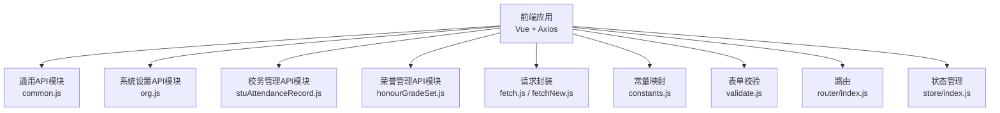
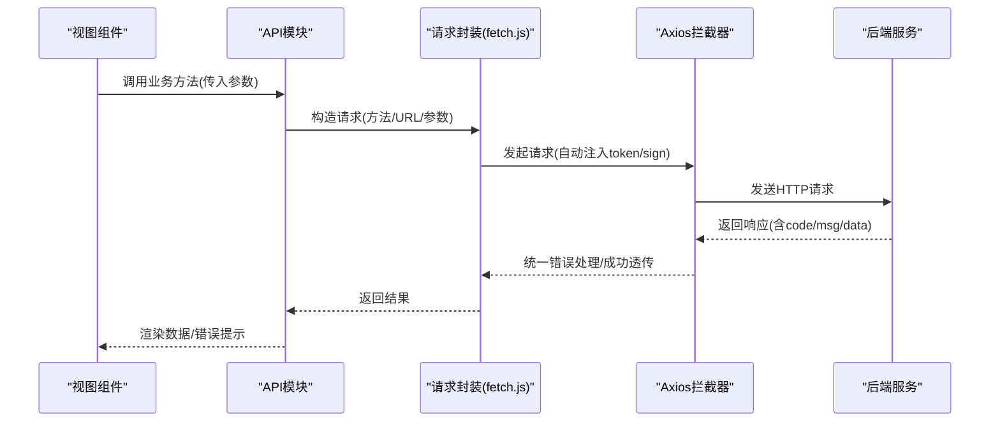
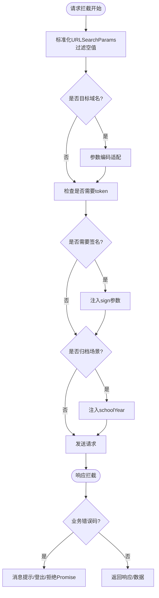
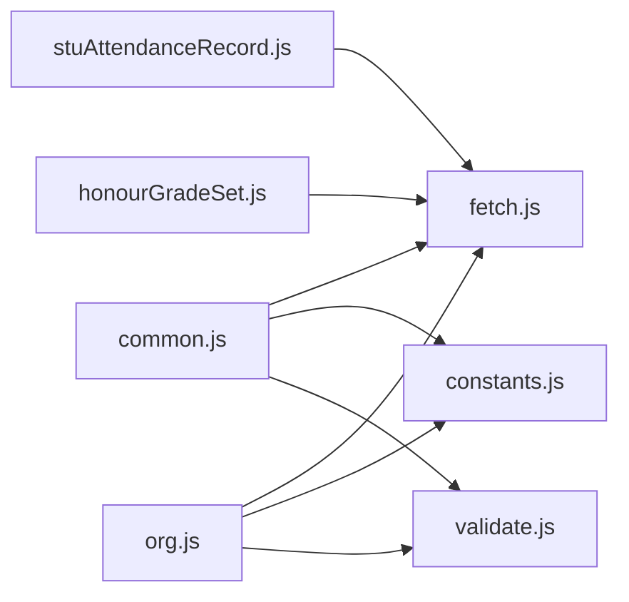

# API设计规范

<cite>
**本文引用的文件**
- [README.md](file://README.md)
- [fetch.js](file://src/utils/fetch.js)
- [fetchNew.js](file://src/utils/fetchNew.js)
- [common.js](file://src/api/common/common.js)
- [org.js](file://src/api/systemSet/org.js)
- [stuAttendanceRecord.js](file://src/api/schoolManage/stuAttendanceRecord.js)
- [honourGradeSet.js](file://src/api/honour/honourGradeSet.js)
- [constants.js](file://src/utils/constants.js)
- [validate.js](file://src/utils/validate.js)
- [index.js](file://src/store/index.js)
- [index.js](file://src/router/index.js)
</cite>

## 目录
1. [引言](#引言)
2. [项目结构](#项目结构)
3. [核心组件](#核心组件)
4. [架构总览](#架构总览)
5. [详细组件分析](#详细组件分析)
6. [依赖分析](#依赖分析)
7. [性能考虑](#性能考虑)
8. [故障排查指南](#故障排查指南)
9. [结论](#结论)
10. [附录](#附录)

## 引言
本规范面向校园管理系统前端与后端交互的RESTful API设计，结合现有代码库中的请求封装、路由与状态管理、常量与校验工具等模块，总结出统一的命名规范、请求/响应格式、错误处理机制、接口分层、数据验证与安全控制策略，并给出版本管理、缓存与性能优化、批量操作与实时通信、API文档生成与测试调试等最佳实践建议。

## 项目结构
- 前端采用Vue生态，通过Axios封装统一发起HTTP请求，支持多环境BaseURL切换、自动注入token与签名参数、统一错误拦截与登录态失效处理。
- API按功能域分层组织于src/api目录，如common、systemSet、schoolManage、honour等，便于职责分离与维护。
- 工具类位于src/utils，包括请求封装(fetch.js、fetchNew.js)、常量映射(constants.js)、表单校验(validate.js)等。
- 路由与状态管理分别在src/router与src/store中定义，为API调用提供导航与全局状态支撑。

**图表来源**
- [common.js:1-459](file://src/api/common/common.js#L1-L459)
- [org.js:1-800](file://src/api/systemSet/org.js#L1-L800)
- [stuAttendanceRecord.js:1-111](file://src/api/schoolManage/stuAttendanceRecord.js#L1-L111)
- [honourGradeSet.js:1-302](file://src/api/honour/honourGradeSet.js#L1-L302)
- [fetch.js:1-240](file://src/utils/fetch.js#L1-L240)
- [fetchNew.js:1-136](file://src/utils/fetchNew.js#L1-L136)
- [constants.js:1-275](file://src/utils/constants.js#L1-L275)
- [validate.js:1-72](file://src/utils/validate.js#L1-L72)
- [index.js:1-207](file://src/router/index.js#L1-L207)
- [index.js:1-20](file://src/store/index.js#L1-L20)

**章节来源**
- [README.md:1-24](file://README.md#L1-L24)
- [index.js:1-207](file://src/router/index.js#L1-L207)
- [index.js:1-20](file://src/store/index.js#L1-L20)

## 核心组件
- 请求封装层
  - 统一基地址、超时、参数序列化、token与签名注入、统一错误拦截与登录态失效处理。
  - 支持多实例：常规请求、系统服务、归档请求、第三方平台等。
- API业务层
  - 按功能域划分，每个模块导出一组函数，函数内部构造参数并调用封装好的请求实例。
- 工具与常量
  - constants.js提供各类枚举映射，validate.js提供常用正则与校验器，辅助API层进行入参校验与提示。
- 路由与状态
  - 路由定义页面级导航，状态管理提供全局用户、组织、应用等状态，为API调用提供上下文。

**章节来源**
- [fetch.js:13-171](file://src/utils/fetch.js#L13-L171)
- [fetchNew.js:8-135](file://src/utils/fetchNew.js#L8-L135)
- [common.js:1-459](file://src/api/common/common.js#L1-L459)
- [org.js:1-800](file://src/api/systemSet/org.js#L1-L800)
- [constants.js:1-275](file://src/utils/constants.js#L1-L275)
- [validate.js:1-72](file://src/utils/validate.js#L1-L72)

## 架构总览
前端通过Axios拦截器完成请求前的参数标准化、鉴权与签名注入，响应拦截器统一处理业务错误码与登录态失效，随后由各业务API模块按需调用不同实例，最终渲染到视图层。

**图表来源**
- [fetch.js:66-169](file://src/utils/fetch.js#L66-L169)
- [common.js:14-47](file://src/api/common/common.js#L14-L47)

## 详细组件分析

### 请求封装与拦截器设计
- 请求拦截
  - 自动将URLSearchParams参数标准化，过滤null/undefined。
  - 对特定域名(ucenter-web)进行参数编码适配。
  - 自动注入token与sign参数，支持白名单豁免。
  - 归档场景自动注入学年参数。
- 响应拦截
  - 统一错误码判定，对登录态失效等进行登出与跳转处理。
  - 成功时按配置返回完整响应或仅data体。
  - 全局消息提示与Promise.reject用于上层捕获。

**图表来源**
- [fetch.js:66-169](file://src/utils/fetch.js#L66-L169)

**章节来源**
- [fetch.js:13-171](file://src/utils/fetch.js#L13-L171)
- [fetchNew.js:8-135](file://src/utils/fetchNew.js#L8-L135)

### API命名规范与分层设计
- 命名规范
  - 函数名采用动宾短语，清晰表达动作与对象，如getUserList、addStudent、updateTeacher等。
  - 参数统一使用URLSearchParams构造，必要时通过headers指定application/json。
- 分层设计
  - 通用模块(common.js)：字典、课程、用户、基础能力等跨域通用接口。
  - 系统设置模块(org.js)：组织、用户、角色、同步等系统级管理接口。
  - 业务模块(schoolManage、honour等)：围绕具体业务域的增删改查与统计分析接口。
- 批量操作
  - 批量删除/移动/转出等操作通常以逗号拼接ID字符串传递，便于后端批量处理。

示例路径参考：
- [common.js:14-47](file://src/api/common/common.js#L14-L47)
- [org.js:32-46](file://src/api/systemSet/org.js#L32-L46)
- [org.js:481-512](file://src/api/systemSet/org.js#L481-L512)
- [org.js:642-673](file://src/api/systemSet/org.js#L642-L673)
- [stuAttendanceRecord.js:76-90](file://src/api/schoolManage/stuAttendanceRecord.js#L76-L90)
- [honourGradeSet.js:18-27](file://src/api/honour/honourGradeSet.js#L18-L27)

**章节来源**
- [common.js:1-459](file://src/api/common/common.js#L1-L459)
- [org.js:1-800](file://src/api/systemSet/org.js#L1-L800)
- [stuAttendanceRecord.js:1-111](file://src/api/schoolManage/stuAttendanceRecord.js#L1-L111)
- [honourGradeSet.js:1-302](file://src/api/honour/honourGradeSet.js#L1-L302)

### 请求/响应格式与错误处理
- 请求格式
  - 默认使用URLSearchParams传输键值对；需要JSON时显式设置headers为application/json并序列化data。
  - GET/POST均可，按业务选择；部分接口同时支持GET/POST。
- 响应格式
  - 统一约定包含code、msg、data字段；成功时code通常为200，失败时为负数或特定业务码。
  - 拦截器根据code决定是否提示错误、登出或透传数据。
- 错误处理
  - 登录态失效(如1000)触发登出流程与跳转。
  - 其他错误码统一弹窗提示，Promise.reject便于上层捕获。

示例路径参考：
- [fetch.js:104-169](file://src/utils/fetch.js#L104-L169)
- [org.js:504-511](file://src/api/systemSet/org.js#L504-L511)
- [honourGradeSet.js:18-27](file://src/api/honour/honourGradeSet.js#L18-L27)

**章节来源**
- [fetch.js:104-169](file://src/utils/fetch.js#L104-L169)
- [org.js:504-511](file://src/api/systemSet/org.js#L504-L511)
- [honourGradeSet.js:18-27](file://src/api/honour/honourGradeSet.js#L18-L27)

### 数据验证规则与安全控制
- 数据验证
  - 使用validate.js提供的正则与校验器，覆盖手机号、身份证、URL、IP等常见场景。
  - 结合Element UI的表单校验规则，统一提示文案与触发时机。
- 安全控制
  - 自动注入token与sign参数，敏感接口加入签名白名单。
  - 登录态失效统一拦截并跳转至登录页，避免未授权访问。
  - 对特定接口(如旧框架登录、验证码卡片等)设置无需token白名单。

示例路径参考：
- [validate.js:10-72](file://src/utils/validate.js#L10-L72)
- [fetch.js:24-34](file://src/utils/fetch.js#L24-L34)
- [fetch.js:81-92](file://src/utils/fetch.js#L81-L92)

**章节来源**
- [validate.js:1-72](file://src/utils/validate.js#L1-L72)
- [fetch.js:24-34](file://src/utils/fetch.js#L24-L34)
- [fetch.js:81-92](file://src/utils/fetch.js#L81-L92)

### 接口分层与模块职责
- 通用层(common.js)
  - 字典查询、课程/班级/年级查询、用户信息查询、视频/文件能力等。
- 系统设置层(org.js)
  - 部门管理、用户管理、角色管理、同步与迁移、个人中心等。
- 业务层(schoolManage、honour等)
  - 考勤统计、荣誉管理、教学评估等具体业务。

示例路径参考：
- [common.js:14-47](file://src/api/common/common.js#L14-L47)
- [org.js:21-26](file://src/api/systemSet/org.js#L21-L26)
- [stuAttendanceRecord.js:11-16](file://src/api/schoolManage/stuAttendanceRecord.js#L11-L16)

**章节来源**
- [common.js:1-459](file://src/api/common/common.js#L1-L459)
- [org.js:1-800](file://src/api/systemSet/org.js#L1-L800)
- [stuAttendanceRecord.js:1-111](file://src/api/schoolManage/stuAttendanceRecord.js#L1-L111)

### 实时通信与批量操作
- 批量操作
  - 通过逗号分隔的ID字符串传递，后端批量处理，减少多次往返。
- 实时通信
  - 当前代码库未见WebSocket或长连接实现，建议在需要实时推送的场景引入独立通道并在路由/状态中配合使用。

示例路径参考：
- [org.js:173-190](file://src/api/systemSet/org.js#L173-L190)
- [org.js:642-673](file://src/api/systemSet/org.js#L642-L673)

**章节来源**
- [org.js:173-190](file://src/api/systemSet/org.js#L173-L190)
- [org.js:642-673](file://src/api/systemSet/org.js#L642-L673)

## 依赖分析
- 组件耦合
  - API模块依赖请求封装(fetch.js/fetchNew.js)，通过不同实例(baseURL/timeout)隔离不同域。
  - 工具模块(constants.js、validate.js)被API模块间接使用，提升复用性。
- 外部依赖
  - Axios作为HTTP客户端，Element UI用于消息提示，Cookies用于token存储。
- 路由与状态
  - 路由与状态为API调用提供导航与上下文，但不直接参与HTTP请求逻辑。

**图表来源**
- [common.js:1-459](file://src/api/common/common.js#L1-L459)
- [org.js:1-800](file://src/api/systemSet/org.js#L1-L800)
- [stuAttendanceRecord.js:1-111](file://src/api/schoolManage/stuAttendanceRecord.js#L1-L111)
- [honourGradeSet.js:1-302](file://src/api/honour/honourGradeSet.js#L1-L302)
- [fetch.js:1-240](file://src/utils/fetch.js#L1-L240)
- [constants.js:1-275](file://src/utils/constants.js#L1-L275)
- [validate.js:1-72](file://src/utils/validate.js#L1-L72)

**章节来源**
- [common.js:1-459](file://src/api/common/common.js#L1-L459)
- [org.js:1-800](file://src/api/systemSet/org.js#L1-L800)
- [fetch.js:1-240](file://src/utils/fetch.js#L1-L240)

## 性能考虑
- 请求合并与去抖
  - 对频繁触发的查询(如搜索/筛选)建议增加防抖，减少无效请求。
- 参数压缩
  - 对长列表查询使用分页与合理pageSize，避免一次性拉取过多数据。
- 缓存策略
  - 对静态字典/常量类接口可采用内存缓存或本地持久化缓存，降低重复请求。
- 超时与重试
  - 根据接口重要性设置不同超时阈值；对幂等请求可考虑指数退避重试。
- 并发控制
  - 对批量操作建议串行或分批提交，避免后端压力过大。

## 故障排查指南
- 常见错误码定位
  - 登录态失效(1000)：触发登出与跳转，检查token与sign参数是否正确注入。
  - 参数错误(1001/1002/1003)：核对请求参数与Content-Type，确保JSON接口使用application/json。
  - 服务器错误(500)：查看后端日志与网络面板，确认接口可用性。
- 日志与断点
  - 在请求/响应拦截器中打印关键信息，便于定位问题。
- 用户反馈
  - 统一的消息提示与错误堆栈收集，有助于快速修复。

**章节来源**
- [fetch.js:104-169](file://src/utils/fetch.js#L104-L169)
- [fetchNew.js:81-133](file://src/utils/fetchNew.js#L81-L133)

## 结论
本规范基于现有代码库提炼了统一的API设计原则：明确的命名与分层、一致的请求/响应格式、完善的错误处理与安全控制、可扩展的批量与实时通信模式。建议在后续迭代中补充API文档生成与自动化测试流程，持续完善性能与稳定性。

## 附录

### API命名与参数规范清单
- 命名
  - 动宾短语，清晰表达意图；避免缩写与歧义。
- 参数
  - 默认URLSearchParams；需要JSON时显式设置headers与序列化。
  - 批量ID使用逗号分隔字符串。
- 方法
  - 按业务选择GET/POST；必要时提供两种方式以兼容不同场景。

**章节来源**
- [org.js:504-511](file://src/api/systemSet/org.js#L504-L511)
- [honourGradeSet.js:18-27](file://src/api/honour/honourGradeSet.js#L18-L27)
- [org.js:173-190](file://src/api/systemSet/org.js#L173-L190)

### 错误码与处理对照
- 登录态失效(1000)：登出并跳转登录页。
- 业务错误(-1、4xx、5xx)：弹窗提示并拒绝Promise。
- 成功(200)：透传数据供上层使用。

**章节来源**
- [fetch.js:104-169](file://src/utils/fetch.js#L104-L169)
- [fetchNew.js:81-133](file://src/utils/fetchNew.js#L81-L133)

### 常用校验规则
- 手机号、身份证、URL、IP等正则，结合Element UI表单规则统一提示。

**章节来源**
- [validate.js:10-72](file://src/utils/validate.js#L10-L72)