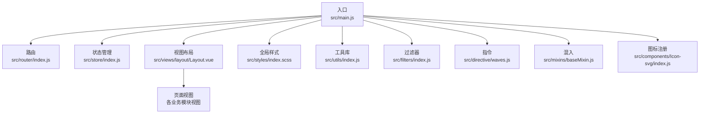
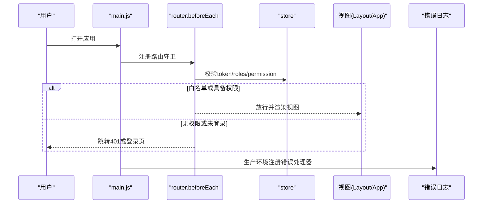
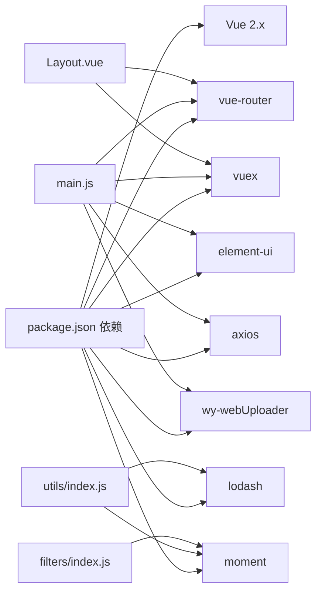

# 代码质量规范

<cite>
**本文引用的文件**   
- [.eslintrc.js](file://.eslintrc.js)
- [.editorconfig](file://.editorconfig)
- [.postcssrc.js](file://.postcssrc.js)
- [package.json](file://package.json)
- [src/main.js](file://src/main.js)
- [src/App.vue](file://src/App.vue)
- [src/views/layout/Layout.vue](file://src/views/layout/Layout.vue)
- [src/router/index.js](file://src/router/index.js)
- [src/store/index.js](file://src/store/index.js)
- [src/utils/index.js](file://src/utils/index.js)
- [src/filters/index.js](file://src/filters/index.js)
- [src/components/Icon-svg/index.js](file://src/components/Icon-svg/index.js)
- [src/styles/index.scss](file://src/styles/index.scss)
- [src/directive/waves.js](file://src/directive/waves.js)
- [src/mixins/baseMixin.js](file://src/mixins/baseMixin.js)
</cite>

## 目录
1. [简介](#简介)
2. [项目结构](#项目结构)
3. [核心组件](#核心组件)
4. [架构总览](#架构总览)
5. [详细组件分析](#详细组件分析)
6. [依赖关系分析](#依赖关系分析)
7. [性能考虑](#性能考虑)
8. [故障排查指南](#故障排查指南)
9. [结论](#结论)
10. [附录](#附录)

## 简介
本规范面向校园管理系统前端工程，覆盖 JavaScript 编码规范、CSS/SCSS 样式规范、HTML 模板规范、注释与命名约定、函数设计原则、代码审查流程、单元与集成测试策略、性能优化与安全实践、重构与技术债务管理、持续改进策略等。目标是统一团队开发标准，提升代码一致性、可维护性与可测试性。

## 项目结构
项目采用 Vue 2.x 单页应用结构，按功能域划分目录，核心入口与路由、状态管理、工具库、过滤器、指令、混入、样式主题等模块清晰分离，便于规模化协作与质量控制。

图表来源
- [src/main.js:1-221](file://src/main.js#L1-L221)
- [src/router/index.js:1-207](file://src/router/index.js#L1-L207)
- [src/store/index.js:1-20](file://src/store/index.js#L1-L20)
- [src/views/layout/Layout.vue:1-507](file://src/views/layout/Layout.vue#L1-L507)
- [src/styles/index.scss:1-349](file://src/styles/index.scss#L1-L349)
- [src/utils/index.js:1-385](file://src/utils/index.js#L1-L385)
- [src/filters/index.js:1-121](file://src/filters/index.js#L1-L121)
- [src/directive/waves.js:1-55](file://src/directive/waves.js#L1-L55)
- [src/mixins/baseMixin.js:1-103](file://src/mixins/baseMixin.js#L1-L103)
- [src/components/Icon-svg/index.js:1-12](file://src/components/Icon-svg/index.js#L1-L12)

章节来源
- [src/main.js:1-221](file://src/main.js#L1-L221)
- [src/router/index.js:1-207](file://src/router/index.js#L1-L207)
- [src/store/index.js:1-20](file://src/store/index.js#L1-L20)
- [src/views/layout/Layout.vue:1-507](file://src/views/layout/Layout.vue#L1-L507)
- [src/styles/index.scss:1-349](file://src/styles/index.scss#L1-L349)
- [src/utils/index.js:1-385](file://src/utils/index.js#L1-L385)
- [src/filters/index.js:1-121](file://src/filters/index.js#L1-L121)
- [src/directive/waves.js:1-55](file://src/directive/waves.js#L1-L55)
- [src/mixins/baseMixin.js:1-103](file://src/mixins/baseMixin.js#L1-L103)
- [src/components/Icon-svg/index.js:1-12](file://src/components/Icon-svg/index.js#L1-L12)

## 核心组件
- 入口与全局初始化：统一引入 UI 组件库、进度条、全局过滤器、打印插件、上传组件、权限与登录拦截、错误日志上报。
- 路由与导航：集中常量路由与模块化路由拆分，支持白名单免登录、权限路径校验、侧边栏与顶部导航联动。
- 状态管理：模块化 app/user/org，统一 getters，集中处理用户信息、角色、权限与组织数据。
- 工具库与过滤器：时间格式化、URL 参数解析、权限判断、深拷贝、文件预览、打印等常用能力。
- 样式体系：基于 SCSS 的全局样式、按钮与 Element UI 覆盖、滚动条与表格优化、响应式适配。
- 指令与混入：波纹点击效果、表格布局修复、导出 Excel、分页与刷新等通用逻辑复用。

章节来源
- [src/main.js:1-221](file://src/main.js#L1-L221)
- [src/router/index.js:1-207](file://src/router/index.js#L1-L207)
- [src/store/index.js:1-20](file://src/store/index.js#L1-L20)
- [src/utils/index.js:1-385](file://src/utils/index.js#L1-L385)
- [src/filters/index.js:1-121](file://src/filters/index.js#L1-L121)
- [src/styles/index.scss:1-349](file://src/styles/index.scss#L1-L349)
- [src/directive/waves.js:1-55](file://src/directive/waves.js#L1-L55)
- [src/mixins/baseMixin.js:1-103](file://src/mixins/baseMixin.js#L1-L103)

## 架构总览
系统采用“入口初始化 → 路由守卫 → 视图布局 → 页面组件”的主干流程；通过 Vuex 管理用户态与全局状态；通过工具库与混入提供跨页面复用能力；通过全局样式与指令增强交互体验。

图表来源
- [src/main.js:73-214](file://src/main.js#L73-L214)
- [src/router/index.js:40-199](file://src/router/index.js#L40-L199)
- [src/views/layout/Layout.vue:94-261](file://src/views/layout/Layout.vue#L94-L261)

## 详细组件分析

### JavaScript 编码规范
- 语言特性与版本
  - 使用 ES2019（ecmaVersion: 11），模块化（sourceType: 'module'）。
  - 全局变量声明与只读约束：Atomics、SharedArrayBuffer、import、export 等。
- 缩进与格式
  - EditorConfig 统一缩进为 4 空格，LF 结尾，UTF-8，末行换行与去除尾随空白。
  - ESLint 强制脚本缩进为 4，Vue 脚本缩进规则在 *.vue 中关闭以避免冲突。
- 等值比较与引号
  - eqeqeq 规则启用“smart”模式，推荐使用严格相等。
  - 字符串统一使用单引号。
- Vue 规范
  - 使用 plugin:vue/essential 与 plugin:html，对 script-indent 进行显式配置。
- 文件与模块
  - 建议每个模块职责单一，导出明确的函数/对象，避免副作用。
  - 组件内部 data/props/computed/methods 分层清晰，避免在模板中写复杂表达式。

章节来源
- [.eslintrc.js:1-28](file://.eslintrc.js#L1-L28)
- [.editorconfig:1-10](file://.editorconfig#L1-L10)

### CSS/SCSS 样式规范
- 全局样式
  - normalize.css 初始化，统一字体与盒模型，避免重复声明。
  - 全局类名如浮动、对齐、间距、指针样式等，保持语义化与可复用。
- 组件样式
  - 使用 scoped 与局部作用域，避免全局污染。
  - 变量与 mixin 统一管理，滚动条、表格、按钮等进行统一覆盖。
- 响应式与兼容
  - 针对不同屏幕高度与浏览器差异进行适配，确保表格与滚动区域稳定。
- PostCSS 配置
  - autoprefixer 自动补全厂商前缀，postcss-import/url 便于模块化与资源处理。

章节来源
- [src/styles/index.scss:1-349](file://src/styles/index.scss#L1-L349)
- [.postcssrc.js:1-11](file://.postcssrc.js#L1-L11)

### HTML 模板规范
- 结构与语义
  - 使用语义化标签，避免过度 div 包裹；列表、表单、表格等遵循最佳实践。
- 数据绑定
  - v-if/v-show 合理使用，避免在 v-if 中进行复杂计算；v-for 提供唯一 key。
- 事件与指令
  - 自定义指令（如 waves）仅在交互反馈场景使用，避免滥用。
- 缓存与生命周期
  - keep-alive 与 meta.isCached 控制缓存策略，减少重复渲染与请求。

章节来源
- [src/App.vue:1-183](file://src/App.vue#L1-L183)
- [src/views/layout/Layout.vue:1-507](file://src/views/layout/Layout.vue#L1-L507)
- [src/directive/waves.js:1-55](file://src/directive/waves.js#L1-L55)

### 代码注释标准
- 文件级注释：简述模块职责与关键接口。
- 函数注释：说明输入输出、边界条件、异常处理与调用注意事项。
- 复杂逻辑注释：对算法步骤、状态机分支、权限判断等进行解释。
- TODO/NOTE 注释：明确待办事项与风险提示，限定责任人与截止时间。

### 变量命名约定
- 命名风格：驼峰命名为主，常量全大写下划线，类名首字母大写。
- 前缀后缀：布尔变量以 is_/has_ 等前缀；集合以 s/_list/_map 等后缀；Promise 对象以 _p 后缀。
- 路径与权限：permissionPath、moduleKey 等语义化标识，避免缩写不清。

### 函数设计原则
- 单一职责：每个函数只做一件事，并尽量短小。
- 输入输出：明确参数类型与默认值，返回值具有一致性。
- 错误处理：对空值、越界、异步失败等情况进行防御式编程。
- 可测试性：避免强耦合外部状态，必要时通过依赖注入或工厂函数解耦。

### 代码审查流程
- 提交前检查
  - 本地运行 ESLint、格式化检查与构建产物校验。
  - 关键路径增加单元测试与端到端用例。
- 审查清单
  - 功能正确性、边界条件、性能影响、安全风险、可维护性。
  - 是否引入循环依赖、是否破坏既有行为、是否遗漏注释与测试。
- 工具链
  - 使用 .eslintrc.js 与 .editorconfig 作为强制规则，CI 中执行静态检查。

章节来源
- [.eslintrc.js:1-28](file://.eslintrc.js#L1-L28)
- [.editorconfig:1-10](file://.editorconfig#L1-L10)

### 单元测试与集成测试策略
- 单元测试
  - 对工具函数（如时间格式化、权限判断、深拷贝）编写独立测试。
  - 对混入方法（分页、导出、刷新）进行行为断言。
- 集成测试
  - 路由守卫与权限校验：构造 token/roles/permission 场景，验证放行/拦截。
  - 登录流程：模拟登录成功/失败、白名单跳过、权限不足等分支。
- 测试覆盖率
  - 关键业务函数与分支达到阈值，避免回归。

（本节为通用策略说明，不直接分析具体文件）

### 性能优化原则
- 资源加载
  - 按需引入第三方库与组件，避免全局污染；合理拆分包体。
- 渲染优化
  - 使用 keep-alive 缓存视图；避免在模板中进行复杂计算；合理使用 v-show/v-if。
- 数据流
  - Vuex 模块化与 getters 复用，减少重复计算；组件内 data 局部化。
- 样式与指令
  - SCSS 变量与 mixin 复用，减少重复规则；指令仅在必要场景使用。
- 打包与构建
  - 依据 browserslist 配置目标浏览器，启用 autoprefixer 与压缩。

章节来源
- [src/main.js:1-221](file://src/main.js#L1-L221)
- [src/views/layout/Layout.vue:1-507](file://src/views/layout/Layout.vue#L1-L507)
- [src/styles/index.scss:1-349](file://src/styles/index.scss#L1-L349)
- [package.json:92-96](file://package.json#L92-L96)

### 内存泄漏防范
- 生命周期
  - 在 beforeDestroy 中清理定时器、事件监听器、轮询任务与临时 DOM。
- 组件缓存
  - 合理使用 keep-alive 与 meta.isCached，避免无限制缓存导致内存累积。
- 异步资源
  - 及时取消请求与销毁订阅，防止回调访问已销毁实例。

章节来源
- [src/App.vue:14-16](file://src/App.vue#L14-L16)
- [src/views/layout/Layout.vue:247-253](file://src/views/layout/Layout.vue#L247-L253)

### 安全编码实践
- 权限与鉴权
  - 白名单机制与 permissionPath 校验，避免越权访问。
  - token 存储与传递遵循最小暴露原则，避免明文泄露。
- 输入与输出
  - 对用户输入进行清洗与长度/字符集限制；对外输出进行 HTML 实体转义。
- 第三方依赖
  - 定期更新依赖，关注安全公告；对上传与富文本场景加强校验。

章节来源
- [src/main.js:58-197](file://src/main.js#L58-L197)
- [src/utils/index.js:254-290](file://src/utils/index.js#L254-L290)

### 代码重构指南
- 识别坏味道
  - 过长函数、重复代码、巨大类、发散式变化、霰弹式修改。
- 重构策略
  - 提取函数、拆分组件、引入混入/指令复用公共逻辑、模块化工具函数。
  - 逐步替换旧实现，保留测试与注释，确保行为一致。
- 回归保障
  - 重构前后对比测试、端到端验证、性能回归检测。

（本节为通用指导，不直接分析具体文件）

### 技术债务管理与持续改进
- 债务分类
  - 代码质量、架构演进、文档缺失、测试不足、依赖陈旧。
- 优先级排序
  - 影响稳定性与安全性的债务优先处理；对高频改动模块优先优化。
- 改进计划
  - 设定迭代目标与验收标准；定期回顾与度量（如圈复杂度、重复率、测试覆盖率）。
- 文化建设
  - 团队培训、结对编程、代码评审文化、自动化检查与 CI 集成。

（本节为通用指导，不直接分析具体文件）

## 依赖关系分析

图表来源
- [package.json:12-42](file://package.json#L12-L42)
- [src/main.js:1-221](file://src/main.js#L1-L221)
- [src/views/layout/Layout.vue:1-507](file://src/views/layout/Layout.vue#L1-L507)
- [src/utils/index.js:1-385](file://src/utils/index.js#L1-L385)
- [src/filters/index.js:1-121](file://src/filters/index.js#L1-L121)

章节来源
- [package.json:12-42](file://package.json#L12-L42)
- [src/main.js:1-221](file://src/main.js#L1-L221)

## 性能考虑
- 路由与渲染
  - 路由守卫中避免阻塞操作，必要时异步加载组件与懒加载模块。
  - 使用 keep-alive 缓存高频页面，减少重复初始化。
- 状态与数据
  - Vuex 模块化与 getters 复用，避免重复计算；组件内 data 局部化。
- 样式与指令
  - SCSS 变量与 mixin 复用，减少重复规则；指令仅在必要场景使用。
- 打包与构建
  - 依据 browserslist 配置目标浏览器，启用 autoprefixer 与压缩。

（本节为通用指导，不直接分析具体文件）

## 故障排查指南
- 登录与权限
  - 检查白名单配置与 permissionPath 校验逻辑；确认 token 与 roles 是否正确下发。
- 错误日志
  - 生产环境注册 errorHandler，收集错误堆栈与上下文信息，定位问题根因。
- 组件缓存
  - 若出现缓存导致的状态不一致，检查 meta.isCached 与 keep-alive 使用。
- 第三方上传
  - 校验签名与回调接口，确认上传组件初始化与事件绑定。

章节来源
- [src/main.js:58-214](file://src/main.js#L58-L214)
- [src/views/layout/Layout.vue:94-261](file://src/views/layout/Layout.vue#L94-L261)

## 结论
通过统一的编码规范、样式约定与质量工具链，结合完善的路由与状态管理、工具库与混入复用、以及安全与性能策略，本项目可在规模化开发中保持高质量与高效率。建议持续完善测试与文档，建立技术债务跟踪与改进闭环，推动团队长期健康发展。

## 附录
- 工具与配置参考
  - ESLint：脚本缩进、等值比较、引号策略、Vue 规则。
  - EditorConfig：统一缩进、换行、字符集与尾随空白。
  - PostCSS：autoprefixer、import/url 插件。
- 最佳实践清单
  - 单一职责、明确输入输出、防御式编程、可测试性优先、缓存与生命周期管理、安全输入输出与最小暴露。