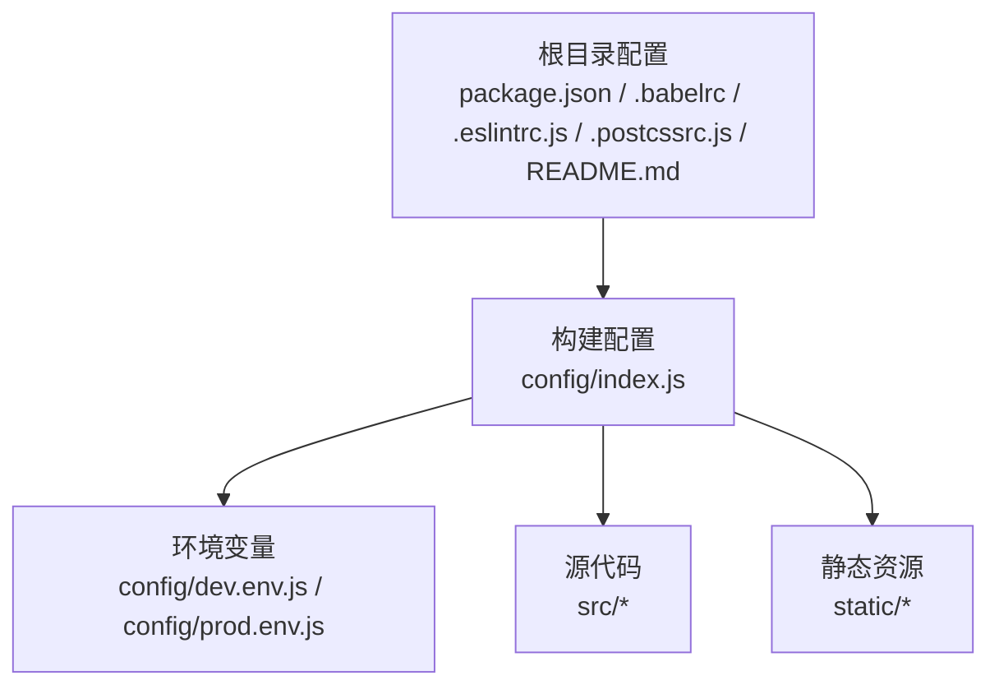
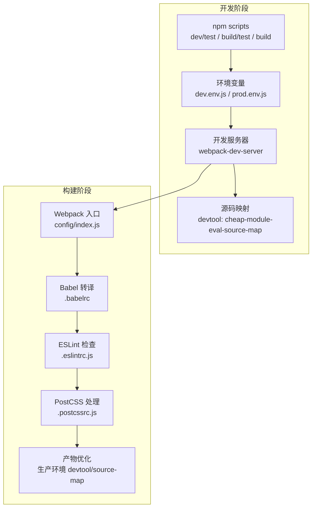
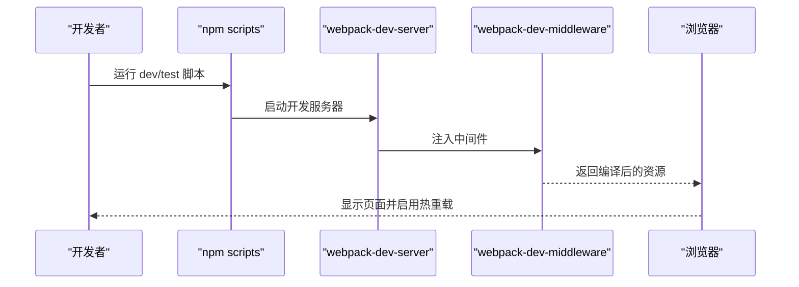
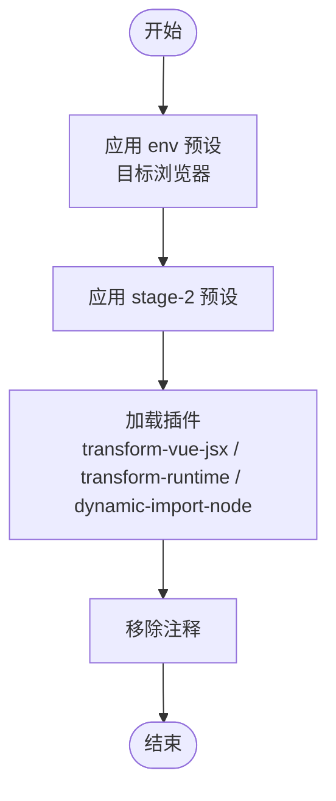
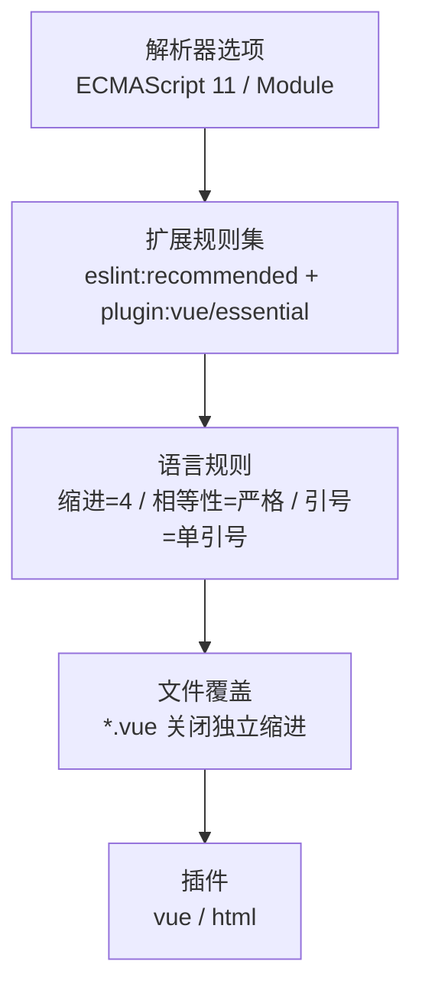
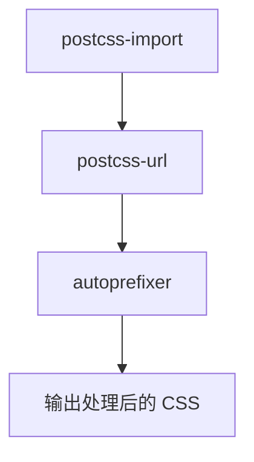
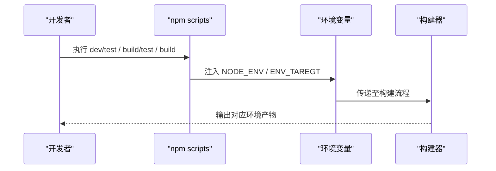
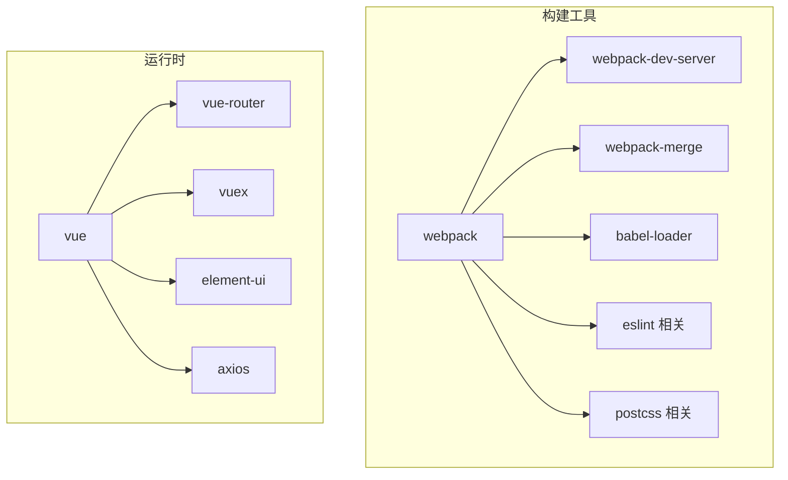

# 开发工具使用

<cite>
**本文引用的文件**
- [package.json](file://package.json)
- [.babelrc](file://.babelrc)
- [.eslintrc.js](file://.eslintrc.js)
- [.postcssrc.js](file://.postcssrc.js)
- [config/index.js](file://config/index.js)
- [config/dev.env.js](file://config/dev.env.js)
- [config/prod.env.js](file://config/prod.env.js)
- [README.md](file://README.md)
</cite>

## 目录
1. [简介](#简介)
2. [项目结构](#项目结构)
3. [核心组件](#核心组件)
4. [架构总览](#架构总览)
5. [详细组件分析](#详细组件分析)
6. [依赖分析](#依赖分析)
7. [性能考虑](#性能考虑)
8. [故障排查指南](#故障排查指南)
9. [结论](#结论)
10. [附录](#附录)

## 简介
本指南面向校园管理系统开发团队，系统性梳理项目在构建、转译、代码质量与开发体验方面的工具链与配置，包括：
- 构建与打包：基于 Webpack 的开发服务器、热重载、源码映射与产物优化
- 转译与语法支持：Babel 预设与插件、目标浏览器兼容策略
- 代码质量：ESLint 规则与插件、HTML 插件集成
- 后处理器：PostCSS 自动前缀与模块化处理
- 环境变量：开发/生产环境变量与多目标构建脚本
- IDE 与调试：推荐配置与调试要点
- 性能与可观测性：打包体积分析与运行时性能建议

## 项目结构
项目采用经典的 Vue CLI 早期模板风格，核心目录与职责如下：
- build：构建相关配置（当前仓库中未直接包含具体配置文件）
- config：开发与生产环境配置入口
- src：源代码与资源
- static：静态资源（非构建期处理）
- 根目录配置：package.json、.babelrc、.eslintrc.js、.postcssrc.js、README.md

图表来源
- [config/index.js:1-72](file://config/index.js#L1-L72)
- [config/dev.env.js:1-9](file://config/dev.env.js#L1-L9)
- [config/prod.env.js:1-6](file://config/prod.env.js#L1-L6)

章节来源
- [README.md:1-24](file://README.md#L1-L24)
- [config/index.js:1-72](file://config/index.js#L1-L72)

## 核心组件
- 构建与开发服务器
  - 使用 webpack-dev-server 提供本地开发服务，默认端口与主机可在配置中调整
  - 支持热重载与错误覆盖显示，便于快速迭代
- Babel 转译
  - 预设：env（目标浏览器）、stage-2（实验特性）
  - 插件：JSX 转换、运行时辅助、动态 import 适配
- ESLint 代码检查
  - 扩展：eslint:recommended、plugin:vue/essential
  - 规则：缩进、相等性、引号；对 *.vue 文件关闭独立缩进校验
- PostCSS
  - 插件：postcss-import、postcss-url、autoprefixer
- 环境变量
  - 开发/生产环境变量合并，支持多目标构建脚本（dev/test、build/test、build）

章节来源
- [package.json:7-11](file://package.json#L7-L11)
- [.babelrc:1-16](file://.babelrc#L1-L16)
- [.eslintrc.js:1-28](file://.eslintrc.js#L1-L28)
- [.postcssrc.js:1-11](file://.postcssrc.js#L1-L11)
- [config/index.js:8-37](file://config/index.js#L8-L37)
- [config/dev.env.js:1-9](file://config/dev.env.js#L1-L9)
- [config/prod.env.js:1-6](file://config/prod.env.js#L1-L6)

## 架构总览
下图展示开发与构建阶段的关键交互：脚本触发器、环境变量注入、开发服务器与源码映射、Babel/ESLint/PostCSS 处理链。

图表来源
- [package.json:7-11](file://package.json#L7-L11)
- [config/index.js:8-37](file://config/index.js#L8-L37)
- [.babelrc:1-16](file://.babelrc#L1-L16)
- [.eslintrc.js:1-28](file://.eslintrc.js#L1-L28)
- [.postcssrc.js:1-11](file://.postcssrc.js#L1-L11)

## 详细组件分析

### Webpack 开发服务器与热重载
- 默认主机与端口：localhost:8080（可被环境变量覆盖）
- 错误覆盖与通知：开启错误覆盖与编译错误提示
- 源码映射：开发环境使用低开销映射，便于调试
- 缓存与 CSS SourceMap：缓存开关与 CSS SourceMap 可控

图表来源
- [package.json:7-11](file://package.json#L7-L11)
- [config/index.js:8-37](file://config/index.js#L8-L37)

章节来源
- [config/index.js:8-37](file://config/index.js#L8-L37)
- [README.md:7-21](file://README.md#L7-L21)

### Babel 转译配置
- 预设组合：env（按 browserslist 目标转换）、stage-2（实验特性）
- 插件：JSX 转换、运行时辅助、动态 import 适配
- 注释清理：关闭注释输出，减小产物体积

图表来源
- [.babelrc:1-16](file://.babelrc#L1-L16)

章节来源
- [.babelrc:1-16](file://.babelrc#L1-L16)

### ESLint 代码检查
- 扩展：eslint:recommended、plugin:vue/essential
- 解析选项：ECMAScript 版本 11、模块类型
- 规则：
  - 缩进统一为 4 空格
  - 相等性强制使用严格比较
  - 字符串统一使用单引号
- *.vue 文件：关闭独立缩进校验，避免与模板缩进冲突

图表来源
- [.eslintrc.js:1-28](file://.eslintrc.js#L1-L28)

章节来源
- [.eslintrc.js:1-28](file://.eslintrc.js#L1-L28)

### PostCSS 处理链
- 插件：postcss-import（模块导入）、postcss-url（资源路径）、autoprefixer（自动前缀）
- 目标浏览器：继承 browserslist 配置

图表来源
- [.postcssrc.js:1-11](file://.postcssrc.js#L1-L11)

章节来源
- [.postcssrc.js:1-11](file://.postcssrc.js#L1-L11)

### 环境变量与多目标构建
- 开发环境：NODE_ENV=development，ENV_TAREGT 由外部传入
- 生产环境：NODE_ENV=production，ENV_TAREGT 由外部传入
- 脚本：
  - dev/test：开发测试环境
  - build/test：测试构建
  - build：生产构建

图表来源
- [package.json:7-11](file://package.json#L7-L11)
- [config/dev.env.js:1-9](file://config/dev.env.js#L1-L9)
- [config/prod.env.js:1-6](file://config/prod.env.js#L1-L6)

章节来源
- [package.json:7-11](file://package.json#L7-L11)
- [config/dev.env.js:1-9](file://config/dev.env.js#L1-L9)
- [config/prod.env.js:1-6](file://config/prod.env.js#L1-L6)

## 依赖分析
- 构建工具链
  - webpack、webpack-dev-server、webpack-merge：构建与开发服务器
  - babel-*：转译与 JSX 支持
  - eslint 相关：规则与插件
  - postcss-*：模块导入、URL 处理、自动前缀
- 运行时依赖
  - vue、vue-router、vuex、element-ui、axios 等：业务框架与 UI 组件库

图表来源
- [package.json:44-86](file://package.json#L44-L86)

章节来源
- [package.json:12-86](file://package.json#L12-L86)

## 性能考虑
- 源码映射
  - 开发：低开销映射以提升调试速度
  - 生产：可选择关闭或使用更紧凑映射以平衡调试与体积
- 产物优化
  - 压缩与 Gzip：可通过插件启用压缩与 Gzip 输出
  - 分包与懒加载：结合路由与组件懒加载减少首屏体积
- 构建分析
  - 使用打包分析报告（通过构建脚本参数）定位大体积模块与重复依赖

章节来源
- [config/index.js:28-69](file://config/index.js#L28-L69)
- [package.json:7-11](file://package.json#L7-L11)

## 故障排查指南
- 端口占用
  - 开发服务器端口可被环境变量覆盖；若端口被占用，配置中支持自动选择可用端口
- 热重载失效
  - 检查开发服务器配置与浏览器网络连接；确保未禁用热更新
- 源码映射异常
  - 确认 devtool 设置与浏览器开发者工具匹配；生产环境需正确配置映射文件
- ESLint 报错
  - 按规则修正缩进、相等性与引号；对 *.vue 文件遵循覆盖规则
- Babel 转译问题
  - 确认预设与插件版本兼容；必要时清理缓存后重试

章节来源
- [config/index.js:16-37](file://config/index.js#L16-L37)
- [.eslintrc.js:20-26](file://.eslintrc.js#L20-L26)
- [.babelrc:1-16](file://.babelrc#L1-L16)

## 结论
本项目采用成熟稳定的前端工具链：Webpack + Babel + ESLint + PostCSS，配合灵活的环境变量与多目标构建脚本，能够满足开发调试、质量保障与生产优化的需求。建议在团队内统一 IDE 插件与格式化配置，持续关注依赖升级与安全补丁，以保持工具链的稳定性与安全性。

## 附录
- 快速上手
  - 安装依赖：npm install
  - 启动开发：npm run dev
  - 构建产物：npm run build
  - 查看分析报告：npm run build --report
- 推荐 IDE 配置
  - ESLint 插件：启用保存时自动修复
  - Prettier 插件：与 ESLint 规则协同
  - Vue 官方插件：语法高亮与模板诊断
  - Babel/ESLint/PostCSS 相关插件：按需启用
- Git 工作流与提交规范
  - 分支策略：主分支保护、功能分支开发、Pull Request 审查
  - 提交信息：采用约定式提交（如 feat/fix/docs/chore），清晰描述变更内容
  - 代码审查：强制通过 CI 与 Lint 校验后再合并
- 测试与覆盖率
  - 单元测试：建议引入 Jest 或 Mocha + Vue Test Utils
  - 覆盖率：配置 Istanbul 或 nyc，设定阈值并纳入 CI
- 性能分析与监控
  - 打包分析：使用 webpack-bundle-analyzer
  - 运行时性能：结合浏览器性能面板与网络面板进行分析

章节来源
- [README.md:5-24](file://README.md#L5-L24)
- [package.json:7-11](file://package.json#L7-L11)