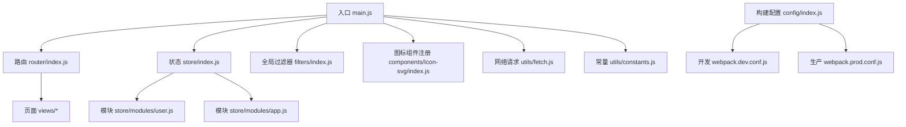
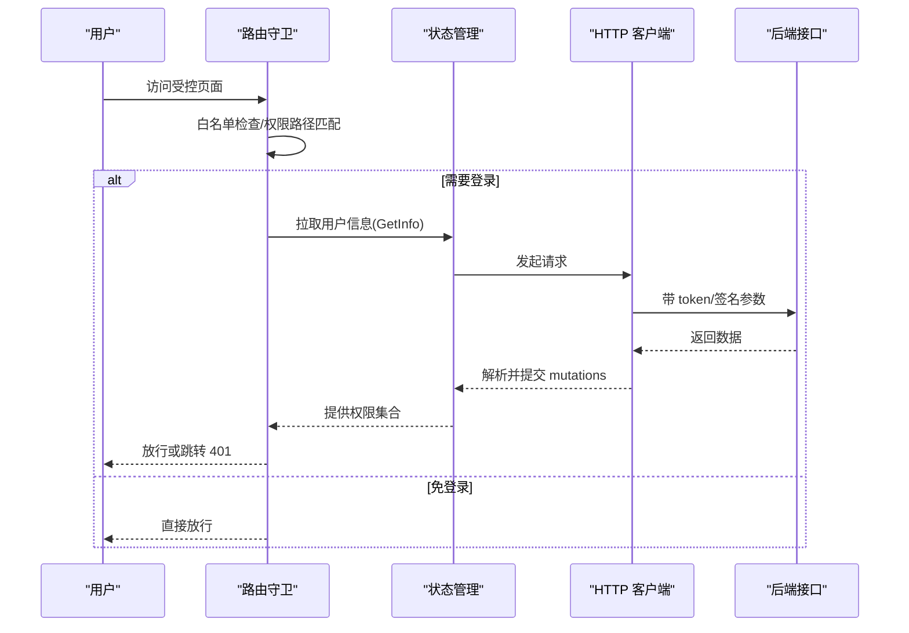
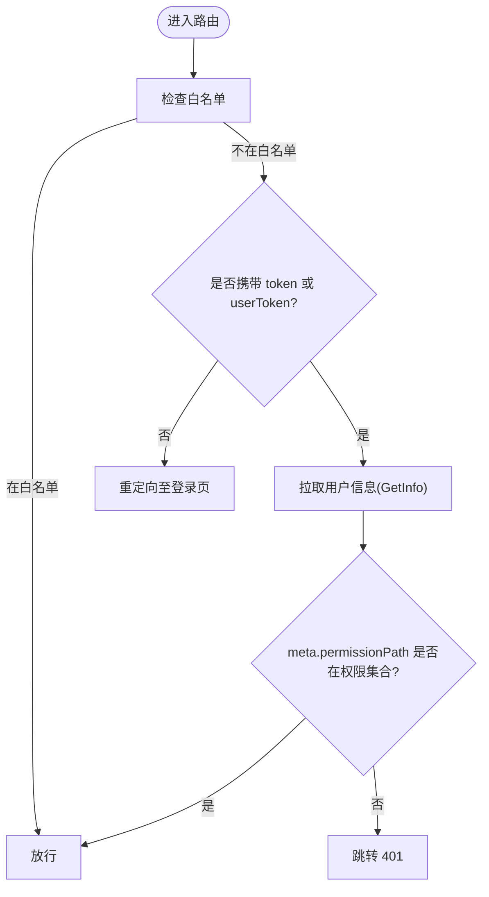
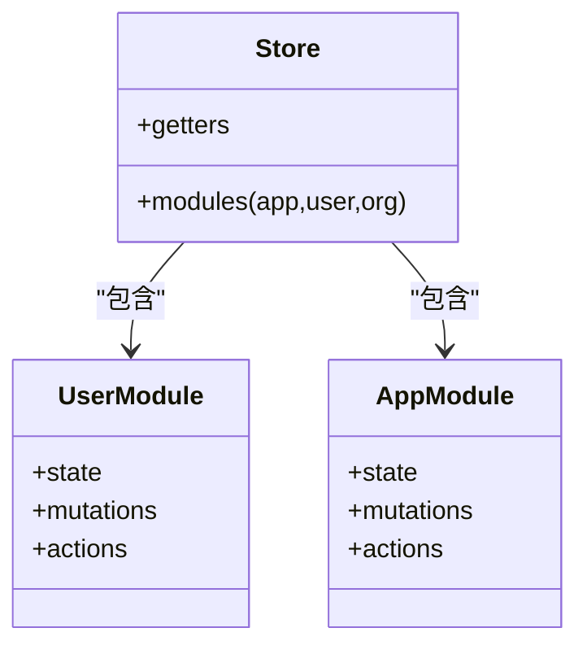
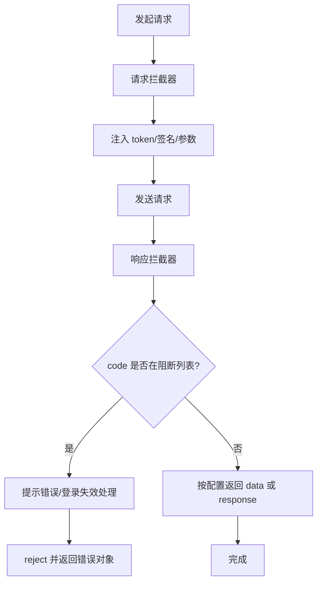
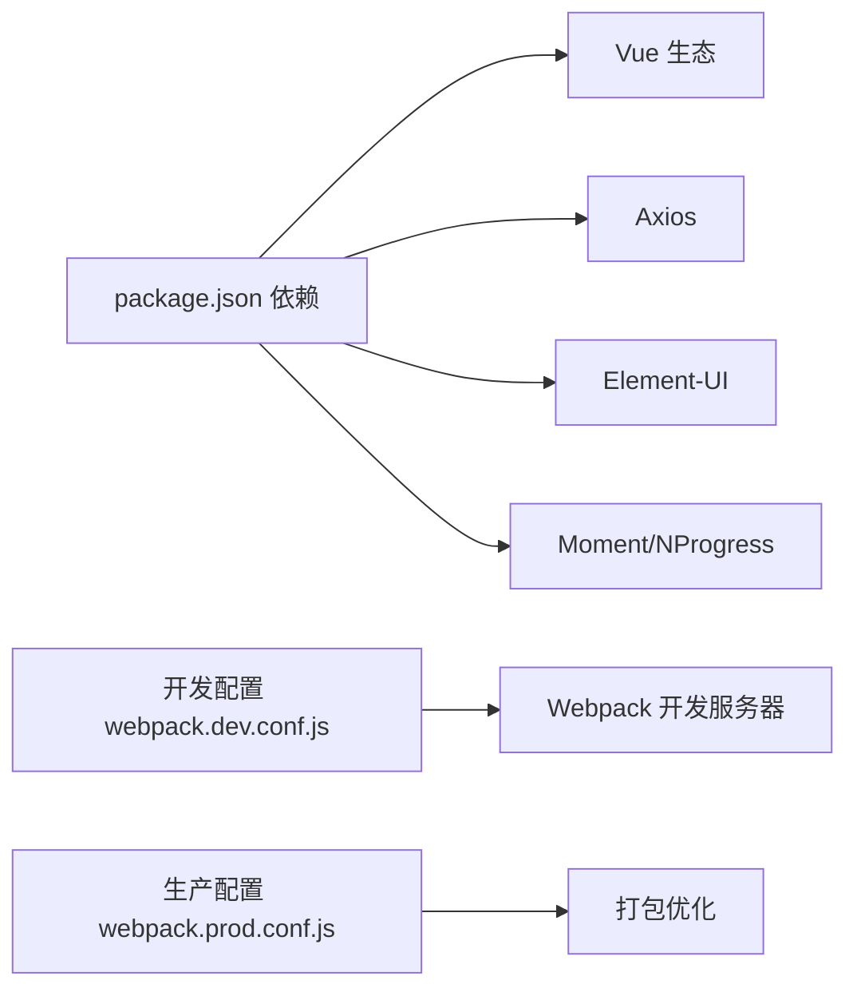

# 开发指南

<cite>
**本文引用的文件**   
- [package.json](file://package.json)
- [README.md](file://README.md)
- [main.js](file://src/main.js)
- [router/index.js](file://src/router/index.js)
- [store/index.js](file://src/store/index.js)
- [store/modules/user.js](file://src/store/modules/user.js)
- [store/modules/app.js](file://src/store/modules/app.js)
- [utils/fetch.js](file://src/utils/fetch.js)
- [utils/constants.js](file://src/utils/constants.js)
- [.eslintrc.js](file://.eslintrc.js)
- [filters/index.js](file://src/filters/index.js)
- [mixins/baseMixin.js](file://src/mixins/baseMixin.js)
- [components/Icon-svg/index.js](file://src/components/Icon-svg/index.js)
- [config/index.js](file://config/index.js)
- [build/webpack.dev.conf.js](file://build/webpack.dev.conf.js)
- [build/webpack.prod.conf.js](file://build/webpack.prod.conf.js)
</cite>

## 目录
1. [简介](#简介)
2. [项目结构](#项目结构)
3. [核心组件](#核心组件)
4. [架构总览](#架构总览)
5. [详细组件分析](#详细组件分析)
6. [依赖关系分析](#依赖关系分析)
7. [性能考虑](#性能考虑)
8. [故障排查指南](#故障排查指南)
9. [结论](#结论)
10. [附录](#附录)

## 简介
本开发指南面向校园管理系统前端团队，旨在提供统一的开发规范与最佳实践，覆盖代码组织、命名约定、组件开发、API 设计、路由与状态管理、组件通信、数据处理流程、开发工具与调试、性能优化、常用模式与重构策略以及代码质量保障措施。目标是提升协作效率、降低维护成本并确保系统稳定性与可扩展性。

## 项目结构
项目采用 Vue 2.x + Vue-Router + Vuex + Webpack 的经典组合，目录按功能域与层次划分清晰：
- 构建与配置：build、config
- 源码：src
  - api：业务接口封装与模块化分层
  - components：通用组件库
  - directives：指令
  - filters：全局过滤器
  - mixins：混入
  - router：路由模块化与权限控制
  - store：状态管理（modules、getters）
  - utils：工具函数与常量
  - views：页面视图
  - assets/styles：静态资源与样式
- 根目录：package.json、README.md、.eslintrc.js 等

**图表来源**
- [main.js:1-221](file://src/main.js#L1-L221)
- [router/index.js:1-207](file://src/router/index.js#L1-L207)
- [store/index.js:1-20](file://src/store/index.js#L1-L20)
- [store/modules/user.js:1-447](file://src/store/modules/user.js#L1-L447)
- [store/modules/app.js:1-54](file://src/store/modules/app.js#L1-L54)
- [utils/fetch.js:1-240](file://src/utils/fetch.js#L1-L240)
- [utils/constants.js:1-275](file://src/utils/constants.js#L1-L275)
- [filters/index.js:1-121](file://src/filters/index.js#L1-L121)
- [components/Icon-svg/index.js:1-12](file://src/components/Icon-svg/index.js#L1-L12)
- [config/index.js:1-72](file://config/index.js#L1-L72)
- [build/webpack.dev.conf.js:1-96](file://build/webpack.dev.conf.js#L1-L96)
- [build/webpack.prod.conf.js:1-149](file://build/webpack.prod.conf.js#L1-L149)

**章节来源**
- [package.json:1-98](file://package.json#L1-L98)
- [README.md:1-24](file://README.md#L1-L24)
- [config/index.js:1-72](file://config/index.js#L1-L72)

## 核心组件
- 应用入口与全局初始化：在入口中完成 UI 组件、全局过滤器、进度条、上传组件、打印插件、HTTP 客户端等的注册与全局配置；同时实现路由前置守卫与错误日志记录。
- 路由系统：采用模块化路由组织，支持常量路由与动态子路由，结合白名单与权限路径进行访问控制。
- 状态管理：以 Vuex 为核心，拆分为 app、user、org 等模块，集中管理用户信息、角色权限、学校信息、分页状态等。
- 网络层：基于 Axios 的服务工厂，统一注入 token、签名参数、错误拦截与登录态失效处理。
- 工具与常量：提供日期格式化、数字格式化、Excel 导出、权限判断等通用能力；大量业务常量以 Map 形式集中管理。
- 过滤器与混入：提供时间、金额、文本等过滤器，以及分页、跳转、导出等混入方法，减少重复代码。
- 图标组件：自动注册 SVG 图标组件，便于统一使用。

**章节来源**
- [main.js:1-221](file://src/main.js#L1-L221)
- [router/index.js:1-207](file://src/router/index.js#L1-L207)
- [store/index.js:1-20](file://src/store/index.js#L1-L20)
- [store/modules/user.js:1-447](file://src/store/modules/user.js#L1-L447)
- [store/modules/app.js:1-54](file://src/store/modules/app.js#L1-L54)
- [utils/fetch.js:1-240](file://src/utils/fetch.js#L1-L240)
- [utils/constants.js:1-275](file://src/utils/constants.js#L1-L275)
- [filters/index.js:1-121](file://src/filters/index.js#L1-L121)
- [mixins/baseMixin.js:1-103](file://src/mixins/baseMixin.js#L1-L103)
- [components/Icon-svg/index.js:1-12](file://src/components/Icon-svg/index.js#L1-L12)

## 架构总览
系统采用“入口初始化 → 路由守卫 → 页面渲染 → 状态管理 → 接口请求”的主流程。路由守卫负责登录态与权限校验；状态管理负责用户与系统上下文；网络层负责统一的请求与响应处理；视图层通过组件与混入复用通用逻辑。

**图表来源**
- [main.js:73-198](file://src/main.js#L73-L198)
- [store/modules/user.js:217-237](file://src/store/modules/user.js#L217-L237)
- [utils/fetch.js:65-169](file://src/utils/fetch.js#L65-L169)

## 详细组件分析

### 路由与权限控制
- 常量路由：登录页、错误页、仪表盘等固定页面。
- 动态路由：通过模块导入的方式组织业务路由，如首页、教学研究、校园管理等。
- 权限控制：在路由守卫中根据 meta.permissionPath 与用户权限集合进行比对，未授权跳转 401。
- 单点登录与免登白名单：针对特定路径与场景设置白名单，避免重复登录。

**图表来源**
- [router/index.js:40-199](file://src/router/index.js#L40-L199)
- [main.js:73-198](file://src/main.js#L73-L198)

**章节来源**
- [router/index.js:1-207](file://src/router/index.js#L1-L207)
- [main.js:57-198](file://src/main.js#L57-L198)

### 状态管理（Vuex）
- 用户模块：登录、获取用户信息、从旧框架迁移、权限拉取、学年信息、地图密钥初始化等。
- 应用模块：分页状态、页面类型等应用级状态。
- 全局 getters：对外暴露权限集合、当前学校信息等。

**图表来源**
- [store/index.js:1-20](file://src/store/index.js#L1-L20)
- [store/modules/user.js:1-447](file://src/store/modules/user.js#L1-L447)
- [store/modules/app.js:1-54](file://src/store/modules/app.js#L1-L54)

**章节来源**
- [store/index.js:1-20](file://src/store/index.js#L1-L20)
- [store/modules/user.js:1-447](file://src/store/modules/user.js#L1-L447)
- [store/modules/app.js:1-54](file://src/store/modules/app.js#L1-L54)

### 网络请求与错误处理
- 服务工厂：支持自定义 baseURL、超时、签名接口列表、免 token 接口列表、归档模式等。
- 请求拦截：自动注入 token、签名参数、参数序列化（URLSearchParams）、ucenter-web 参数适配。
- 响应拦截：统一错误码处理、消息提示、登录态失效跳转、返回数据包装。

**图表来源**
- [utils/fetch.js:13-171](file://src/utils/fetch.js#L13-L171)

**章节来源**
- [utils/fetch.js:1-240](file://src/utils/fetch.js#L1-L240)

### 过滤器与混入
- 过滤器：时间格式化、相对时间、数字格式化、HTML 文本提取、千分位等。
- 混入：分页参数、页面跳转（支持 replace/刷新）、权限判断、Excel 导出、日期计算等。

**章节来源**
- [filters/index.js:1-121](file://src/filters/index.js#L1-L121)
- [mixins/baseMixin.js:1-103](file://src/mixins/baseMixin.js#L1-L103)

### 常量与业务字典
- 教师类型、岗位、荣誉头衔、人员状态、政治面貌、学历、学位、学科、编制、证书类型、家长称谓、户口性质、地区类型、在校类型、学生操作类型等，均以 Map 形式集中管理，便于复用与维护。

**章节来源**
- [utils/constants.js:1-275](file://src/utils/constants.js#L1-L275)

### 组件与图标
- 自动注册 SVG 图标组件，统一使用方式，减少重复注册代码。

**章节来源**
- [components/Icon-svg/index.js:1-12](file://src/components/Icon-svg/index.js#L1-L12)

## 依赖关系分析
- 运行时依赖：Vue、Vue-Router、Vuex、Element-UI、Axios、Moment、NProgress、文件上传与打印等。
- 开发依赖：Webpack、Babel、Sass、ESLint、Webpack 插件等。
- 构建配置：开发与生产环境分别定义 devtool、资源路径、压缩与分析等策略。

**图表来源**
- [package.json:12-42](file://package.json#L12-L42)
- [build/webpack.dev.conf.js:16-68](file://build/webpack.dev.conf.js#L16-L68)
- [build/webpack.prod.conf.js:16-122](file://build/webpack.prod.conf.js#L16-L122)

**章节来源**
- [package.json:1-98](file://package.json#L1-L98)
- [build/webpack.dev.conf.js:1-96](file://build/webpack.dev.conf.js#L1-L96)
- [build/webpack.prod.conf.js:1-149](file://build/webpack.prod.conf.js#L1-L149)

## 性能考虑
- 代码分割与懒加载：路由与部分视图采用异步加载，减少首屏体积。
- 打包优化：生产环境启用压缩、CSS 提取、模块 ID 哈希、CommonsChunk 抽离第三方库。
- 网络层优化：请求参数统一序列化、签名注入、错误快速失败，避免无效请求。
- UI 体验：NProgress 进度条、Element-UI 默认行为调整、粘性头部组件等提升交互流畅度。
- 可观测性：生产环境统一错误处理与日志上报，便于定位问题。

**章节来源**
- [router/index.js:36-160](file://src/router/index.js#L36-L160)
- [build/webpack.prod.conf.js:33-122](file://build/webpack.prod.conf.js#L33-L122)
- [utils/fetch.js:65-169](file://src/utils/fetch.js#L65-L169)
- [main.js:10-24](file://src/main.js#L10-L24)

## 故障排查指南
- 登录态失效：响应拦截器检测到登录态异常时，会触发登出并跳转登录页，需检查 token 注入与签名参数。
- 权限不足：路由守卫根据 meta.permissionPath 与权限集合判断，未授权跳转 401，需核对权限下发与路由配置。
- 参数传递：统一使用 URLSearchParams，注意 ucenter-web 场景下的参数适配。
- 构建问题：开发/生产配置差异较大，确认环境变量与资源路径映射。

**章节来源**
- [utils/fetch.js:124-152](file://src/utils/fetch.js#L124-L152)
- [main.js:88-132](file://src/main.js#L88-L132)
- [build/webpack.dev.conf.js:16-68](file://build/webpack.dev.conf.js#L16-L68)
- [build/webpack.prod.conf.js:16-122](file://build/webpack.prod.conf.js#L16-L122)

## 结论
本指南总结了校园管理系统在路由、状态管理、网络层、组件与工具等方面的开发规范与最佳实践。遵循统一的命名、组织与流程，有助于提升团队协作效率与系统长期可维护性。建议在日常开发中持续完善测试与监控体系，确保高质量交付。

## 附录

### 开发工具与脚本
- 启动与构建：提供开发、测试构建与生产构建脚本，支持查看打包分析报告。
- ESLint 规则：强制缩进、相等性比较、引号风格等规则，保证代码一致性。

**章节来源**
- [package.json:7-20](file://package.json#L7-L20)
- [.eslintrc.js:1-28](file://.eslintrc.js#L1-L28)

### 常用开发模式与重构策略
- 组件化：优先使用通用组件与混入，减少重复逻辑。
- 状态下沉：将跨页面共享的状态放入 Vuex，避免跨层级传递。
- API 层抽象：统一在 utils/fetch.js 中处理请求与响应，保持视图层简洁。
- 常量集中：业务字典统一在 constants.js 中维护，便于变更与审计。
- 重构建议：对大型页面进行模块拆分，引入按需加载与懒加载，优化首屏性能。

**章节来源**
- [mixins/baseMixin.js:1-103](file://src/mixins/baseMixin.js#L1-L103)
- [utils/constants.js:1-275](file://src/utils/constants.js#L1-L275)
- [utils/fetch.js:13-171](file://src/utils/fetch.js#L13-L171)