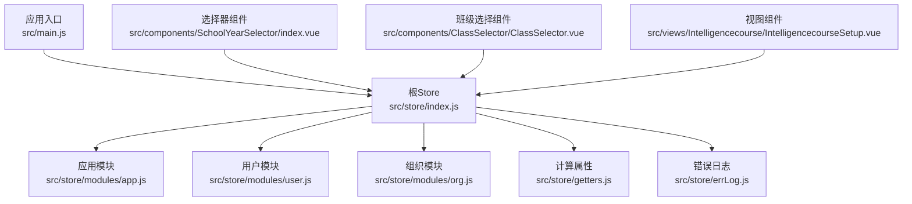
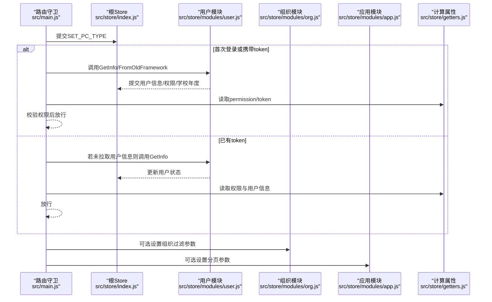
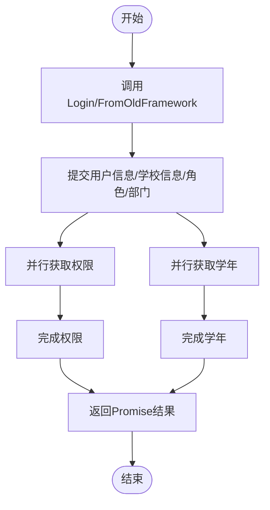
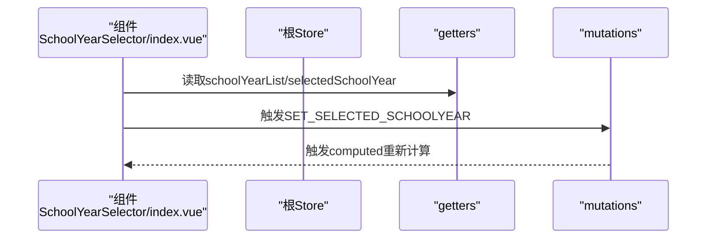
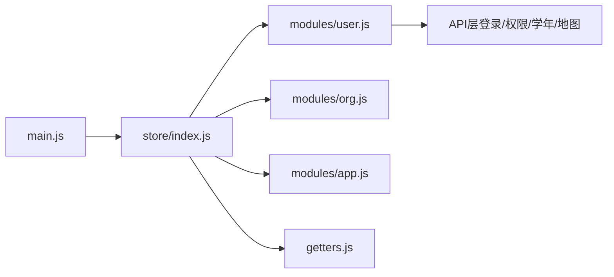

# 状态管理规范

<cite>
**本文引用的文件**
- [src/store/index.js](file://src/store/index.js)
- [src/store/getters.js](file://src/store/getters.js)
- [src/store/modules/app.js](file://src/store/modules/app.js)
- [src/store/modules/user.js](file://src/store/modules/user.js)
- [src/store/modules/org.js](file://src/store/modules/org.js)
- [src/store/errLog.js](file://src/store/errLog.js)
- [src/main.js](file://src/main.js)
- [src/components/SchoolYearSelector/index.vue](file://src/components/SchoolYearSelector/index.vue)
- [src/components/ClassSelector/ClassSelector.vue](file://src/components/ClassSelector/ClassSelector.vue)
- [src/views/Intelligencecourse/IntelligencecourseSetup.vue](file://src/views/Intelligencecourse/IntelligencecourseSetup.vue)
</cite>

## 目录
1. [引言](#引言)
2. [项目结构](#项目结构)
3. [核心组件](#核心组件)
4. [架构总览](#架构总览)
5. [详细组件分析](#详细组件分析)
6. [依赖分析](#依赖分析)
7. [性能考虑](#性能考虑)
8. [故障排查指南](#故障排查指南)
9. [结论](#结论)
10. [附录](#附录)

## 引言
本规范面向校园管理系统中的Vuex状态管理，系统性阐述Store结构设计原则、模块化策略与状态树组织方式；明确Mutation设计规范、Action异步处理模式与Getter计算属性使用指南；给出状态持久化与同步机制建议，以及错误日志记录最佳实践；覆盖用户状态、组织状态与应用状态的管理规范，并提供状态调试与性能优化技巧，帮助团队在大型前端工程中保持一致、可维护且高性能的状态管理。

## 项目结构
本项目的Vuex状态管理采用“根Store聚合模块”的结构：根Store仅负责注册模块与导出实例，各业务域状态拆分为独立模块，避免状态耦合与职责不清。模块划分如下：
- 应用状态模块：app.js，管理界面主题、分页参数、页面类型等应用级配置
- 用户状态模块：user.js，管理登录态、用户信息、角色权限、学校年度等用户域数据
- 组织状态模块：org.js，管理组织架构过滤参数与组织树数据
- 计算属性：getters.js，统一对外暴露派生数据
- 错误日志：errLog.js，提供全局错误收集能力
- 入口集成：main.js，将Store注入到Vue实例，并在路由守卫中进行鉴权与状态初始化

**图表来源**
- [src/store/index.js:1-20](file://src/store/index.js#L1-L20)
- [src/store/modules/app.js:1-54](file://src/store/modules/app.js#L1-L54)
- [src/store/modules/user.js:1-447](file://src/store/modules/user.js#L1-L447)
- [src/store/modules/org.js:1-34](file://src/store/modules/org.js#L1-L34)
- [src/store/getters.js:1-26](file://src/store/getters.js#L1-L26)
- [src/store/errLog.js:1-14](file://src/store/errLog.js#L1-L14)
- [src/main.js:1-221](file://src/main.js#L1-L221)

**章节来源**
- [src/store/index.js:1-20](file://src/store/index.js#L1-L20)
- [src/store/modules/app.js:1-54](file://src/store/modules/app.js#L1-L54)
- [src/store/modules/user.js:1-447](file://src/store/modules/user.js#L1-L447)
- [src/store/modules/org.js:1-34](file://src/store/modules/org.js#L1-L34)
- [src/store/getters.js:1-26](file://src/store/getters.js#L1-L26)
- [src/store/errLog.js:1-14](file://src/store/errLog.js#L1-L14)
- [src/main.js:1-221](file://src/main.js#L1-L221)

## 核心组件
- 根Store与模块注册：集中注册app、user、org模块，并挂载getters，确保模块边界清晰、职责单一
- 计算属性层：通过getters统一暴露token、用户信息、权限、学校年度等派生数据，便于组件按需订阅
- 模块职责：
  - app：应用级分页与页面类型等轻量状态
  - user：登录态、用户资料、角色权限、学校年度、组织部门等重状态
  - org：组织架构过滤参数与组织树数据
- 错误日志：提供errLog对象，支持pushLog/clearLog，配合main.js的全局错误处理器使用

**章节来源**
- [src/store/index.js:1-20](file://src/store/index.js#L1-L20)
- [src/store/getters.js:1-26](file://src/store/getters.js#L1-L26)
- [src/store/modules/app.js:1-54](file://src/store/modules/app.js#L1-L54)
- [src/store/modules/user.js:1-447](file://src/store/modules/user.js#L1-L447)
- [src/store/modules/org.js:1-34](file://src/store/modules/org.js#L1-L34)
- [src/store/errLog.js:1-14](file://src/store/errLog.js#L1-L14)

## 架构总览
下图展示从路由守卫到状态初始化、再到组件消费状态的完整流程，体现“路由驱动状态”和“状态驱动UI”的闭环。

**图表来源**
- [src/main.js:73-198](file://src/main.js#L73-L198)
- [src/store/modules/user.js:217-362](file://src/store/modules/user.js#L217-L362)
- [src/store/modules/org.js:19-30](file://src/store/modules/org.js#L19-L30)
- [src/store/modules/app.js:26-48](file://src/store/modules/app.js#L26-L48)
- [src/store/getters.js:1-26](file://src/store/getters.js#L1-L26)

## 详细组件分析

### 用户状态模块（user）
- 设计要点
  - 状态字段覆盖登录态、用户资料、角色权限、学校年度、组织部门等关键数据
  - Mutation严格命名，遵循“动词+名词”的语义化风格，保证可读性与可追踪性
  - Action以Promise封装异步流程，集中处理登录、获取用户信息、权限与学年数据
  - 使用Promise.all并行拉取权限与学年，减少等待时间
- 关键流程
  - 登录：提交SET_TOKEN/SET_USERINFO/SET_SCHOOLINFO/SET_ROLES/SET_DEPARTS，随后并行获取权限与学年
  - 获取用户信息：先调用后端接口，再统一提交到状态，最后并行获取权限与学年
  - 权限与学年：权限列表转换为URL集合与名称映射；学年列表排序并设置当前学年与选中学年
- 最佳实践
  - 所有异步操作均返回Promise，便于上层统一处理
  - 对第三方地图密钥等副作用逻辑，仅在必要时初始化，避免重复请求
  - 登出时清理token与角色，确保安全

**图表来源**
- [src/store/modules/user.js:120-324](file://src/store/modules/user.js#L120-L324)

**章节来源**
- [src/store/modules/user.js:1-447](file://src/store/modules/user.js#L1-L447)

### 组织状态模块（org）
- 设计要点
  - 专注于组织架构相关状态：过滤参数与组织树结构
  - 提供SetOrgFilterParams与SETORGANIZATIONALSTRUCTURE两个Action与对应Mutation
- 使用场景
  - 在组织管理页面中，通过SetOrgFilterParams记录筛选条件
  - 通过SETORGANIZATIONALSTRUCTURE更新组织树数据，供树形组件渲染

**章节来源**
- [src/store/modules/org.js:1-34](file://src/store/modules/org.js#L1-L34)

### 应用状态模块（app）
- 设计要点
  - 存储应用级分页参数（如食谱通知、打卡、作业管理）与页面类型标识
  - Mutation以“页面类型+变更项”命名，语义清晰
- 使用场景
  - 在列表组件中根据RECIPE_PAGE_CHANGE/CLOCK_PAGE_CHANGE/HOMEWORK_PAGE_CHANGE更新分页状态
  - SET_PC_TYPE用于区分嵌入模式与独立模式，影响UI行为

**章节来源**
- [src/store/modules/app.js:1-54](file://src/store/modules/app.js#L1-L54)

### 计算属性（getters）
- 设计要点
  - 统一暴露用户token、头像、姓名、邮箱、角色、权限、学校信息、权限名映射、学年列表与当前选中学年等
  - 提供isStandalone等复合判断，便于组件按需使用
- 使用建议
  - 组件通过mapGetters或直接$store.getters访问，避免在模板中直接引用深层路径
  - 避免在getters中做复杂计算，保持纯函数特性

**章节来源**
- [src/store/getters.js:1-26](file://src/store/getters.js#L1-L26)

### 错误日志（errLog）
- 设计要点
  - 提供errLog数组与pushLog/clearLog方法，便于集中收集运行期错误
- 集成方式
  - main.js在生产环境设置全局错误处理器，将错误推送到errLog
- 使用建议
  - 在开发阶段可通过控制台或专用面板查看；生产环境建议上报至服务端

**章节来源**
- [src/store/errLog.js:1-14](file://src/store/errLog.js#L1-L14)
- [src/main.js:205-214](file://src/main.js#L205-L214)

### 组件与状态交互示例
- 学年选择器（SchoolYearSelector）
  - 通过mapGetters读取schoolYearList与selectedSchoolYear
  - 通过mapMutations调用SET_SELECTED_SCHOOLYEAR更新选中学年
- 班级选择器（ClassSelector）
  - 通过mapGetters读取userInfo，结合后端接口动态生成班级列表
- 排课系统设置（IntelligencecourseSetup）
  - 通过mapGetters读取schoolInfo.id，向后端发起配置读取与保存请求

**图表来源**
- [src/components/SchoolYearSelector/index.vue:17-31](file://src/components/SchoolYearSelector/index.vue#L17-L31)
- [src/store/getters.js:16-23](file://src/store/getters.js#L16-L23)
- [src/store/modules/user.js:107-110](file://src/store/modules/user.js#L107-L110)

**章节来源**
- [src/components/SchoolYearSelector/index.vue:1-37](file://src/components/SchoolYearSelector/index.vue#L1-L37)
- [src/components/ClassSelector/ClassSelector.vue:1-109](file://src/components/ClassSelector/ClassSelector.vue#L1-L109)
- [src/views/Intelligencecourse/IntelligencecourseSetup.vue:1-96](file://src/views/Intelligencecourse/IntelligencecourseSetup.vue#L1-L96)

## 依赖分析
- 模块内聚与解耦
  - app、user、org模块职责清晰，彼此无直接依赖，降低耦合
  - getters作为统一出口，避免组件直接依赖具体模块内部结构
- 外部依赖
  - user模块依赖API层（登录、权限、学年、地图密钥等），通过Promise串联异步流程
  - main.js在路由守卫中协调Store与API，形成“路由→状态→UI”的闭环
- 潜在风险
  - 并行请求过多可能造成网络拥塞，建议对关键接口进行合并或节流
  - 权限与学年数据的并行加载需保证失败兜底，避免阻塞主流程

**图表来源**
- [src/main.js:1-221](file://src/main.js#L1-L221)
- [src/store/index.js:1-20](file://src/store/index.js#L1-L20)
- [src/store/modules/user.js:1-447](file://src/store/modules/user.js#L1-L447)

**章节来源**
- [src/main.js:1-221](file://src/main.js#L1-L221)
- [src/store/index.js:1-20](file://src/store/index.js#L1-L20)
- [src/store/modules/user.js:1-447](file://src/store/modules/user.js#L1-L447)

## 性能考虑
- 异步优化
  - 并行拉取权限与学年，减少首屏等待时间
  - 对第三方初始化（如地图密钥）仅在必要时请求，避免重复开销
- 计算属性与缓存
  - 将稳定派生数据放入getters，避免在组件中重复计算
  - 对于昂贵计算，建议引入缓存策略或使用memoization
- 分页与列表
  - app模块提供分页参数，建议在组件中按需更新，避免一次性加载大量数据
- 路由守卫
  - 在main.js中尽量减少不必要的状态提交与API调用，优先复用已有状态

[本节为通用指导，无需列出具体文件来源]

## 故障排查指南
- 登录与权限
  - 若出现权限不足跳转401，检查路由meta.permissionPath与getters.permission是否匹配
  - 若登录后无法获取用户信息，检查GetInfo/FromOldFramework的Promise链路与异常处理
- 学年与学校信息
  - 若学年列表为空或选中学年不正确，检查SET_SCHOOLYEAR与SET_SELECTED_SCHOOLYEAR的提交顺序
- 组织架构
  - 若组织树渲染异常，检查SETORGANIZATIONALSTRUCTURE是否被正确提交
- 错误日志
  - 生产环境可通过全局错误处理器收集错误，结合errLog查看堆栈与上下文
- 调试技巧
  - 使用Vue DevTools观察state、getters与mutations的变更轨迹
  - 在Action中打印关键节点的日志，定位异步流程中的异常点

**章节来源**
- [src/main.js:73-198](file://src/main.js#L73-L198)
- [src/store/modules/user.js:120-324](file://src/store/modules/user.js#L120-L324)
- [src/store/errLog.js:1-14](file://src/store/errLog.js#L1-L14)

## 结论
本规范基于现有代码实现了“模块化、可扩展、可维护”的Vuex状态管理方案。通过明确的模块职责、语义化的Mutation命名、Promise化的Action与统一的getters出口，系统在校园管理场景中具备良好的可读性与可演进性。建议在后续迭代中持续完善错误上报、异步流程监控与性能观测，以进一步提升系统的稳定性与可观测性。

[本节为总结性内容，无需列出具体文件来源]

## 附录

### 状态树组织与命名规范
- 模块命名：按业务域划分（app/user/org），避免跨域混杂
- 状态字段：语义化命名，避免缩写；必要时添加注释说明用途
- Mutation命名：动词+名词，如SET_TOKEN、SET_USERINFO、SET_SCHOOLYEAR
- Action命名：动词短语，如Login、GetInfo、GetPermission、GetSchoolYear
- Getter命名：名词短语或谓语短语，如token、userInfo、permissions、isStandalone

### 状态持久化与同步建议
- 本地存储：仅存放轻量状态（如selectedSchoolYear、pcType），避免持久化敏感数据
- 同步策略：对关键状态（如用户信息、权限）采用“登录即拉取、路由切换即校验”的策略
- 缓存策略：对频繁读取的数据（如权限名映射）进行内存缓存，减少重复计算

### 最佳实践清单
- 组件中通过mapGetters/mapActions/mapMutations使用状态，避免直接访问this.$store
- 所有异步操作返回Promise，便于统一处理错误与加载状态
- 在main.js中集中处理路由守卫与鉴权，避免在组件中分散逻辑
- 对复杂计算放入getters，保持组件逻辑简洁

[本节为通用指导，无需列出具体文件来源]