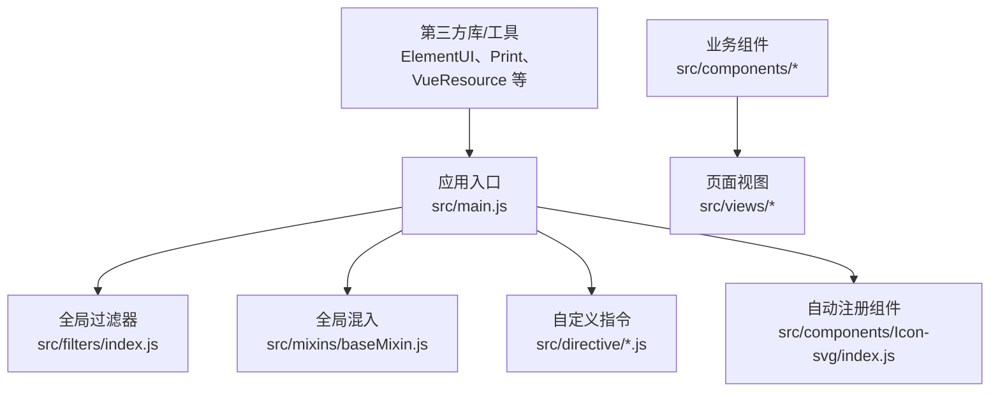
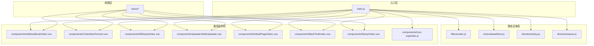
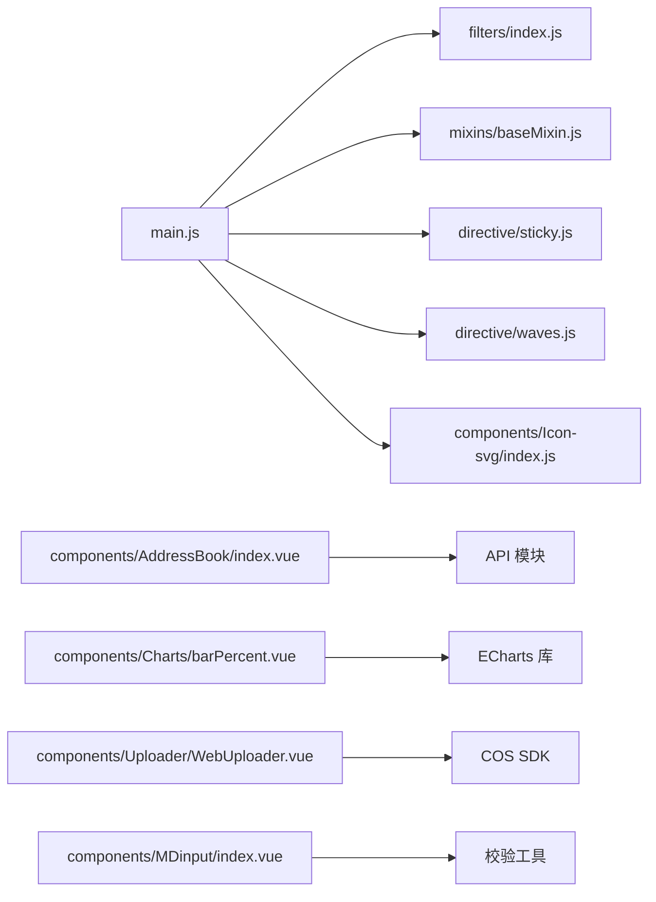
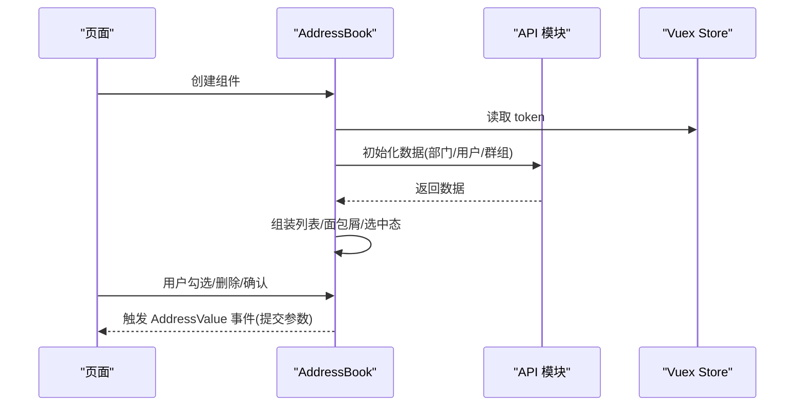

# 组件开发规范

<cite>
**本文引用的文件**   
- [main.js](file://src/main.js)
- [index.js](file://src/filters/index.js)
- [baseMixin.js](file://src/mixins/baseMixin.js)
- [sticky.js](file://src/directive/sticky.js)
- [waves.js](file://src/directive/waves.js)
- [index.js](file://src/components/Icon-svg/index.js)
- [AddressBook/index.vue](file://src/components/AddressBook/index.vue)
- [Charts/barPercent.vue](file://src/components/Charts/barPercent.vue)
- [MDinput/index.vue](file://src/components/MDinput/index.vue)
- [Uploader/WebUploader.vue](file://src/components/Uploader/WebUploader.vue)
- [DefaultPage/index.vue](file://src/components/DefaultPage/index.vue)
- [BackTool/index.vue](file://src/components/BackTool/index.vue)
- [Sticky/index.vue](file://src/components/Sticky/index.vue)
</cite>

## 目录
1. [引言](#引言)
2. [项目结构](#项目结构)
3. [核心组件](#核心组件)
4. [架构总览](#架构总览)
5. [组件详解与规范](#组件详解与规范)
6. [依赖关系分析](#依赖关系分析)
7. [性能考量](#性能考量)
8. [故障排查指南](#故障排查指南)
9. [结论](#结论)
10. [附录](#附录)

## 引言
本规范面向Vue校园管理系统中的组件开发，旨在统一组件设计、命名、文件组织、注册与使用方式，明确全局/局部组件的职责边界，规范指令、混入、过滤器的开发与使用，以及生命周期、props校验、事件与插槽的最佳实践。通过本规范，提升组件的可复用性、可维护性与性能表现。

## 项目结构
- 组件按功能域分目录存放于 src/components 下，如 AddressBook、Charts、Uploader、Icon-svg 等。
- 全局过滤器集中于 src/filters/index.js。
- 全局混入集中于 src/mixins/baseMixin.js。
- 自定义指令位于 src/directive 下，如 sticky、waves。
- 全局组件注册集中在入口文件 src/main.js 中。

图表来源
- [main.js:1-221](file://src/main.js#L1-L221)
- [index.js:1-12](file://src/components/Icon-svg/index.js#L1-L12)

章节来源
- [main.js:1-221](file://src/main.js#L1-L221)
- [index.js:1-12](file://src/components/Icon-svg/index.js#L1-L12)

## 核心组件
- 全局组件注册：在入口文件中集中注册全局组件，并对 ElementUI 的部分默认行为进行覆盖与增强。
- 自动注册：通过 Icon-svg 的上下文扫描批量注册同目录下的子组件，降低重复注册成本。
- 全局过滤器与混入：统一时间格式化、导出、权限判断、日期计算等能力，供全局使用。

章节来源
- [main.js:14-55](file://src/main.js#L14-L55)
- [index.js:1-12](file://src/components/Icon-svg/index.js#L1-L12)
- [baseMixin.js:1-103](file://src/mixins/baseMixin.js#L1-L103)

## 架构总览
组件开发遵循“分层+域划分”的组织方式：
- 视图层：页面视图 src/views/* 使用业务组件与全局组件。
- 通用层：src/components 下的通用组件（AddressBook、Charts、Uploader、MDinput、BackTool、Sticky 等）。
- 基础设施层：filters、mixins、directives 提供横切能力。
- 入口层：main.js 负责全局注册、路由守卫、错误处理等。

图表来源
- [main.js:1-221](file://src/main.js#L1-L221)
- [index.js:1-12](file://src/components/Icon-svg/index.js#L1-L12)
- [AddressBook/index.vue:1-427](file://src/components/AddressBook/index.vue#L1-L427)
- [Charts/barPercent.vue:1-105](file://src/components/Charts/barPercent.vue#L1-L105)
- [MDinput/index.vue:1-298](file://src/components/MDinput/index.vue#L1-L298)
- [Uploader/WebUploader.vue:1-651](file://src/components/Uploader/WebUploader.vue#L1-L651)
- [DefaultPage/index.vue:1-35](file://src/components/DefaultPage/index.vue#L1-L35)
- [BackTool/index.vue:1-29](file://src/components/BackTool/index.vue#L1-L29)
- [Sticky/index.vue:1-74](file://src/components/Sticky/index.vue#L1-L74)

## 组件详解与规范

### 组件分类体系与命名约定
- 分类维度
  - 通用展示型：DefaultPage、BackTool、Sticky 等。
  - 表单输入型：MDinput、AddressBook 等。
  - 数据可视化型：Charts/*。
  - 文件上传型：Uploader/*。
  - 图标型：Icon-svg 下的 SVG 组件。
- 命名约定
  - 目录与组件名采用 PascalCase，如 AddressBook、Charts、Uploader。
  - 组件文件名统一为 index.vue，便于自动注册与导入。
  - 属性名使用 camelCase，事件名使用 kebab-case，便于模板书写与可读性。

章节来源
- [AddressBook/index.vue:146-164](file://src/components/AddressBook/index.vue#L146-L164)
- [Charts/barPercent.vue:11-34](file://src/components/Charts/barPercent.vue#L11-L34)
- [MDinput/index.vue:37-144](file://src/components/MDinput/index.vue#L37-L144)
- [Uploader/WebUploader.vue:56-146](file://src/components/Uploader/WebUploader.vue#L56-L146)
- [DefaultPage/index.vue:7-12](file://src/components/DefaultPage/index.vue#L7-L12)
- [BackTool/index.vue:8-21](file://src/components/BackTool/index.vue#L8-L21)
- [Sticky/index.vue:10-37](file://src/components/Sticky/index.vue#L10-L37)

### 文件组织结构
- 单文件组件：每个功能域目录下以 index.vue 作为主入口，内部可包含模板、脚本与样式。
- 自动注册：Icon-svg 通过 require.context 扫描并注册同目录下所有 .vue 组件，减少手工注册。
- 入口集中：main.js 中集中注册全局组件、过滤器、指令与第三方插件，保证一致性。

章节来源
- [index.js:1-12](file://src/components/Icon-svg/index.js#L1-L12)
- [main.js:14-55](file://src/main.js#L14-L55)

### 全局组件注册规范
- 注册位置：入口文件集中注册，避免分散导致遗漏。
- 注册方式：Vue.component('组件名', 组件对象)，或通过插件形式 Vue.use(插件)。
- ElementUI 默认行为覆盖：对 Dialog 的 closeOnClickModal 进行全局覆盖，避免误关闭。
- 第三方组件：Multiselect、Print、VueResource 等通过入口统一引入与配置。

章节来源
- [main.js:19-49](file://src/main.js#L19-L49)
- [main.js:42-42](file://src/main.js#L42-L42)

### 局部组件使用模式
- 在页面视图中按需 import 组件并在 components 中局部注册，仅在需要的页面使用。
- 通过 props 传递数据，通过 $emit 触发事件向上反馈状态变化。
- 插槽使用：支持默认插槽与具名插槽，用于灵活定制内容区域。

章节来源
- [AddressBook/index.vue:146-164](file://src/components/AddressBook/index.vue#L146-L164)
- [BackTool/index.vue:1-29](file://src/components/BackTool/index.vue#L1-L29)

### 组件通信机制
- 父子通信：props 接收父级数据，$emit 向父级发送事件。
- 全局状态：通过 Vuex 获取 token、学校信息等，避免跨层级传递。
- 事件总线：不建议使用，推荐通过 props/$emit 或 Vuex 管理。

章节来源
- [AddressBook/index.vue:184-194](file://src/components/AddressBook/index.vue#L184-L194)
- [Uploader/WebUploader.vue:166-168](file://src/components/Uploader/WebUploader.vue#L166-L168)

### 生命周期管理
- created/mounted：在 created 中发起异步请求（如初始化数据），mounted 中进行 DOM 相关操作（如图表初始化）。
- 销毁阶段：在 destroyed 中移除事件监听，防止内存泄漏。
- keep-alive：配合 activated/ deactivated 处理缓存场景（如表格布局重绘）。

章节来源
- [AddressBook/index.vue:184-194](file://src/components/AddressBook/index.vue#L184-L194)
- [Charts/barPercent.vue:45-52](file://src/components/Charts/barPercent.vue#L45-L52)
- [Sticky/index.vue:65-71](file://src/components/Sticky/index.vue#L65-L71)
- [baseMixin.js:21-27](file://src/mixins/baseMixin.js#L21-L27)

### Props 验证与默认值
- 类型声明：明确 props 的类型、默认值与是否必填。
- 默认函数：对象/数组默认值应使用工厂函数返回新实例，避免引用共享。
- 受控与非受控：对于表单类组件，建议使用 v-model 或 input 事件双向绑定。

章节来源
- [AddressBook/index.vue:146-164](file://src/components/AddressBook/index.vue#L146-L164)
- [Charts/barPercent.vue:11-34](file://src/components/Charts/barPercent.vue#L11-L34)
- [MDinput/index.vue:87-143](file://src/components/MDinput/index.vue#L87-L143)
- [Uploader/WebUploader.vue:56-146](file://src/components/Uploader/WebUploader.vue#L56-L146)

### 事件处理与插槽使用
- 事件：统一使用 kebab-case 命名，如 @click、@input、@delete、@out-delete 等。
- 插槽：支持默认插槽与具名插槽，BackTool 提供默认插槽承载额外工具按钮。
- 上传组件：对外暴露 input、delete、outInput、outDelete 等事件，便于上层控制。

章节来源
- [BackTool/index.vue:1-29](file://src/components/BackTool/index.vue#L1-L29)
- [Uploader/WebUploader.vue:256-295](file://src/components/Uploader/WebUploader.vue#L256-L295)
- [Uploader/WebUploader.vue:409-420](file://src/components/Uploader/WebUploader.vue#L409-L420)

### 自定义指令开发规范
- 指令命名：使用 v- 前缀，语义清晰，如 v-sticky、v-waves。
- 安装方式：通过 install 方法挂载到 Vue，支持传入选项进行定制。
- 事件绑定：在 inserted 中绑定事件，unbind 中解绑，避免内存泄漏。
- 示例参考：
  - 粘性定位指令：v-sticky，支持 stickyTop、zIndex 等参数。
  - 水波纹指令：v-waves，支持点击位置、颜色等参数。

章节来源
- [sticky.js:1-100](file://src/directive/sticky.js#L1-L100)
- [waves.js:1-55](file://src/directive/waves.js#L1-L55)

### 混入(mixin)使用原则
- 职责单一：每个混入只负责一类横切关注点（如分页、导出、日期处理）。
- 命名规范：方法与数据以语义化命名，避免与组件内属性冲突。
- 生命周期钩子：谨慎使用 activated 等钩子，确保在缓存场景下正确工作。
- 导出与过滤器：可在混入中定义过滤器，供组件内使用。

章节来源
- [baseMixin.js:1-103](file://src/mixins/baseMixin.js#L1-L103)

### 过滤器实现标准
- 功能单一：每个过滤器只负责一种格式化逻辑。
- 输入输出稳定：对空值、非法值进行兜底处理，保证渲染安全。
- 全局注册：在入口文件统一注册，模板中直接使用。

章节来源
- [index.js:1-121](file://src/filters/index.js#L1-L121)
- [main.js:53-55](file://src/main.js#L53-L55)

### UI 组件设计原则
- 一致性：统一的尺寸、间距、配色与交互反馈。
- 可访问性：提供键盘可达、高对比度与语义化标签。
- 响应式：适配不同屏幕尺寸，合理使用 ElementUI 组件。
- 易用性：提供占位符、错误提示、加载状态等用户体验细节。

### 可复用性考虑
- 抽象公共能力：将通用逻辑抽取至混入或工具函数。
- 参数化配置：通过 props 与指令参数实现灵活配置。
- 事件契约：明确事件命名与回调参数，便于组合使用。

### 性能优化策略
- 懒加载与按需注册：仅在需要时加载组件，减少首屏体积。
- 图表与大列表：延迟初始化、虚拟滚动、节流防抖。
- 缓存与复用：keep-alive 缓存、本地存储、服务端缓存。
- 事件解绑：在组件销毁时移除监听，避免内存泄漏。

## 依赖关系分析
- 入口依赖：main.js 依赖 filters、mixins、directives、components 等模块。
- 组件依赖：业务组件依赖 API、工具函数、第三方库（如 ECharts、COS SDK）。
- 指令依赖：指令依赖 DOM API 与事件模型，注意兼容性与性能。

图表来源
- [main.js:1-221](file://src/main.js#L1-L221)
- [AddressBook/index.vue:134-144](file://src/components/AddressBook/index.vue#L134-L144)
- [Charts/barPercent.vue:5-11](file://src/components/Charts/barPercent.vue#L5-L11)
- [Uploader/WebUploader.vue:48-54](file://src/components/Uploader/WebUploader.vue#L48-L54)
- [MDinput/index.vue:36-36](file://src/components/MDinput/index.vue#L36-L36)

章节来源
- [main.js:1-221](file://src/main.js#L1-L221)
- [AddressBook/index.vue:134-144](file://src/components/AddressBook/index.vue#L134-L144)
- [Charts/barPercent.vue:5-11](file://src/components/Charts/barPercent.vue#L5-L11)
- [Uploader/WebUploader.vue:48-54](file://src/components/Uploader/WebUploader.vue#L48-L54)
- [MDinput/index.vue:36-36](file://src/components/MDinput/index.vue#L36-L36)

## 性能考量
- 组件懒加载：对大型图表、上传组件按需加载，减少初始包体。
- 渲染优化：避免在模板中执行复杂计算，使用计算属性与缓存。
- 事件节流：滚动、输入等高频事件使用节流/防抖。
- 图表初始化时机：在 mounted 后根据容器尺寸初始化，避免测量误差。
- 上传组件：并发上传与进度展示，合理设置并发数与失败重试。

## 故障排查指南
- 组件未生效
  - 检查是否在入口文件中注册或是否在页面中局部注册。
  - 确认组件名大小写与导入路径一致。
- 指令无效
  - 确认指令已通过 Vue.use 或在组件中正确安装。
  - 检查事件绑定与解绑是否匹配。
- 过滤器报错
  - 检查输入值类型与边界条件，必要时添加默认值。
- 上传失败
  - 检查签名接口返回、Bucket 与 Region 配置、文件类型限制。
  - 查看控制台错误与网络请求状态码。

章节来源
- [main.js:53-55](file://src/main.js#L53-L55)
- [Uploader/WebUploader.vue:172-212](file://src/components/Uploader/WebUploader.vue#L172-L212)
- [sticky.js:1-100](file://src/directive/sticky.js#L1-L100)
- [waves.js:1-55](file://src/directive/waves.js#L1-L55)

## 结论
通过统一的组件分类、命名与文件组织，结合全局注册、指令与混入的横切能力，本规范为校园管理系统提供了清晰、可维护且高性能的组件开发框架。建议在后续迭代中持续完善自动化测试与文档生成，进一步提升团队协作效率与质量保障水平。

## 附录
- 组件清单与用途概览
  - AddressBook：组织架构与人员/群组选择器。
  - Charts：基于 ECharts 的图表组件（柱状、折线等）。
  - MDinput：Material Design 风格输入框。
  - Uploader：基于 COS 的文件/图片上传组件。
  - DefaultPage：空状态占位页。
  - BackTool：返回工具条。
  - Sticky：粘性布局容器。
- 关键流程示意（以 AddressBook 为例）

图表来源
- [AddressBook/index.vue:184-298](file://src/components/AddressBook/index.vue#L184-L298)