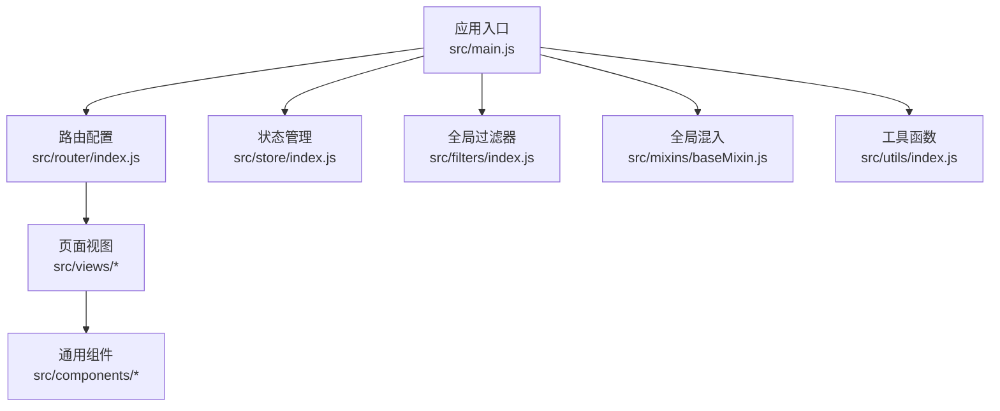
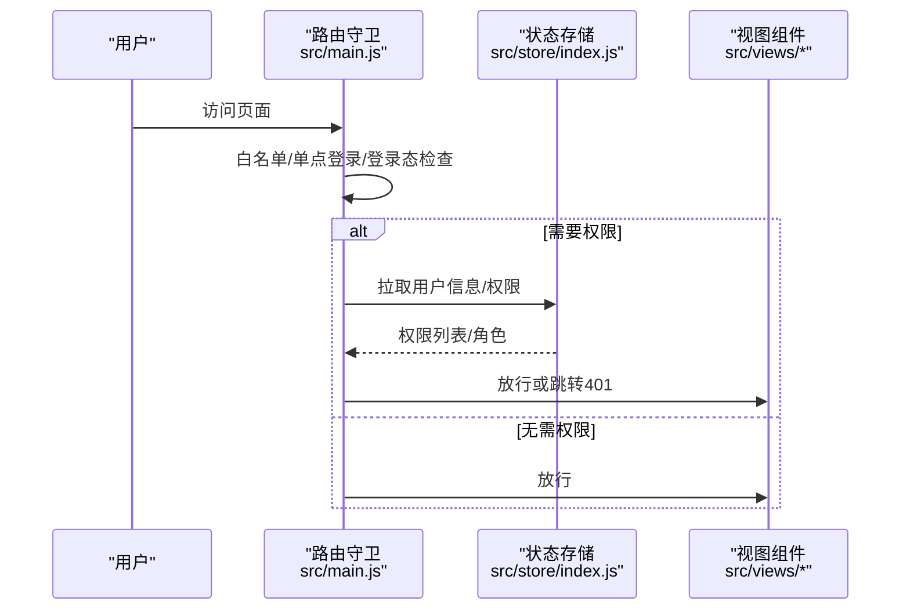
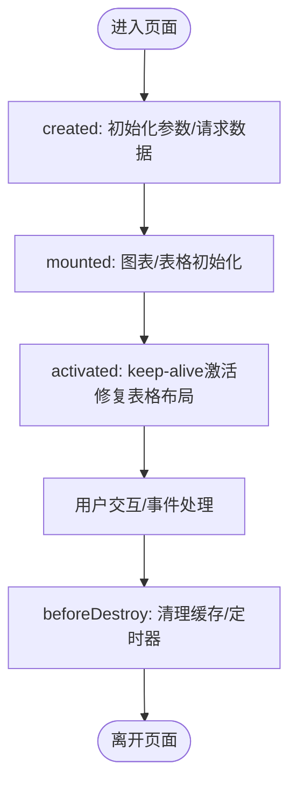
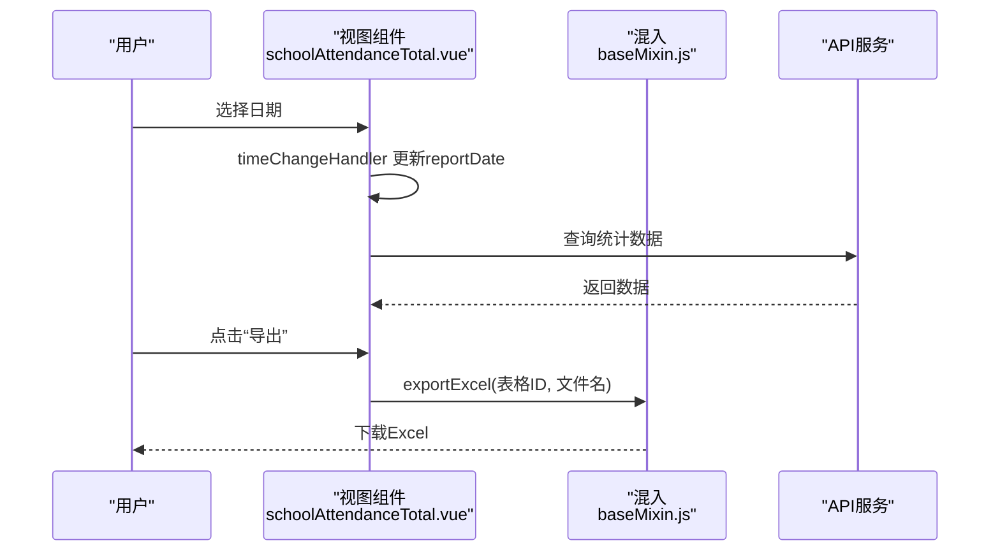
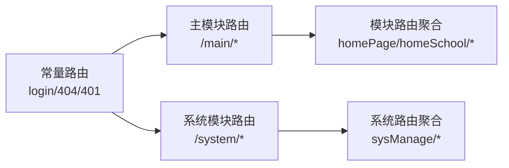
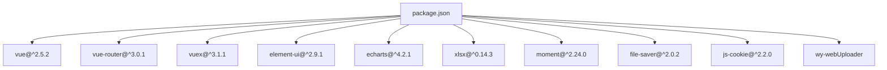

# 视图开发规范

<cite>
**本文引用的文件**   
- [main.js](file://src/main.js)
- [App.vue](file://src/App.vue)
- [router/index.js](file://src/router/index.js)
- [store/index.js](file://src/store/index.js)
- [mixins/baseMixin.js](file://src/mixins/baseMixin.js)
- [filters/index.js](file://src/filters/index.js)
- [utils/index.js](file://src/utils/index.js)
- [components/Charts/barPercent.vue](file://src/components/Charts/barPercent.vue)
- [components/Upload/singleImage.vue](file://src/components/Upload/singleImage.vue)
- [views/attendanceStatistics/schoolAttendanceTotal.vue](file://src/views/attendanceStatistics/schoolAttendanceTotal.vue)
- [package.json](file://package.json)
</cite>

## 目录
1. [引言](#引言)
2. [项目结构](#项目结构)
3. [核心组件](#核心组件)
4. [架构总览](#架构总览)
5. [详细组件分析](#详细组件分析)
6. [依赖分析](#依赖分析)
7. [性能考虑](#性能考虑)
8. [故障排查指南](#故障排查指南)
9. [结论](#结论)
10. [附录](#附录)

## 引言
本规范面向校园管理系统中Vue单文件组件（SFC）的开发，旨在统一页面组件结构、数据绑定与事件处理、布局与路由、生命周期管理、表单与表格、图表集成、文件上传、响应式与无障碍、性能与内存管理以及调试方法。规范以仓库现有代码为依据，结合通用最佳实践，形成可执行、可落地的开发标准。

## 项目结构
- 应用入口与全局初始化：在应用入口集中注册UI库、过滤器、全局组件、进度条、权限拦截等。
- 路由与布局：采用嵌套路由与布局组件组合，支持常量路由与模块化路由聚合。
- 状态管理：基于Vuex模块化组织状态与派生状态。
- 组件体系：通用业务组件（图表、上传、选择器等）与页面视图分离。
- 工具与混入：通过工具函数与混入封装通用逻辑（分页、权限、导出、日期等）。



**图表来源**
- [main.js:1-221](file://src/main.js#L1-L221)
- [router/index.js:1-207](file://src/router/index.js#L1-L207)
- [store/index.js:1-20](file://src/store/index.js#L1-L20)
- [mixins/baseMixin.js:1-103](file://src/mixins/baseMixin.js#L1-L103)
- [filters/index.js:1-121](file://src/filters/index.js#L1-L121)
- [utils/index.js:1-385](file://src/utils/index.js#L1-L385)

**章节来源**
- [main.js:1-221](file://src/main.js#L1-L221)
- [router/index.js:1-207](file://src/router/index.js#L1-L207)
- [store/index.js:1-20](file://src/store/index.js#L1-L20)

## 核心组件
- 应用根组件与缓存策略：根组件对路由进行条件缓存渲染，结合keep-alive控制页面缓存命中。
- 路由守卫与权限：全局前置守卫统一处理白名单、单点登录、角色与权限校验、进度条与登录态维护。
- 过滤器：提供时间格式化、数字格式化、HTML转文本等常用过滤器。
- 工具函数：封装时间解析、权限判断、跳转、深拷贝、文件预览、ID校验等。
- 混入：提供分页、导出、日期辅助、页面跳转、表格布局修复等通用能力。

**章节来源**
- [App.vue:1-183](file://src/App.vue#L1-L183)
- [main.js:57-198](file://src/main.js#L57-L198)
- [filters/index.js:1-121](file://src/filters/index.js#L1-L121)
- [utils/index.js:1-385](file://src/utils/index.js#L1-L385)
- [mixins/baseMixin.js:1-103](file://src/mixins/baseMixin.js#L1-L103)

## 架构总览
- 入口初始化：注册ElementUI、打印插件、全局过滤器、全局组件、进度条、路由守卫。
- 路由层：常量路由（登录、错误页、仪表板等）与模块路由聚合；支持系统管理与普通模块双路由树。
- 视图层：页面组件按功能域拆分，复用通用组件与混入。
- 数据流：组件内状态 + Vuex模块状态 + API请求；权限与角色通过全局守卫注入Store。



**图表来源**
- [main.js:57-198](file://src/main.js#L57-L198)
- [store/index.js:1-20](file://src/store/index.js#L1-L20)

## 详细组件分析

### 页面组件结构设计与生命周期
- 结构设计：模板区域划分清晰（头部、内容、滚动容器），使用Element UI组件实现交互；通过混入提供通用方法与过滤器。
- 生命周期：在created阶段发起数据请求；在beforeDestroy阶段清理缓存；在activated中修复表格布局。
- 缓存策略：根组件根据meta.isCached决定是否缓存；页面组件在离开时清理sessionStorage键值。



**图表来源**
- [views/attendanceStatistics/schoolAttendanceTotal.vue:108-127](file://src/views/attendanceStatistics/schoolAttendanceTotal.vue#L108-L127)
- [mixins/baseMixin.js:21-28](file://src/mixins/baseMixin.js#L21-L28)
- [App.vue:3-7](file://src/App.vue#L3-L7)

**章节来源**
- [views/attendanceStatistics/schoolAttendanceTotal.vue:108-127](file://src/views/attendanceStatistics/schoolAttendanceTotal.vue#L108-L127)
- [mixins/baseMixin.js:21-28](file://src/mixins/baseMixin.js#L21-L28)
- [App.vue:3-7](file://src/App.vue#L3-L7)

### 数据绑定模式与事件处理机制
- 双向绑定：表单字段通过v-model绑定至组件data；日期选择器绑定到reportDate。
- 事件处理：按钮点击触发导出与跳转；日期变更触发接口刷新；点击表格单元格跳转详情。
- 混入方法：exportExcel、jumpToPage、changeSize/Current等统一处理导出与分页跳转。



**图表来源**
- [views/attendanceStatistics/schoolAttendanceTotal.vue:200-205](file://src/views/attendanceStatistics/schoolAttendanceTotal.vue#L200-L205)
- [views/attendanceStatistics/schoolAttendanceTotal.vue:134-137](file://src/views/attendanceStatistics/schoolAttendanceTotal.vue#L134-L137)
- [mixins/baseMixin.js:65-86](file://src/mixins/baseMixin.js#L65-L86)

**章节来源**
- [views/attendanceStatistics/schoolAttendanceTotal.vue:200-205](file://src/views/attendanceStatistics/schoolAttendanceTotal.vue#L200-L205)
- [views/attendanceStatistics/schoolAttendanceTotal.vue:134-137](file://src/views/attendanceStatistics/schoolAttendanceTotal.vue#L134-L137)
- [mixins/baseMixin.js:65-86](file://src/mixins/baseMixin.js#L65-L86)

### 布局组件使用规范
- 根组件缓存：通过router-view与keep-alive配合，按meta.isCached控制缓存命中，减少重复渲染。
- 滚动与样式：页面主体使用滚动容器与自定义滚动条样式，确保表格与长列表稳定显示。

**章节来源**
- [App.vue:3-7](file://src/App.vue#L3-L7)
- [views/attendanceStatistics/schoolAttendanceTotal.vue:297-309](file://src/views/attendanceStatistics/schoolAttendanceTotal.vue#L297-L309)

### 页面路由配置与导航
- 常量路由：登录、错误页、仪表板、模块管理等固定路径。
- 模块路由：通过模块导入聚合，支持系统管理与普通模块双路由树。
- 导航守卫：白名单放行、权限校验、登录态维护、进度条控制。



**图表来源**
- [router/index.js:40-199](file://src/router/index.js#L40-L199)

**章节来源**
- [router/index.js:40-199](file://src/router/index.js#L40-L199)
- [main.js:57-198](file://src/main.js#L57-L198)

### 表单处理与表格展示
- 表单：使用ElForm与ElFormItem，v-model双向绑定；日期选择器限制可选日期；按钮禁用状态通过类名控制。
- 表格：使用ElTable，支持多表联动、合计行、百分比列；通过id与exportExcel导出。
- 混入导出：exportExcel基于xlsx生成文件并保存。

**章节来源**
- [views/attendanceStatistics/schoolAttendanceTotal.vue:1-74](file://src/views/attendanceStatistics/schoolAttendanceTotal.vue#L1-L74)
- [mixins/baseMixin.js:65-86](file://src/mixins/baseMixin.js#L65-L86)

### 图表集成（ECharts）
- 组件封装：引入ECharts模块，按需注册柱状图与提示框；通过props接收尺寸与数据；watch监听数据变化并重新setOption。
- 使用建议：在mounted中初始化，避免DOM未就绪；在数据更新后调用setOptions；注意grid与tooltip配置以适配小尺寸。

```mermaid
classDiagram
class BarPercentChart {
+string className
+string id
+string width
+string height
+number dataNum
+initBar()
+setOptions()
}
BarPercentChart : "props : 尺寸/数据"
BarPercentChart : "watch : dataNum"
BarPercentChart : "mounted : initBar()"
```

**图表来源**
- [components/Charts/barPercent.vue:1-105](file://src/components/Charts/barPercent.vue#L1-L105)

**章节来源**
- [components/Charts/barPercent.vue:1-105](file://src/components/Charts/barPercent.vue#L1-L105)

### 文件上传与预览
- 组件封装：基于Element UI Upload，拖拽上传，隐藏文件列表；上传前获取签名与key；上传成功回填value。
- 预览：图片预览区域支持悬停删除操作。
- 通用工具：提供文件预览URL拼接、深拷贝、Blob转换等工具函数。

**章节来源**
- [components/Upload/singleImage.vue:1-128](file://src/components/Upload/singleImage.vue#L1-L128)
- [utils/index.js:342-354](file://src/utils/index.js#L342-L354)
- [utils/index.js:356-384](file://src/utils/index.js#L356-L384)

### 响应式设计与无障碍
- 响应式：通过媒体查询与滚动条样式适配不同高度屏幕；表格单元格padding随高度调整。
- 无障碍：按钮类名控制禁用态；链接样式与光标指针提升可点击性；打印样式分离，保证打印输出可控。

**章节来源**
- [App.vue:176-180](file://src/App.vue#L176-L180)
- [App.vue:107-118](file://src/App.vue#L107-L118)

### 用户体验优化
- 进度条：路由切换时显示NProgress，提升感知速度。
- 权限与角色：全局守卫校验permissionPath与roles，避免无效渲染。
- 页面跳转：统一jumpToPage方法，支持replace与刷新策略。

**章节来源**
- [main.js:101-203](file://src/main.js#L101-L203)
- [utils/index.js:247-252](file://src/utils/index.js#L247-L252)

## 依赖分析
- 核心依赖：Vue、Vue Router、Vuex、Element UI、ECharts、xlsx、moment、file-saver、js-cookie、wy-webUploader等。
- 构建与脚手架：Webpack 3、Babel、PostCSS、Sass等。



**图表来源**
- [package.json:12-43](file://package.json#L12-L43)

**章节来源**
- [package.json:12-43](file://package.json#L12-L43)

## 性能考虑
- 渲染性能
  - 使用keep-alive与meta.isCached缓存页面，减少重复渲染。
  - 表格布局修复：在activated中调用doLayout，避免首屏错位。
- 网络与资源
  - 路由守卫中统一处理登录态与权限，避免无效请求。
  - 图表组件按需引入模块，避免全量引入导致体积增大。
- 内存管理
  - 页面销毁时清理sessionStorage与定时器，防止内存泄漏。
  - 导出Excel时使用Blob对象，及时释放临时对象。

**章节来源**
- [App.vue:3-7](file://src/App.vue#L3-L7)
- [mixins/baseMixin.js:21-28](file://src/mixins/baseMixin.js#L21-L28)
- [main.js:142-176](file://src/main.js#L142-L176)
- [components/Charts/barPercent.vue:45-52](file://src/components/Charts/barPercent.vue#L45-L52)

## 故障排查指南
- 登录与权限
  - 若出现401，检查路由meta.permissionPath与store.getters.permission匹配关系。
  - 单点登录场景，确认userToken与sessionStorage状态同步。
- 表格错位
  - 在activated钩子中调用doLayout；确保表格ref可用且在DOM渲染后执行。
- 导出失败
  - 确认表格ID与exportExcel入参一致；检查浏览器下载权限与FileSaver兼容性。
- 上传异常
  - 检查签名与key获取流程；确认action地址与跨域设置；上传成功回调回填value。

**章节来源**
- [main.js:88-96](file://src/main.js#L88-L96)
- [mixins/baseMixin.js:21-28](file://src/mixins/baseMixin.js#L21-L28)
- [mixins/baseMixin.js:65-86](file://src/mixins/baseMixin.js#L65-L86)
- [components/Upload/singleImage.vue:54-68](file://src/components/Upload/singleImage.vue#L54-L68)

## 结论
本规范以仓库现有代码为基础，总结了页面组件结构、数据绑定、事件处理、布局与路由、生命周期、表单与表格、图表与上传、响应式与无障碍、性能与内存管理及调试方法。建议在新页面开发中遵循统一的目录结构、混入与工具函数使用、路由与权限策略，确保一致性与可维护性。

## 附录
- 常用工具函数
  - 时间格式化：parseTime、formatTime
  - 权限判断：checkPermission、checkIndexPermission、isShowByPermission、isShowByRole
  - 页面跳转：jumpToPage
  - 文件处理：previewFile、deepClone、dataURLtoBlob
- 过滤器
  - timeAgo、parseTime、formatTime、nFormatter、toThousandslsFilter、timeIgnoreSecond、html2Text

**章节来源**
- [utils/index.js:3-62](file://src/utils/index.js#L3-L62)
- [utils/index.js:217-246](file://src/utils/index.js#L217-L246)
- [utils/index.js:247-252](file://src/utils/index.js#L247-L252)
- [utils/index.js:342-354](file://src/utils/index.js#L342-L354)
- [utils/index.js:356-384](file://src/utils/index.js#L356-L384)
- [filters/index.js:1-121](file://src/filters/index.js#L1-L121)