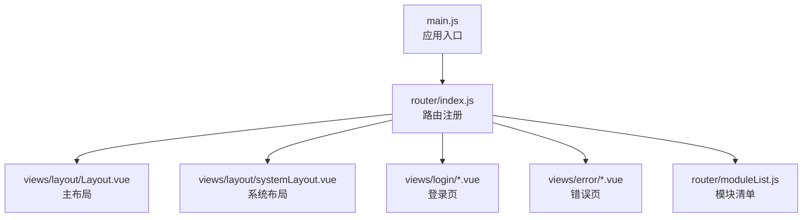
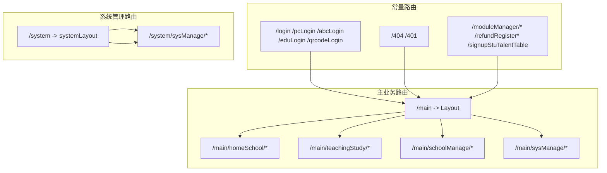
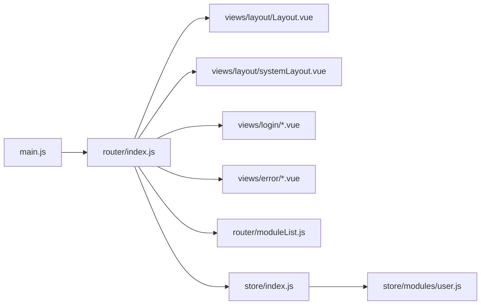

# 路由开发规范

<cite>
**本文引用的文件**
- [src/router/index.js](file://src/router/index.js)
- [src/router/moduleList.js](file://src/router/moduleList.js)
- [src/main.js](file://src/main.js)
- [src/views/layout/Layout.vue](file://src/views/layout/Layout.vue)
- [src/views/layout/systemLayout.vue](file://src/views/layout/systemLayout.vue)
- [src/views/login/index.vue](file://src/views/login/index.vue)
- [src/views/login/abcLogin.vue](file://src/views/login/abcLogin.vue)
- [src/views/login/eduLogin.vue](file://src/views/login/eduLogin.vue)
- [src/views/login/qrcodeLogin.vue](file://src/views/login/qrcodeLogin.vue)
- [src/views/error/404.vue](file://src/views/error/404.vue)
- [src/views/error/401.vue](file://src/views/error/401.vue)
- [src/store/index.js](file://src/store/index.js)
- [src/store/modules/user.js](file://src/store/modules/user.js)
</cite>

## 目录
1. [简介](#简介)
2. [项目结构](#项目结构)
3. [核心组件](#核心组件)
4. [架构总览](#架构总览)
5. [详细组件分析](#详细组件分析)
6. [依赖关系分析](#依赖关系分析)
7. [性能考虑](#性能考虑)
8. [故障排查指南](#故障排查指南)
9. [结论](#结论)
10. [附录](#附录)

## 简介
本规范面向校园管理系统前端团队，系统性阐述 Vue Router 在项目中的配置与使用规范，覆盖路由结构设计原则、嵌套路由配置、动态路由加载与权限控制机制，明确模块化组织方式、命名规范与路径设计标准，并提供路由守卫实现、懒加载策略与错误处理的最佳实践。文档同时给出常见路由场景（登录、主页面、系统管理）的实现模式与调试技巧，帮助开发者高效、一致地进行路由开发。

## 项目结构
- 路由入口与常量路由：统一在路由入口文件中定义常量路由与嵌套路由集合，便于集中管理与扩展。
- 模块化路由：通过模块清单文件集中描述业务模块的菜单项、权限路径与路由映射，形成“模块即菜单”的组织方式。
- 布局层：采用布局组件包裹主内容区域，支持主系统与系统管理两类布局。
- 登录与错误页：提供多种登录方式与统一的 404/401 错误页，提升用户体验与可维护性。

图表来源
- [src/main.js](file://src/main.js)
- [src/router/index.js](file://src/router/index.js)
- [src/router/moduleList.js](file://src/router/moduleList.js)
- [src/views/layout/Layout.vue](file://src/views/layout/Layout.vue)
- [src/views/layout/systemLayout.vue](file://src/views/layout/systemLayout.vue)
- [src/views/login/index.vue](file://src/views/login/index.vue)
- [src/views/error/404.vue](file://src/views/error/404.vue)

章节来源
- [src/router/index.js:1-207](file://src/router/index.js#L1-L207)
- [src/router/moduleList.js:1-800](file://src/router/moduleList.js#L1-L800)
- [src/main.js](file://src/main.js)

## 核心组件
- 常量路由集合：集中声明无需权限校验的基础路由（如登录、错误页、仪表盘等），并以布局组件包裹主业务路由。
- 嵌套路由：通过主路由挂载多个业务模块路由集合，实现模块化扩展。
- 动态路由加载：大量使用异步组件（函数返回 Promise）实现按需加载，降低首屏体积。
- 模块清单：以模块清单描述菜单项、权限路径与路由映射，便于统一生成导航与权限控制。

章节来源
- [src/router/index.js:40-207](file://src/router/index.js#L40-L207)
- [src/router/moduleList.js:1-800](file://src/router/moduleList.js#L1-L800)

## 架构总览
系统采用“布局 + 模块集合”的路由架构：
- 主路由 /main 下挂载多个业务模块集合（如 homeSchool、teachingStudy 等）。
- 系统管理路由 /system 通过独立布局与重定向逻辑组织。
- 登录与错误页作为常量路由，贯穿全局。
- 模块清单驱动菜单与权限，路由与菜单解耦但强关联。

图表来源
- [src/router/index.js:40-207](file://src/router/index.js#L40-L207)

章节来源
- [src/router/index.js:40-207](file://src/router/index.js#L40-L207)

## 详细组件分析

### 路由入口与常量路由
- 常量路由集合包含登录页、错误页、部分直连页面与主业务路由 /main 的布局容器。
- /main 路由通过展开多个模块集合实现模块化扩展，便于新增业务模块。
- /system 路由采用系统布局与默认重定向，形成独立的系统管理域。
- 多处使用异步组件加载视图，实现懒加载与代码分割。

章节来源
- [src/router/index.js:40-207](file://src/router/index.js#L40-L207)

### 布局组件
- 主布局 Layout：承载主业务区域，作为 /main 下各模块集合的父级容器。
- 系统布局 systemLayout：承载系统管理区域，提供独立的导航与样式。

章节来源
- [src/views/layout/Layout.vue](file://src/views/layout/Layout.vue)
- [src/views/layout/systemLayout.vue](file://src/views/layout/systemLayout.vue)

### 登录与错误页
- 登录页：提供多种登录入口（pcLogin、abcLogin、eduLogin、qrcodeLogin），满足不同场景需求。
- 错误页：统一 404 与 401 页面，提升异常体验一致性。

章节来源
- [src/router/index.js:7-22](file://src/router/index.js#L7-L22)
- [src/views/login/index.vue](file://src/views/login/index.vue)
- [src/views/login/abcLogin.vue](file://src/views/login/abcLogin.vue)
- [src/views/login/eduLogin.vue](file://src/views/login/eduLogin.vue)
- [src/views/login/qrcodeLogin.vue](file://src/views/login/qrcodeLogin.vue)
- [src/views/error/404.vue](file://src/views/error/404.vue)
- [src/views/error/401.vue](file://src/views/error/401.vue)

### 模块清单与菜单驱动
- 模块清单以 normal.homeSchool、normal.teachingStudy 等维度组织，每个模块包含名称、图标、权限路径、索引路由与子菜单项。
- 子菜单项包含路由路径与权限路径，用于导航生成与权限控制。
- 该清单是菜单与路由的“事实来源”，建议在权限系统与导航生成中复用。

章节来源
- [src/router/moduleList.js:1-800](file://src/router/moduleList.js#L1-L800)

### 常见路由场景实现模式

#### 登录路由
- 设计要点：多入口登录页统一指向布局或特定视图；登录成功后根据用户角色跳转至对应模块。
- 实现参考：登录页路由与常量路由集合中的登录路径。

章节来源
- [src/router/index.js:53-71](file://src/router/index.js#L53-L71)

#### 主页面路由
- 设计要点：/main 作为布局容器，内部展开多个模块集合；模块集合通过模块清单集中管理。
- 实现参考：/main 路由与模块集合导入。

章节来源
- [src/router/index.js:136-148](file://src/router/index.js#L136-L148)
- [src/router/moduleList.js:1-800](file://src/router/moduleList.js#L1-L800)

#### 系统管理路由
- 设计要点：/system 使用独立布局与重定向逻辑，形成独立域；系统管理模块集合挂载于其下。
- 实现参考：/system 路由与系统布局。

章节来源
- [src/router/index.js:149-159](file://src/router/index.js#L149-L159)
- [src/views/layout/systemLayout.vue](file://src/views/layout/systemLayout.vue)

### 路由守卫与权限控制
- 权限控制建议：结合用户状态与模块清单中的权限路径，在路由进入前进行鉴权与导航拦截。
- 用户状态：通过全局状态管理获取用户信息与角色，决定可访问模块。
- 导航拦截：在路由守卫中判断当前路由是否需要权限，若无权限则跳转至 401 或登录页。

章节来源
- [src/store/modules/user.js](file://src/store/modules/user.js)
- [src/store/index.js](file://src/store/index.js)

### 懒加载策略
- 异步组件：大量使用函数返回异步组件的方式，实现按需加载与代码分割。
- 适用场景：非首屏关键页面、大型模块、不常用功能页。
- 注意事项：确保异步组件路径正确，避免打包后资源路径问题。

章节来源
- [src/router/index.js:21-22](file://src/router/index.js#L21-L22)
- [src/router/index.js:104-125](file://src/router/index.js#L104-L125)
- [src/router/index.js:166-189](file://src/router/index.js#L166-L189)

### 错误处理最佳实践
- 404/401 统一处理：所有未匹配路由重定向到 404；权限不足统一跳转 401。
- 友好提示：错误页提供简洁提示与返回入口，提升用户体验。
- 日志记录：建议在路由守卫中记录未授权访问与 404 访问日志，便于排查。

章节来源
- [src/router/index.js:41-102](file://src/router/index.js#L41-L102)
- [src/views/error/404.vue](file://src/views/error/404.vue)
- [src/views/error/401.vue](file://src/views/error/401.vue)

## 依赖关系分析
- 入口依赖：main.js 依赖路由入口文件完成路由注册。
- 路由依赖：路由入口依赖布局组件、登录页与错误页；模块清单为菜单与权限提供数据源。
- 状态依赖：权限控制依赖用户状态模块与全局状态管理。

图表来源
- [src/main.js](file://src/main.js)
- [src/router/index.js](file://src/router/index.js)
- [src/router/moduleList.js](file://src/router/moduleList.js)
- [src/store/index.js](file://src/store/index.js)
- [src/store/modules/user.js](file://src/store/modules/user.js)

章节来源
- [src/main.js](file://src/main.js)
- [src/router/index.js:1-207](file://src/router/index.js#L1-L207)
- [src/router/moduleList.js:1-800](file://src/router/moduleList.js#L1-L800)
- [src/store/index.js](file://src/store/index.js)
- [src/store/modules/user.js](file://src/store/modules/user.js)

## 性能考虑
- 懒加载：对非关键页面采用异步组件加载，减少首屏包体。
- 路由拆分：将大型模块拆分为独立路由集合，按需引入。
- 缓存策略：结合浏览器缓存与服务端缓存，优化重复访问性能。
- 资源优化：确保异步组件路径正确，避免重复请求与 404。

## 故障排查指南
- 路由无法匹配：检查常量路由与模块集合是否正确导入；确认路径大小写与斜杠。
- 登录后无法跳转：检查登录成功后的跳转逻辑与用户状态；确认路由守卫是否正确执行。
- 权限相关问题：核对模块清单中的权限路径与后端接口；检查用户角色与权限映射。
- 错误页显示异常：确认 404/401 组件路径与布局是否正确；检查路由重定向逻辑。

章节来源
- [src/router/index.js:40-207](file://src/router/index.js#L40-L207)
- [src/router/moduleList.js:1-800](file://src/router/moduleList.js#L1-L800)
- [src/views/error/404.vue](file://src/views/error/404.vue)
- [src/views/error/401.vue](file://src/views/error/401.vue)

## 结论
本规范基于现有路由入口与模块清单，总结了校园管理系统中 Vue Router 的配置与使用方法。通过常量路由、嵌套路由与模块清单的协同，实现了清晰的模块化组织与灵活的权限控制。建议在后续开发中严格遵循命名规范与路径设计标准，持续完善路由守卫与懒加载策略，确保系统的可维护性与性能表现。

## 附录

### 路由命名规范与路径设计标准
- 命名规范
  - 路由名称：使用语义化英文或拼音缩写，避免中文；多词组合使用驼峰或短横线风格。
  - 模块名称：与模块清单中的模块键保持一致，便于菜单与路由联动。
- 路径设计
  - 主业务路径：以 /main 开头，按模块维度细分（如 /main/homeSchool、/main/teachingStudy）。
  - 系统管理路径：以 /system 开头，独立布局与权限域。
  - 登录与错误页：以根路径或特定标识开头，保证全局可访问。
- 嵌套路由
  - 父路由使用布局组件，子路由直接挂载在父路由下，避免深层嵌套导致复杂度上升。
- 动态加载
  - 对大型模块与非首屏页面使用异步组件加载，确保路径正确与打包产物稳定。

章节来源
- [src/router/index.js:136-159](file://src/router/index.js#L136-L159)
- [src/router/moduleList.js:1-800](file://src/router/moduleList.js#L1-L800)