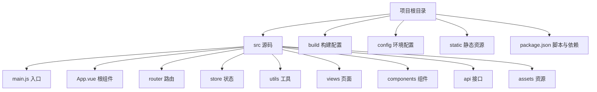
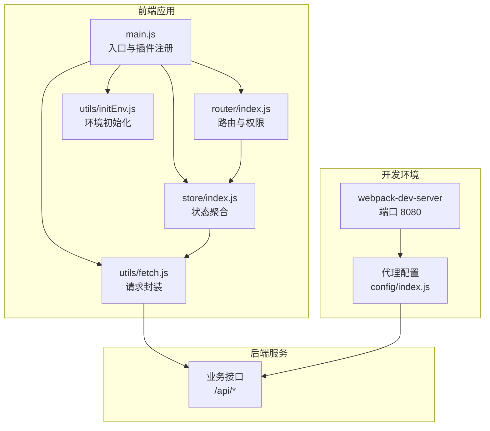
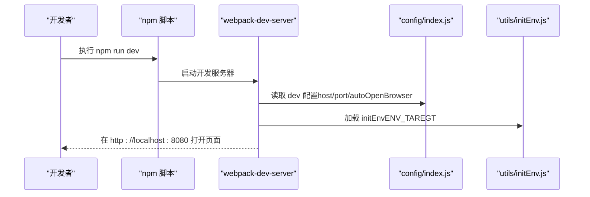
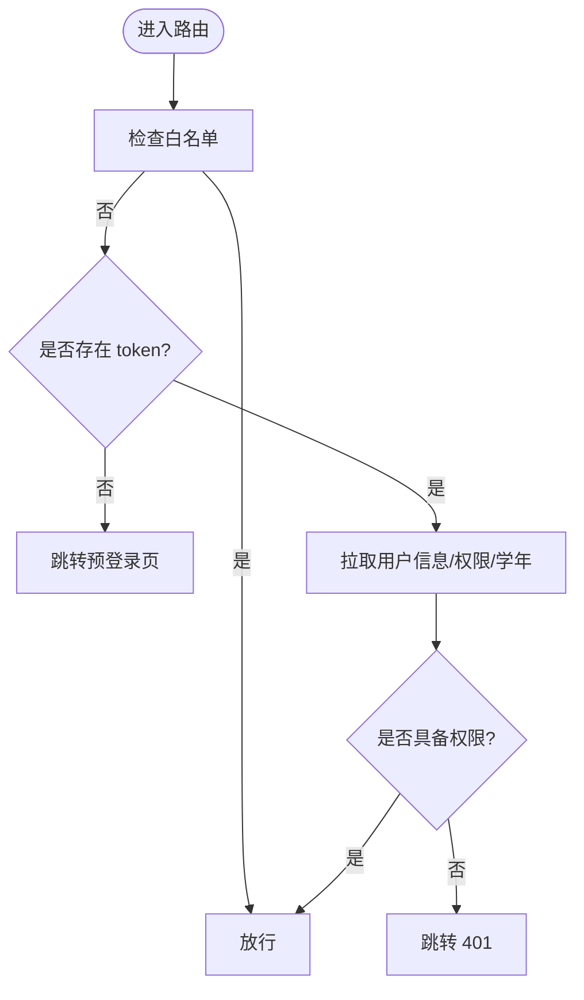
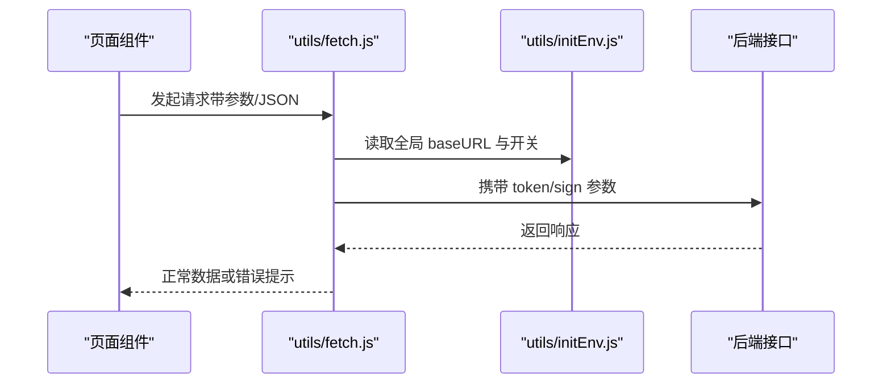
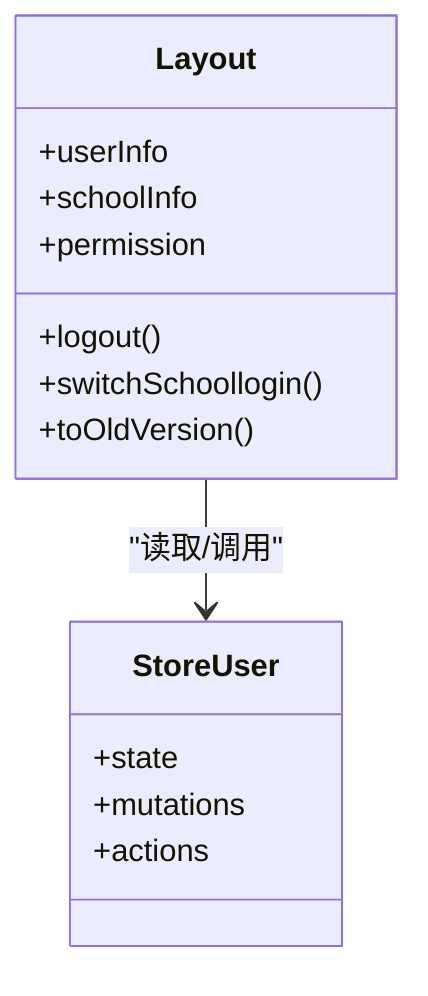
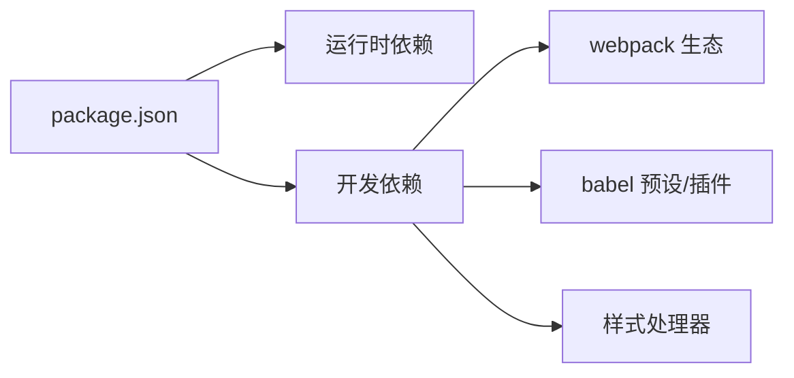

# 快速开始

<cite>
**本文引用的文件**
- [package.json](file://package.json)
- [README.md](file://README.md)
- [config/index.js](file://config/index.js)
- [config/dev.env.js](file://config/dev.env.js)
- [config/prod.env.js](file://config/prod.env.js)
- [.babelrc](file://.babelrc)
- [build/webpack.dev.conf.js](file://build/webpack.dev.conf.js)
- [build/build.js](file://build/build.js)
- [src/main.js](file://src/main.js)
- [src/App.vue](file://src/App.vue)
- [src/router/index.js](file://src/router/index.js)
- [src/store/index.js](file://src/store/index.js)
- [src/utils/fetch.js](file://src/utils/fetch.js)
- [src/utils/initEnv.js](file://src/utils/initEnv.js)
- [src/store/modules/user.js](file://src/store/modules/user.js)
- [src/views/layout/Layout.vue](file://src/views/layout/Layout.vue)
</cite>

## 目录
1. [简介](#简介)
2. [项目结构](#项目结构)
3. [核心组件](#核心组件)
4. [架构总览](#架构总览)
5. [详细组件分析](#详细组件分析)
6. [依赖关系分析](#依赖关系分析)
7. [性能注意事项](#性能注意事项)
8. [故障排除指南](#故障排除指南)
9. [结论](#结论)
10. [附录](#附录)

## 简介
本快速开始指南面向新加入的开发者，帮助你在最短时间内完成环境准备、依赖安装、开发服务器启动与基础配置，从而顺利运行校园管理系统前端工程。文档覆盖以下内容：
- 环境要求（Node.js、npm）
- 依赖安装与脚本命令
- 开发服务器启动与访问
- 关键配置文件说明（构建、代理、环境变量）
- 项目结构概览与开发工作流
- 常见问题与故障排除

## 项目结构
该工程采用 Vue 2.x + Vue-Router + Vuex + Webpack 的传统前端工程结构，主要目录与职责如下：
- build：构建相关配置与脚本（开发/生产）
- config：开发与生产环境配置（端口、资源路径、代理等）
- src：源码目录
  - api：业务接口封装（按功能模块划分）
  - assets：静态资源（字体、图片、图标）
  - components：通用组件
  - router：路由定义与模块化拆分
  - store：状态管理（Vuex）
  - utils：工具函数（网络请求、环境初始化等）
  - views：页面视图（按模块组织）
  - App.vue、main.js：应用入口与根组件
- static：第三方静态库与演示页面
- 根目录：构建脚本、引擎声明、Babel 配置、ESLint 规则等

**图表来源**
- [package.json](file://package.json)
- [src/main.js](file://src/main.js)
- [src/App.vue](file://src/App.vue)
- [src/router/index.js](file://src/router/index.js)
- [src/store/index.js](file://src/store/index.js)
- [src/utils/fetch.js](file://src/utils/fetch.js)
- [src/views/layout/Layout.vue](file://src/views/layout/Layout.vue)

**章节来源**
- [package.json](file://package.json)
- [README.md](file://README.md)

## 核心组件
- 应用入口与全局初始化
  - main.js：注册全局插件（Element UI、打印、上传组件等），挂载路由与状态，配置导航守卫与进度条。
- 根组件
  - App.vue：页面容器，控制缓存与非缓存路由视图的渲染。
- 路由系统
  - router/index.js：集中定义常量路由与模块化路由，支持权限与白名单控制。
- 状态管理
  - store/index.js：聚合模块（app、user、org），提供 getters。
  - store/modules/user.js：用户登录、权限、学校信息、学年等状态与动作。
- 网络层
  - utils/fetch.js：基于 axios 的请求封装，统一注入 token、签名参数、错误处理与跳转。
- 环境初始化
  - utils/initEnv.js：根据 ENV_TAREGT 切换登录与接口域名、支付、卡务、作业平台等全局地址。

**章节来源**
- [src/main.js](file://src/main.js)
- [src/App.vue](file://src/App.vue)
- [src/router/index.js](file://src/router/index.js)
- [src/store/index.js](file://src/store/index.js)
- [src/store/modules/user.js](file://src/store/modules/user.js)
- [src/utils/fetch.js](file://src/utils/fetch.js)
- [src/utils/initEnv.js](file://src/utils/initEnv.js)

## 架构总览
系统从前端入口开始，经由路由与状态管理，调用网络层封装的接口，连接后端服务。开发阶段通过 webpack-dev-server 提供热更新与本地代理；生产阶段通过 webpack 打包输出静态资源。

**图表来源**
- [build/webpack.dev.conf.js](file://build/webpack.dev.conf.js)
- [config/index.js](file://config/index.js)
- [src/main.js](file://src/main.js)
- [src/router/index.js](file://src/router/index.js)
- [src/store/index.js](file://src/store/index.js)
- [src/utils/fetch.js](file://src/utils/fetch.js)
- [src/utils/initEnv.js](file://src/utils/initEnv.js)

## 详细组件分析

### 开发服务器与构建流程
- 开发服务器
  - 默认监听 localhost:8080，自动打开浏览器，开启热更新与错误覆盖。
  - 可通过环境变量 HOST/PORT 覆盖主机与端口。
- 构建流程
  - 生产构建使用 webpack，输出至 dist 目录，支持 SourceMap 与 Gzip（可选）。
- 环境变量
  - 通过 cross-env 注入 ENV_TAREGT，影响 utils/initEnv.js 中的全局地址与登录路径。

**图表来源**
- [build/webpack.dev.conf.js](file://build/webpack.dev.conf.js)
- [config/index.js](file://config/index.js)
- [src/utils/initEnv.js](file://src/utils/initEnv.js)

**章节来源**
- [build/webpack.dev.conf.js](file://build/webpack.dev.conf.js)
- [config/index.js](file://config/index.js)
- [package.json](file://package.json)

### 路由与权限控制
- 常量路由：登录页、错误页、仪表板等。
- 模块化路由：首页、家校互动、教学教务、校园办公、总务后勤、学生评价、系统管理等。
- 权限与白名单：通过白名单数组与 meta.permissionPath 控制访问；登录态缺失时跳转预登录页。
- 导航守卫：在 beforeEach 中注入 token、拉取用户信息、权限与学年数据。

**图表来源**
- [src/router/index.js](file://src/router/index.js)
- [src/main.js](file://src/main.js)
- [src/store/modules/user.js](file://src/store/modules/user.js)

**章节来源**
- [src/router/index.js](file://src/router/index.js)
- [src/main.js](file://src/main.js)
- [src/store/modules/user.js](file://src/store/modules/user.js)

### 网络层与环境初始化
- 网络层
  - 统一 baseURL、超时、参数序列化、token 注入、签名参数注入。
  - 错误码映射与登录超时处理（1000），自动跳转登录。
- 环境初始化
  - 根据 ENV_TAREGT 切换登录域、接口域、支付域、卡务域、作业域、人脸识别域等。

**图表来源**
- [src/utils/fetch.js](file://src/utils/fetch.js)
- [src/utils/initEnv.js](file://src/utils/initEnv.js)

**章节来源**
- [src/utils/fetch.js](file://src/utils/fetch.js)
- [src/utils/initEnv.js](file://src/utils/initEnv.js)

### 布局与主框架
- Layout.vue：顶部导航、用户下拉菜单、切换学校弹窗、外部链接等。
- 与 store 的交互：读取用户信息、学校信息、权限列表；提供退出登录与跳转。

**图表来源**
- [src/views/layout/Layout.vue](file://src/views/layout/Layout.vue)
- [src/store/modules/user.js](file://src/store/modules/user.js)

**章节来源**
- [src/views/layout/Layout.vue](file://src/views/layout/Layout.vue)
- [src/store/modules/user.js](file://src/store/modules/user.js)

## 依赖关系分析
- 运行时依赖
  - Vue 生态（vue、vue-router、vuex、element-ui）、网络请求（axios、vue-resource）、工具库（moment、lodash、js-cookie）、图表（echarts）、轮播（swiper）等。
- 开发依赖
  - Webpack 生态（webpack、webpack-dev-server、webpack-merge）、Babel（babel-core、babel-preset-*）、样式（sass-loader、postcss）、构建工具（rimraf、uglifyjs-webpack-plugin）等。
- 引擎要求
  - Node >= 6.0.0，npm >= 3.0.0。

**图表来源**
- [package.json](file://package.json)

**章节来源**
- [package.json](file://package.json)

## 性能注意事项
- 开发阶段
  - 使用 cheap-module-eval-source-map 提升编译速度；启用热更新与友好错误提示。
  - 若文件较多导致编译慢，可减少拷贝静态资源或优化 loader。
- 生产阶段
  - 关闭生产 SourceMap 以减小体积；按需开启 Gzip 并指定扩展名。
  - 使用 Bundle 分析器定位体积热点（npm run build --report）。

**章节来源**
- [config/index.js](file://config/index.js)
- [build/build.js](file://build/build.js)

## 故障排除指南
- 无法启动开发服务器
  - 端口被占用：修改 config/index.js 中的 port 或通过环境变量 PORT 指定；确认端口未被占用。
  - Node/npm 版本过低：升级 Node 至 >= 6.0.0，npm 至 >= 3.0.0。
- 登录失败或报“登录超时”
  - 检查 utils/initEnv.js 中的 ENV_TAREGT 对应的全局地址是否正确；确认后端接口可用。
  - 网络层错误码 1000：表示登录态失效，将自动跳转登录页；检查 token 注入与签名参数。
- 路由跳转 401
  - 确认当前用户是否具备目标路由的权限；检查 meta.permissionPath 与 store 中的权限列表。
- 打包失败
  - 查看构建输出中的错误信息；确保依赖安装完整（npm install）；必要时清理 node_modules 并重装。

**章节来源**
- [config/index.js](file://config/index.js)
- [src/utils/fetch.js](file://src/utils/fetch.js)
- [src/utils/initEnv.js](file://src/utils/initEnv.js)
- [src/router/index.js](file://src/router/index.js)
- [build/build.js](file://build/build.js)

## 结论
通过本快速开始指南，你已经了解了项目的环境要求、安装与启动流程、关键配置与核心组件的工作方式。建议在本地成功启动后，结合 README 的说明进一步学习工程细节与开发规范。

## 附录

### 环境要求与安装步骤
- 环境要求
  - Node.js >= 6.0.0，npm >= 3.0.0
- 安装依赖
  - 在项目根目录执行安装命令
- 启动开发服务器
  - 在项目根目录执行开发命令，默认访问 http://localhost:8080

**章节来源**
- [package.json](file://package.json)
- [README.md](file://README.md)

### 关键配置文件说明
- config/index.js
  - 开发环境：host、port、自动打开浏览器、错误覆盖、SourceMap、CSS SourceMap 等。
  - 生产环境：输出路径、publicPath、bundle 分析器开关、Gzip 等。
- config/dev.env.js / config/prod.env.js
  - 定义 NODE_ENV 与 ENV_TAREGT，影响 utils/initEnv.js 的全局地址选择。
- .babelrc
  - 预设与插件：env、stage-2、transform-vue-jsx、transform-runtime、dynamic-import-node。

**章节来源**
- [config/index.js](file://config/index.js)
- [config/dev.env.js](file://config/dev.env.js)
- [config/prod.env.js](file://config/prod.env.js)
- [.babelrc](file://.babelrc)

### 开发工作流程
- 启动开发服务器：npm run dev
- 修改 src 下代码，保存即热更新
- 如需切换环境：设置 ENV_TAREGT 并重启开发服务器
- 构建产物：npm run build（生产）

**章节来源**
- [package.json](file://package.json)
- [build/webpack.dev.conf.js](file://build/webpack.dev.conf.js)
- [build/build.js](file://build/build.js)