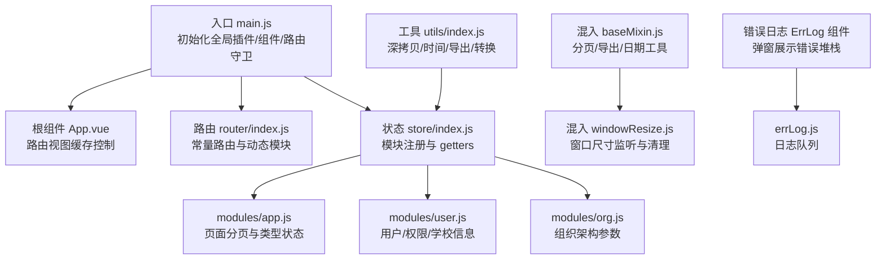
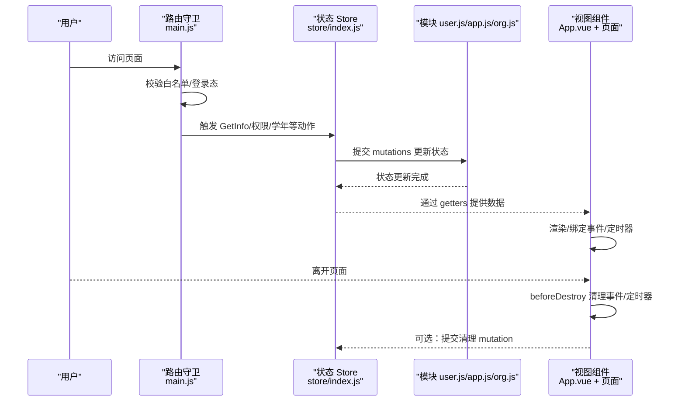
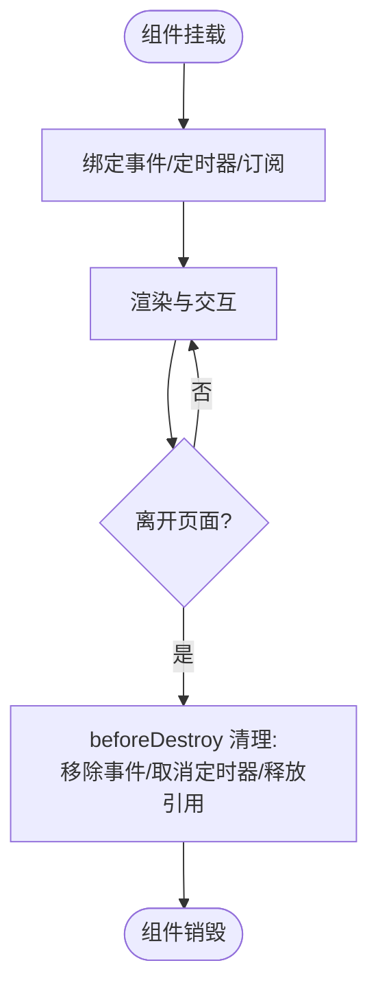
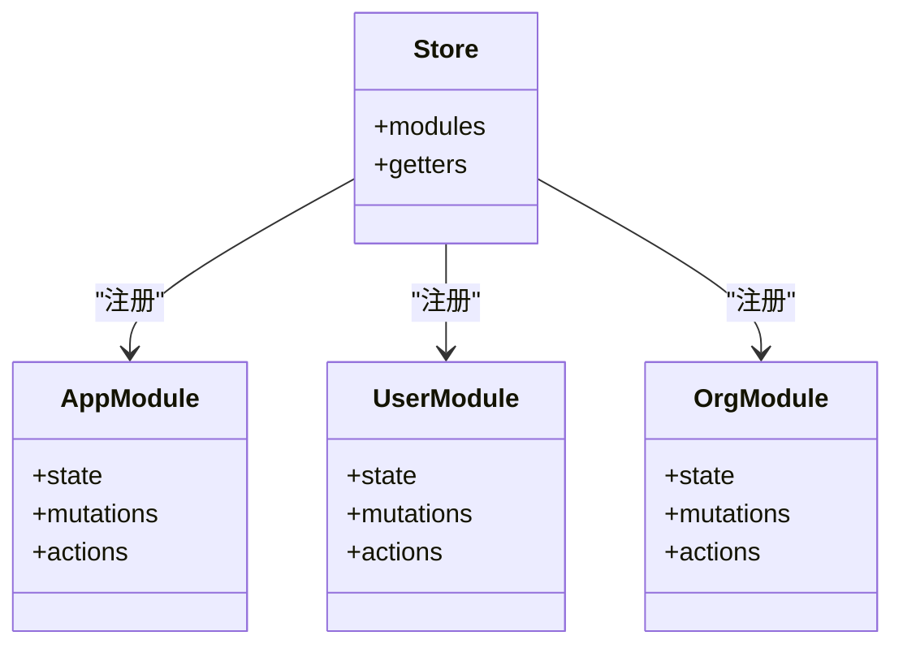
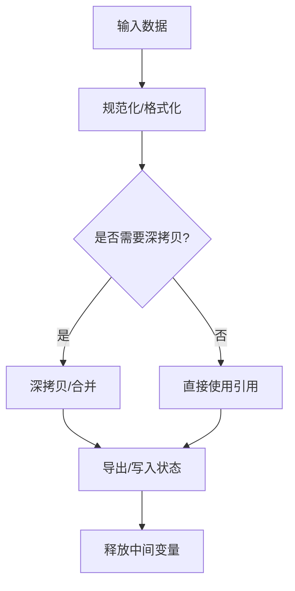
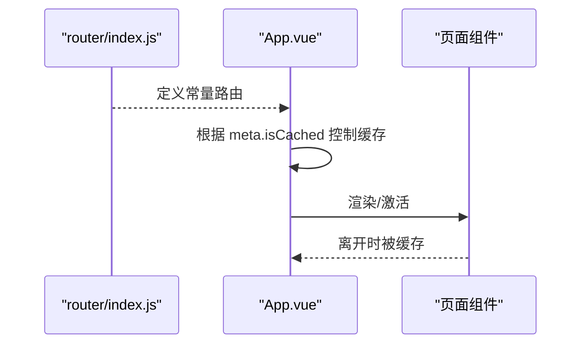
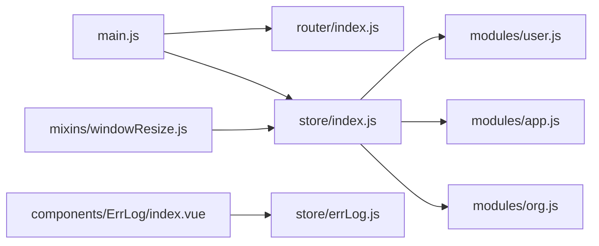
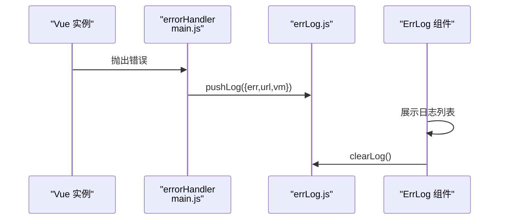

# 内存管理优化

<cite>
**本文引用的文件**   
- [src/main.js](file://src/main.js)
- [src/App.vue](file://src/App.vue)
- [src/router/index.js](file://src/router/index.js)
- [src/store/index.js](file://src/store/index.js)
- [src/store/modules/app.js](file://src/store/modules/app.js)
- [src/store/modules/user.js](file://src/store/modules/user.js)
- [src/store/modules/org.js](file://src/store/modules/org.js)
- [src/store/getters.js](file://src/store/getters.js)
- [src/mixins/baseMixin.js](file://src/mixins/baseMixin.js)
- [src/mixins/windowResize.js](file://src/mixins/windowResize.js)
- [src/utils/index.js](file://src/utils/index.js)
- [src/components/ErrLog/index.vue](file://src/components/ErrLog/index.vue)
- [src/store/errLog.js](file://src/store/errLog.js)
</cite>

## 目录
1. [引言](#引言)
2. [项目结构](#项目结构)
3. [核心组件](#核心组件)
4. [架构总览](#架构总览)
5. [详细组件分析](#详细组件分析)
6. [依赖分析](#依赖分析)
7. [性能考量](#性能考量)
8. [故障排查指南](#故障排查指南)
9. [结论](#结论)
10. [附录](#附录)

## 引言
本指南面向校园管理系统在 Vue 技术栈下的内存管理与性能优化，聚焦以下目标：
- 预防与检测内存泄漏：组件销毁、事件监听器清理、定时器管理
- Vuex 状态管理优化：状态清理、模块卸载、数据结构优化
- 浏览器内存监控工具使用：Chrome DevTools 内存面板、堆快照分析、泄漏检测
- 大数组处理、图片资源管理、Canvas 优化等具体场景的内存优化实践

## 项目结构
本项目采用典型的 Vue 单页应用结构，前端入口、路由、状态管理、混入与工具函数分布清晰，便于在生命周期钩子与状态变更处实施内存优化。

**图表来源**
- [src/main.js:1-221](file://src/main.js#L1-L221)
- [src/App.vue:1-183](file://src/App.vue#L1-L183)
- [src/router/index.js:1-207](file://src/router/index.js#L1-L207)
- [src/store/index.js:1-20](file://src/store/index.js#L1-L20)
- [src/store/modules/app.js:1-54](file://src/store/modules/app.js#L1-L54)
- [src/store/modules/user.js:1-447](file://src/store/modules/user.js#L1-L447)
- [src/store/modules/org.js:1-34](file://src/store/modules/org.js#L1-L34)
- [src/mixins/baseMixin.js:1-103](file://src/mixins/baseMixin.js#L1-L103)
- [src/mixins/windowResize.js:1-63](file://src/mixins/windowResize.js#L1-L63)
- [src/utils/index.js:1-385](file://src/utils/index.js#L1-L385)
- [src/components/ErrLog/index.vue:1-52](file://src/components/ErrLog/index.vue#L1-L52)
- [src/store/errLog.js:1-14](file://src/store/errLog.js#L1-L14)

**章节来源**
- [src/main.js:1-221](file://src/main.js#L1-L221)
- [src/router/index.js:1-207](file://src/router/index.js#L1-L207)
- [src/store/index.js:1-20](file://src/store/index.js#L1-L20)

## 核心组件
- 入口与全局配置：在入口集中注册全局组件、插件与路由守卫，避免在组件内重复初始化导致的内存滞留。
- 根组件与缓存：通过路由元信息控制 keep-alive 缓存，减少频繁重建带来的 DOM 与事件绑定开销。
- 路由守卫：在导航前后进行进度条与登录态检查，避免不必要的状态持久化。
- 状态模块：按功能拆分模块，避免单一模块状态无限增长；提供清理与重置能力。
- 混入与工具：统一导出、深拷贝、时间处理等通用逻辑，降低重复对象创建。

**章节来源**
- [src/main.js:1-221](file://src/main.js#L1-L221)
- [src/App.vue:1-183](file://src/App.vue#L1-L183)
- [src/store/modules/app.js:1-54](file://src/store/modules/app.js#L1-L54)
- [src/store/modules/user.js:1-447](file://src/store/modules/user.js#L1-L447)
- [src/store/modules/org.js:1-34](file://src/store/modules/org.js#L1-L34)
- [src/mixins/baseMixin.js:1-103](file://src/mixins/baseMixin.js#L1-L103)
- [src/utils/index.js:1-385](file://src/utils/index.js#L1-L385)

## 架构总览
下面以代码级视角展示内存相关的关键交互路径。

**图表来源**
- [src/main.js:73-198](file://src/main.js#L73-L198)
- [src/store/index.js:10-17](file://src/store/index.js#L10-L17)
- [src/store/modules/user.js:218-324](file://src/store/modules/user.js#L218-L324)
- [src/store/modules/app.js:26-47](file://src/store/modules/app.js#L26-L47)
- [src/store/modules/org.js:11-29](file://src/store/modules/org.js#L11-L29)
- [src/App.vue:14-16](file://src/App.vue#L14-L16)

## 详细组件分析

### 组件生命周期与内存清理
- 销毁阶段清理：根组件在销毁时清理会话标记，避免后续异常状态残留。
- 窗口尺寸监听：混入在挂载时绑定 resize 事件，在销毁时移除，防止内存泄漏。
- 导航守卫：在 beforeEach/afterEach 中开启/结束进度条，避免多余渲染与状态堆积。

**图表来源**
- [src/App.vue:14-16](file://src/App.vue#L14-L16)
- [src/mixins/windowResize.js:17-32](file://src/mixins/windowResize.js#L17-L32)
- [src/main.js:73-203](file://src/main.js#L73-L203)

**章节来源**
- [src/App.vue:14-16](file://src/App.vue#L14-L16)
- [src/mixins/windowResize.js:17-32](file://src/mixins/windowResize.js#L17-L32)
- [src/main.js:73-203](file://src/main.js#L73-L203)

### Vuex 状态管理中的内存优化
- 模块化与职责分离：用户、组织、应用状态分别维护，避免跨模块耦合导致的状态膨胀。
- 分页与临时状态：应用模块维护分页与筛选状态，建议在离开页面或切换模块时重置。
- 用户信息与权限：用户模块在登出/重置时清空令牌与角色，避免长期持有敏感数据。
- getters 选择性暴露：仅暴露必要字段，减少不必要的响应式追踪。

**图表来源**
- [src/store/index.js:10-17](file://src/store/index.js#L10-L17)
- [src/store/modules/app.js:1-54](file://src/store/modules/app.js#L1-L54)
- [src/store/modules/user.js:1-447](file://src/store/modules/user.js#L1-L447)
- [src/store/modules/org.js:1-34](file://src/store/modules/org.js#L1-L34)

**章节来源**
- [src/store/index.js:10-17](file://src/store/index.js#L10-L17)
- [src/store/modules/app.js:26-47](file://src/store/modules/app.js#L26-L47)
- [src/store/modules/user.js:115-117](file://src/store/modules/user.js#L115-L117)
- [src/store/getters.js:1-26](file://src/store/getters.js#L1-L26)

### 工具函数与数据结构优化
- 深拷贝与对象合并：避免直接修改原对象引发的副作用与隐式引用。
- 时间与导出：提供格式化与导出能力，注意生成临时 Blob/二进制数据的及时释放。
- 字节长度与查询参数：对输入进行规范化处理，减少无效状态与重复计算。

**图表来源**
- [src/utils/index.js:357-371](file://src/utils/index.js#L357-L371)
- [src/utils/index.js:126-147](file://src/utils/index.js#L126-L147)
- [src/utils/index.js:373-384](file://src/utils/index.js#L373-L384)

**章节来源**
- [src/utils/index.js:357-371](file://src/utils/index.js#L357-L371)
- [src/utils/index.js:126-147](file://src/utils/index.js#L126-L147)
- [src/utils/index.js:373-384](file://src/utils/index.js#L373-L384)

### 路由与页面缓存策略
- keep-alive 缓存：根据路由元信息决定是否缓存，减少重建成本。
- 常量路由与动态模块：将静态页面与系统管理路由集中配置，便于统一管控。

**图表来源**
- [src/router/index.js:40-199](file://src/router/index.js#L40-L199)
- [src/App.vue:3-6](file://src/App.vue#L3-L6)

**章节来源**
- [src/router/index.js:40-199](file://src/router/index.js#L40-L199)
- [src/App.vue:3-6](file://src/App.vue#L3-L6)

## 依赖分析
- 入口依赖：main.js 依赖路由、状态、全局组件与插件，集中初始化有助于统一生命周期管理。
- 状态依赖：各模块通过 getters 与 mutations 解耦，避免跨模块直接访问引发的内存滞留。
- 混入依赖：windowResize 依赖 store 的 getters，确保在独立运行模式下正确计算尺寸。

**图表来源**
- [src/main.js:1-221](file://src/main.js#L1-L221)
- [src/router/index.js:1-207](file://src/router/index.js#L1-L207)
- [src/store/index.js:1-20](file://src/store/index.js#L1-L20)
- [src/store/modules/user.js:1-447](file://src/store/modules/user.js#L1-L447)
- [src/store/modules/app.js:1-54](file://src/store/modules/app.js#L1-L54)
- [src/store/modules/org.js:1-34](file://src/store/modules/org.js#L1-L34)
- [src/mixins/windowResize.js:1-63](file://src/mixins/windowResize.js#L1-L63)
- [src/components/ErrLog/index.vue:1-52](file://src/components/ErrLog/index.vue#L1-L52)
- [src/store/errLog.js:1-14](file://src/store/errLog.js#L1-L14)

**章节来源**
- [src/main.js:1-221](file://src/main.js#L1-L221)
- [src/store/index.js:1-20](file://src/store/index.js#L1-L20)

## 性能考量
- 避免在组件内重复注册全局插件/组件，统一在入口初始化，减少重复实例与事件绑定。
- 使用 keep-alive 缓存高频页面，但需在合适时机重置状态，防止缓存累积。
- 在混入中统一处理窗口尺寸监听与清理，避免多处重复绑定。
- 对大数组与复杂对象进行深拷贝时，优先使用工具函数，减少浅拷贝导致的共享引用。
- 图片与 Canvas：尽量延迟加载、及时释放临时 Blob 与离屏 Canvas，避免长时间驻留内存。

[本节为通用指导，无需列出具体文件来源]

## 故障排查指南
- 错误日志收集：生产环境下通过入口的 errorHandler 将错误推送到日志模块，并在 ErrLog 组件中展示。
- 日志清理：提供 clearLog 方法，定期清理日志队列，避免日志过多导致内存占用。
- 建议流程：捕获错误 -> 推送日志 -> 展示弹窗 -> 清理日志。

**图表来源**
- [src/main.js:206-214](file://src/main.js#L206-L214)
- [src/store/errLog.js:5-10](file://src/store/errLog.js#L5-L10)
- [src/components/ErrLog/index.vue:8-24](file://src/components/ErrLog/index.vue#L8-L24)

**章节来源**
- [src/main.js:206-214](file://src/main.js#L206-L214)
- [src/store/errLog.js:5-10](file://src/store/errLog.js#L5-L10)
- [src/components/ErrLog/index.vue:8-24](file://src/components/ErrLog/index.vue#L8-L24)

## 结论
通过在入口集中初始化、在组件销毁阶段清理事件与定时器、在状态模块中按职责拆分与提供清理能力、以及利用工具函数与混入统一处理通用逻辑，可以有效降低内存泄漏风险。结合 Chrome DevTools 的内存面板与堆快照分析，能够定位泄漏点并持续优化性能。

[本节为总结性内容，无需列出具体文件来源]

## 附录
- 浏览器内存监控工具使用建议
  - 打开“性能”面板进行录制，观察内存曲线与垃圾回收频率
  - 使用“内存”面板的“堆快照”对比“快照1”与“快照2”，查找未释放的对象
  - 关注常见泄漏源：DOM 引用、事件监听器、定时器、闭包、全局变量、缓存
  - 对比“堆快照”中的对象数量与大小，定位异常增长的模块或组件

[本节为通用指导，无需列出具体文件来源]