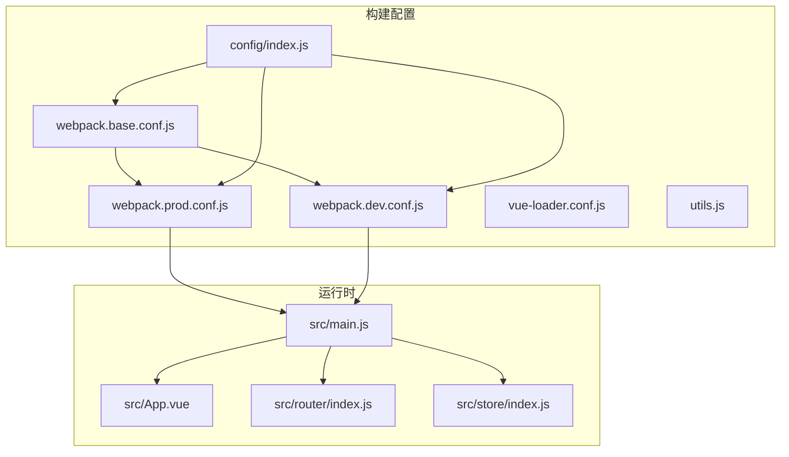
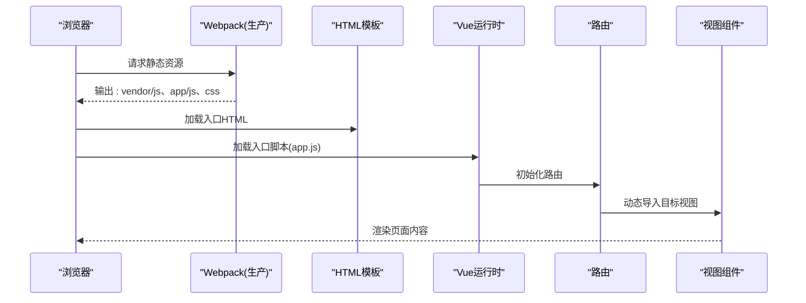
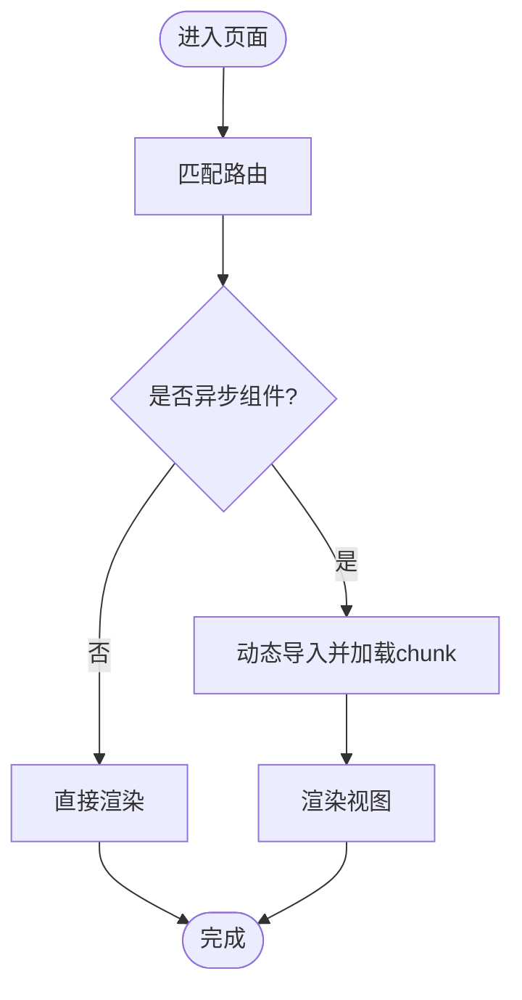
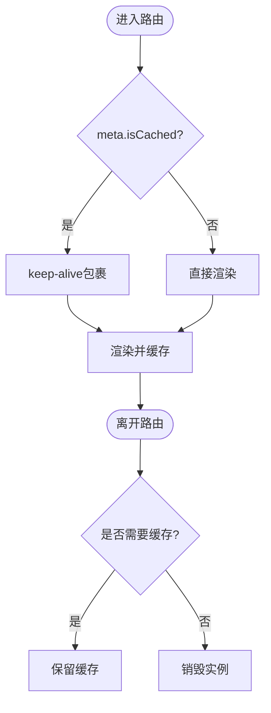
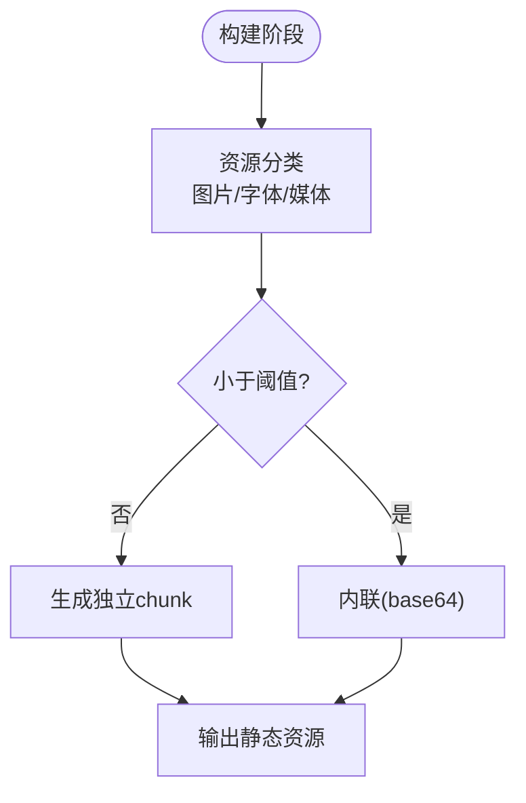
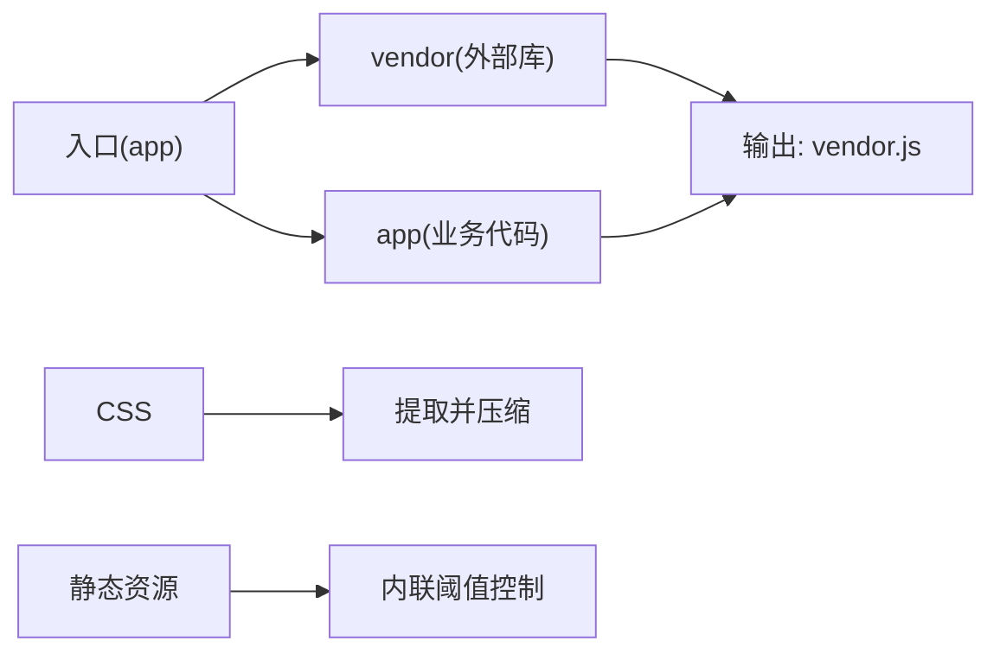
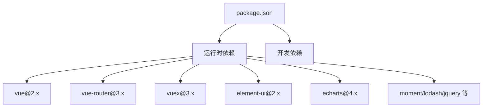

# 前端性能优化

<cite>
**本文引用的文件**
- [package.json](file://package.json)
- [config/index.js](file://config/index.js)
- [build/webpack.base.conf.js](file://build/webpack.base.conf.js)
- [build/webpack.prod.conf.js](file://build/webpack.prod.conf.js)
- [build/webpack.dev.conf.js](file://build/webpack.dev.conf.js)
- [build/vue-loader.conf.js](file://build/vue-loader.conf.js)
- [build/utils.js](file://build/utils.js)
- [src/main.js](file://src/main.js)
- [src/App.vue](file://src/App.vue)
- [src/router/index.js](file://src/router/index.js)
- [src/store/index.js](file://src/store/index.js)
</cite>

## 目录
1. [引言](#引言)
2. [项目结构](#项目结构)
3. [核心组件](#核心组件)
4. [架构总览](#架构总览)
5. [详细组件分析](#详细组件分析)
6. [依赖分析](#依赖分析)
7. [性能考虑](#性能考虑)
8. [故障排查指南](#故障排查指南)
9. [结论](#结论)
10. [附录](#附录)

## 引言
本指南面向校园管理系统（基于 Vue.js 2.x）的前端性能优化，聚焦以下目标：
- 分析现有构建与运行配置，识别性能瓶颈与优化空间
- 提供代码分割、组件懒加载、路由懒加载与资源预加载策略
- 给出 Webpack 构建优化（externals、Tree Shaking、代码压缩、资源优化）
- 明确首屏加载时间、交互延迟、内存使用等关键指标
- 落实组件渲染优化、虚拟滚动、防抖节流等工程实践
- 提供性能测试工具与基准测试案例

## 项目结构
该项目采用经典的 Vue CLI 早期模板风格，目录组织清晰：
- 构建配置位于 build/，包含开发、生产与通用基础配置
- 运行时入口在 src/，包含入口文件 main.js、路由 router、状态 store、根组件 App.vue
- 配置集中于 config/index.js，区分开发与生产环境参数

图表来源
- [build/webpack.base.conf.js:1-102](file://build/webpack.base.conf.js#L1-L102)
- [build/webpack.dev.conf.js:1-96](file://build/webpack.dev.conf.js#L1-L96)
- [build/webpack.prod.conf.js:1-149](file://build/webpack.prod.conf.js#L1-L149)
- [build/vue-loader.conf.js:1-23](file://build/vue-loader.conf.js#L1-L23)
- [build/utils.js:1-102](file://build/utils.js#L1-L102)
- [config/index.js:1-72](file://config/index.js#L1-L72)
- [src/main.js:1-221](file://src/main.js#L1-L221)
- [src/App.vue:1-183](file://src/App.vue#L1-L183)
- [src/router/index.js:1-207](file://src/router/index.js#L1-L207)
- [src/store/index.js:1-20](file://src/store/index.js#L1-L20)

章节来源
- [config/index.js:1-72](file://config/index.js#L1-L72)
- [build/webpack.base.conf.js:1-102](file://build/webpack.base.conf.js#L1-L102)
- [build/webpack.prod.conf.js:1-149](file://build/webpack.prod.conf.js#L1-L149)
- [build/webpack.dev.conf.js:1-96](file://build/webpack.dev.conf.js#L1-L96)
- [src/main.js:1-221](file://src/main.js#L1-L221)
- [src/router/index.js:1-207](file://src/router/index.js#L1-L207)
- [src/App.vue:1-183](file://src/App.vue#L1-L183)
- [src/store/index.js:1-20](file://src/store/index.js#L1-L20)

## 核心组件
- 入口与全局初始化：在入口文件中完成第三方库引入、全局组件注册、进度条、过滤器、路由守卫与错误处理等，直接影响首屏与交互体验。
- 路由与懒加载：路由层广泛使用动态导入实现按需加载，有助于减小首屏包体。
- 状态管理：集中式状态便于组件间共享数据，但需注意模块拆分与 getter 计算属性以避免不必要的重渲染。
- 样式与资源：通过 url-loader 对小资源内联，减少请求数；生产环境提取 CSS 并进行压缩。

章节来源
- [src/main.js:1-221](file://src/main.js#L1-L221)
- [src/router/index.js:1-207](file://src/router/index.js#L1-L207)
- [src/store/index.js:1-20](file://src/store/index.js#L1-L20)
- [build/webpack.base.conf.js:60-83](file://build/webpack.base.conf.js#L60-L83)
- [build/webpack.prod.conf.js:47-62](file://build/webpack.prod.conf.js#L47-L62)

## 架构总览
下图展示从入口到页面渲染的关键路径，以及构建期的代码分割与资源处理流程。

图表来源
- [build/webpack.prod.conf.js:84-112](file://build/webpack.prod.conf.js#L84-L112)
- [build/webpack.prod.conf.js:66-79](file://build/webpack.prod.conf.js#L66-L79)
- [src/router/index.js:104-125](file://src/router/index.js#L104-L125)
- [src/main.js:216-221](file://src/main.js#L216-L221)

## 详细组件分析

### 代码分割与路由懒加载
- 现状：路由层大量使用动态导入（例如“系统管理”、“考勤统计”、“校园卡”等），有效实现按需加载。
- 建议：
  - 为高频访问模块单独拆分异步块，结合路由元信息控制缓存策略
  - 对大型第三方库（如图表、富文本）独立拆包，配合 CDN 或 externals
  - 使用路由级别的异步分块，结合 webpack 的魔法注释生成更语义化的 chunk 名称

图表来源
- [src/router/index.js:104-125](file://src/router/index.js#L104-L125)
- [src/router/index.js:166-176](file://src/router/index.js#L166-L176)
- [src/router/index.js:182-190](file://src/router/index.js#L182-L190)

章节来源
- [src/router/index.js:1-207](file://src/router/index.js#L1-L207)

### 组件懒加载与 keep-alive 缓存
- 现状：根组件对带缓存标记的路由使用 keep-alive 包裹，减少重复渲染成本。
- 建议：
  - 仅对需要保持状态且体积较大的页面启用缓存
  - 为频繁切换的列表页设置合理的缓存失效策略
  - 对复杂子组件使用局部 keep-alive，避免全局缓存导致内存占用上升

图表来源
- [src/App.vue:3-6](file://src/App.vue#L3-L6)

章节来源
- [src/App.vue:1-183](file://src/App.vue#L1-L183)

### 资源预加载与预连接
- 现状：构建配置对图片、字体、媒体资源使用 url-loader 内联阈值控制；生产环境提取 CSS 并压缩。
- 建议：
  - 对首屏关键资源使用 preload/prefetch
  - 对常用第三方库通过 CDN + externals，减少主包体积
  - 图片采用 WebP/SVG 优先，必要时使用懒加载与尺寸适配

图表来源
- [build/webpack.base.conf.js:60-83](file://build/webpack.base.conf.js#L60-L83)
- [build/webpack.prod.conf.js:47-62](file://build/webpack.prod.conf.js#L47-L62)

章节来源
- [build/webpack.base.conf.js:1-102](file://build/webpack.base.conf.js#L1-L102)
- [build/webpack.prod.conf.js:1-149](file://build/webpack.prod.conf.js#L1-L149)

### Webpack 构建优化
- externals 与 CDN
  - 已配置多个外部库映射，建议统一走 CDN，进一步降低主包大小
- Tree Shaking
  - 使用 ES Module 导入导出，确保未使用代码被移除
- 代码压缩
  - 生产环境使用 UglifyJsPlugin，并开启并行压缩
- 资源优化
  - 提取 CSS 并去重压缩
  - 可选开启 gzip 压缩插件，平衡带宽与 CPU

图表来源
- [build/webpack.base.conf.js:26-36](file://build/webpack.base.conf.js#L26-L36)
- [build/webpack.prod.conf.js:38-46](file://build/webpack.prod.conf.js#L38-L46)
- [build/webpack.prod.conf.js:47-62](file://build/webpack.prod.conf.js#L47-L62)
- [build/webpack.prod.conf.js:125-141](file://build/webpack.prod.conf.js#L125-L141)

章节来源
- [build/webpack.base.conf.js:1-102](file://build/webpack.base.conf.js#L1-L102)
- [build/webpack.prod.conf.js:1-149](file://build/webpack.prod.conf.js#L1-L149)
- [package.json:12-43](file://package.json#L12-L43)

### 组件渲染优化、虚拟滚动与防抖节流
- 渲染优化
  - 使用计算属性与缓存结果，避免重复计算
  - 合理拆分组件，减少不必要的响应式数据绑定范围
- 虚拟滚动
  - 对长列表采用虚拟滚动，仅渲染可视区域
- 防抖节流
  - 对窗口 resize、滚动、输入事件进行节流/防抖，降低主线程压力

（本节为通用实践指导，不直接分析具体文件）

### 性能监控指标
- 首屏加载时间（FCP/LCP/TTI）
- 交互延迟（FID/CLS）
- 内存使用率与 GC 频率
- 资源体积与请求数（JS/CSS/图片）

（本节为通用实践指导，不直接分析具体文件）

### 性能测试工具与基准测试
- Lighthouse/Puppeteer 自动化测试
- WebPageTest/SpeedCurve 承载测试
- Chrome DevTools Performance/Heap Profiler
- 基准测试案例：对比开启/关闭 keep-alive、虚拟滚动前后 TTI 与内存峰值

（本节为通用实践指导，不直接分析具体文件）

## 依赖分析
- 第三方依赖集中在 package.json，包含 axios、element-ui、echarts、moment、swiper 等
- 构建依赖集中在 devDependencies，包含 babel、webpack、css 压缩与打包分析工具
- 运行时通过 externals 将部分库交由 CDN 管理，降低主包体积

图表来源
- [package.json:12-43](file://package.json#L12-L43)

章节来源
- [package.json:1-98](file://package.json#L1-L98)

## 性能考虑
- 代码分割
  - 使用异步路由与动态导入，结合 CommonsChunkPlugin/ModuleConcatenationPlugin 实现稳定模块 ID 与作用域提升
- 资源优化
  - 图片与字体内联阈值合理设置；CSS 提取并压缩；可选 gzip
- 运行时优化
  - keep-alive 缓存高频页面；组件拆分与计算属性缓存；虚拟滚动与事件节流
- 监控与回归
  - 建立自动化性能基线，持续跟踪关键指标变化

（本节为通用实践指导，不直接分析具体文件）

## 故障排查指南
- 首屏过慢
  - 检查是否存在超大依赖未拆分；确认 externals 是否生效；核对 CSS 提取与压缩配置
- 交互延迟高
  - 排查长任务与阻塞渲染的逻辑；对高频事件进行节流/防抖
- 内存泄漏
  - 检查 keep-alive 缓存策略与路由离开钩子；确认定时器与事件监听及时清理

章节来源
- [src/App.vue:14-16](file://src/App.vue#L14-L16)
- [src/main.js:205-214](file://src/main.js#L205-L214)

## 结论
本项目已具备良好的按需加载与资源内联基础，建议围绕以下方向持续优化：
- 强化 externals 与 CDN 策略，进一步瘦身主包
- 通过路由与组件级懒加载，精细化控制首屏与关键路径
- 引入虚拟滚动与事件节流，改善长列表与高频交互体验
- 建立性能监控与回归机制，保障长期稳定性

## 附录
- 关键配置参考路径
  - [构建基础配置:1-102](file://build/webpack.base.conf.js#L1-L102)
  - [生产构建配置:1-149](file://build/webpack.prod.conf.js#L1-L149)
  - [开发构建配置:1-96](file://build/webpack.dev.conf.js#L1-L96)
  - [Vue Loader 配置:1-23](file://build/vue-loader.conf.js#L1-L23)
  - [样式加载工具:1-102](file://build/utils.js#L1-L102)
  - [运行时入口:1-221](file://src/main.js#L1-L221)
  - [根组件缓存:1-183](file://src/App.vue#L1-L183)
  - [路由懒加载:1-207](file://src/router/index.js#L1-L207)
  - [状态管理入口:1-20](file://src/store/index.js#L1-L20)
  - [环境配置:1-72](file://config/index.js#L1-L72)