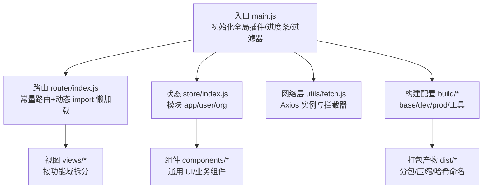
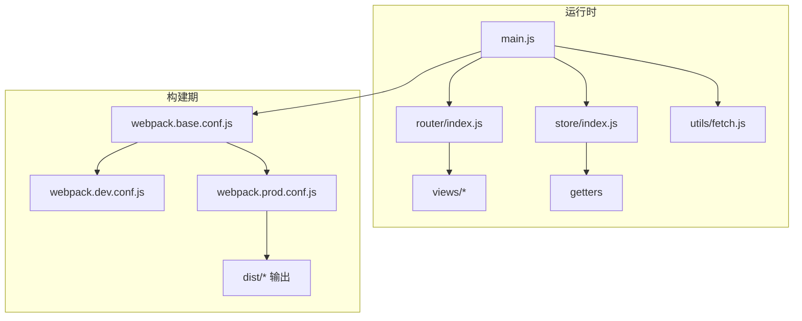
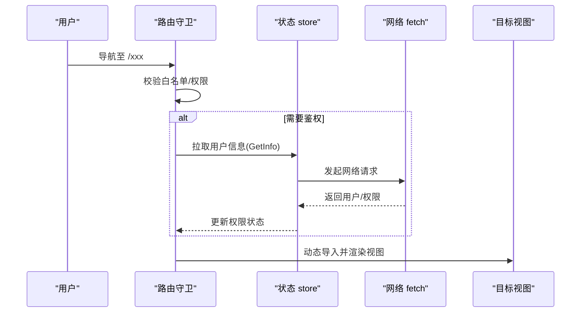
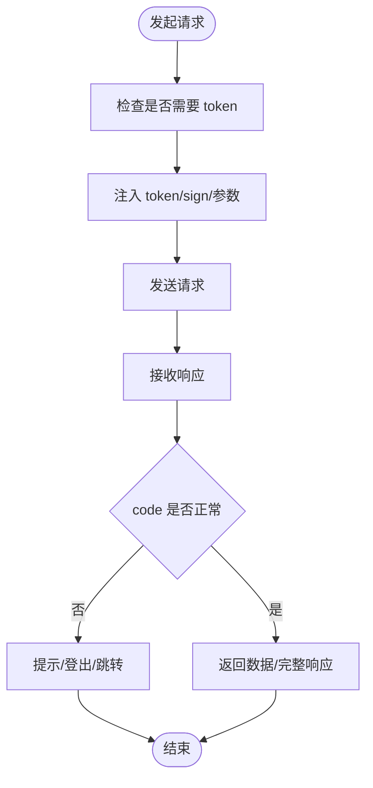
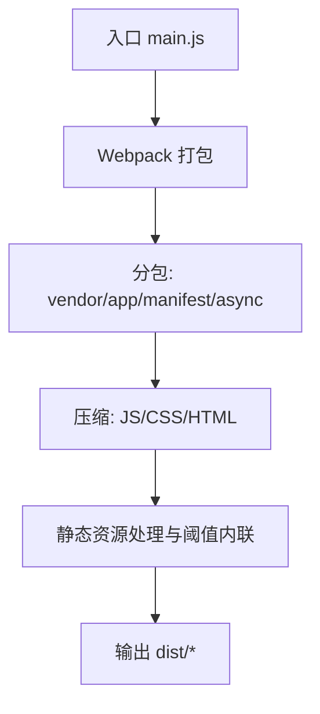
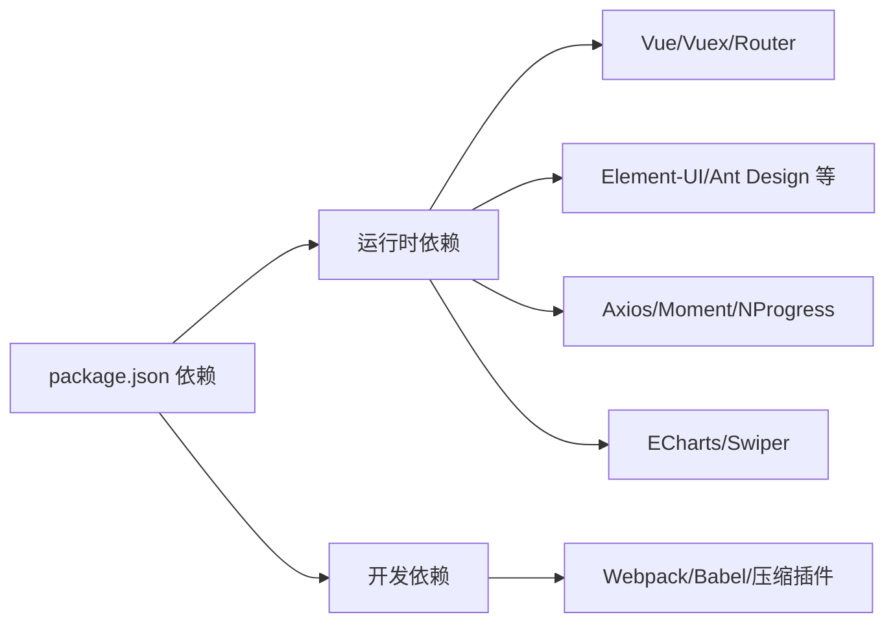

# 性能优化

<cite>
**本文引用的文件**
- [package.json](file://package.json)
- [main.js](file://src/main.js)
- [router/index.js](file://src/router/index.js)
- [store/index.js](file://src/store/index.js)
- [store/modules/app.js](file://src/store/modules/app.js)
- [utils/fetch.js](file://src/utils/fetch.js)
- [mixins/baseMixin.js](file://src/mixins/baseMixin.js)
- [config/index.js](file://config/index.js)
- [build/webpack.base.conf.js](file://build/webpack.base.conf.js)
- [build/webpack.dev.conf.js](file://build/webpack.dev.conf.js)
- [build/webpack.prod.conf.js](file://build/webpack.prod.conf.js)
- [build/utils.js](file://build/utils.js)
- [build/build.js](file://build/build.js)
</cite>

## 目录
1. [引言](#引言)
2. [项目结构](#项目结构)
3. [核心组件](#核心组件)
4. [架构总览](#架构总览)
5. [详细组件分析](#详细组件分析)
6. [依赖分析](#依赖分析)
7. [性能考量](#性能考量)
8. [故障排查指南](#故障排查指南)
9. [结论](#结论)
10. [附录](#附录)

## 引言
本指南面向校园管理系统，聚焦于前端性能优化与工程化实践，覆盖代码分割、懒加载、缓存策略、资源压缩、网络性能、内存与渲染优化、数据处理性能、性能测试与持续监控等主题。目标是在高并发与大数据量场景下，保障系统稳定与流畅体验。

## 项目结构
项目采用 Vue 2 + Vue-Router + Vuex + Webpack 的经典前端架构，结合 Element-UI 组件库与 Axios 网络层，构建模块化的 PC 端应用。构建配置通过多入口与分包策略实现体积控制与缓存优化；路由采用按需加载（动态 import）以降低首屏负担；状态管理集中于 Vuex，便于统一缓存与复用。

图表来源
- [main.js:1-221](file://src/main.js#L1-L221)
- [router/index.js:1-207](file://src/router/index.js#L1-L207)
- [store/index.js:1-20](file://src/store/index.js#L1-L20)
- [utils/fetch.js:1-240](file://src/utils/fetch.js#L1-L240)
- [build/webpack.base.conf.js:1-102](file://build/webpack.base.conf.js#L1-L102)
- [build/webpack.prod.conf.js:1-149](file://build/webpack.prod.conf.js#L1-L149)

章节来源
- [package.json:1-98](file://package.json#L1-L98)
- [config/index.js:1-72](file://config/index.js#L1-L72)
- [build/webpack.base.conf.js:1-102](file://build/webpack.base.conf.js#L1-L102)
- [build/webpack.dev.conf.js:1-96](file://build/webpack.dev.conf.js#L1-L96)
- [build/webpack.prod.conf.js:1-149](file://build/webpack.prod.conf.js#L1-L149)
- [build/utils.js:1-102](file://build/utils.js#L1-L102)
- [build/build.js:1-42](file://build/build.js#L1-L42)

## 核心组件
- 入口与全局初始化：注册 Element-UI、NProgress、全局过滤器、打印、上传组件、路由守卫与错误处理。
- 路由与懒加载：常量路由与动态 import 的组合，减少初始包体。
- 状态管理：集中模块化管理页面级分页、类型等轻量状态。
- 网络层：统一 Axios 实例、请求/响应拦截器、鉴权参数注入、错误处理与登出逻辑。
- 构建配置：分包、压缩、SourceMap、Gzip 可选、Bundle 分析。

章节来源
- [main.js:1-221](file://src/main.js#L1-L221)
- [router/index.js:1-207](file://src/router/index.js#L1-L207)
- [store/index.js:1-20](file://src/store/index.js#L1-L20)
- [store/modules/app.js:1-54](file://src/store/modules/app.js#L1-L54)
- [utils/fetch.js:1-240](file://src/utils/fetch.js#L1-L240)
- [build/webpack.prod.conf.js:1-149](file://build/webpack.prod.conf.js#L1-L149)

## 架构总览
系统前端架构围绕“入口初始化—路由—状态—网络—构建”展开，配合按需加载与分包策略，形成清晰的性能优化抓手。

图表来源
- [main.js:1-221](file://src/main.js#L1-L221)
- [router/index.js:1-207](file://src/router/index.js#L1-L207)
- [store/index.js:1-20](file://src/store/index.js#L1-L20)
- [utils/fetch.js:1-240](file://src/utils/fetch.js#L1-L240)
- [build/webpack.base.conf.js:1-102](file://build/webpack.base.conf.js#L1-L102)
- [build/webpack.prod.conf.js:1-149](file://build/webpack.prod.conf.js#L1-L149)

## 详细组件分析

### 路由与懒加载
- 动态 import：大量路由使用动态 import 实现按需加载，显著降低首屏 JS 体积。
- 常量路由：登录、错误页、仪表盘等常驻路由保持同步加载，保证访问速度。
- 权限与白名单：路由守卫中结合白名单与权限路径判断，避免无效请求与重复渲染。

图表来源
- [router/index.js:1-207](file://src/router/index.js#L1-L207)
- [main.js:73-198](file://src/main.js#L73-L198)
- [utils/fetch.js:1-240](file://src/utils/fetch.js#L1-L240)

章节来源
- [router/index.js:1-207](file://src/router/index.js#L1-L207)
- [main.js:73-198](file://src/main.js#L73-L198)

### 网络层与鉴权拦截
- Axios 实例：统一 baseURL、超时、序列化策略与签名/令牌注入。
- 请求拦截：自动注入 token、sign、学年参数；对特定服务端进行参数转换。
- 响应拦截：统一错误码处理、消息提示、登出与跳转逻辑。
- 多实例：按业务域划分 fetch 实例，隔离配置与缓存策略。

图表来源
- [utils/fetch.js:13-171](file://src/utils/fetch.js#L13-L171)

章节来源
- [utils/fetch.js:1-240](file://src/utils/fetch.js#L1-L240)

### 构建与分包策略
- 分包：CommonsChunkPlugin 提取 vendor、manifest 与异步分包，稳定哈希、提升缓存命中。
- 压缩：UglifyJS 压缩 JS，OptimizeCSSPlugin 压缩 CSS，可选 Gzip。
- 资源：图片/媒体/字体使用 url-loader 并设置阈值内联，减少请求数。
- 外链：externals 对常用库进行外部化，减小包体并利用 CDN 加速。

图表来源
- [build/webpack.prod.conf.js:16-149](file://build/webpack.prod.conf.js#L16-L149)
- [build/webpack.base.conf.js:14-102](file://build/webpack.base.conf.js#L14-L102)
- [build/utils.js:15-83](file://build/utils.js#L15-L83)

章节来源
- [build/webpack.prod.conf.js:1-149](file://build/webpack.prod.conf.js#L1-L149)
- [build/webpack.base.conf.js:1-102](file://build/webpack.base.conf.js#L1-L102)
- [build/utils.js:1-102](file://build/utils.js#L1-L102)
- [build/build.js:1-42](file://build/build.js#L1-L42)

### 状态管理与页面级缓存
- 轻量状态：分页、查询条件等页面级状态放入 app 模块，避免跨组件通信成本。
- 生命周期：在组件 activated 中触发表格布局重算，减少布局抖动。

章节来源
- [store/modules/app.js:1-54](file://src/store/modules/app.js#L1-L54)
- [mixins/baseMixin.js:21-28](file://src/mixins/baseMixin.js#L21-L28)

## 依赖分析
- 运行时依赖：Vue 生态、Element-UI、Axios、Vuex、Vue-Router、Moment、NProgress、Swiper、InteractJS、ECharts 等。
- 开发依赖：Webpack 3、babel、optimize-css-assets-webpack-plugin、uglifyjs-webpack-plugin、webpack-bundle-analyzer 等。
- 外链策略：webpack.base.conf.js 中对多个库进行 externals，结合 CDN 使用，降低包体与首屏时间。

图表来源
- [package.json:12-87](file://package.json#L12-L87)
- [build/webpack.base.conf.js:26-36](file://build/webpack.base.conf.js#L26-L36)

章节来源
- [package.json:1-98](file://package.json#L1-L98)
- [build/webpack.base.conf.js:1-102](file://build/webpack.base.conf.js#L1-L102)

## 性能考量

### 代码分割与懒加载
- 路由级懒加载：通过动态 import 将非首屏模块延迟加载，显著降低首屏 JS 体积。
- 异步分包：CommonsChunkPlugin 的 async 配置提取共享异步模块，进一步提升缓存复用。

章节来源
- [router/index.js:1-207](file://src/router/index.js#L1-L207)
- [build/webpack.prod.conf.js:107-112](file://build/webpack.prod.conf.js#L107-L112)

### 缓存策略
- 构建缓存：HashedModuleIdsPlugin 与稳定 chunk 名称，提升浏览器缓存命中率。
- 外链资源：externals 外部化常用库，结合 CDN 与长期缓存策略。
- 本地存储：路由守卫中使用 sessionStorage/cookies 缓存登录态与模块标识，减少重复请求。

章节来源
- [build/webpack.prod.conf.js:80-83](file://build/webpack.prod.conf.js#L80-L83)
- [build/webpack.base.conf.js:26-36](file://build/webpack.base.conf.js#L26-L36)
- [main.js:73-198](file://src/main.js#L73-L198)

### 资源压缩与传输优化
- JS 压缩：UglifyJsPlugin 并行压缩，减少体积。
- CSS 压缩：OptimizeCSSPlugin 去重与压缩。
- HTML 压缩：HtmlWebpackPlugin 去注释与空白。
- Gzip 可选：根据部署环境启用，进一步降低传输体积。

章节来源
- [build/webpack.prod.conf.js:38-79](file://build/webpack.prod.conf.js#L38-L79)
- [build/webpack.prod.conf.js:125-141](file://build/webpack.prod.conf.js#L125-L141)

### 网络性能优化
- 请求合并与去重：在业务层避免重复请求相同数据，结合本地缓存与状态复用。
- 超时与重试：合理设置超时与失败重试策略，避免长时间阻塞。
- 参数优化：仅在必要接口注入 token/sign，减少无关字段。

章节来源
- [utils/fetch.js:13-171](file://src/utils/fetch.js#L13-L171)

### 内存管理与渲染优化
- 组件卸载清理：在 beforeDestroy/beforeRouteLeave 中清理定时器、事件监听与订阅。
- 渲染抖动控制：在 activated 中统一触发表格布局重算，避免频繁强制重排。
- 图片与媒体：使用 url-loader 阈值内联小资源，减少请求数；大图懒加载与尺寸优化。

章节来源
- [mixins/baseMixin.js:21-28](file://src/mixins/baseMixin.js#L21-L28)
- [build/webpack.base.conf.js:61-83](file://build/webpack.base.conf.js#L61-L83)

### 数据处理性能
- 分页与虚拟滚动：对长列表采用分页或虚拟滚动，限制一次性渲染的数据量。
- 过滤与排序：在后端接口侧完成复杂筛选与排序，前端仅做轻量展示处理。

章节来源
- [store/modules/app.js:17-23](file://src/store/modules/app.js#L17-L23)

### 性能监控与测试
- 构建报告：开启 bundle analyzer 报告，定位大体积模块与重复依赖。
- 运行时监控：结合浏览器开发者工具 Timeline/Performance 面板观察长任务与渲染耗时。
- 基准测试：使用 Lighthouse 或 WebPageTest 对关键页面进行基准打分与回归对比。
- 持续监控：在 CI 中集成构建体积与 Bundle 报告，建立体积阈值告警。

章节来源
- [build/webpack.prod.conf.js:143-146](file://build/webpack.prod.conf.js#L143-L146)

## 故障排查指南
- 登录态失效：响应拦截器对特定错误码触发登出与跳转，检查 token/sign 注入逻辑与白名单配置。
- 首屏过慢：检查路由懒加载是否生效、是否存在未分包的大依赖、是否启用 Gzip。
- 资源 404：确认 externals 与 CDN 配置一致，检查 publicPath 与静态资源目录映射。
- 构建失败：查看构建日志中的错误堆栈，优先修复依赖版本与插件兼容性。

章节来源
- [utils/fetch.js:104-169](file://src/utils/fetch.js#L104-L169)
- [config/index.js:47-48](file://config/index.js#L47-L48)
- [build/webpack.prod.conf.js:125-141](file://build/webpack.prod.conf.js#L125-L141)

## 结论
通过路由懒加载、稳定的分包策略、资源压缩与外链优化、网络层拦截与缓存、以及渲染与内存管理的最佳实践，校园管理系统可在高并发与大数据量场景下保持良好性能与用户体验。建议在持续集成中引入体积与性能基线，定期进行性能回归测试与监控。

## 附录
- 关键配置参考
  - 构建输出路径与 publicPath：[config/index.js:44-48](file://config/index.js#L44-L48)
  - 生产环境 SourceMap 与 Gzip：[config/index.js:54-63](file://config/index.js#L54-L63)
  - 外链库配置：[build/webpack.base.conf.js:26-36](file://build/webpack.base.conf.js#L26-L36)
  - 分包与压缩插件：[build/webpack.prod.conf.js:33-122](file://build/webpack.prod.conf.js#L33-L122)