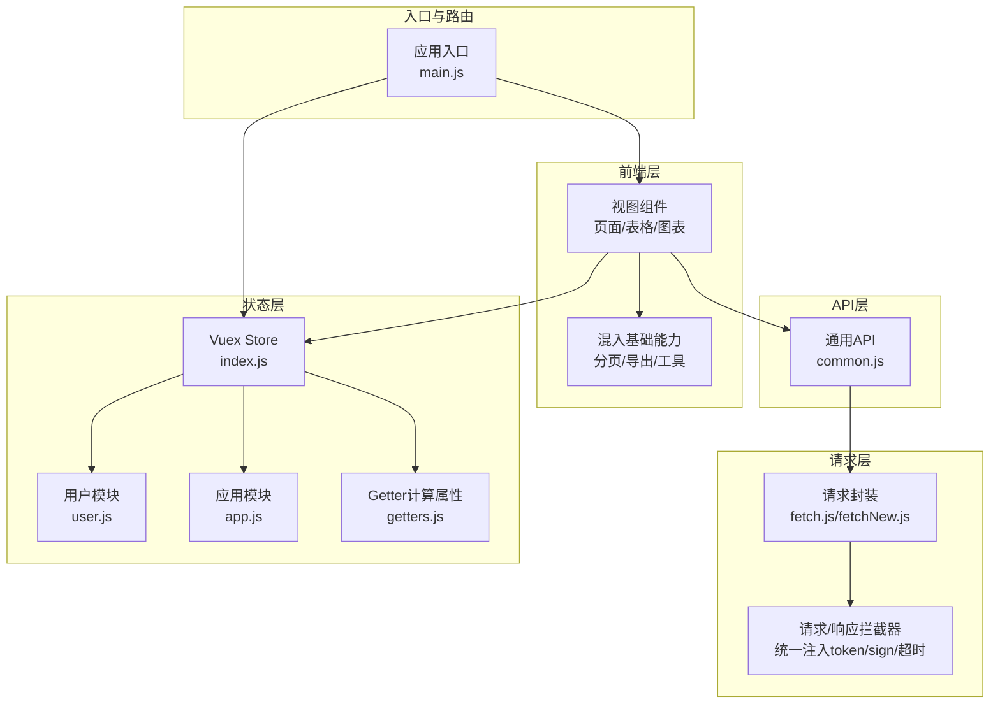
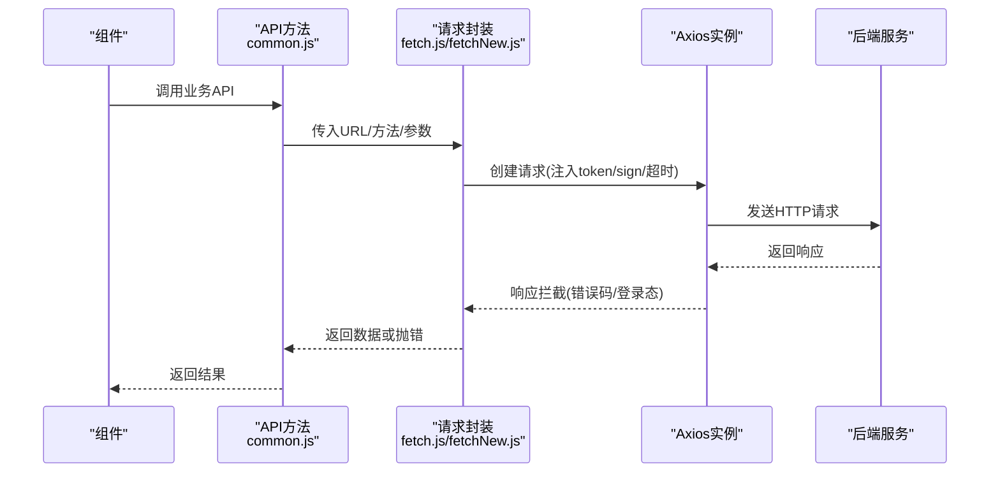
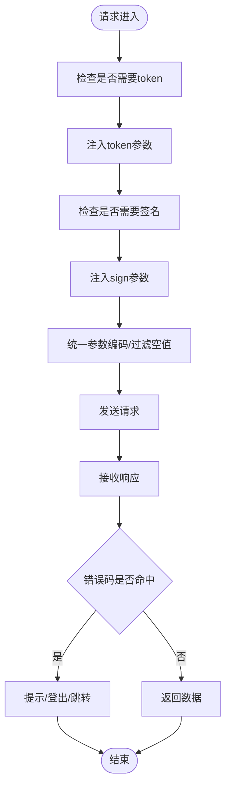
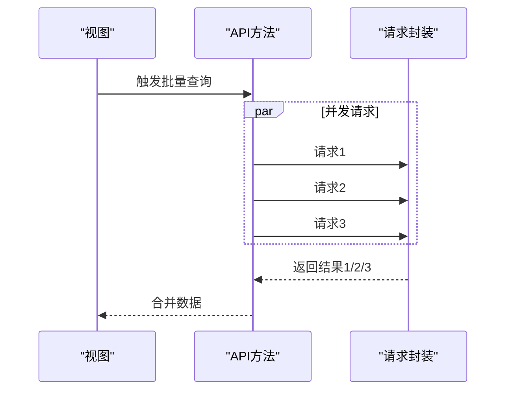
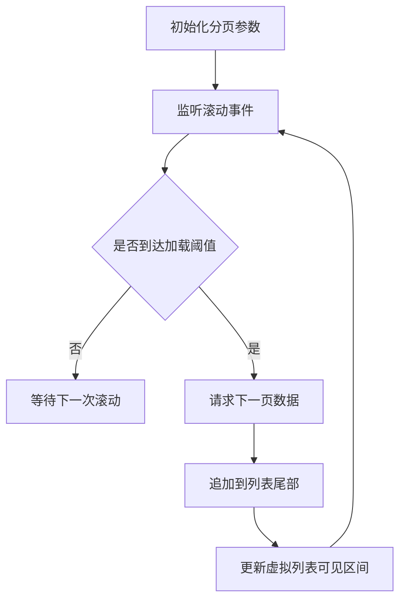
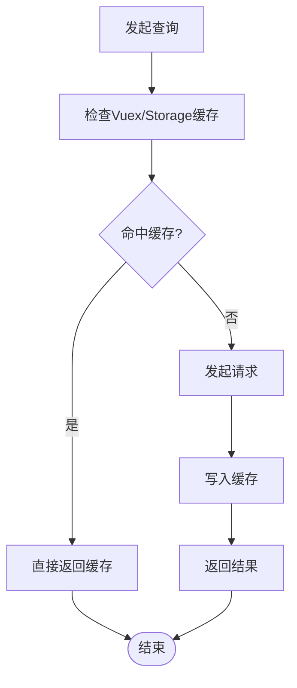
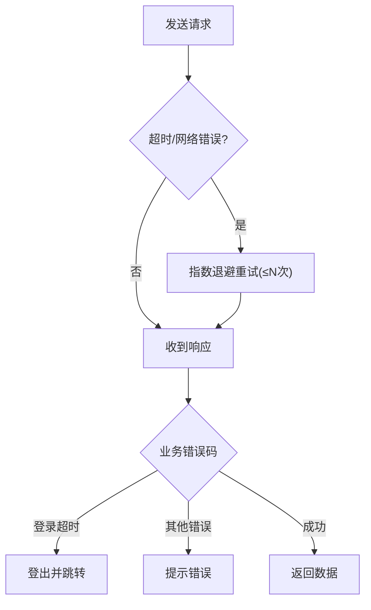
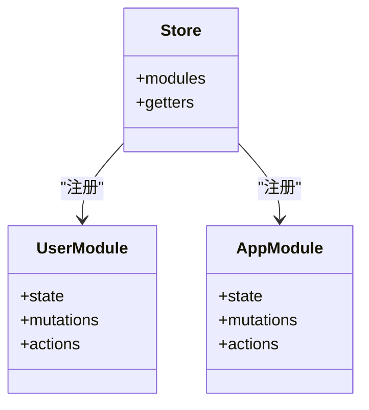
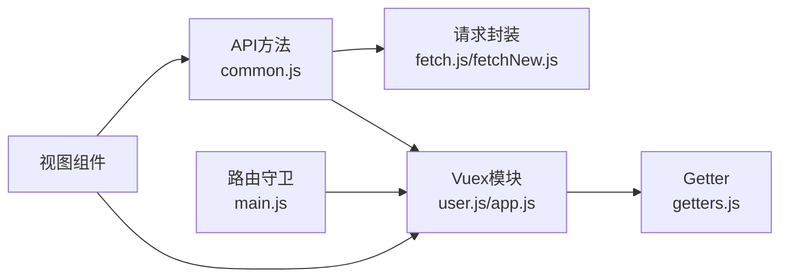

# 数据加载优化

<cite>
**本文引用的文件**
- [fetch.js](file://src/utils/fetch.js)
- [fetchNew.js](file://src/utils/fetchNew.js)
- [common.js](file://src/api/common/common.js)
- [user.js](file://src/store/modules/user.js)
- [app.js](file://src/store/modules/app.js)
- [getters.js](file://src/store/getters.js)
- [index.js](file://src/store/index.js)
- [main.js](file://src/main.js)
- [baseMixin.js](file://src/mixins/baseMixin.js)
</cite>

## 目录
1. [引言](#引言)
2. [项目结构](#项目结构)
3. [核心组件](#核心组件)
4. [架构总览](#架构总览)
5. [详细组件分析](#详细组件分析)
6. [依赖关系分析](#依赖关系分析)
7. [性能考量](#性能考量)
8. [故障排查指南](#故障排查指南)
9. [结论](#结论)
10. [附录](#附录)

## 引言
本指南聚焦于校园管理系统在数据加载与请求优化方面的实践，围绕以下目标展开：
- API 请求优化策略：请求合并、批量请求、缓存策略、请求去重
- 数据分页加载、无限滚动与虚拟列表思路
- 请求拦截器优化、错误重试与超时处理
- Vuex 状态管理中的数据缓存与持久化优化
- 网络请求性能监控、慢查询分析与优化案例

通过对现有请求封装层、API 层、状态管理与路由守卫的代码级分析，给出可落地的优化建议与最佳实践。

## 项目结构
本项目采用典型的前端单页应用架构，核心涉及：
- 请求封装层：基于 Axios 的统一服务工厂与拦截器
- API 层：按业务模块组织的接口方法，统一调用请求封装
- 状态管理层：Vuex 模块化管理用户、应用与组织等状态
- 路由与入口：全局路由守卫与进度条控制，结合 Cookie 令牌注入

**图表来源**
- [fetch.js:13-171](file://src/utils/fetch.js#L13-L171)
- [fetchNew.js:9-136](file://src/utils/fetchNew.js#L9-L136)
- [common.js:1-459](file://src/api/common/common.js#L1-L459)
- [index.js:10-17](file://src/store/index.js#L10-L17)
- [user.js:20-118](file://src/store/modules/user.js#L20-L118)
- [app.js:4-25](file://src/store/modules/app.js#L4-L25)
- [getters.js:1-26](file://src/store/getters.js#L1-L26)
- [main.js:57-198](file://src/main.js#L57-L198)

**章节来源**
- [fetch.js:13-171](file://src/utils/fetch.js#L13-L171)
- [fetchNew.js:9-136](file://src/utils/fetchNew.js#L9-L136)
- [common.js:1-459](file://src/api/common/common.js#L1-L459)
- [index.js:10-17](file://src/store/index.js#L10-L17)
- [user.js:20-118](file://src/store/modules/user.js#L20-L118)
- [app.js:4-25](file://src/store/modules/app.js#L4-L25)
- [getters.js:1-26](file://src/store/getters.js#L1-L26)
- [main.js:57-198](file://src/main.js#L57-L198)

## 核心组件
- 请求封装工厂：提供多实例配置（不同 base URL、超时、transformRequest），统一注入 token 与签名参数，拦截错误并处理登录态失效
- API 方法集合：按业务模块导出函数，内部统一构造参数并调用请求封装
- Vuex 用户模块：集中管理用户信息、权限、学年选择、地图密钥等，支持并发初始化
- 应用模块：维护分页参数、作业管理分页等应用级状态
- Getter：对外暴露派生状态，供组件按需读取
- 路由守卫：在进入页面前注入 token、拉取用户信息与权限，并控制白名单放行

**章节来源**
- [fetch.js:13-171](file://src/utils/fetch.js#L13-L171)
- [fetchNew.js:9-136](file://src/utils/fetchNew.js#L9-L136)
- [common.js:1-459](file://src/api/common/common.js#L1-L459)
- [user.js:20-118](file://src/store/modules/user.js#L20-L118)
- [app.js:4-25](file://src/store/modules/app.js#L4-L25)
- [getters.js:1-26](file://src/store/getters.js#L1-L26)
- [main.js:57-198](file://src/main.js#L57-L198)

## 架构总览
请求从组件发起，经 API 方法封装，交由请求封装工厂创建 Axios 实例，统一注入 token 与签名参数，执行拦截器链，最终返回响应或错误。状态管理在关键节点进行缓存与持久化，路由守卫保障访问控制与初始化流程。

**图表来源**
- [common.js:1-459](file://src/api/common/common.js#L1-L459)
- [fetch.js:13-171](file://src/utils/fetch.js#L13-L171)
- [fetchNew.js:9-136](file://src/utils/fetchNew.js#L9-L136)

## 详细组件分析

### 请求封装与拦截器优化
- 多实例策略：通过工厂函数创建不同 baseURL 的实例，分别用于不同业务域（如支付、卡片、模块等），便于隔离超时与签名策略
- 请求拦截器：
  - 自动注入 token（白名单除外）
  - 对特定路由自动附加签名参数
  - 统一参数编码（URLSearchParams），过滤空值
  - 归档场景自动注入学年参数
- 响应拦截器：
  - 统一错误码判定与提示
  - 登录超时触发登出与跳转
  - 可配置返回 data 或完整响应体

**图表来源**
- [fetch.js:66-169](file://src/utils/fetch.js#L66-L169)
- [fetchNew.js:36-133](file://src/utils/fetchNew.js#L36-L133)

**章节来源**
- [fetch.js:13-171](file://src/utils/fetch.js#L13-L171)
- [fetchNew.js:9-136](file://src/utils/fetchNew.js#L9-L136)

### API 方法与批量/合并策略
- API 方法统一使用 URLSearchParams 构造参数，便于后续合并与去重
- 建议在组件侧对短时间内多次触发的相同查询进行“请求合并”（同一查询键值相同则复用上次请求）
- 批量请求：对多个独立接口，使用 Promise.all 并发拉取，减少串行等待（参考用户模块初始化）

**图表来源**
- [common.js:1-459](file://src/api/common/common.js#L1-L459)
- [user.js:162-168](file://src/store/modules/user.js#L162-L168)

**章节来源**
- [common.js:1-459](file://src/api/common/common.js#L1-L459)
- [user.js:162-168](file://src/store/modules/user.js#L162-L168)

### 分页加载、无限滚动与虚拟列表
- 分页基座：混入提供 pagination 对象与切换页大小/页码的方法，组件可直接复用
- 无限滚动：建议在滚动容器底部放置“加载更多”占位，监听滚动事件，到达阈值时触发下一页请求
- 虚拟列表：对大数据集采用固定高度行，仅渲染可视窗口内元素，动态计算起止索引，避免一次性渲染大量 DOM

**图表来源**
- [baseMixin.js:8-13](file://src/mixins/baseMixin.js#L8-L13)
- [baseMixin.js:55-61](file://src/mixins/baseMixin.js#L55-L61)

**章节来源**
- [baseMixin.js:8-13](file://src/mixins/baseMixin.js#L8-L13)
- [baseMixin.js:55-61](file://src/mixins/baseMixin.js#L55-L61)

### 缓存策略与请求去重
- Vuex 缓存：用户信息、权限、学年列表、当前学校等状态持久化在 Vuex，避免重复请求
- 本地存储：token、地图密钥、选中学年等通过 Cookie 与 sessionStorage 缓存
- 请求去重：对相同查询键值的请求进行去重（同一查询未完成则复用），完成后更新缓存

**图表来源**
- [user.js:97-110](file://src/store/modules/user.js#L97-L110)
- [getters.js:16-23](file://src/store/getters.js#L16-L23)

**章节来源**
- [user.js:97-110](file://src/store/modules/user.js#L97-L110)
- [getters.js:16-23](file://src/store/getters.js#L16-L23)

### 错误重试与超时处理
- 超时策略：默认 10 秒（系统接口）与 30 秒（新接口），可在工厂配置
- 错误重试：对网络瞬断或 5xx 类错误建议实现指数退避重试，限制最大次数
- 登录态失效：响应拦截器检测登录超时，触发登出并跳转登录页

**图表来源**
- [fetch.js:16-16](file://src/utils/fetch.js#L16-L16)
- [fetchNew.js:10-11](file://src/utils/fetchNew.js#L10-L11)
- [fetch.js:104-169](file://src/utils/fetch.js#L104-L169)

**章节来源**
- [fetch.js:16-16](file://src/utils/fetch.js#L16-L16)
- [fetchNew.js:10-11](file://src/utils/fetchNew.js#L10-L11)
- [fetch.js:104-169](file://src/utils/fetch.js#L104-L169)

### Vuex 状态管理中的缓存与持久化
- 用户模块：集中管理 token、用户信息、角色、权限、学年列表、选中学年等，初始化时并发拉取
- 应用模块：维护分页参数（如食谱通知、打卡、作业管理）等应用级状态
- Getter：提供派生状态，如当前选中学年、是否为独立运行模式等
- 入口与路由：在进入页面前拉取用户信息与权限，确保访问控制

**图表来源**
- [user.js:20-118](file://src/store/modules/user.js#L20-L118)
- [app.js:4-25](file://src/store/modules/app.js#L4-L25)
- [index.js:10-17](file://src/store/index.js#L10-L17)

**章节来源**
- [user.js:20-118](file://src/store/modules/user.js#L20-L118)
- [app.js:4-25](file://src/store/modules/app.js#L4-L25)
- [index.js:10-17](file://src/store/index.js#L10-L17)
- [getters.js:1-26](file://src/store/getters.js#L1-L26)
- [main.js:57-198](file://src/main.js#L57-L198)

## 依赖关系分析
- API 方法依赖请求封装工厂，统一参数构造与错误处理
- Vuex 模块依赖 API 方法进行初始化与更新
- 路由守卫依赖 Vuex 进行权限与用户信息校验
- 组件通过 API 方法与 Vuex 状态进行数据交互

**图表来源**
- [common.js:1-459](file://src/api/common/common.js#L1-L459)
- [fetch.js:13-171](file://src/utils/fetch.js#L13-L171)
- [fetchNew.js:9-136](file://src/utils/fetchNew.js#L9-L136)
- [user.js:20-118](file://src/store/modules/user.js#L20-L118)
- [app.js:4-25](file://src/store/modules/app.js#L4-L25)
- [getters.js:1-26](file://src/store/getters.js#L1-L26)
- [main.js:57-198](file://src/main.js#L57-L198)

**章节来源**
- [common.js:1-459](file://src/api/common/common.js#L1-L459)
- [fetch.js:13-171](file://src/utils/fetch.js#L13-L171)
- [fetchNew.js:9-136](file://src/utils/fetchNew.js#L9-L136)
- [user.js:20-118](file://src/store/modules/user.js#L20-L118)
- [app.js:4-25](file://src/store/modules/app.js#L4-L25)
- [getters.js:1-26](file://src/store/getters.js#L1-L26)
- [main.js:57-198](file://src/main.js#L57-L198)

## 性能考量
- 减少请求次数：使用 Promise.all 并发拉取，避免串行等待
- 参数压缩：统一 URLSearchParams 编码，过滤空值，减少无效参数
- 缓存优先：优先命中 Vuex/Storage 缓存，降低网络压力
- 超时合理：根据接口特性设置不同超时，避免阻塞主线程
- 渲染优化：大数据采用虚拟列表，减少 DOM 节点数量
- 白名单与去重：对高频查询进行去重，避免重复请求

## 故障排查指南
- 登录超时：响应拦截器检测到登录超时，自动登出并跳转登录页
- 网络错误：统一提示并返回错误对象，便于上层捕获与重试
- 参数异常：检查请求拦截器是否正确注入 token/sign，确认 baseURL 是否匹配
- 页面白屏：检查路由守卫是否正确拉取用户信息与权限

**章节来源**
- [fetch.js:104-169](file://src/utils/fetch.js#L104-L169)
- [fetchNew.js:81-133](file://src/utils/fetchNew.js#L81-L133)
- [main.js:73-198](file://src/main.js#L73-L198)

## 结论
通过多实例请求封装、统一拦截器、并发初始化与缓存策略，校园管理系统在数据加载与请求优化方面具备良好基础。建议进一步引入请求合并、去重与指数退避重试机制，配合虚拟列表与合理的分页策略，持续提升用户体验与系统性能。

## 附录
- 优化清单
  - 引入请求去重与合并：对相同查询键值进行去重
  - 指数退避重试：对瞬断/5xx 错误进行有限次重试
  - 虚拟列表：对大数据表格采用虚拟渲染
  - 缓存策略：完善 Vuex 与 Storage 的缓存键设计
  - 性能监控：埋点统计请求耗时、错误率与首屏时间