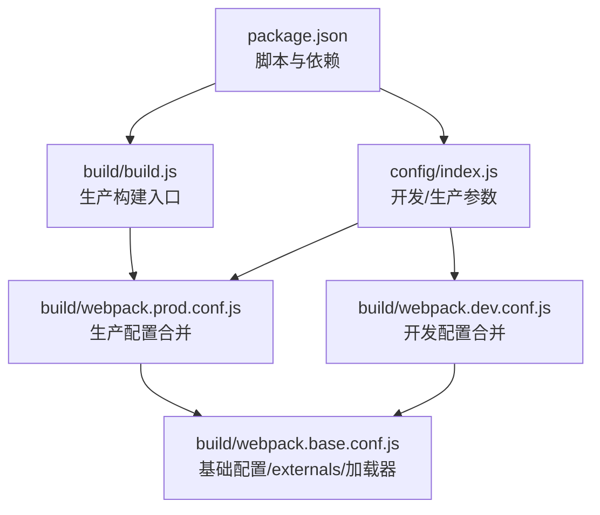
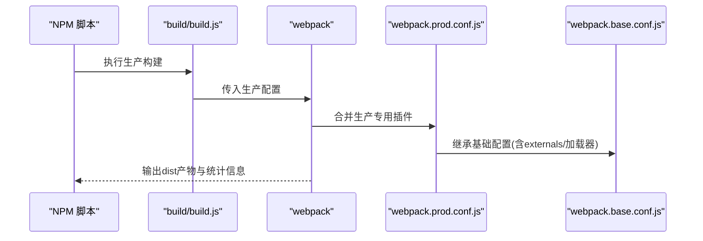
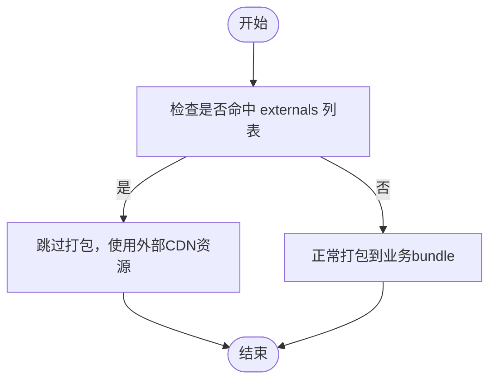
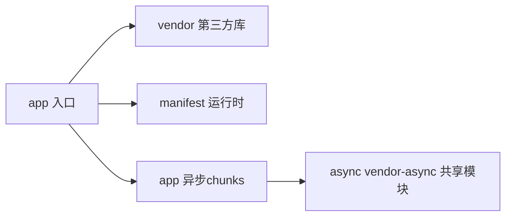
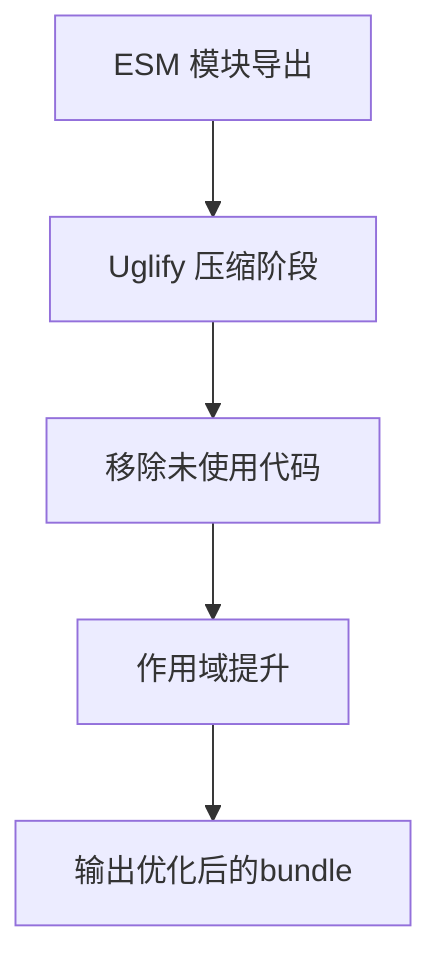
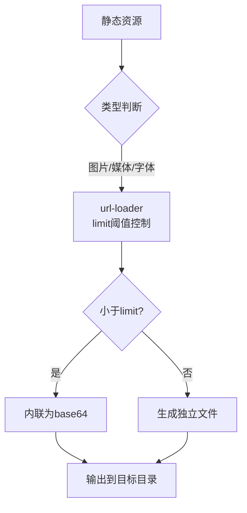
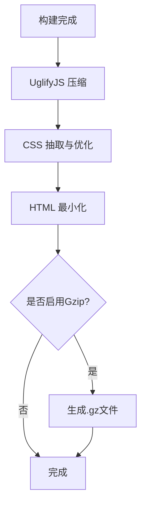
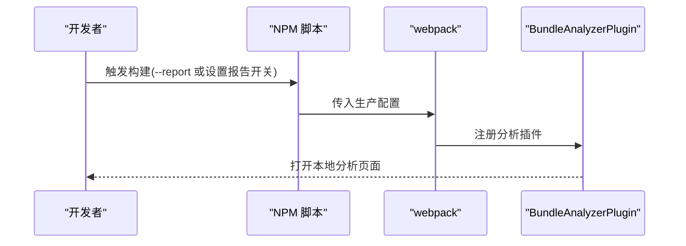
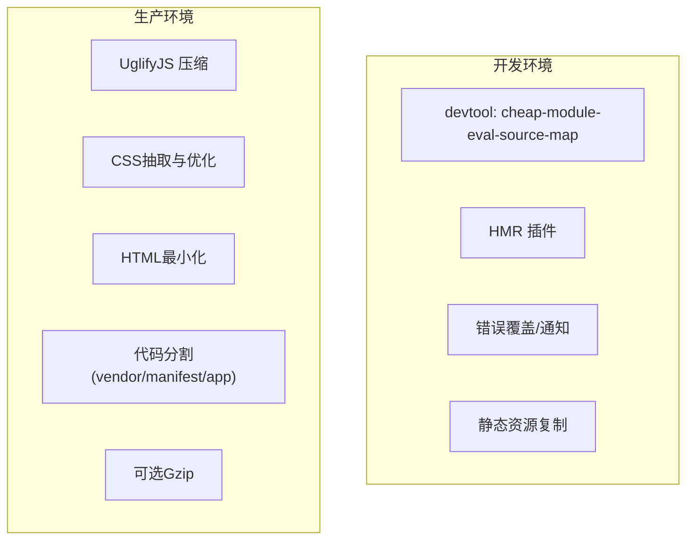
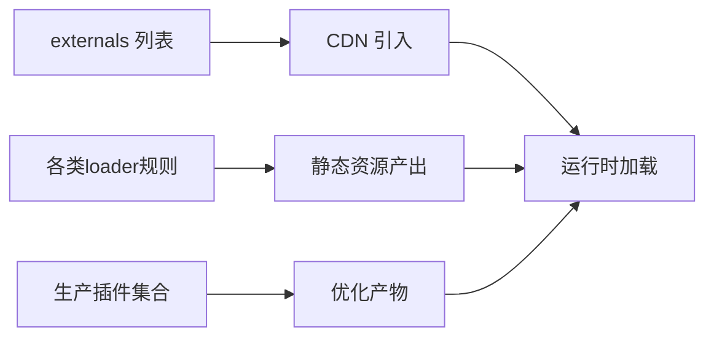

# 构建优化

<cite>
**本文引用的文件**
- [package.json](file://package.json)
- [config/index.js](file://config/index.js)
- [config/dev.env.js](file://config/dev.env.js)
- [config/prod.env.js](file://config/prod.env.js)
- [build/webpack.base.conf.js](file://build/webpack.base.conf.js)
- [build/webpack.dev.conf.js](file://build/webpack.dev.conf.js)
- [build/webpack.prod.conf.js](file://build/webpack.prod.conf.js)
- [build/build.js](file://build/build.js)
</cite>

## 目录
1. [简介](#简介)
2. [项目结构](#项目结构)
3. [核心组件](#核心组件)
4. [架构总览](#架构总览)
5. [详细组件分析](#详细组件分析)
6. [依赖分析](#依赖分析)
7. [性能考量](#性能考量)
8. [故障排查指南](#故障排查指南)
9. [结论](#结论)
10. [附录](#附录)

## 简介
本指南面向校园管理系统的前端构建流程，聚焦于Webpack配置层面的性能优化与工程化实践。内容涵盖：externals外部依赖剥离、代码分割策略（vendor/manifest/app异步拆分）、Tree Shaking与模块作用域提升、资源与图片处理优化、第三方库优化策略、开发与生产环境差异化配置、以及在CI/CD流水线中的构建优化与监控建议。同时提供Bundle分析工具的使用方法与最佳实践。

## 项目结构
该工程采用基于模板的多环境配置与分层构建策略：
- 根目录提供脚本与依赖声明，统一入口与版本约束
- config目录定义开发与生产环境的通用参数
- build目录包含基础配置、开发配置、生产配置与打包执行脚本
- src目录为业务源码，静态资源位于static目录

图表来源
- [package.json:1-98](file://package.json#L1-L98)
- [config/index.js:1-72](file://config/index.js#L1-L72)
- [build/build.js:1-42](file://build/build.js#L1-L42)
- [build/webpack.prod.conf.js:1-149](file://build/webpack.prod.conf.js#L1-L149)
- [build/webpack.dev.conf.js:1-96](file://build/webpack.dev.conf.js#L1-L96)
- [build/webpack.base.conf.js:1-102](file://build/webpack.base.conf.js#L1-L102)

章节来源
- [package.json:1-98](file://package.json#L1-L98)
- [config/index.js:1-72](file://config/index.js#L1-L72)

## 核心组件
- 基础配置（externals、加载器、别名、Node行为）
- 开发配置（热更新、错误覆盖、端口发现、友好提示）
- 生产配置（Uglify压缩、CSS抽取与优化、HTML最小化、代码分割、Gzip、Bundle分析）

章节来源
- [build/webpack.base.conf.js:12-102](file://build/webpack.base.conf.js#L12-L102)
- [build/webpack.dev.conf.js:16-96](file://build/webpack.dev.conf.js#L16-L96)
- [build/webpack.prod.conf.js:16-149](file://build/webpack.prod.conf.js#L16-L149)

## 架构总览
下图展示从脚本到最终产物的关键流程与关键插件：

图表来源
- [build/build.js:14-41](file://build/build.js#L14-L41)
- [build/webpack.prod.conf.js:16-149](file://build/webpack.prod.conf.js#L16-L149)
- [build/webpack.base.conf.js:14-102](file://build/webpack.base.conf.js#L14-L102)

## 详细组件分析

### 外部依赖剥离（Externals）与第三方库优化
- 基础配置中通过externals将常用库（如Vue、Element-UI、jQuery、ECharts等）标记为外部依赖，避免被打包进业务代码，显著降低首屏体积与打包时间
- 生产配置中保留了基础配置的externals，未在生产配置中覆盖或删除，确保生产与开发一致的外部依赖策略
- 建议：在CDN引入这些库时，确保版本与打包内使用的版本兼容；若需按需引入，可结合动态导入与代码分割进一步细化

图表来源
- [build/webpack.base.conf.js:26-36](file://build/webpack.base.conf.js#L26-L36)
- [build/webpack.prod.conf.js:17-19](file://build/webpack.prod.conf.js#L17-L19)

章节来源
- [build/webpack.base.conf.js:26-36](file://build/webpack.base.conf.js#L26-L36)
- [build/webpack.prod.conf.js:17-19](file://build/webpack.prod.conf.js#L17-L19)

### 代码分割策略（Vendor/Manifest/App 异步拆分）
- vendor：提取来自node_modules的第三方依赖，保持稳定以获得更好的缓存效果
- manifest：提取webpack运行时与模块映射，避免业务代码变更导致其hash变化
- app + async vendor-async：对异步chunks进行共享模块抽取，减少重复与提升加载效率
- 模块ID稳定化：HashedModuleIdsPlugin确保模块ID稳定，有利于长期缓存
- 作用域提升：ModuleConcatenationPlugin开启Scope Hoisting，减少函数包裹与作用域开销

图表来源
- [build/webpack.prod.conf.js:84-112](file://build/webpack.prod.conf.js#L84-L112)
- [build/webpack.prod.conf.js:80-83](file://build/webpack.prod.conf.js#L80-L83)

章节来源
- [build/webpack.prod.conf.js:84-112](file://build/webpack.prod.conf.js#L84-L112)
- [build/webpack.prod.conf.js:80-83](file://build/webpack.prod.conf.js#L80-L83)

### Tree Shaking 与模块作用域提升
- 作用域提升：启用ModuleConcatenationPlugin，减少模块包装与作用域解析成本
- Tree Shaking：配合ES模块语法与生产环境无用代码剔除（由UglifyJS处理），建议在模块侧使用纯ESM导出与按需引入，避免全量引入导致无法摇树

图表来源
- [build/webpack.prod.conf.js:83](file://build/webpack.prod.conf.js#L83)
- [build/webpack.prod.conf.js:38-46](file://build/webpack.prod.conf.js#L38-L46)

章节来源
- [build/webpack.prod.conf.js:83](file://build/webpack.prod.conf.js#L83)
- [build/webpack.prod.conf.js:38-46](file://build/webpack.prod.conf.js#L38-L46)

### 资源与图片处理优化
- 图片/媒体/字体均通过url-loader处理，设置合理limit阈值，小资源内联减少请求数，大资源单独文件便于缓存
- 建议：对图片进行格式选择（WebP/JPEG2000等）与尺寸控制；对SVG图标采用内联或雪碧图策略；对视频/音频采用流式播放与懒加载

图表来源
- [build/webpack.base.conf.js:61-83](file://build/webpack.base.conf.js#L61-L83)

章节来源
- [build/webpack.base.conf.js:61-83](file://build/webpack.base.conf.js#L61-L83)

### 生产环境压缩与Gzip
- JS压缩：UglifyJsPlugin，开启并行压缩与sourceMap控制
- CSS压缩：OptimizeCSSPlugin与ExtractTextPlugin配合，抽取并去重CSS
- HTML最小化：HtmlWebpackPlugin启用removeComments/collapseWhitespace等选项
- 可选Gzip：根据配置决定是否启用CompressionWebpackPlugin

图表来源
- [build/webpack.prod.conf.js:38-79](file://build/webpack.prod.conf.js#L38-L79)
- [build/webpack.prod.conf.js:125-141](file://build/webpack.prod.conf.js#L125-L141)

章节来源
- [build/webpack.prod.conf.js:38-79](file://build/webpack.prod.conf.js#L38-L79)
- [build/webpack.prod.conf.js:125-141](file://build/webpack.prod.conf.js#L125-L141)

### Bundle分析工具使用
- 工具：webpack-bundle-analyzer
- 使用方式：在生产配置中通过bundleAnalyzerReport开关控制是否启用BundleAnalyzerPlugin；也可通过命令行参数触发
- 建议：定期对比不同分支/版本的Bundle构成，定位体积增长点并制定削减策略

图表来源
- [config/index.js:69](file://config/index.js#L69)
- [build/webpack.prod.conf.js:143-146](file://build/webpack.prod.conf.js#L143-L146)

章节来源
- [config/index.js:69](file://config/index.js#L69)
- [build/webpack.prod.conf.js:143-146](file://build/webpack.prod.conf.js#L143-L146)

### 开发环境与生产环境差异化策略
- 开发环境
  - SourceMap：cheap-module-eval-source-map，快速映射
  - HMR：HotModuleReplacementPlugin + NamedModulesPlugin
  - 错误覆盖与通知：overlay与notifier
  - 静态资源复制：CopyWebpackPlugin
- 生产环境
  - SourceMap：可选，关闭以减小体积
  - 压缩与优化：UglifyJS、CSS抽取与优化、HTML最小化
  - 代码分割：vendor/manifest/app异步拆分
  - 分析与Gzip：按需启用

图表来源
- [config/index.js:28-37](file://config/index.js#L28-L37)
- [build/webpack.dev.conf.js:20-68](file://build/webpack.dev.conf.js#L20-L68)
- [config/index.js:54-69](file://config/index.js#L54-L69)
- [build/webpack.prod.conf.js:38-122](file://build/webpack.prod.conf.js#L38-L122)

章节来源
- [config/index.js:28-37](file://config/index.js#L28-L37)
- [build/webpack.dev.conf.js:20-68](file://build/webpack.dev.conf.js#L20-L68)
- [config/index.js:54-69](file://config/index.js#L54-L69)
- [build/webpack.prod.conf.js:38-122](file://build/webpack.prod.conf.js#L38-L122)

### CI/CD 流水线中的构建优化实践
- 缓存策略：缓存node_modules与构建中间产物，缩短二次构建时间
- 并行任务：将lint、测试与构建并行执行，仅在成功后进入发布阶段
- 安全与一致性：固定Node/NPM版本，锁定依赖版本，避免环境漂移
- 构建产物校验：校验产物大小阈值、关键文件存在性与完整性
- 分析报告归档：将Bundle分析报告与构建日志一并归档，便于回溯

（本节为通用实践建议，不直接分析具体文件）

## 依赖分析
- 外部依赖（externals）与打包产物的关系
- 加载器链路与资源类型匹配
- 插件依赖顺序与职责边界

图表来源
- [build/webpack.base.conf.js:26-36](file://build/webpack.base.conf.js#L26-L36)
- [build/webpack.base.conf.js:47-84](file://build/webpack.base.conf.js#L47-L84)
- [build/webpack.prod.conf.js:33-122](file://build/webpack.prod.conf.js#L33-L122)

章节来源
- [build/webpack.base.conf.js:26-36](file://build/webpack.base.conf.js#L26-L36)
- [build/webpack.base.conf.js:47-84](file://build/webpack.base.conf.js#L47-L84)
- [build/webpack.prod.conf.js:33-122](file://build/webpack.prod.conf.js#L33-L122)

## 性能考量
- 优先启用externals，减少打包体积与时间
- 合理设置url-loader的limit，平衡内联与请求数
- 使用代码分割与模块ID稳定化，提升缓存命中率
- 在生产环境启用压缩与CSS抽取，关闭不必要的SourceMap
- 使用Bundle分析工具定期审视体积构成，及时调整策略

（本节提供通用指导，不直接分析具体文件）

## 故障排查指南
- 构建失败
  - 查看构建日志中的错误汇总与堆栈
  - 关注UglifyJS压缩阶段的报错，必要时临时关闭以定位问题模块
- 体积异常增大
  - 使用Bundle分析工具定位新增/重复模块
  - 检查是否误将大资源内联或未启用压缩
- 开发体验不佳
  - 确认HMR与错误覆盖已启用
  - 检查端口占用与静态资源复制是否正常

章节来源
- [build/build.js:20-41](file://build/build.js#L20-L41)
- [build/webpack.prod.conf.js:38-46](file://build/webpack.prod.conf.js#L38-L46)

## 结论
通过externals剥离、合理的代码分割、Tree Shaking与作用域提升、资源与图片处理优化、以及生产环境的压缩与分析工具，校园管理系统可在保证功能完整性的前提下显著提升构建性能与运行效率。建议在CI/CD中固化上述策略，并建立持续监控与回归分析机制，确保构建质量与稳定性。

## 附录
- 常用命令
  - 开发测试：通过脚本启动开发服务器并开启分析报告
  - 生产构建：清理输出目录后执行构建，输出带哈希的产物
- 版本与浏览器兼容
  - 依赖与browserslist配置确保兼容主流现代浏览器

章节来源
- [package.json:7-11](file://package.json#L7-L11)
- [build/build.js:17-41](file://build/build.js#L17-L41)
- [package.json:88-96](file://package.json#L88-L96)