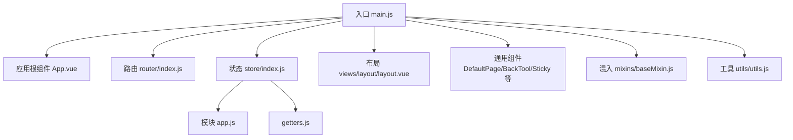
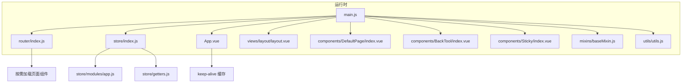
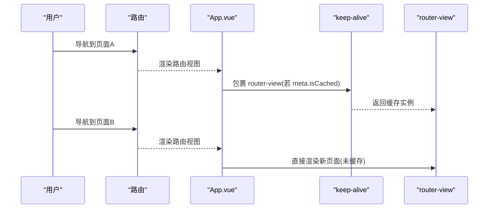
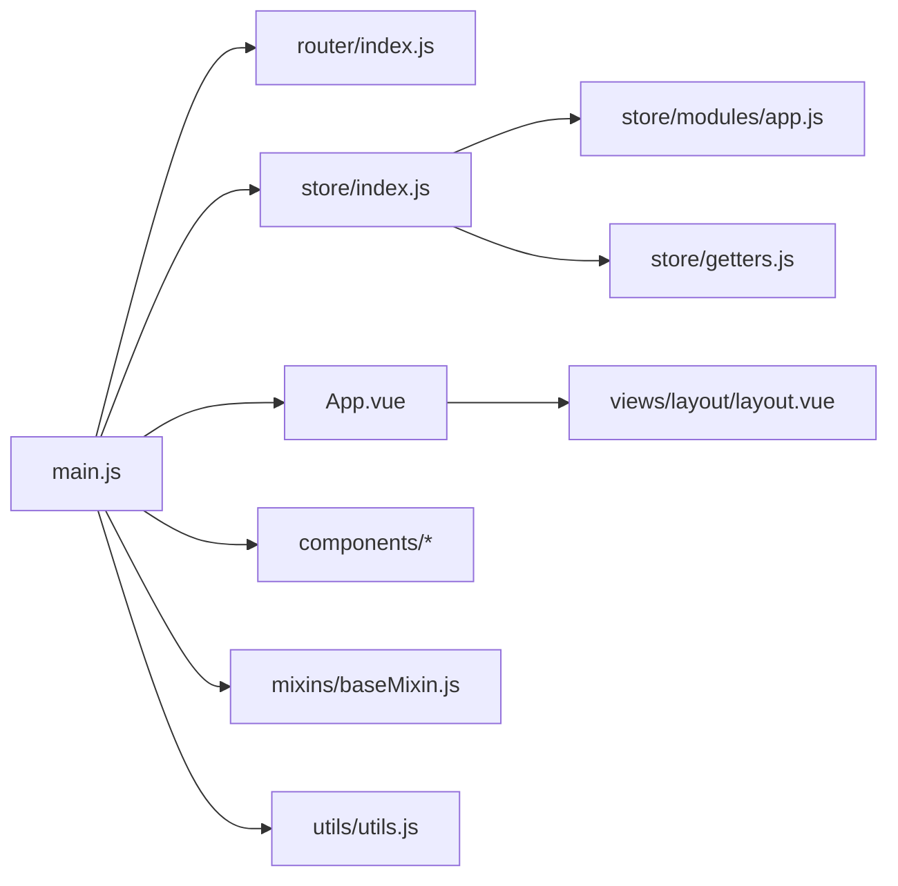

# 组件性能优化

<cite>
**本文引用的文件**
- [main.js](file://src/main.js)
- [App.vue](file://src/App.vue)
- [router/index.js](file://src/router/index.js)
- [store/index.js](file://src/store/index.js)
- [store/modules/app.js](file://src/store/modules/app.js)
- [store/getters.js](file://src/store/getters.js)
- [components/DefaultPage/index.vue](file://src/components/DefaultPage/index.vue)
- [components/BackTool/index.vue](file://src/components/BackTool/index.vue)
- [components/Sticky/index.vue](file://src/components/Sticky/index.vue)
- [mixins/baseMixin.js](file://src/mixins/baseMixin.js)
- [utils/utils.js](file://src/utils/utils.js)
- [views/layout/layout.vue](file://src/views/layout/layout.vue)
</cite>

## 目录
1. [简介](#简介)
2. [项目结构](#项目结构)
3. [核心组件](#核心组件)
4. [架构总览](#架构总览)
5. [组件级性能优化策略](#组件级性能优化策略)
6. [依赖关系分析](#依赖关系分析)
7. [性能考量与建议](#性能考量与建议)
8. [故障排查与调试](#故障排查与调试)
9. [结论](#结论)
10. [附录](#附录)

## 简介
本指南聚焦于校园管理系统的组件级别性能优化，围绕可复用组件的懒加载与动态组件、keep-alive 缓存、组件拆分；渲染层面的 v-memo 与计算属性缓存、watcher 优化与响应式数据优化；以及组件通信、事件处理与 DOM 操作优化进行系统梳理，并提供可落地的监控与调试技巧及大型组件拆分与重构策略。

## 项目结构
系统采用 Vue 2 + Element UI 的前端架构，路由按模块拆分，全局注册通用组件与指令，状态集中管理，布局组件统一承载导航与页面容器职责。

图表来源
- [main.js:1-221](file://src/main.js#L1-L221)
- [App.vue:1-183](file://src/App.vue#L1-L183)
- [router/index.js:1-207](file://src/router/index.js#L1-L207)
- [store/index.js:1-20](file://src/store/index.js#L1-L20)
- [store/modules/app.js:1-54](file://src/store/modules/app.js#L1-L54)
- [store/getters.js:1-26](file://src/store/getters.js#L1-L26)
- [views/layout/layout.vue:1-507](file://src/views/layout/layout.vue#L1-L507)
- [components/DefaultPage/index.vue:1-35](file://src/components/DefaultPage/index.vue#L1-L35)
- [components/BackTool/index.vue:1-29](file://src/components/BackTool/index.vue#L1-L29)
- [components/Sticky/index.vue:1-74](file://src/components/Sticky/index.vue#L1-L74)
- [mixins/baseMixin.js:1-103](file://src/mixins/baseMixin.js#L1-L103)
- [utils/utils.js:1-320](file://src/utils/utils.js#L1-L320)

章节来源
- [main.js:1-221](file://src/main.js#L1-L221)
- [router/index.js:1-207](file://src/router/index.js#L1-L207)
- [store/index.js:1-20](file://src/store/index.js#L1-L20)

## 核心组件
- 布局与导航：views/layout/layout.vue 承载顶部导航、侧边菜单、用户信息与弹窗交互，是页面骨架与权限控制的关键节点。
- 通用小部件：components/DefaultPage/index.vue 提供空态占位图；components/BackTool/index.vue 提供返回按钮与分割线控制；components/Sticky/index.vue 提供粘性定位逻辑。
- 混入与工具：mixins/baseMixin.js 提供分页、跳转、导出等常用能力；utils/utils.js 提供适配、权限判断、脚本/样式动态加载、字典查询等工具函数。
- 状态与路由：store/modules/app.js 管理分页与页面参数；router/index.js 定义模块化路由与按需加载；App.vue 通过 keep-alive 控制页面缓存。

章节来源
- [views/layout/layout.vue:1-507](file://src/views/layout/layout.vue#L1-L507)
- [components/DefaultPage/index.vue:1-35](file://src/components/DefaultPage/index.vue#L1-L35)
- [components/BackTool/index.vue:1-29](file://src/components/BackTool/index.vue#L1-L29)
- [components/Sticky/index.vue:1-74](file://src/components/Sticky/index.vue#L1-L74)
- [mixins/baseMixin.js:1-103](file://src/mixins/baseMixin.js#L1-L103)
- [utils/utils.js:1-320](file://src/utils/utils.js#L1-L320)
- [store/modules/app.js:1-54](file://src/store/modules/app.js#L1-L54)
- [router/index.js:1-207](file://src/router/index.js#L1-L207)
- [App.vue:1-183](file://src/App.vue#L1-L183)

## 架构总览
系统通过路由按模块划分页面，使用 keep-alive 对可缓存页面进行内存复用；全局混入与工具函数提供通用能力；布局组件统一处理导航与权限；状态模块管理页面级参数。

图表来源
- [main.js:1-221](file://src/main.js#L1-L221)
- [router/index.js:1-207](file://src/router/index.js#L1-L207)
- [store/index.js:1-20](file://src/store/index.js#L1-L20)
- [store/modules/app.js:1-54](file://src/store/modules/app.js#L1-L54)
- [store/getters.js:1-26](file://src/store/getters.js#L1-L26)
- [App.vue:1-183](file://src/App.vue#L1-L183)
- [views/layout/layout.vue:1-507](file://src/views/layout/layout.vue#L1-L507)
- [components/DefaultPage/index.vue:1-35](file://src/components/DefaultPage/index.vue#L1-L35)
- [components/BackTool/index.vue:1-29](file://src/components/BackTool/index.vue#L1-L29)
- [components/Sticky/index.vue:1-74](file://src/components/Sticky/index.vue#L1-L74)
- [mixins/baseMixin.js:1-103](file://src/mixins/baseMixin.js#L1-L103)
- [utils/utils.js:1-320](file://src/utils/utils.js#L1-L320)

## 组件级性能优化策略

### 可复用组件的懒加载与动态组件
- 动态组件与按需加载
  - 路由层已广泛使用动态导入以实现页面级懒加载，减少首屏体积与初次渲染压力。
  - 建议在业务组件中对重型子组件（如富文本、图表、地图）采用动态导入或 v-if 控制首次渲染。
- 动态组件切换
  - 对频繁切换但内容差异较大的面板，使用动态组件与 key 变更避免缓存污染，必要时结合 keep-alive 的 include/exclude 精准缓存。

章节来源
- [router/index.js:24-38](file://src/router/index.js#L24-L38)
- [router/index.js:105-125](file://src/router/index.js#L105-L125)

### keep-alive 缓存
- 缓存策略
  - App.vue 已通过 meta.isCached 区分缓存与非缓存路由，配合 keep-alive 实现页面级复用，降低重复初始化成本。
  - 建议仅对稳定且状态可复用的页面启用缓存，复杂表单或需要强刷新的页面禁用缓存。
- include/exclude 精准控制
  - 在实际项目中可通过 include/exclude 明确缓存白名单，避免无关组件被缓存导致内存占用上升。

图表来源
- [App.vue:1-9](file://src/App.vue#L1-L9)
- [router/index.js:135-148](file://src/router/index.js#L135-L148)

章节来源
- [App.vue:1-9](file://src/App.vue#L1-L9)

### 组件拆分与职责单一
- 页面骨架与业务解耦
  - views/layout/layout.vue 负责导航与权限，业务页面仅关注自身数据与交互，降低单页复杂度。
- 通用小部件内聚
  - DefaultPage/BackTool/Sticky 等组件功能明确、可复用性强，适合独立维护与性能优化。

章节来源
- [views/layout/layout.vue:1-507](file://src/views/layout/layout.vue#L1-L507)
- [components/DefaultPage/index.vue:1-35](file://src/components/DefaultPage/index.vue#L1-L35)
- [components/BackTool/index.vue:1-29](file://src/components/BackTool/index.vue#L1-L29)
- [components/Sticky/index.vue:1-74](file://src/components/Sticky/index.vue#L1-L74)

### 渲染优化：v-memo、计算属性缓存、watcher 优化与响应式数据
- v-memo
  - 对重复渲染的大块静态模板或稳定列表项使用 v-memo，避免不必要的 diff。
- 计算属性缓存
  - 将昂贵的派生逻辑放入计算属性，利用依赖追踪自动缓存；避免在模板中直接执行复杂表达式。
- watcher 优化
  - 对高频变更的输入使用防抖（debounce）或节流（throttle），并合理设置 immediate/flush 时机。
- 响应式数据优化
  - 避免一次性注入大量字段；优先使用局部变量或常量；对数组/对象更新使用就地修改或替换策略，减少深层监听开销。

说明：本节为通用优化原则，不直接对应具体代码片段。

### 组件通信优化
- 父子通信
  - 使用 props 下发数据，尽量扁平化结构；对大对象使用浅拷贝或只传递必要字段。
- 事件处理
  - 在组件销毁前移除事件监听；对滚动、窗口尺寸等高频事件使用防抖/去抖。
- 全局状态
  - 将跨层级共享的状态放入 Vuex，避免层层传参；使用 getters 计算派生值，减少重复计算。

章节来源
- [mixins/baseMixin.js:21-28](file://src/mixins/baseMixin.js#L21-L28)
- [utils/utils.js:20-28](file://src/utils/utils.js#L20-L28)

### 事件处理优化与 DOM 操作
- DOM 操作
  - 避免直接操作原生 DOM；优先使用 ref + $nextTick 触发布局重排；对表格类组件在激活钩子中调用 doLayout。
- 事件绑定
  - 在 mounted 中绑定事件，在 beforeDestroy 中解绑；对全局事件（如 scroll）注意生命周期清理。

章节来源
- [mixins/baseMixin.js:21-28](file://src/mixins/baseMixin.js#L21-L28)
- [components/Sticky/index.vue:38-71](file://src/components/Sticky/index.vue#L38-L71)

### 组件渲染与交互细节
- 空态与占位
  - DefaultPage 组件简洁高效，避免额外渲染逻辑，适合在数据为空时快速展示。
- 返回工具
  - BackTool 提供返回与分割线控制，避免在业务页重复实现相同逻辑。

章节来源
- [components/DefaultPage/index.vue:1-35](file://src/components/DefaultPage/index.vue#L1-L35)
- [components/BackTool/index.vue:1-29](file://src/components/BackTool/index.vue#L1-L29)

## 依赖关系分析
- 入口依赖：main.js 注册全局组件、指令与插件，配置路由守卫与进度条，挂载应用。
- 路由依赖：router/index.js 引入各模块路由并使用动态导入，减少初始包体。
- 状态依赖：store/index.js 聚合模块与 getters，app.js 管理页面级参数，getters 提供派生访问。
- 组件依赖：App.vue 作为根容器，配合 keep-alive；layout.vue 作为页面骨架；通用组件作为基础能力。

图表来源
- [main.js:1-221](file://src/main.js#L1-L221)
- [router/index.js:1-207](file://src/router/index.js#L1-L207)
- [store/index.js:1-20](file://src/store/index.js#L1-L20)
- [store/modules/app.js:1-54](file://src/store/modules/app.js#L1-L54)
- [store/getters.js:1-26](file://src/store/getters.js#L1-L26)
- [App.vue:1-183](file://src/App.vue#L1-L183)
- [views/layout/layout.vue:1-507](file://src/views/layout/layout.vue#L1-L507)
- [mixins/baseMixin.js:1-103](file://src/mixins/baseMixin.js#L1-L103)
- [utils/utils.js:1-320](file://src/utils/utils.js#L1-L320)

章节来源
- [main.js:1-221](file://src/main.js#L1-L221)
- [router/index.js:1-207](file://src/router/index.js#L1-L207)
- [store/index.js:1-20](file://src/store/index.js#L1-L20)

## 性能考量与建议
- 首屏与交互体验
  - 通过路由动态导入与 keep-alive 缓存平衡首屏体积与后续切换性能。
  - 对高频交互（滚动、窗口变化）使用防抖/节流，避免过度重绘。
- 数据与状态
  - 将跨组件共享的数据收敛至 store，使用 getters 计算派生值；避免在组件内部做重复计算。
  - 对分页参数、筛选条件等页面级状态放入模块 store，减少 props 传递层级。
- DOM 与渲染
  - 使用 $nextTick 触发布局重排；对表格类组件在激活钩子中触发布局修正。
  - 对大列表使用虚拟滚动或分页，避免一次性渲染过多节点。

章节来源
- [store/modules/app.js:1-54](file://src/store/modules/app.js#L1-L54)
- [mixins/baseMixin.js:21-28](file://src/mixins/baseMixin.js#L21-L28)
- [utils/utils.js:20-28](file://src/utils/utils.js#L20-L28)

## 故障排查与调试
- 错误日志
  - 生产环境配置全局错误处理器，记录错误堆栈与上下文，便于定位异常组件与调用链。
- 路由与缓存
  - 若出现缓存页面状态异常，检查 meta.isCached 与 keep-alive 的 include/exclude 配置；必要时在 beforeDestroy 中清理副作用。
- 性能监控
  - 使用浏览器性能面板观察长任务、重排与重绘热点；结合 Vue DevTools 分析组件渲染次数与响应式依赖变化。
- 事件泄漏
  - 确认组件销毁时移除了全局事件监听；对粘性组件在 mounted/destroyed 生命周期中正确绑定/解绑。

章节来源
- [main.js:205-214](file://src/main.js#L205-L214)
- [components/Sticky/index.vue:65-71](file://src/components/Sticky/index.vue#L65-L71)

## 结论
通过路由懒加载、keep-alive 缓存、组件拆分与职责单一化，结合渲染与事件处理优化、响应式数据治理，可显著提升校园管理系统的组件级性能。配合完善的监控与调试流程，能够持续发现并解决性能瓶颈，保障复杂业务场景下的流畅体验。

## 附录
- 术语
  - keep-alive：Vue 内置组件，缓存动态组件实例，避免重复创建与销毁。
  - v-memo：Vue 3+ 指令，对稳定子树进行记忆化渲染。
  - 防抖/节流：对高频事件进行采样，降低回调触发频率。
- 参考实现位置
  - 路由动态导入与白名单：[router/index.js:24-38](file://src/router/index.js#L24-L38)
  - 页面缓存开关：[App.vue:1-9](file://src/App.vue#L1-L9)
  - 表格布局修正：[mixins/baseMixin.js:21-28](file://src/mixins/baseMixin.js#L21-L28)
  - 粘性定位逻辑：[components/Sticky/index.vue:38-71](file://src/components/Sticky/index.vue#L38-L71)
  - 全局错误处理：[main.js:205-214](file://src/main.js#L205-L214)