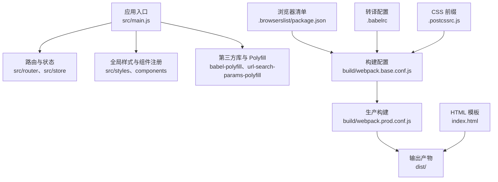
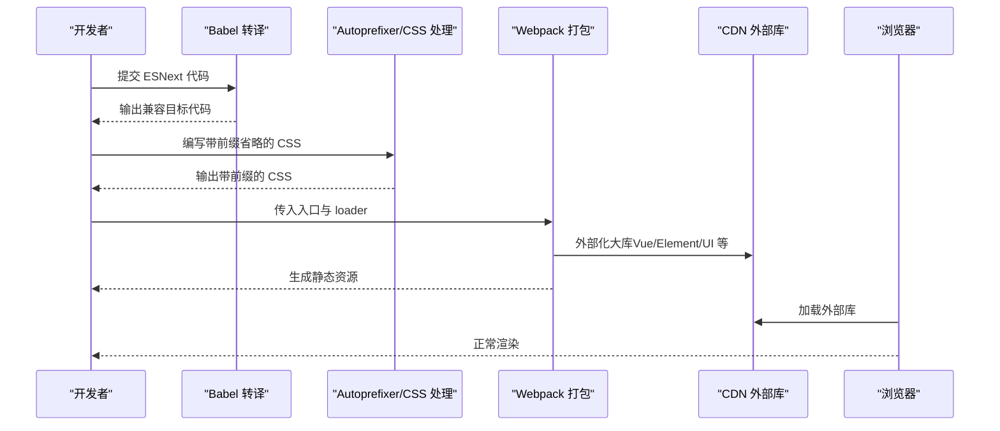
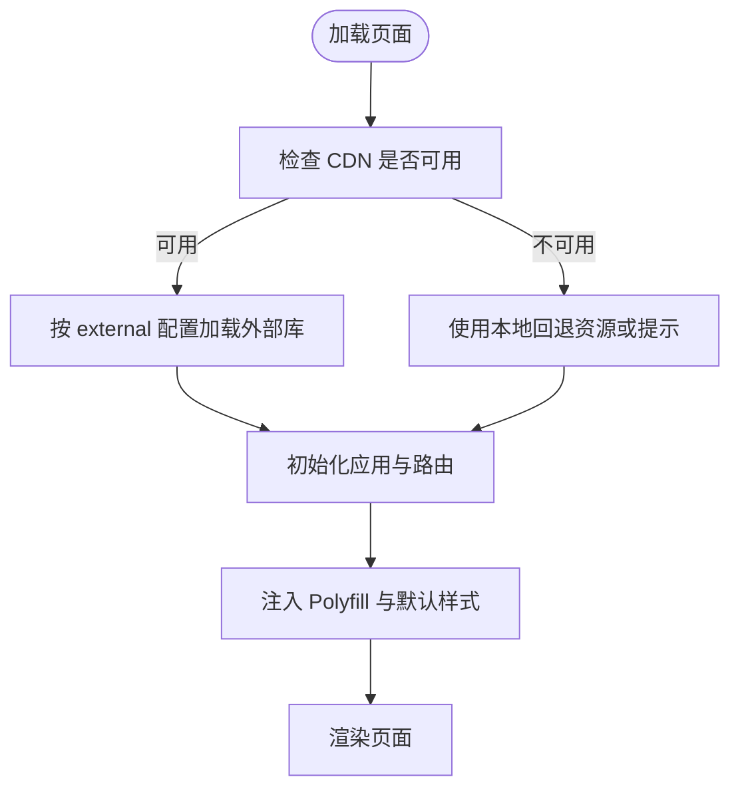
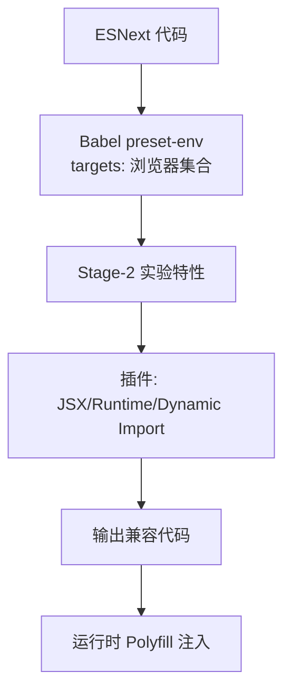
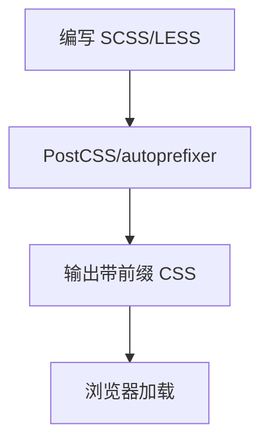
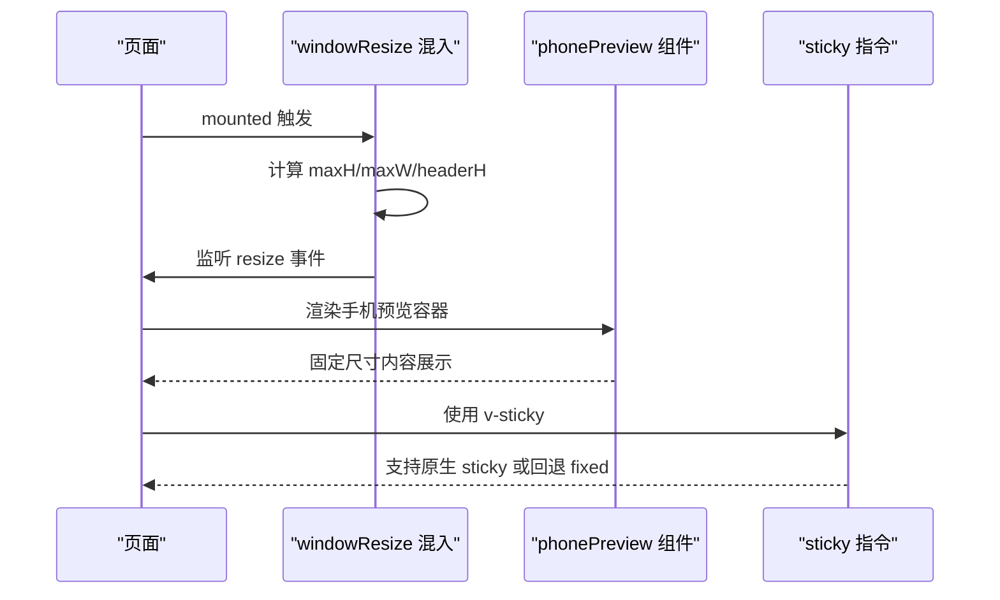
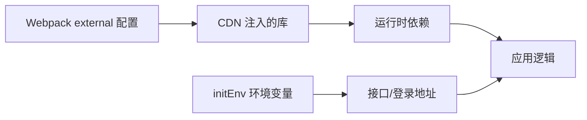
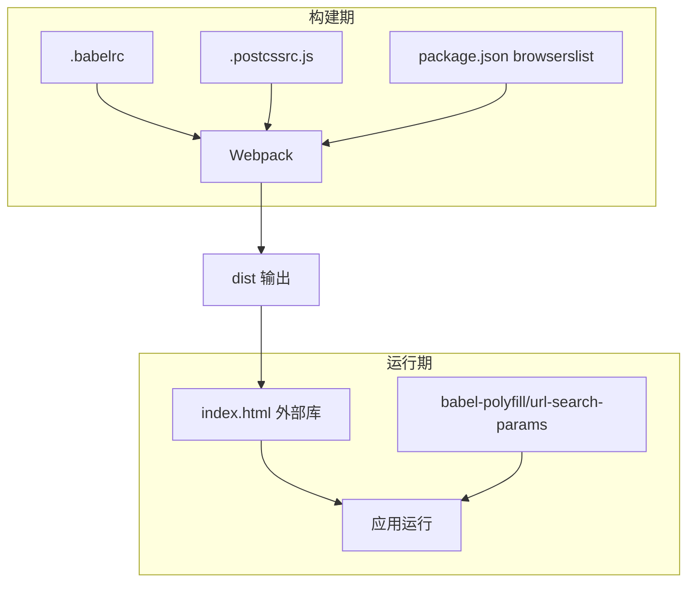

# 兼容性问题

<cite>
**本文引用的文件**
- [.babelrc](file://.babelrc)
- [.postcssrc.js](file://.postcssrc.js)
- [package.json](file://package.json)
- [config/index.js](file://config/index.js)
- [build/webpack.base.conf.js](file://build/webpack.base.conf.js)
- [build/webpack.prod.conf.js](file://build/webpack.prod.conf.js)
- [src/main.js](file://src/main.js)
- [index.html](file://index.html)
- [src/utils/initEnv.js](file://src/utils/initEnv.js)
- [src/mixins/windowResize.js](file://src/mixins/windowResize.js)
- [src/styles/mixin.scss](file://src/styles/mixin.scss)
- [src/components/phonePreview/index.vue](file://src/components/phonePreview/index.vue)
- [src/directive/sticky.js](file://src/directive/sticky.js)
- [src/filters/index.js](file://src/filters/index.js)
</cite>

## 目录
1. [简介](#简介)
2. [项目结构](#项目结构)
3. [核心组件](#核心组件)
4. [架构总览](#架构总览)
5. [详细组件分析](#详细组件分析)
6. [依赖关系分析](#依赖关系分析)
7. [性能考量](#性能考量)
8. [故障排查指南](#故障排查指南)
9. [结论](#结论)
10. [附录](#附录)

## 简介
本文件聚焦于本项目的兼容性问题排查与治理，覆盖以下方面：
- 浏览器兼容性：重点说明对 IE 的支持策略、现代浏览器差异与规避手段
- 移动端适配：响应式布局、触摸交互、屏幕尺寸适配与预览组件
- 第三方库版本冲突：CDN 引入与打包外部化策略、版本不一致风险
- 构建与转译：Babel 转译配置、Polyfill 使用、CSS 前缀处理
- 自动化与测试：浏览器测试策略、自动化兼容性测试建议、问题复现流程
- 实战技巧：响应式设计、触摸事件处理、屏幕尺寸适配

## 项目结构
本项目采用 Vue 2.x + Webpack 3 的传统工程化结构，关键目录与文件如下：
- 构建与配置：build、config、.babelrc、.postcssrc.js、package.json
- 应用入口：src/main.js、index.html
- 工具与混入：src/utils、src/mixins、src/directive、src/filters
- 样式与主题：src/styles
- 组件与页面：src/components、src/views
- 静态资源：static

图表来源
- [src/main.js:1-221](file://src/main.js#L1-L221)
- [build/webpack.base.conf.js:1-102](file://build/webpack.base.conf.js#L1-L102)
- [build/webpack.prod.conf.js:1-149](file://build/webpack.prod.conf.js#L1-L149)
- [package.json:92-96](file://package.json#L92-L96)
- [.babelrc:1-16](file://.babelrc#L1-L16)
- [.postcssrc.js:1-11](file://.postcssrc.js#L1-L11)
- [index.html:1-41](file://index.html#L1-L41)

章节来源
- [config/index.js:1-72](file://config/index.js#L1-L72)
- [package.json:12-43](file://package.json#L12-L43)

## 核心组件
- 转译与构建
  - Babel 预设与插件：用于 JS 新语法降级与 JSX/Vue 转译
  - PostCSS/Autoprefixer：自动添加 CSS 前缀
  - Webpack 外部化：将常用库从包体剥离，通过 CDN 引入
- 运行时兼容
  - Polyfill：babel-polyfill、URLSearchParams Polyfill
  - 全局样式：normalize.css、nprogress、Element-UI 主题
- 响应式与移动端
  - 视口元标签：viewport、X-UA-Compatible
  - 窗口尺寸监听混入：动态计算布局高度
  - 手机预览组件：固定尺寸容器模拟移动端展示
  - 指令与过滤器：粘性布局、日期/数字格式化等

章节来源
- [.babelrc:1-16](file://.babelrc#L1-L16)
- [.postcssrc.js:1-11](file://.postcssrc.js#L1-L11)
- [build/webpack.base.conf.js:26-36](file://build/webpack.base.conf.js#L26-L36)
- [src/main.js:4-14](file://src/main.js#L4-L14)
- [index.html:7](file://index.html#L7)
- [src/mixins/windowResize.js:17-62](file://src/mixins/windowResize.js#L17-L62)
- [src/components/phonePreview/index.vue:40-98](file://src/components/phonePreview/index.vue#L40-L98)

## 架构总览
本项目在“构建期”与“运行期”双维度保障兼容性：
- 构建期
  - Babel 将 ES2015+ 语法转译为目标浏览器集合
  - Autoprefixer 为 CSS 属性自动添加厂商前缀
  - Webpack 将大型第三方库 external，减少包体并提升缓存命中
- 运行期
  - 通过 Polyfill 与 normalize.css 解决 API 与默认样式的差异
  - HTML meta 提供渲染与视口控制，避免旧版 IE 渲染异常
  - 动态窗口尺寸计算与移动端预览组件辅助适配

图表来源
- [.babelrc:2-13](file://.babelrc#L2-L13)
- [.postcssrc.js:4-8](file://.postcssrc.js#L4-L8)
- [build/webpack.base.conf.js:26-36](file://build/webpack.base.conf.js#L26-L36)
- [index.html:24-32](file://index.html#L24-L32)

## 详细组件分析

### 浏览器与第三方库兼容策略
- 浏览器目标
  - browserslist 与 Babel targets 均声明不支持 IE <= 8，建议在目标环境中避免使用 IE8 及以下
- 外部化与 CDN
  - Webpack 将 Vue、Element-UI、jQuery、ECharts 等外部化，由 index.html 中的 CDN 注入
  - 若 CDN 不可用，需准备回退方案或本地备用资源
- Polyfill 与默认样式
  - babel-polyfill 与 URLSearchParams Polyfill 在入口处引入，保证 API 可用性
  - normalize.css 用于统一默认样式

图表来源
- [build/webpack.base.conf.js:26-36](file://build/webpack.base.conf.js#L26-L36)
- [index.html:24-32](file://index.html#L24-L32)
- [src/main.js:4-14](file://src/main.js#L4-L14)

章节来源
- [package.json:92-96](file://package.json#L92-L96)
- [.babelrc:5-7](file://.babelrc#L5-L7)
- [build/webpack.base.conf.js:26-36](file://build/webpack.base.conf.js#L26-L36)
- [index.html:24-32](file://index.html#L24-L32)
- [src/main.js:4-14](file://src/main.js#L4-L14)

### Babel 转译与 Polyfill 使用
- 预设与目标
  - env 预设配合 browsers 参数，限定转译范围
  - stage-2 保留实验性特性
- 插件
  - transform-vue-jsx、transform-runtime、dynamic-import-node
- Polyfill
  - babel-polyfill 与 URLSearchParams Polyfill 在入口引入，确保 Promise、URLSearchParams 等可用

图表来源
- [.babelrc:2-13](file://.babelrc#L2-L13)
- [src/main.js:4-5](file://src/main.js#L4-L5)

章节来源
- [.babelrc:1-16](file://.babelrc#L1-L16)
- [src/main.js:4-5](file://src/main.js#L4-L5)

### CSS 前缀与样式一致性
- Autoprefixer
  - 通过 postcssrc 配置启用 autoprefixer，依据 browserslist 自动添加前缀
- 默认样式与主题
  - normalize.css 统一样式基线
  - Element-UI 主题与全局 SCSS 混合变量统一视觉风格

图表来源
- [.postcssrc.js:4-8](file://.postcssrc.js#L4-L8)
- [src/main.js:12-13](file://src/main.js#L12-L13)
- [src/styles/mixin.scss:1-359](file://src/styles/mixin.scss#L1-L359)

章节来源
- [.postcssrc.js:1-11](file://.postcssrc.js#L1-L11)
- [src/main.js:12-13](file://src/main.js#L12-L13)
- [src/styles/mixin.scss:1-359](file://src/styles/mixin.scss#L1-L359)

### 移动端适配与触摸交互
- 视口与渲染
  - index.html 设置 viewport、X-UA-Compatible 与 renderer，避免旧版 IE 与双核浏览器渲染差异
- 窗口尺寸监听
  - windowResize 混入在 mounted 时计算布局高度，并监听 resize 动态更新
- 手机预览组件
  - 固定尺寸容器（如 371x574）模拟移动端展示，便于开发调试
- 粘性布局指令
  - 自研 sticky 指令在不支持原生 sticky 的浏览器中回退为 fixed 定位

图表来源
- [index.html:7](file://index.html#L7)
- [src/mixins/windowResize.js:17-62](file://src/mixins/windowResize.js#L17-L62)
- [src/components/phonePreview/index.vue:40-98](file://src/components/phonePreview/index.vue#L40-L98)
- [src/directive/sticky.js:1-100](file://src/directive/sticky.js#L1-L100)

章节来源
- [index.html:7](file://index.html#L7)
- [src/mixins/windowResize.js:17-62](file://src/mixins/windowResize.js#L17-L62)
- [src/components/phonePreview/index.vue:40-98](file://src/components/phonePreview/index.vue#L40-L98)
- [src/directive/sticky.js:1-100](file://src/directive/sticky.js#L1-L100)

### JavaScript 新特性降级方案
- Promise、URLSearchParams 等
  - 通过 babel-polyfill 与 url-search-params-polyfill 提供降级支持
- 时间处理与格式化
  - moment、自定义过滤器（parseTime、formatTime、timeAgo、nFormatter 等）

章节来源
- [src/main.js:4-5](file://src/main.js#L4-L5)
- [src/filters/index.js:1-121](file://src/filters/index.js#L1-L121)

### 第三方库版本冲突与环境隔离
- 外部化策略
  - Webpack external 将 Vue、Element-UI、jQuery、ECharts 等从包体剥离，通过 index.html 的 CDN 注入
- 版本一致性
  - 若 CDN 与本地版本不一致，可能导致运行时错误；建议在构建阶段校验版本号或提供回退资源
- 环境切换
  - initEnv 根据 ENV_TAREGT 切换登录与接口域名，避免跨域与版本差异带来的问题

图表来源
- [build/webpack.base.conf.js:26-36](file://build/webpack.base.conf.js#L26-L36)
- [index.html:24-32](file://index.html#L24-L32)
- [src/utils/initEnv.js:1-33](file://src/utils/initEnv.js#L1-L33)

章节来源
- [build/webpack.base.conf.js:26-36](file://build/webpack.base.conf.js#L26-L36)
- [index.html:24-32](file://index.html#L24-L32)
- [src/utils/initEnv.js:1-33](file://src/utils/initEnv.js#L1-L33)

## 依赖关系分析
- 构建工具链
  - Babel + PostCSS + Webpack 形成前端工程化基础
- 运行时依赖
  - Vue 2.x、Element-UI、jQuery、ECharts、moment 等
- 外部化与缓存
  - external 将大库交给 CDN，提升首屏与缓存效率

图表来源
- [.babelrc:1-16](file://.babelrc#L1-L16)
- [.postcssrc.js:1-11](file://.postcssrc.js#L1-L11)
- [package.json:92-96](file://package.json#L92-L96)
- [build/webpack.base.conf.js:26-36](file://build/webpack.base.conf.js#L26-L36)
- [index.html:24-32](file://index.html#L24-L32)
- [src/main.js:4-5](file://src/main.js#L4-L5)

章节来源
- [package.json:12-43](file://package.json#L12-L43)
- [build/webpack.base.conf.js:26-36](file://build/webpack.base.conf.js#L26-L36)

## 性能考量
- 包体积与缓存
  - external 大库减少包体，提升缓存命中率
- 源码映射
  - 开发与生产分别采用不同 devtool 策略，平衡调试与体积
- CSS 提取与压缩
  - ExtractTextPlugin 与 OptimizeCSSPlugin 减少重复样式与体积

章节来源
- [build/webpack.prod.conf.js:48-62](file://build/webpack.prod.conf.js#L48-L62)
- [config/index.js:29](file://config/index.js#L29)
- [config/index.js:56](file://config/index.js#L56)

## 故障排查指南
- IE 兼容性问题
  - 现状：不支持 IE <= 8
  - 排查步骤
    - 确认 browserslist 与 Babel targets 是否包含 IE8 及以下
    - 检查 HTML meta 是否正确设置 X-UA-Compatible
    - 如需支持旧版 IE，需调整转译目标与引入额外 Polyfill
- 第三方库版本冲突
  - 现象：运行时报错或功能异常
  - 排查步骤
    - 核对外部化库与 CDN 版本一致性
    - 检查 initEnv 环境变量是否指向正确的服务端点
    - 若 CDN 不可用，准备本地回退资源
- 移动端显示异常
  - 现象：布局错乱、滚动条异常
  - 排查步骤
    - 检查 viewport 设置与 meta 渲染头
    - 使用 phonePreview 组件验证内容适配
    - 使用 windowResize 混入确认动态高度计算
- 构建后样式缺失或前缀不生效
  - 现象：部分属性无厂商前缀
  - 排查步骤
    - 确认 browserslist 与 autoprefixer 配置
    - 检查 PostCSS loader 与 usePostCSS 选项
- 路由与权限导致的白屏
  - 现象：登录后无法进入主页面
  - 排查步骤
    - 检查 router beforeEach/afterEach 逻辑与 Cookie/Token 设置
    - 核对白名单与权限判断分支

章节来源
- [package.json:92-96](file://package.json#L92-L96)
- [index.html:6-7](file://index.html#L6-L7)
- [build/webpack.base.conf.js:26-36](file://build/webpack.base.conf.js#L26-L36)
- [src/utils/initEnv.js:1-33](file://src/utils/initEnv.js#L1-L33)
- [src/mixins/windowResize.js:17-62](file://src/mixins/windowResize.js#L17-L62)
- [.postcssrc.js:4-8](file://.postcssrc.js#L4-L8)
- [build/webpack.prod.conf.js:48-62](file://build/webpack.prod.conf.js#L48-L62)
- [src/main.js:57-203](file://src/main.js#L57-L203)

## 结论
本项目通过“构建期转译 + 运行期 Polyfill + 外部化大库 + Autoprefixer”的组合策略，在现代浏览器上具备良好兼容性。针对 IE8 及以下浏览器，项目明确不支持，建议在目标环境中避免使用旧版 IE。对于移动端与第三方库版本冲突，建议完善 CDN 回退与版本校验机制，并结合 phonePreview 与 windowResize 混入进行快速验证。

## 附录
- 浏览器测试策略
  - 使用自动化测试平台（如 BrowserStack/Sauce Labs）覆盖主流浏览器与版本
  - 本地使用多虚拟机/容器运行不同浏览器组合进行回归
- 自动化兼容性测试
  - 在 CI 中加入浏览器截图对比与关键交互验证
  - 对外部库版本变更进行回归测试
- 问题复现方法
  - 通过 initEnv 切换不同环境变量，复现接口与登录差异
  - 使用 phonePreview 组件快速复现移动端布局问题
  - 在 windowResize 混入中临时打印尺寸变量，定位布局异常