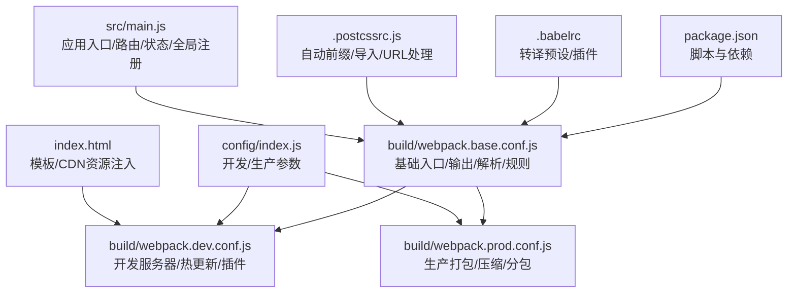
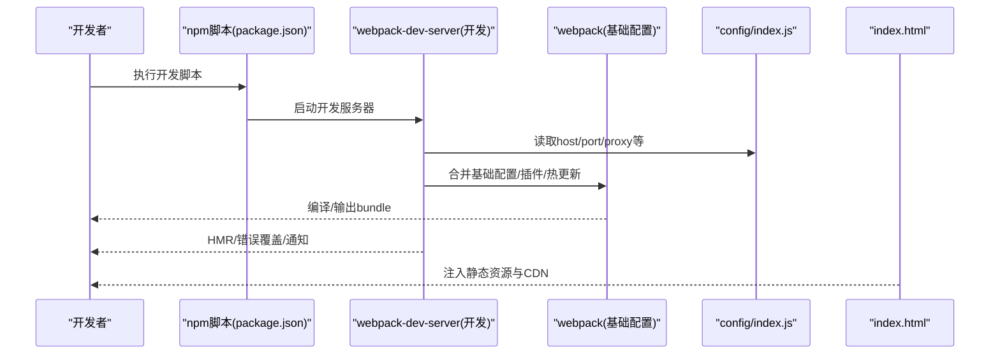
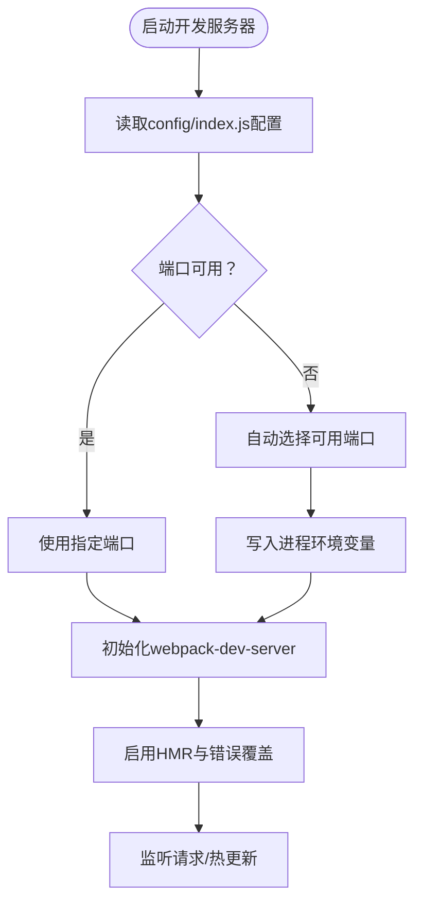
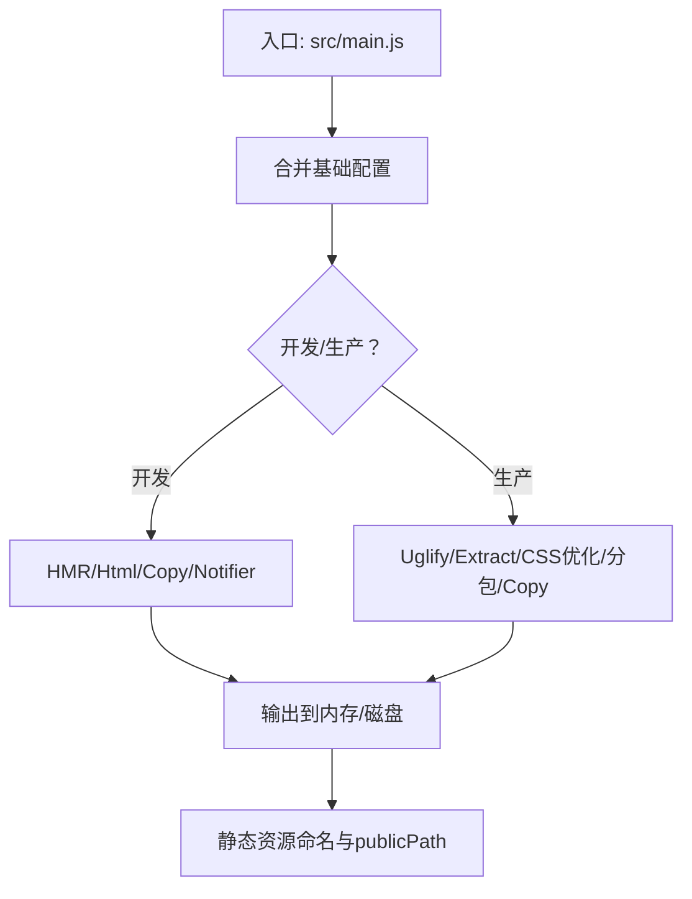
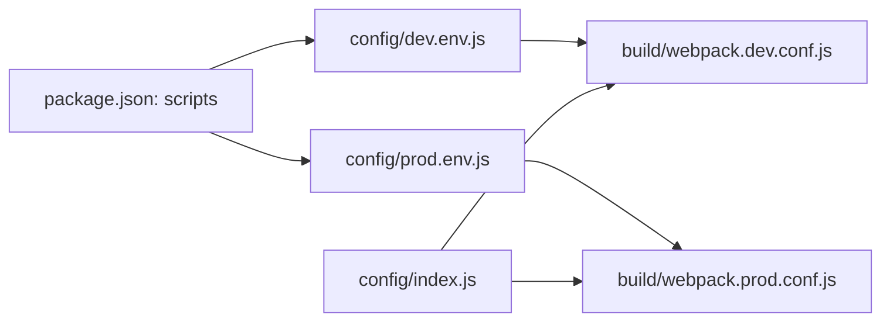

# 开发环境问题

<cite>
**本文引用的文件**
- [package.json](file://package.json)
- [config/index.js](file://config/index.js)
- [config/dev.env.js](file://config/dev.env.js)
- [config/prod.env.js](file://config/prod.env.js)
- [build/webpack.dev.conf.js](file://build/webpack.dev.conf.js)
- [build/webpack.prod.conf.js](file://build/webpack.prod.conf.js)
- [build/webpack.base.conf.js](file://build/webpack.base.conf.js)
- [build/utils.js](file://build/utils.js)
- [build/vue-loader.conf.js](file://build/vue-loader.conf.js)
- [.babelrc](file://.babelrc)
- [.postcssrc.js](file://.postcssrc.js)
- [build/build.js](file://build/build.js)
- [.eslintrc.js](file://.eslintrc.js)
- [src/main.js](file://src/main.js)
- [index.html](file://index.html)
</cite>

## 目录
1. [简介](#简介)
2. [项目结构](#项目结构)
3. [核心组件](#核心组件)
4. [架构总览](#架构总览)
5. [详细组件分析](#详细组件分析)
6. [依赖关系分析](#依赖关系分析)
7. [性能考虑](#性能考虑)
8. [故障排查指南](#故障排查指南)
9. [结论](#结论)
10. [附录](#附录)

## 简介
本文件面向Vue.js项目的前端开发者，聚焦开发环境常见问题的诊断与解决，覆盖以下主题：
- Node.js与npm版本兼容性
- npm依赖安装失败
- Webpack构建错误
- 热重载失效、端口占用、代理配置错误
- IDE配置与代码格式化
- 开发服务器启动失败、CSS编译错误、图片资源加载失败
目标是帮助开发者快速定位并解决问题，提升开发效率。

## 项目结构
该项目采用基于webpack的模板工程，核心目录与职责如下：
- build：构建相关配置与脚本（开发/生产、基础配置、工具函数、vue-loader配置）
- config：开发/生产环境配置（端口、代理、publicPath、sourceMap等）
- src：源码入口与业务代码
- 根目录：包管理与工具配置（package.json、.babelrc、.postcssrc.js、.eslintrc.js）

图表来源
- [package.json:1-98](file://package.json#L1-L98)
- [build/webpack.base.conf.js:1-102](file://build/webpack.base.conf.js#L1-L102)
- [build/webpack.dev.conf.js:1-96](file://build/webpack.dev.conf.js#L1-L96)
- [build/webpack.prod.conf.js:1-149](file://build/webpack.prod.conf.js#L1-L149)
- [config/index.js:1-72](file://config/index.js#L1-L72)
- [.babelrc:1-16](file://.babelrc#L1-L16)
- [.postcssrc.js:1-11](file://.postcssrc.js#L1-L11)
- [src/main.js:1-221](file://src/main.js#L1-L221)
- [index.html:1-41](file://index.html#L1-L41)

章节来源
- [package.json:1-98](file://package.json#L1-L98)
- [config/index.js:1-72](file://config/index.js#L1-L72)
- [build/webpack.base.conf.js:1-102](file://build/webpack.base.conf.js#L1-L102)
- [build/webpack.dev.conf.js:1-96](file://build/webpack.dev.conf.js#L1-L96)
- [build/webpack.prod.conf.js:1-149](file://build/webpack.prod.conf.js#L1-L149)
- [.babelrc:1-16](file://.babelrc#L1-L16)
- [.postcssrc.js:1-11](file://.postcssrc.js#L1-L11)
- [src/main.js:1-221](file://src/main.js#L1-L221)
- [index.html:1-41](file://index.html#L1-L41)

## 核心组件
- 构建脚本与引擎要求
  - scripts：提供开发、测试构建、生产构建三类命令；通过环境变量控制目标环境。
  - engines：限定Node与npm最低版本，避免运行时差异导致的问题。
- 开发配置
  - 主机、端口、自动打开浏览器、错误覆盖层、poll策略、sourceMap、缓存破坏等。
  - 代理表为空，需按需配置。
- 基础webpack配置
  - 入口、输出路径与publicPath、externals、resolve别名与扩展、资源loader规则、node模拟。
- 工具与插件
  - utils生成style loaders；vue-loader.conf统一管理vue文件的loaders与sourceMap；postcss与autoprefixer；babel预设与插件；eslint规则。

章节来源
- [package.json:7-11](file://package.json#L7-L11)
- [package.json:88-91](file://package.json#L88-L91)
- [config/index.js:8-37](file://config/index.js#L8-L37)
- [build/webpack.base.conf.js:14-101](file://build/webpack.base.conf.js#L14-L101)
- [build/utils.js:15-83](file://build/utils.js#L15-L83)
- [build/vue-loader.conf.js:9-22](file://build/vue-loader.conf.js#L9-L22)
- [.postcssrc.js:3-10](file://.postcssrc.js#L3-L10)
- [.babelrc:1-16](file://.babelrc#L1-L16)
- [.eslintrc.js:1-28](file://.eslintrc.js#L1-L28)

## 架构总览
开发与构建流程的关键节点如下：

图表来源
- [package.json:7-11](file://package.json#L7-L11)
- [build/webpack.dev.conf.js:16-69](file://build/webpack.dev.conf.js#L16-L69)
- [config/index.js:8-37](file://config/index.js#L8-L37)
- [index.html:1-41](file://index.html#L1-L41)

## 详细组件分析

### 组件A：开发服务器与热重载
- 关键点
  - 端口选择：若指定端口被占用，将自动寻找可用端口并注入环境变量。
  - HMR：启用HotModuleReplacementPlugin与NamedModulesPlugin。
  - 错误覆盖与通知：overlay与node-notifier联动。
  - 资源路径：publicPath与assetsSubDirectory决定静态资源访问前缀。
- 常见问题
  - 端口被占用：检查系统占用或显式设置PORT环境变量。
  - HMR不生效：确认浏览器未禁用JS、网络代理影响、跨域策略、以及开发服务器配置。
  - 资源404：核对publicPath与实际部署路径一致。

图表来源
- [build/webpack.dev.conf.js:71-95](file://build/webpack.dev.conf.js#L71-L95)
- [config/index.js:16-18](file://config/index.js#L16-L18)
- [config/index.js:24-36](file://config/index.js#L24-L36)

章节来源
- [build/webpack.dev.conf.js:16-69](file://build/webpack.dev.conf.js#L16-L69)
- [build/webpack.dev.conf.js:71-95](file://build/webpack.dev.conf.js#L71-L95)
- [config/index.js:8-37](file://config/index.js#L8-L37)

### 组件B：构建配置与CSS/资源处理
- 关键点
  - 基础配置：entry、output、externals、resolve、loader规则、node模拟。
  - 生产构建：Uglify压缩、ExtractText提取CSS、CommonsChunk拆分、Copy静态资源。
  - CSS处理：utils生成各类型loader；vue-loader.conf统一管理；postcss与autoprefixer。
  - 资源加载：url-loader限制阈值，超过阈值生成带hash文件名。
- 常见问题
  - CSS编译错误：检查sass/less/stylus依赖与版本匹配；确认postcss配置与browserslist。
  - 图片资源加载失败：检查publicPath、assetsSubDirectory、url-loader阈值与名称规则。
  - 生产构建体积异常：检查externals与分包策略。

图表来源
- [build/webpack.base.conf.js:14-101](file://build/webpack.base.conf.js#L14-L101)
- [build/webpack.prod.conf.js:16-123](file://build/webpack.prod.conf.js#L16-L123)
- [build/utils.js:15-83](file://build/utils.js#L15-L83)
- [build/vue-loader.conf.js:9-22](file://build/vue-loader.conf.js#L9-L22)
- [.postcssrc.js:3-10](file://.postcssrc.js#L3-L10)

章节来源
- [build/webpack.base.conf.js:14-101](file://build/webpack.base.conf.js#L14-L101)
- [build/webpack.prod.conf.js:16-123](file://build/webpack.prod.conf.js#L16-L123)
- [build/utils.js:15-83](file://build/utils.js#L15-L83)
- [build/vue-loader.conf.js:9-22](file://build/vue-loader.conf.js#L9-L22)
- [.postcssrc.js:3-10](file://.postcssrc.js#L3-L10)

### 组件C：ESLint与代码风格
- 规则要点
  - 推荐规则+vue/essential；强制缩进、相等性、引号；对*.vue文件关闭script-indent以避免冲突。
- 建议
  - 在IDE中启用ESLint实时检查；与pre-commit钩子结合，保证提交质量。

章节来源
- [.eslintrc.js:1-28](file://.eslintrc.js#L1-L28)

### 组件D：Babel与Polyfill
- 预设与插件
  - env + stage-2；transform-vue-jsx、transform-runtime、dynamic-import-node。
- 兼容性
  - browserslist与browsers字段决定目标浏览器范围；确保polyfill按需引入。

章节来源
- [.babelrc:1-16](file://.babelrc#L1-L16)
- [package.json:92-96](file://package.json#L92-L96)

### 组件E：应用入口与路由守卫
- 入口行为
  - 全局注册ElementUI、打印、VueResource、过滤器、组件等；路由前置守卫实现登录态与权限校验。
- 常见问题
  - 登录跳转异常：检查白名单、token获取逻辑、路由meta.permissionPath。
  - 进度条与afterEach：确认NProgress在beforeEach/afterEach正确调用。

章节来源
- [src/main.js:1-221](file://src/main.js#L1-L221)

## 依赖关系分析
- 脚本与环境
  - scripts通过cross-env设置ENV_TAREGT，分别影响dev与build阶段的环境变量。
  - dev.env与prod.env继承并注入ENV_TAREGT，用于区分不同构建目标。
- 版本与兼容
  - engines限制Node与npm版本；部分依赖版本较旧，注意安全与兼容性风险。

图表来源
- [package.json:7-11](file://package.json#L7-L11)
- [config/dev.env.js:5-8](file://config/dev.env.js#L5-L8)
- [config/prod.env.js:2-5](file://config/prod.env.js#L2-L5)
- [build/webpack.dev.conf.js:48-50](file://build/webpack.dev.conf.js#L48-L50)
- [build/webpack.prod.conf.js:35-37](file://build/webpack.prod.conf.js#L35-L37)
- [config/index.js:8-37](file://config/index.js#L8-L37)

章节来源
- [package.json:7-11](file://package.json#L7-L11)
- [config/dev.env.js:5-8](file://config/dev.env.js#L5-L8)
- [config/prod.env.js:2-5](file://config/prod.env.js#L2-L5)
- [build/webpack.dev.conf.js:48-50](file://build/webpack.dev.conf.js#L48-L50)
- [build/webpack.prod.conf.js:35-37](file://build/webpack.prod.conf.js#L35-L37)
- [config/index.js:8-37](file://config/index.js#L8-L37)

## 性能考虑
- 开发体验
  - 使用cheap-module-eval-source-map提升编译速度；开启HMR与错误覆盖减少调试成本。
  - 合理设置watchOptions.poll，避免高CPU占用。
- 生产优化
  - 提取CSS、压缩JS、模块ID哈希稳定、CommonsChunk拆分第三方库。
  - 注意生产sourceMap与gzip配置，平衡体积与调试成本。

章节来源
- [config/index.js:29](file://config/index.js#L29)
- [config/index.js:56](file://config/index.js#L56)
- [build/webpack.prod.conf.js:38-107](file://build/webpack.prod.conf.js#L38-L107)
- [build/webpack.dev.conf.js:43-45](file://build/webpack.dev.conf.js#L43-L45)

## 故障排查指南

### 一、Node.js与npm版本兼容性
- 现状
  - engines要求Node >= 6、npm >= 3；项目中存在较老依赖，升级需谨慎评估。
- 排查步骤
  - 使用nvm切换Node版本至推荐范围，清理node_modules与lock文件后重装依赖。
  - 若必须使用旧版Node，请锁定依赖版本并单独测试关键功能。
- 参考
  - [engines字段:88-91](file://package.json#L88-L91)

章节来源
- [package.json:88-91](file://package.json#L88-L91)

### 二、npm依赖安装失败
- 常见原因
  - 网络/镜像问题、权限不足、缓存污染、平台/架构不匹配。
- 解决方案
  - 清理缓存与锁文件后重试；更换镜像源；以管理员权限执行；检查Python与编译工具链。
- 参考
  - [依赖声明与版本:12-87](file://package.json#L12-L87)

章节来源
- [package.json:12-87](file://package.json#L12-L87)

### 三、Webpack构建错误
- 开发构建失败
  - 检查loader与插件版本兼容性；确认.babelrc与.postcssrc配置正确；查看HMR与错误覆盖提示。
- 生产构建失败
  - 关注ExtractText、Uglify、CommonsChunk相关报错；逐步注释分包与压缩配置定位问题。
- 参考
  - [开发配置:16-69](file://build/webpack.dev.conf.js#L16-L69)
  - [生产配置:16-123](file://build/webpack.prod.conf.js#L16-L123)
  - [基础配置:14-101](file://build/webpack.base.conf.js#L14-L101)

章节来源
- [build/webpack.dev.conf.js:16-69](file://build/webpack.dev.conf.js#L16-L69)
- [build/webpack.prod.conf.js:16-123](file://build/webpack.prod.conf.js#L16-L123)
- [build/webpack.base.conf.js:14-101](file://build/webpack.base.conf.js#L14-L101)

### 四、热重载失效
- 检查项
  - 浏览器未禁用JS、网络代理/跨域策略、开发服务器host/port配置、publicPath与实际访问路径一致。
  - 确认HMR插件已启用且未被其他插件覆盖。
- 参考
  - [开发服务器配置:24-46](file://build/webpack.dev.conf.js#L24-L46)
  - [错误覆盖与通知:83-90](file://build/webpack.dev.conf.js#L83-L90)

章节来源
- [build/webpack.dev.conf.js:24-46](file://build/webpack.dev.conf.js#L24-L46)
- [build/webpack.dev.conf.js:83-90](file://build/webpack.dev.conf.js#L83-L90)

### 五、端口占用
- 现象
  - 启动时报端口被占用或无法访问。
- 解决方案
  - 显式设置PORT环境变量；或等待自动端口选择完成。
- 参考
  - [端口选择逻辑:71-95](file://build/webpack.dev.conf.js#L71-L95)
  - [默认端口配置](file://config/index.js#L17)

章节来源
- [build/webpack.dev.conf.js:71-95](file://build/webpack.dev.conf.js#L71-L95)
- [config/index.js:17](file://config/index.js#L17)

### 六、代理配置错误
- 现象
  - 请求转发失败、CORS错误、后端接口不通。
- 解决方案
  - 在config/index.js中为proxyTable添加目标后端地址与路径前缀映射；重启开发服务器。
- 参考
  - [代理表位置](file://config/index.js#L13)
  - [代理注入](file://build/webpack.dev.conf.js#L41)

章节来源
- [config/index.js:13](file://config/index.js#L13)
- [build/webpack.dev.conf.js:41](file://build/webpack.dev.conf.js#L41)

### 七、开发服务器启动失败
- 检查项
  - 确认Node版本满足engines要求；依赖安装完整；端口可用；publicPath与访问路径一致。
- 参考
  - [engines:88-91](file://package.json#L88-L91)
  - [端口选择:71-95](file://build/webpack.dev.conf.js#L71-L95)
  - [publicPath](file://config/index.js#L12)

章节来源
- [package.json:88-91](file://package.json#L88-L91)
- [build/webpack.dev.conf.js:71-95](file://build/webpack.dev.conf.js#L71-L95)
- [config/index.js:12](file://config/index.js#L12)

### 八、CSS编译错误
- 检查项
  - 确认sass-loader/node-sass、postcss相关依赖版本匹配；browserslist与autoprefixer配置正确。
  - *.vue文件内<style>语法与lang属性对应loader。
- 参考
  - [CSS loaders生成:15-67](file://build/utils.js#L15-L67)
  - [vue-loader配置:9-22](file://build/vue-loader.conf.js#L9-L22)
  - [postcss配置:3-10](file://.postcssrc.js#L3-L10)

章节来源
- [build/utils.js:15-67](file://build/utils.js#L15-L67)
- [build/vue-loader.conf.js:9-22](file://build/vue-loader.conf.js#L9-L22)
- [.postcssrc.js:3-10](file://.postcssrc.js#L3-L10)

### 九、图片资源加载失败
- 检查项
  - publicPath与assetsSubDirectory；url-loader阈值与生成文件名规则；静态资源复制插件配置。
- 参考
  - [资源loader与阈值:61-83](file://build/webpack.base.conf.js#L61-L83)
  - [静态资源复制:61-67](file://build/webpack.dev.conf.js#L61-L67)
  - [publicPath](file://config/index.js#L12)

章节来源
- [build/webpack.base.conf.js:61-83](file://build/webpack.base.conf.js#L61-L83)
- [build/webpack.dev.conf.js:61-67](file://build/webpack.dev.conf.js#L61-L67)
- [config/index.js:12](file://config/index.js#L12)

### 十、IDE配置建议与代码格式化
- ESLint
  - 在IDE中启用ESLint；保持与项目规则一致；对*.vue文件关闭script-indent以避免冲突。
- Babel/Prettier
  - 与ESLint配合，确保缩进、引号、相等性等规则统一。
- 参考
  - [ESLint规则:20-26](file://.eslintrc.js#L20-L26)

章节来源
- [.eslintrc.js:20-26](file://.eslintrc.js#L20-L26)

### 十一、开发工具使用技巧
- 使用portfinder自动选择端口，避免冲突。
- 使用FriendlyErrorsPlugin与node-notifier获得更友好的错误提示。
- 生产构建时关注分包与压缩配置，必要时开启bundle分析报告。

章节来源
- [build/webpack.dev.conf.js:71-95](file://build/webpack.dev.conf.js#L71-L95)
- [build/webpack.prod.conf.js:143-146](file://build/webpack.prod.conf.js#L143-L146)

## 结论
本项目采用成熟的webpack模板，围绕开发服务器、构建配置、CSS与资源处理、ESLint与Babel等方面形成了完整的开发链路。通过本文提供的排查步骤与配置参考，开发者可以快速定位并解决常见的开发环境问题，显著提升开发效率与稳定性。

## 附录

### A. 常用命令与用途
- 开发测试：通过ENV_TAREGT区分不同开发目标
- 生产构建：生成带hash的静态资源与HTML
- 参考
  - [scripts定义:7-11](file://package.json#L7-L11)

章节来源
- [package.json:7-11](file://package.json#L7-L11)

### B. 关键配置一览
- 开发配置：host/port/autoOpenBrowser/errorOverlay/poll/publicPath/proxyTable
- 生产配置：output路径与publicPath、分包策略、压缩与sourceMap
- 参考
  - [config/index.js:8-71](file://config/index.js#L8-L71)
  - [build/webpack.base.conf.js:14-101](file://build/webpack.base.conf.js#L14-L101)
  - [build/webpack.prod.conf.js:16-123](file://build/webpack.prod.conf.js#L16-L123)

章节来源
- [config/index.js:8-71](file://config/index.js#L8-L71)
- [build/webpack.base.conf.js:14-101](file://build/webpack.base.conf.js#L14-L101)
- [build/webpack.prod.conf.js:16-123](file://build/webpack.prod.conf.js#L16-L123)