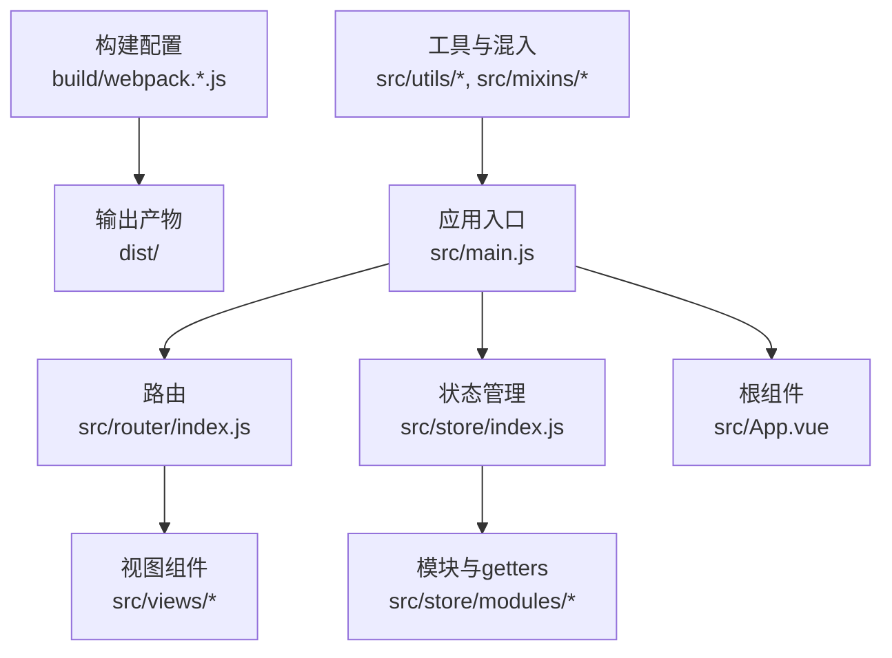
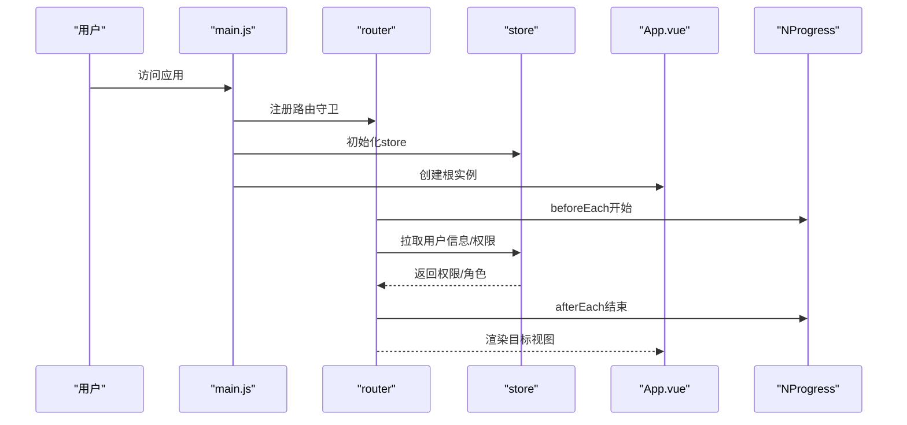
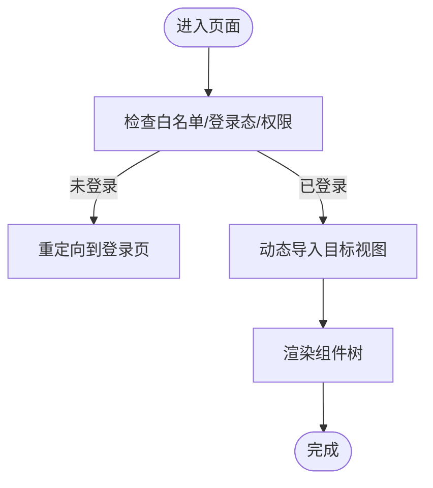
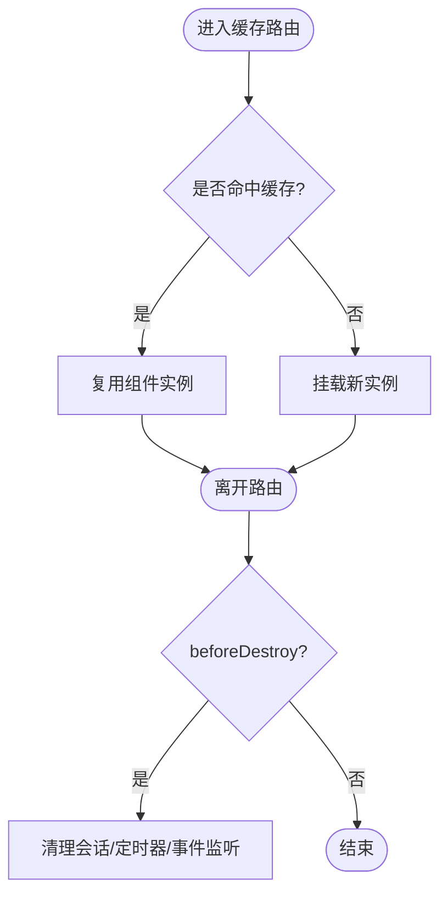
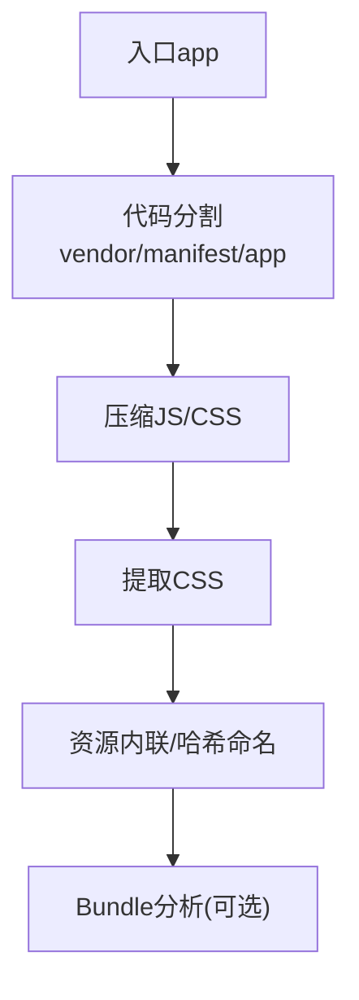
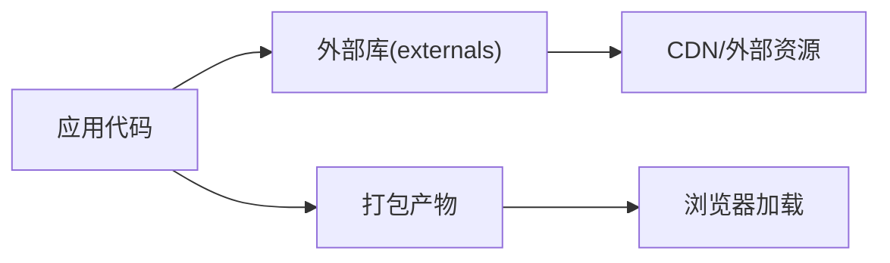

# 性能问题

<cite>
**本文引用的文件**
- [package.json](file://package.json)
- [config/index.js](file://config/index.js)
- [build/webpack.base.conf.js](file://build/webpack.base.conf.js)
- [build/webpack.prod.conf.js](file://build/webpack.prod.conf.js)
- [build/utils.js](file://build/utils.js)
- [src/main.js](file://src/main.js)
- [src/App.vue](file://src/App.vue)
- [src/router/index.js](file://src/router/index.js)
- [src/store/index.js](file://src/store/index.js)
- [src/mixins/windowResize.js](file://src/mixins/windowResize.js)
- [src/utils/index.js](file://src/utils/index.js)
</cite>

## 目录
1. [简介](#简介)
2. [项目结构](#项目结构)
3. [核心组件](#核心组件)
4. [架构总览](#架构总览)
5. [详细组件分析](#详细组件分析)
6. [依赖分析](#依赖分析)
7. [性能考量](#性能考量)
8. [故障排查指南](#故障排查指南)
9. [结论](#结论)
10. [附录](#附录)

## 简介
本文件面向Vue.js应用的性能问题排查与优化，聚焦页面加载缓慢、组件渲染卡顿、内存泄漏、资源体积过大等常见瓶颈，并结合仓库现有构建与运行配置，给出可落地的诊断方法、优化策略与最佳实践。内容涵盖Webpack打包优化、代码分割与懒加载、缓存机制、性能监控与DevTools分析技巧，以及组件层面的优化建议（如keep-alive缓存、虚拟滚动、图片资源优化）。

## 项目结构
该项目采用经典的Vue CLI模板风格，核心目录与职责如下：
- 构建与配置：build/（Webpack配置）、config/（开发/生产配置）
- 源代码：src/（入口main.js、路由router、状态store、组件components、视图views、工具utils、样式styles等）
- 静态资源：static/（第三方静态库）
- 依赖与脚本：package.json（依赖、脚本）

图表来源
- [build/webpack.prod.conf.js:16-149](file://build/webpack.prod.conf.js#L16-L149)
- [src/main.js:1-221](file://src/main.js#L1-L221)
- [src/router/index.js:1-207](file://src/router/index.js#L1-L207)
- [src/store/index.js:1-20](file://src/store/index.js#L1-L20)
- [src/App.vue:1-183](file://src/App.vue#L1-L183)

章节来源
- [package.json:1-98](file://package.json#L1-L98)
- [config/index.js:1-72](file://config/index.js#L1-L72)
- [build/webpack.base.conf.js:1-102](file://build/webpack.base.conf.js#L1-L102)
- [build/webpack.prod.conf.js:16-149](file://build/webpack.prod.conf.js#L16-L149)

## 核心组件
- 应用入口与全局行为
  - 路由守卫与进度条：在导航前后开启/结束NProgress，控制鉴权与权限判断逻辑。
  - 全局组件注册：ElementUI、多选组件、粘性头部、打印插件、上传组件等。
  - 错误处理：生产环境统一设置Vue errorHandler，上报错误日志。
- 根组件与缓存策略
  - 使用keep-alive对带meta.isCached的路由进行缓存，减少重复渲染与请求。
- 路由与代码分割
  - 大量异步路由（动态import），天然支持按需加载与代码分割。
- 状态管理
  - 模块化store，集中管理应用状态与派生数据（getters）。
- 工具与混入
  - windowResize混入：监听窗口变化，动态计算布局高度，避免频繁重排。
  - 工具函数：时间格式化、权限判断、深拷贝、文件预览等。

章节来源
- [src/main.js:1-221](file://src/main.js#L1-L221)
- [src/App.vue:1-183](file://src/App.vue#L1-L183)
- [src/router/index.js:1-207](file://src/router/index.js#L1-L207)
- [src/store/index.js:1-20](file://src/store/index.js#L1-L20)
- [src/mixins/windowResize.js:1-63](file://src/mixins/windowResize.js#L1-L63)
- [src/utils/index.js:1-385](file://src/utils/index.js#L1-L385)

## 架构总览
应用启动流程与性能相关的关键节点如下：

图表来源
- [src/main.js:73-203](file://src/main.js#L73-L203)
- [src/router/index.js:1-207](file://src/router/index.js#L1-L207)
- [src/store/index.js:1-20](file://src/store/index.js#L1-L20)
- [src/App.vue:1-183](file://src/App.vue#L1-L183)

## 详细组件分析

### 路由与懒加载
- 动态导入：大量路由通过动态import实现按需加载，有助于拆分bundle、降低首屏体积。
- 常量路由与模块化路由：将不同业务域路由拆分至独立文件，便于维护与分析。
- 异步chunk命名：CommonsChunkPlugin生成vendor/manifest/app等chunk，配合HashedModuleIds提升缓存命中。

图表来源
- [src/router/index.js:1-207](file://src/router/index.js#L1-L207)
- [build/webpack.prod.conf.js:85-112](file://build/webpack.prod.conf.js#L85-L112)

章节来源
- [src/router/index.js:1-207](file://src/router/index.js#L1-L207)
- [build/webpack.prod.conf.js:85-112](file://build/webpack.prod.conf.js#L85-L112)

### keep-alive缓存与内存管理
- 缓存策略：通过App.vue中的keep-alive包裹带meta.isCached的路由，避免重复渲染与请求。
- 生命周期：根组件beforeDestroy清理会话标记，防止残留状态影响后续页面。

图表来源
- [src/App.vue:3-17](file://src/App.vue#L3-L17)
- [src/main.js:14-20](file://src/main.js#L14-L20)

章节来源
- [src/App.vue:1-183](file://src/App.vue#L1-L183)
- [src/main.js:14-20](file://src/main.js#L14-L20)

### 构建与打包优化
- 代码分割：CommonsChunkPlugin拆分vendor/manifest/app，分离第三方库与运行时，提升缓存稳定性。
- 压缩与去重：UglifyJS压缩JS；OptimizeCSSPlugin压缩CSS；ExtractTextPlugin提取CSS。
- SourceMap与Gzip：生产环境关闭devtool以减小体积，可选开启Gzip压缩。
- 资源处理：url-loader限制内联阈值，字体/媒体/图片走hash命名，利于长期缓存。

图表来源
- [build/webpack.prod.conf.js:16-149](file://build/webpack.prod.conf.js#L16-L149)
- [build/webpack.base.conf.js:47-84](file://build/webpack.base.conf.js#L47-L84)
- [config/index.js:39-70](file://config/index.js#L39-L70)

章节来源
- [build/webpack.prod.conf.js:16-149](file://build/webpack.prod.conf.js#L16-L149)
- [build/webpack.base.conf.js:14-102](file://build/webpack.base.conf.js#L14-L102)
- [config/index.js:1-72](file://config/index.js#L1-L72)

### 组件优化与交互体验
- 窗口尺寸适配：windowResize混入根据容器高度动态计算布局，减少不必要的重排与重绘。
- 权限与可见性：工具函数isShowByPermission/isShowByRole控制元素显示，避免无效DOM。
- 时间与格式化：parseTime/formatTime等工具减少重复计算，提高渲染效率。

章节来源
- [src/mixins/windowResize.js:1-63](file://src/mixins/windowResize.js#L1-L63)
- [src/utils/index.js:217-246](file://src/utils/index.js#L217-L246)
- [src/utils/index.js:3-62](file://src/utils/index.js#L3-L62)

## 依赖分析
- 外部依赖注入：webpack.base.conf.js通过externals将element-ui、vue、echarts等声明为外部库，减少打包体积。
- 开发与生产差异：devtool、sourceMap、gzip等在config/index.js中分别配置，生产默认关闭devtool以优化体积。

图表来源
- [build/webpack.base.conf.js:26-36](file://build/webpack.base.conf.js#L26-L36)
- [config/index.js:28-56](file://config/index.js#L28-L56)

章节来源
- [build/webpack.base.conf.js:26-36](file://build/webpack.base.conf.js#L26-L36)
- [config/index.js:28-56](file://config/index.js#L28-L56)

## 性能考量
- 页面加载缓慢
  - 诊断：使用Chrome DevTools Network面板观察首屏资源加载顺序与大小；启用Performance面板记录首次交互耗时。
  - 优化：利用动态import拆分路由；确保vendor/manifest稳定；开启Gzip；合理设置静态资源缓存头。
- 组件渲染卡顿
  - 诊断：Performance面板录制帧率，定位长任务；Elements面板检查重排/重绘热点区域。
  - 优化：使用keep-alive缓存；避免在render中执行重计算；拆分大型列表为虚拟滚动；减少不必要的响应式数据。
- 内存泄漏
  - 诊断：Memory面板快照对比，关注未释放的DOM、事件监听器、定时器。
  - 优化：组件销毁时移除事件监听；清理定时器；避免闭包持有DOM引用；使用windowResize混入时在beforeDestroy解绑。
- 资源文件过大
  - 诊断：Bundle Analyzer（webpack-bundle-analyzer）查看依赖构成。
  - 优化：拆分vendor；剔除未使用依赖；图片与字体按需引入；CSS按需加载。

章节来源
- [build/webpack.prod.conf.js:125-146](file://build/webpack.prod.conf.js#L125-L146)
- [src/mixins/windowResize.js:30-32](file://src/mixins/windowResize.js#L30-L32)

## 故障排查指南
- 路由与权限导致的白屏/长时间加载
  - 现象：登录后长时间无响应或跳转异常。
  - 排查：检查router.beforeEach中的权限判断分支与异步拉取用户信息流程；确认NProgress在afterEach正确结束。
  - 参考路径
    - [src/main.js:73-203](file://src/main.js#L73-L203)
    - [src/router/index.js:1-207](file://src/router/index.js#L1-L207)
- keep-alive导致的内存增长
  - 现象：长时间切换页面后内存持续上升。
  - 排查：确认App.vue中缓存策略仅对必要路由生效；在beforeDestroy清理会话状态；避免缓存中持有大对象。
  - 参考路径
    - [src/App.vue:3-17](file://src/App.vue#L3-L17)
- 图片/字体过大导致首屏慢
  - 现象：首屏加载时间过长。
  - 排查：检查url-loader阈值与资源类型；考虑使用更小的占位图或延迟加载；CDN分发静态资源。
  - 参考路径
    - [build/webpack.base.conf.js:61-83](file://build/webpack.base.conf.js#L61-L83)
- 打包体积过大
  - 现象：bundle体积超预期。
  - 排查：启用Bundle Analyzer；检查vendor拆分是否合理；移除未使用依赖；开启Gzip。
  - 参考路径
    - [build/webpack.prod.conf.js:125-146](file://build/webpack.prod.conf.js#L125-L146)
    - [config/index.js:67-69](file://config/index.js#L67-L69)

## 结论
本项目已具备良好的基础：动态路由与代码分割、keep-alive缓存、外部依赖注入与压缩优化。针对性能问题，建议从以下方面入手：完善Bundle分析与监控、精细化缓存策略、组件级渲染优化、资源体积治理与CDN分发。通过上述措施，可在多设备上显著提升首屏速度与交互流畅度。

## 附录
- 术语
  - 代码分割：将bundle拆分为多个chunk，按需加载。
  - 懒加载：通过动态import实现按需加载模块。
  - 缓存命中：浏览器命中强缓存/协商缓存，减少网络请求。
- 参考配置位置
  - 构建配置：build/webpack.*.js
  - 开发/生产配置：config/index.js
  - 应用入口：src/main.js
  - 路由与视图：src/router/index.js、src/views/*
  - 状态管理：src/store/index.js、src/store/modules/*
  - 工具与混入：src/utils/index.js、src/mixins/*