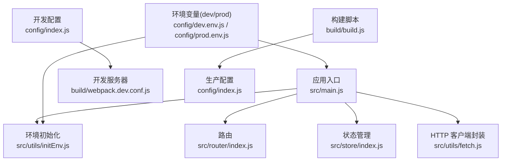
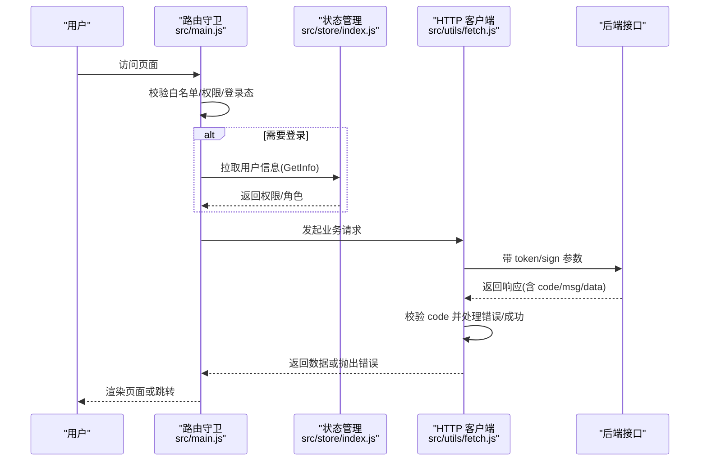
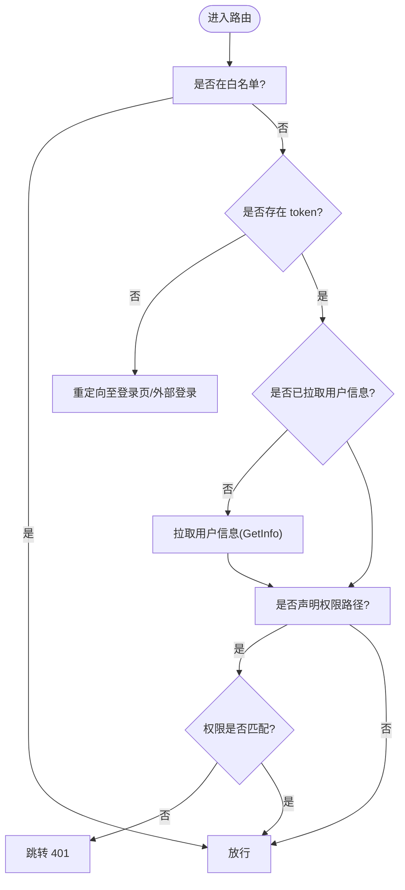
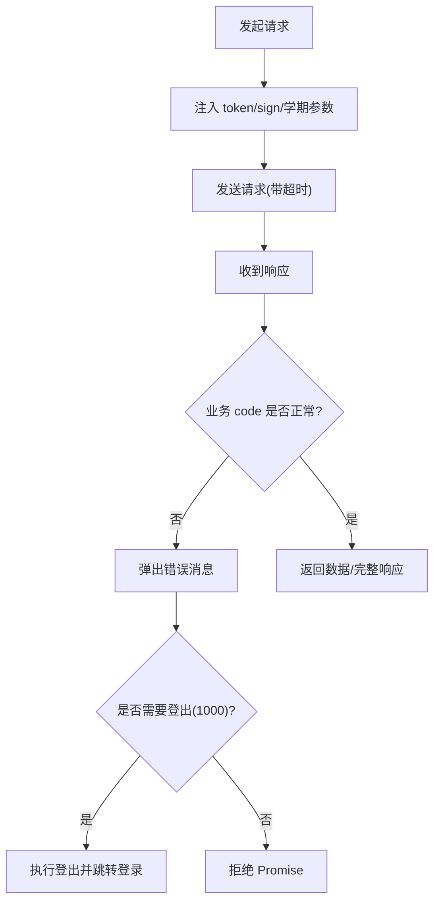
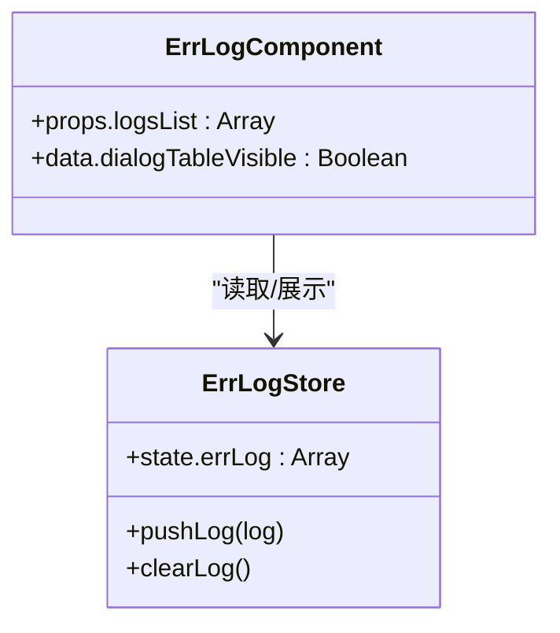
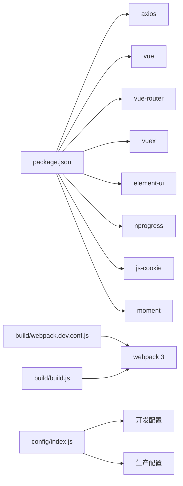

# 故障排除

<cite>
**本文引用的文件**
- [package.json](file://package.json)
- [README.md](file://README.md)
- [src/main.js](file://src/main.js)
- [config/index.js](file://config/index.js)
- [config/dev.env.js](file://config/dev.env.js)
- [config/prod.env.js](file://config/prod.env.js)
- [src/utils/fetch.js](file://src/utils/fetch.js)
- [src/store/index.js](file://src/store/index.js)
- [src/store/errLog.js](file://src/store/errLog.js)
- [src/components/ErrLog/index.vue](file://src/components/ErrLog/index.vue)
- [src/router/index.js](file://src/router/index.js)
- [build/webpack.dev.conf.js](file://build/webpack.dev.conf.js)
- [build/build.js](file://build/build.js)
- [src/utils/initEnv.js](file://src/utils/initEnv.js)
</cite>

## 目录
1. [简介](#简介)
2. [项目结构](#项目结构)
3. [核心组件](#核心组件)
4. [架构总览](#架构总览)
5. [详细组件分析](#详细组件分析)
6. [依赖分析](#依赖分析)
7. [性能考虑](#性能考虑)
8. [故障排除指南](#故障排除指南)
9. [结论](#结论)
10. [附录](#附录)

## 简介
本故障排除文档面向开发者与运维人员，聚焦于本项目的开发环境问题、运行时错误、性能问题与兼容性问题，提供系统化的排查步骤、日志分析技巧、调试工具使用与问题定位策略，并覆盖错误监控、告警机制与应急响应流程。文档同时给出数据库连接问题、API 调用失败与前端渲染异常的处理建议，帮助团队快速定位并解决问题，降低系统停机时间。

## 项目结构
本项目为基于 Vue 2 的前端工程，采用 webpack 3 作为打包与开发服务器配置，结合 Element-UI、Vuex、Vue-Router 等生态组件。关键目录与职责概览如下：
- config：开发与生产环境配置（端口、代理、资源路径等）
- build：webpack 开发与构建配置、构建脚本
- src：源码入口、路由、状态管理、通用工具与组件
- static：静态资源（含第三方库）

图表来源
- [src/main.js:1-221](file://src/main.js#L1-L221)
- [src/router/index.js:1-207](file://src/router/index.js#L1-L207)
- [src/store/index.js:1-20](file://src/store/index.js#L1-L20)
- [src/utils/fetch.js:1-240](file://src/utils/fetch.js#L1-L240)
- [src/utils/initEnv.js:1-33](file://src/utils/initEnv.js#L1-L33)
- [config/index.js:1-72](file://config/index.js#L1-L72)
- [build/webpack.dev.conf.js:1-96](file://build/webpack.dev.conf.js#L1-L96)
- [build/build.js:1-42](file://build/build.js#L1-L42)
- [config/dev.env.js:1-9](file://config/dev.env.js#L1-L9)
- [config/prod.env.js:1-6](file://config/prod.env.js#L1-L6)

章节来源
- [README.md:1-24](file://README.md#L1-L24)
- [package.json:1-98](file://package.json#L1-L98)

## 核心组件
- 应用入口与全局配置：负责引入 UI 组件、进度条、过滤器、全局组件注册、路由守卫与错误处理钩子。
- HTTP 客户端封装：统一拦截器、超时控制、鉴权参数注入、错误码处理与自动登出逻辑。
- 环境初始化：根据环境变量切换不同后端服务地址与功能开关。
- 错误日志与展示：生产环境捕获全局错误并写入本地状态，提供可视化弹窗查看。
- 路由与权限：白名单、token 注入、权限校验与跳转策略。
- 构建与开发服务器：开发端口、热更新、错误覆盖层、构建产物输出与分析报告。

章节来源
- [src/main.js:1-221](file://src/main.js#L1-L221)
- [src/utils/fetch.js:1-240](file://src/utils/fetch.js#L1-L240)
- [src/utils/initEnv.js:1-33](file://src/utils/initEnv.js#L1-L33)
- [src/store/errLog.js:1-14](file://src/store/errLog.js#L1-L14)
- [src/components/ErrLog/index.vue:1-52](file://src/components/ErrLog/index.vue#L1-L52)
- [src/router/index.js:1-207](file://src/router/index.js#L1-L207)
- [build/webpack.dev.conf.js:1-96](file://build/webpack.dev.conf.js#L1-L96)
- [build/build.js:1-42](file://build/build.js#L1-L42)

## 架构总览
前端通过路由守卫进行鉴权与权限控制，HTTP 层统一注入 token 与签名参数，响应层对业务错误码进行统一处理与提示；生产环境启用全局错误捕获并将错误写入本地日志，便于问题复盘。

图表来源
- [src/main.js:73-198](file://src/main.js#L73-L198)
- [src/store/index.js:1-20](file://src/store/index.js#L1-L20)
- [src/utils/fetch.js:66-169](file://src/utils/fetch.js#L66-L169)

## 详细组件分析

### 路由与鉴权流程
- 白名单：免登录直通的路径集合，如登录页、扫码页、外部展示页等。
- 登录态判断：优先从 URL 查询参数或 hash 中提取 token，注入 Cookie 并拉取用户信息；否则检查已有 token 与角色信息。
- 权限校验：若目标路由声明了权限路径，则比对当前用户权限集合，不匹配则跳转 401。
- 登录跳转策略：根据登录类型与 standalone 模式决定跳转地址或外部登录页。

图表来源
- [src/main.js:58-198](file://src/main.js#L58-L198)
- [src/router/index.js:40-199](file://src/router/index.js#L40-L199)

章节来源
- [src/main.js:58-198](file://src/main.js#L58-L198)
- [src/router/index.js:40-199](file://src/router/index.js#L40-L199)

### HTTP 客户端与错误处理
- 统一基座：支持多实例 baseURL（如 ucenter-web、module-web 等），默认超时 10 秒。
- 请求拦截：自动注入 token 与签名参数；对特定域名做 URLSearchParams 规范化；支持归档场景附加学期参数。
- 响应拦截：按业务 code 分类处理，错误时弹出消息并触发登出；成功时返回完整响应或仅 data。
- 自动登出：当返回 code=1000 且非外部单点登录场景时，执行登出并跳转登录页。

图表来源
- [src/utils/fetch.js:13-240](file://src/utils/fetch.js#L13-L240)

章节来源
- [src/utils/fetch.js:13-240](file://src/utils/fetch.js#L13-L240)

### 错误日志与可视化
- 生产环境：全局错误处理器捕获异常并写入本地状态。
- 可视化组件：提供“缺陷日志”徽章，点击弹窗展示错误 message、url 与 stack，便于快速定位。

图表来源
- [src/store/errLog.js:1-14](file://src/store/errLog.js#L1-L14)
- [src/components/ErrLog/index.vue:1-52](file://src/components/ErrLog/index.vue#L1-L52)

章节来源
- [src/store/errLog.js:1-14](file://src/store/errLog.js#L1-L14)
- [src/components/ErrLog/index.vue:1-52](file://src/components/ErrLog/index.vue#L1-L52)
- [src/main.js:205-214](file://src/main.js#L205-L214)

### 开发与构建配置
- 开发服务器：端口自动发现、热更新、错误覆盖层、静态资源拷贝。
- 构建脚本：清理输出目录、执行 webpack 构建、输出统计信息与错误提示。
- 环境变量：dev/prod 环境通过 DefinePlugin 注入，影响运行时行为与资源路径。

章节来源
- [build/webpack.dev.conf.js:1-96](file://build/webpack.dev.conf.js#L1-L96)
- [build/build.js:1-42](file://build/build.js#L1-L42)
- [config/dev.env.js:1-9](file://config/dev.env.js#L1-L9)
- [config/prod.env.js:1-6](file://config/prod.env.js#L1-L6)
- [config/index.js:1-72](file://config/index.js#L1-L72)

## 依赖分析
- 运行时依赖：axios、element-ui、vue、vue-router、vuex、moment、nprogress、js-cookie 等。
- 开发依赖：webpack 3、babel、sass、eslint、webpack-dev-server 等。
- 关键耦合点：fetch 对 axios 的封装与全局路由守卫、状态管理紧密耦合；环境初始化影响多个 baseURL 与命令开关。

图表来源
- [package.json:12-42](file://package.json#L12-L42)
- [build/webpack.dev.conf.js:1-96](file://build/webpack.dev.conf.js#L1-L96)
- [build/build.js:1-42](file://build/build.js#L1-L42)
- [config/index.js:1-72](file://config/index.js#L1-L72)

章节来源
- [package.json:12-42](file://package.json#L12-L42)
- [build/webpack.dev.conf.js:1-96](file://build/webpack.dev.conf.js#L1-L96)
- [build/build.js:1-42](file://build/build.js#L1-L42)
- [config/index.js:1-72](file://config/index.js#L1-L72)

## 性能考虑
- 构建优化：生产环境关闭 source map 与 gzip 可按需开启；bundle 分析报告用于识别体积热点。
- 运行时优化：避免在请求拦截中进行重型转换；合理设置超时时间；减少不必要的全局状态变更。
- 资源加载：静态资源路径与 publicPath 需与部署服务器一致，避免 404 导致重试与回退逻辑开销。

章节来源
- [config/index.js:39-70](file://config/index.js#L39-L70)
- [src/utils/fetch.js:14-22](file://src/utils/fetch.js#L14-L22)

## 故障排除指南

### 一、开发环境问题
- 症状：无法启动开发服务器或端口占用
  - 排查要点：确认端口是否被占用；检查 devServer 配置与 HOST/PORT 环境变量；查看 FriendlyErrors 输出。
  - 解决方案：更换端口或释放占用进程；核对 config/index.js 与 build/webpack.dev.conf.js 的 devServer 配置。
- 症状：热更新无效或页面不刷新
  - 排查要点：检查 watchOptions.poll 设置；确认浏览器与本地网络连通性。
  - 解决方案：适当提高 poll 值或关闭该选项；清除浏览器缓存后重试。
- 症状：样式或资源 404
  - 排查要点：核对 assetsPublicPath 与静态资源复制插件配置；确认路径拼接规则。
  - 解决方案：修正 publicPath 或调整静态资源放置位置。

章节来源
- [build/webpack.dev.conf.js:24-46](file://build/webpack.dev.conf.js#L24-L46)
- [config/index.js:8-37](file://config/index.js#L8-L37)

### 二、运行时错误
- 症状：页面空白或组件渲染异常
  - 排查要点：检查路由守卫中的权限与 token 流程；确认用户信息拉取是否成功；查看控制台报错。
  - 解决方案：在路由守卫中增加更详细的日志输出；确保 GET/POST 参数正确；必要时降级到白名单直通路径验证。
- 症状：全局错误未被捕获
  - 排查要点：确认生产环境 errorHandler 是否生效；检查 Vue.config.errorHandler 注册时机。
  - 解决方案：确保在 new Vue 之前完成 errorHandler 注册；在组件内补充 try/catch 与边界条件判断。
- 症状：错误日志不可见
  - 排查要点：确认 ErrLog 组件是否挂载；检查 store 中 errLog 状态是否更新。
  - 解决方案：在布局中引入 ErrLog 组件；确保生产环境分支生效。

章节来源
- [src/main.js:73-198](file://src/main.js#L73-L198)
- [src/main.js:205-214](file://src/main.js#L205-L214)
- [src/store/errLog.js:1-14](file://src/store/errLog.js#L1-L14)
- [src/components/ErrLog/index.vue:1-52](file://src/components/ErrLog/index.vue#L1-L52)

### 三、API 调用失败
- 症状：请求频繁超时或返回业务错误码
  - 排查要点：检查 baseURL 与 sign/token 注入逻辑；确认后端接口可用性与跨域配置；查看响应拦截器对 code 的处理。
  - 解决方案：缩短超时时间或分批请求；在 signApiList/withoutTokenList 中补充路径；对 1000 登录过期场景触发登出流程。
- 症状：参数编码异常导致后端解析失败
  - 排查要点：检查 transformRequest 与 URLSearchParams 处理；确认 ucenter-web 场景下的参数规范化。
  - 解决方案：统一使用 URLSearchParams；避免传入 null/undefined；必要时改为 JSON 提交并设置 content-type。
- 症状：多实例 baseURL 切换错误
  - 排查要点：确认 initEnv 中的 command 与 global.* 变量；检查各 fetch 实例的 baseURL。
  - 解决方案：在 initEnv 中按环境正确赋值；确保前端与后端域名一致。

章节来源
- [src/utils/fetch.js:13-240](file://src/utils/fetch.js#L13-L240)
- [src/utils/initEnv.js:1-33](file://src/utils/initEnv.js#L1-L33)

### 四、数据库连接问题
- 症状：接口返回数据库相关错误或超时
  - 排查要点：确认后端服务健康状态；检查数据库连接池配置与慢查询；查看后端日志定位 SQL。
  - 解决方案：优化查询语句与索引；增加连接池大小或启用连接复用；对高频接口增加缓存层。

### 五、前端渲染异常
- 症状：组件不显示或样式错乱
  - 排查要点：检查 Element-UI 主题与样式加载顺序；确认 normalize.css 是否生效；查看浏览器控制台与网络面板。
  - 解决方案：调整样式导入顺序；确保字体/图标资源可访问；对动态样式进行兜底处理。

### 六、兼容性问题
- 症状：低版本浏览器报错或功能缺失
  - 排查要点：确认 babel-polyfill 与 url-search-params-polyfill 是否正确引入；检查浏览器列表与构建目标。
  - 解决方案：升级浏览器或补充 polyfill；对不支持的 API 做降级实现。

### 七、日志分析技巧与调试工具
- 日志采集：生产环境通过 errorHandler 写入本地状态，ErrLog 组件提供可视化查看。
- 调试工具：使用浏览器开发者工具断点调试；结合路由守卫与 fetch 拦截器打印关键参数；利用构建分析报告定位体积热点。
- 问题定位策略：先复现再缩小范围（路由/网络/组件），再逐层深入（环境变量/拦截器/状态）。

章节来源
- [src/main.js:205-214](file://src/main.js#L205-L214)
- [src/components/ErrLog/index.vue:1-52](file://src/components/ErrLog/index.vue#L1-L52)
- [build/build.js:14-39](file://build/build.js#L14-L39)

### 八、错误监控、告警机制与应急响应
- 错误监控：生产环境捕获全局错误并记录；建议扩展上报埋点（如上报到监控平台）。
- 告警机制：结合 CI/CD 在构建失败时通知；对关键接口设定 SLA 告警。
- 应急响应：建立快速回滚流程（版本标签与灰度发布）；准备降级方案（白名单直通、离线资源）。

章节来源
- [src/main.js:205-214](file://src/main.js#L205-L214)
- [build/build.js:30-33](file://build/build.js#L30-L33)

## 结论
本项目在路由鉴权、HTTP 统一封装与错误日志方面具备较为完善的基础设施。建议在以下方面持续改进：增强错误上报与监控告警、完善 API 文档与契约校验、加强构建产物的可观测性与缓存策略、提升兼容性与自动化测试覆盖率。通过标准化的故障排除流程与工具链，可显著缩短问题定位与修复时间，保障系统稳定运行。

## 附录
- 常用命令
  - 启动开发环境：npm run dev（或指定环境变量）
  - 构建测试包：npm run build:test
  - 构建生产包：npm run build
  - 查看构建报告：npm run build --report
- 关键配置参考
  - 开发端口与资源路径：config/index.js
  - 环境变量注入：config/dev.env.js、config/prod.env.js
  - 开发服务器与热更新：build/webpack.dev.conf.js
  - 生产构建与输出：build/build.js

章节来源
- [README.md:7-21](file://README.md#L7-L21)
- [package.json:7-11](file://package.json#L7-L11)
- [config/index.js:8-70](file://config/index.js#L8-L70)
- [config/dev.env.js:5-8](file://config/dev.env.js#L5-L8)
- [config/prod.env.js:2-5](file://config/prod.env.js#L2-L5)
- [build/webpack.dev.conf.js:16-96](file://build/webpack.dev.conf.js#L16-L96)
- [build/build.js:14-41](file://build/build.js#L14-L41)