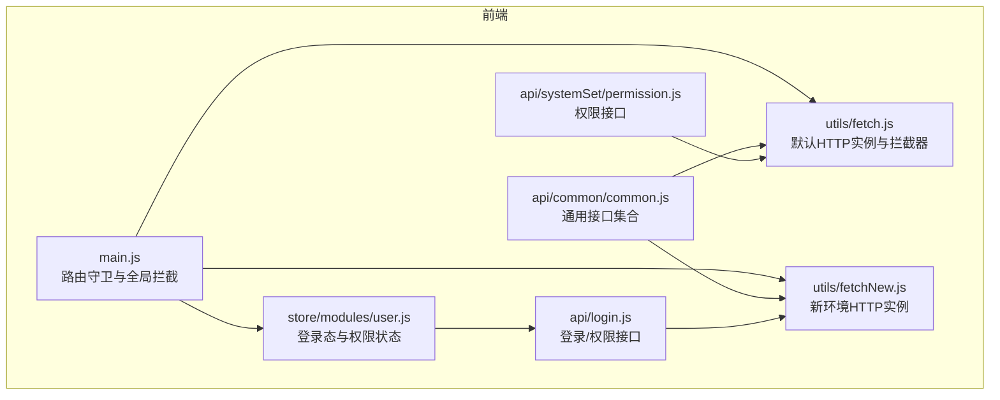
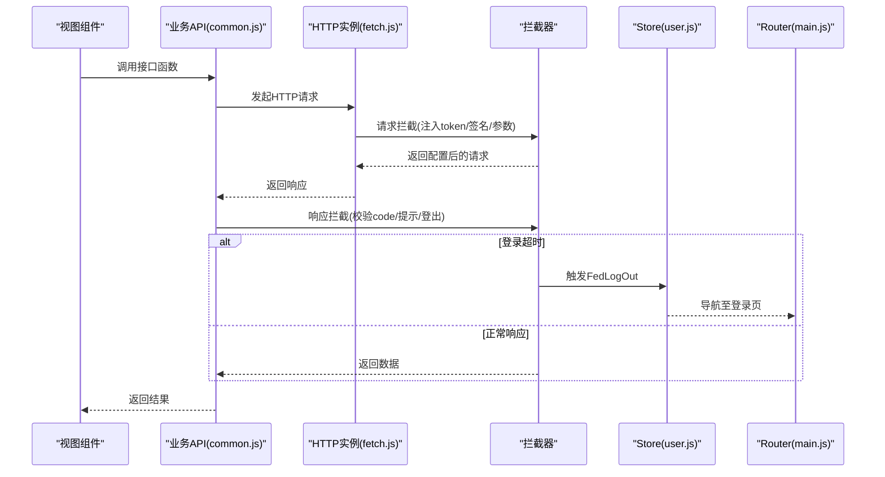
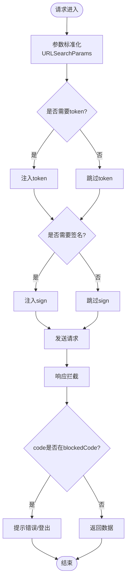
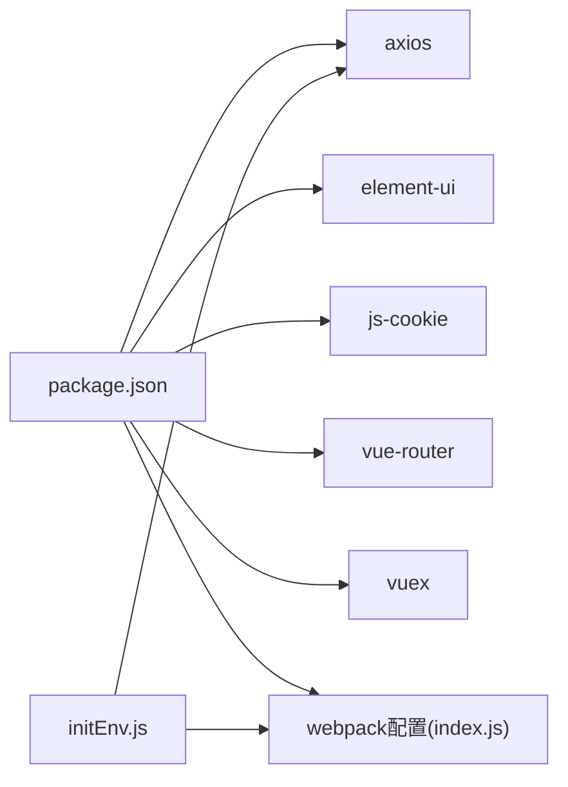

# 数据库和API问题

<cite>
**本文引用的文件**
- [fetch.js](file://src/utils/fetch.js)
- [fetchNew.js](file://src/utils/fetchNew.js)
- [common.js](file://src/api/common/common.js)
- [login.js](file://src/api/login.js)
- [user.js](file://src/store/modules/user.js)
- [main.js](file://src/main.js)
- [initEnv.js](file://src/utils/initEnv.js)
- [index.js](file://config/index.js)
- [package.json](file://package.json)
- [permission.js](file://src/api/systemSet/permission.js)
- [errLog.js](file://src/store/errLog.js)
</cite>

## 目录
1. [简介](#简介)
2. [项目结构](#项目结构)
3. [核心组件](#核心组件)
4. [架构总览](#架构总览)
5. [详细组件分析](#详细组件分析)
6. [依赖分析](#依赖分析)
7. [性能考虑](#性能考虑)
8. [故障排查指南](#故障排查指南)
9. [结论](#结论)
10. [附录](#附录)

## 简介
本文件面向后端接口与数据访问问题的排查，聚焦以下主题：
- API响应超时、数据格式不匹配、认证失败、权限拒绝等常见问题的诊断流程
- RESTful API调试技巧、请求/响应拦截器配置与错误重试机制
- 数据库连接池配置、查询性能优化与事务处理最佳实践
- 接口文档生成、Mock数据使用与联调测试方法
目标是提升前后端数据交互稳定性，降低接口调用失败对用户体验的影响。

## 项目结构
本项目为Vue前端工程，API层主要由工具层与业务API层组成：
- 工具层：封装统一的HTTP客户端与拦截器，支持多环境配置与多实例切换
- 业务API层：按功能域拆分，如登录、通用字典、权限等
- 状态与路由：集中处理登录态、权限与页面导航

图表来源
- [main.js:73-198](file://src/main.js#L73-L198)
- [user.js:120-442](file://src/store/modules/user.js#L120-L442)
- [fetch.js:13-171](file://src/utils/fetch.js#L13-L171)
- [fetchNew.js:9-135](file://src/utils/fetchNew.js#L9-L135)
- [common.js:1-459](file://src/api/common/common.js#L1-L459)
- [login.js:1-259](file://src/api/login.js#L1-L259)
- [permission.js:1-40](file://src/api/systemSet/permission.js#L1-L40)

章节来源
- [main.js:1-221](file://src/main.js#L1-L221)
- [package.json:1-98](file://package.json#L1-L98)

## 核心组件
- HTTP客户端与拦截器
  - 默认实例：统一注入token、签名参数、环境变量、超时控制与错误提示
  - 新环境实例：针对特定域名的长超时与参数处理策略
- 业务API模块
  - 登录/权限：登录、刷新、权限拉取、第三方登录等
  - 通用接口：字典、课程、教师班级、上传、视频等
- 状态与路由
  - 登录态与权限状态管理
  - 路由守卫与白名单控制

章节来源
- [fetch.js:13-171](file://src/utils/fetch.js#L13-L171)
- [fetchNew.js:9-135](file://src/utils/fetchNew.js#L9-L135)
- [common.js:1-459](file://src/api/common/common.js#L1-L459)
- [login.js:1-259](file://src/api/login.js#L1-L259)
- [user.js:120-442](file://src/store/modules/user.js#L120-L442)
- [main.js:73-198](file://src/main.js#L73-L198)

## 架构总览
前端通过HTTP客户端向后端发起REST请求，请求在拦截器中统一注入token与签名参数，响应在拦截器中统一处理错误码与消息提示，并在登录态失效时触发登出流程。路由守卫根据登录态与权限决定页面跳转。

图表来源
- [common.js:14-95](file://src/api/common/common.js#L14-L95)
- [fetch.js:66-169](file://src/utils/fetch.js#L66-L169)
- [user.js:408-434](file://src/store/modules/user.js#L408-L434)
- [main.js:73-198](file://src/main.js#L73-L198)

## 详细组件分析

### 组件A：HTTP客户端与拦截器（fetch.js）
- 功能要点
  - 默认baseURL、timeout、transformRequest
  - 请求拦截：参数过滤、token注入、签名注入、归档场景附加参数
  - 响应拦截：统一错误码判定、消息提示、登录超时自动登出
  - 多实例导出：不同业务域的baseURL与isReturnData策略
- 关键行为
  - 对ucenter-web域名的参数编码策略
  - signApiList与withoutTokenList白名单控制
  - blockedCode集合统一处理异常

图表来源
- [fetch.js:66-169](file://src/utils/fetch.js#L66-L169)

章节来源
- [fetch.js:13-171](file://src/utils/fetch.js#L13-L171)

### 组件B：新环境HTTP客户端（fetchNew.js）
- 功能要点
  - 更长超时时间，适配复杂接口
  - 参数处理策略与默认拦截器一致
- 使用场景
  - 长耗时任务、大文件上传、复杂查询等

章节来源
- [fetchNew.js:9-135](file://src/utils/fetchNew.js#L9-L135)

### 组件C：通用API集合（common.js）
- 功能要点
  - 字典、课程、教师班级、视频、上传等常用接口
  - 统一使用systemFetch或fetch，按业务域选择实例
  - 部分接口以JSON方式提交
- 典型流程
  - 参数构造 -> 选择实例 -> 发送请求 -> 统一错误处理

章节来源
- [common.js:1-459](file://src/api/common/common.js#L1-L459)

### 组件D：登录与权限API（login.js）
- 功能要点
  - 登录、刷新、退出、第三方登录、权限查询等
  - 统一使用systemFetch，便于跨域与签名策略
- 与状态联动
  - 登录成功写入Cookie与Vuex
  - 权限拉取后更新权限映射

章节来源
- [login.js:1-259](file://src/api/login.js#L1-L259)
- [user.js:120-442](file://src/store/modules/user.js#L120-L442)

### 组件E：权限接口（permission.js）
- 功能要点
  - 用户权限查询、子权限树查询
  - 使用fetch并拼接全局LoginPath

章节来源
- [permission.js:1-40](file://src/api/systemSet/permission.js#L1-L40)

### 组件F：路由守卫与登录态（main.js）
- 功能要点
  - 白名单放行、token校验、权限路径校验
  - 登录成功后拉取用户信息与权限
- 异常处理
  - 登录态缺失或权限不足跳转至相应页面

章节来源
- [main.js:73-198](file://src/main.js#L73-L198)

### 组件G：环境初始化（initEnv.js）
- 功能要点
  - 根据ENV_TAREGT设置LoginPath、BasePath、BaseNewPath等
  - 影响HTTP实例的baseURL与接口前缀

章节来源
- [initEnv.js:1-33](file://src/utils/initEnv.js#L1-L33)

## 依赖分析
- 外部依赖
  - axios：HTTP客户端
  - element-ui：消息提示与UI组件
  - js-cookie：Cookie读写
  - vue-router、vuex：路由与状态管理
- 构建与环境
  - cross-env：环境变量传递
  - webpack配置：开发/生产构建参数

图表来源
- [package.json:12-43](file://package.json#L12-L43)
- [initEnv.js:1-33](file://src/utils/initEnv.js#L1-L33)
- [index.js:8-72](file://config/index.js#L8-L72)

章节来源
- [package.json:1-98](file://package.json#L1-L98)
- [index.js:1-72](file://config/index.js#L1-L72)

## 性能考虑
- 请求超时与重试
  - 默认实例10秒，新实例30秒，复杂接口优先使用新实例
  - 可在调用方对关键接口增加指数退避重试
- 参数与序列化
  - 统一使用URLSearchParams，避免无效参数导致后端过滤开销
  - JSON提交仅在必要时使用，减少不必要的Content-Type转换
- 缓存与批量
  - 合理缓存字典、课程等静态数据
  - 批量接口合并请求，减少往返次数
- 日志与监控
  - 生产环境记录错误日志，辅助定位慢请求与异常

## 故障排查指南

### 1. API响应超时
- 现象
  - 请求长时间无响应，最终超时
- 诊断步骤
  - 确认接口是否属于复杂任务，优先使用新实例（30秒超时）
  - 检查网络与代理配置
  - 查看浏览器开发者工具Network面板，确认请求是否到达后端
- 处置建议
  - 对长耗时接口增加重试与进度提示
  - 后端优化接口性能或拆分为异步任务

章节来源
- [fetch.js:16](file://src/utils/fetch.js#L16)
- [fetchNew.js:11](file://src/utils/fetchNew.js#L11)

### 2. 数据格式不匹配
- 现象
  - 后端报“非法请求格式”或参数缺失
- 诊断步骤
  - 检查请求头Content-Type与实际数据类型是否一致
  - 确认是否使用了正确的实例（JSON提交需对应实例）
  - 核对URLSearchParams编码是否正确
- 处置建议
  - 固定参数构造方式，避免空值与undefined参与编码
  - 对必填字段增加前端校验

章节来源
- [fetch.js:40-62](file://src/utils/fetch.js#L40-L62)
- [common.js:295-304](file://src/api/common/common.js#L295-L304)

### 3. 认证失败/登录超时
- 现象
  - code=1000（登录超时）触发自动登出
- 诊断步骤
  - 检查Cookie中Admin-Token是否存在且未过期
  - 确认请求是否被注入token
  - 核对签名sign是否正确
- 处置建议
  - 登录超时时统一跳转登录页
  - 前端保持token刷新逻辑，避免长时间无操作导致失效

章节来源
- [fetch.js:124-152](file://src/utils/fetch.js#L124-L152)
- [user.js:408-434](file://src/store/modules/user.js#L408-L434)

### 4. 权限拒绝
- 现象
  - code=401/403等被拦截器识别为阻断码
- 诊断步骤
  - 确认当前用户权限列表是否包含目标路径
  - 检查路由meta.permissionPath与权限映射
- 处置建议
  - 路由守卫中对无权限路径跳转401或首页
  - 后端完善权限校验与错误码语义

章节来源
- [fetch.js:124](file://src/utils/fetch.js#L124)
- [main.js:88-139](file://src/main.js#L88-L139)

### 5. 请求/响应拦截器调试
- 调试技巧
  - 在拦截器中打印config与response，定位参数与返回体
  - 使用浏览器Network面板查看最终请求参数与响应码
- 错误重试机制
  - 对幂等GET/HEAD请求可增加自动重试
  - 对非幂等请求谨慎重试，避免副作用

章节来源
- [fetch.js:66-169](file://src/utils/fetch.js#L66-L169)

### 6. 接口文档生成与Mock
- 文档生成
  - 基于API文件注释与类型推断生成接口文档
- Mock数据
  - 使用本地Mock服务或静态JSON模拟后端响应
  - 在开发环境切换HTTP实例指向Mock地址
- 联调测试
  - 建立灰度发布与回滚流程
  - 使用抓包工具对比前后端协议一致性

### 7. 数据库连接池与查询优化
- 连接池配置
  - 控制最大连接数、空闲连接数与连接超时
  - 合理设置事务隔离级别，避免长事务锁表
- 查询优化
  - 为高频查询建立索引，避免全表扫描
  - 使用分页与LIMIT限制结果集大小
  - 避免N+1查询，采用批量加载或JOIN
- 事务处理
  - 将相关写操作放入同一事务，失败回滚
  - 事务内尽量缩短持有锁的时间

### 8. 事务与一致性
- 幂等设计
  - 对重复提交的请求保证结果一致
- 错误恢复
  - 对临时性错误（网络抖动）进行重试
  - 对永久性错误（参数错误）给出明确提示

## 结论
通过统一的HTTP客户端与拦截器、完善的路由与权限控制，以及清晰的环境配置，本项目在接口调用层面具备较好的可观测性与可维护性。结合上述故障排查与性能优化建议，可进一步提升接口稳定性与用户体验。

## 附录
- 常用命令
  - 开发测试：设置ENV_TAREGT为dev_test并启动
  - 构建测试：设置ENV_TAREGT为build_test并打包
  - 生产构建：设置ENV_TAREGT为production并打包
- 关键文件清单
  - HTTP客户端：src/utils/fetch.js、src/utils/fetchNew.js
  - 业务API：src/api/common/common.js、src/api/login.js、src/api/systemSet/permission.js
  - 状态与路由：src/store/modules/user.js、src/main.js
  - 环境配置：src/utils/initEnv.js、config/index.js、package.json