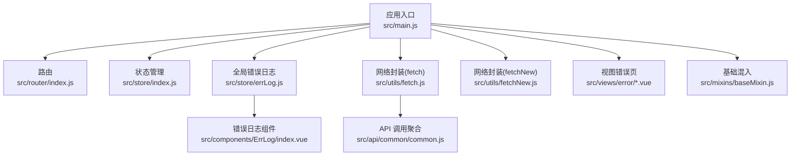
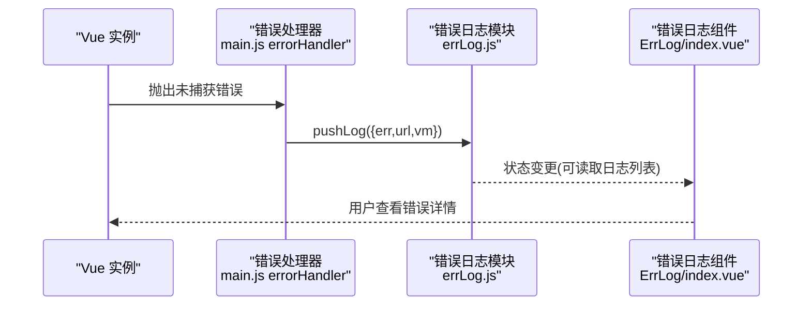
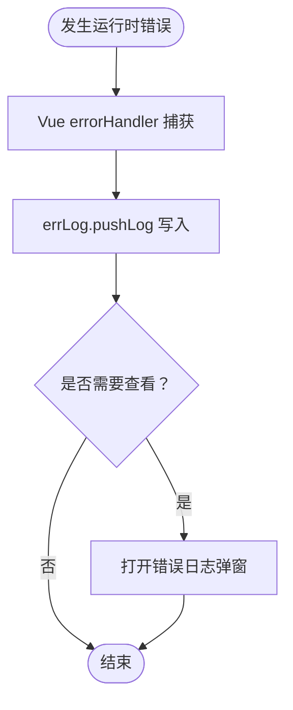
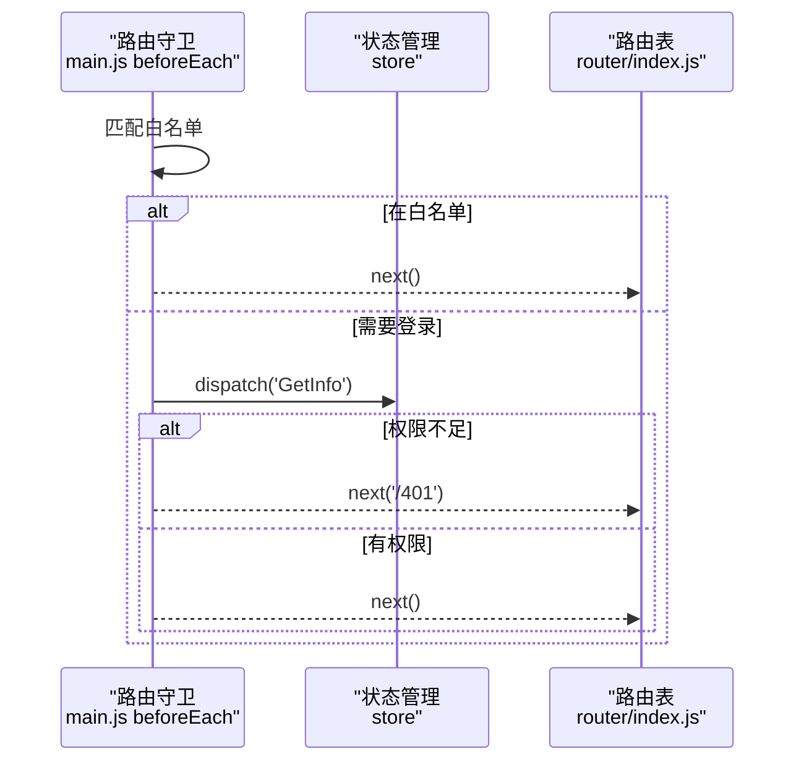
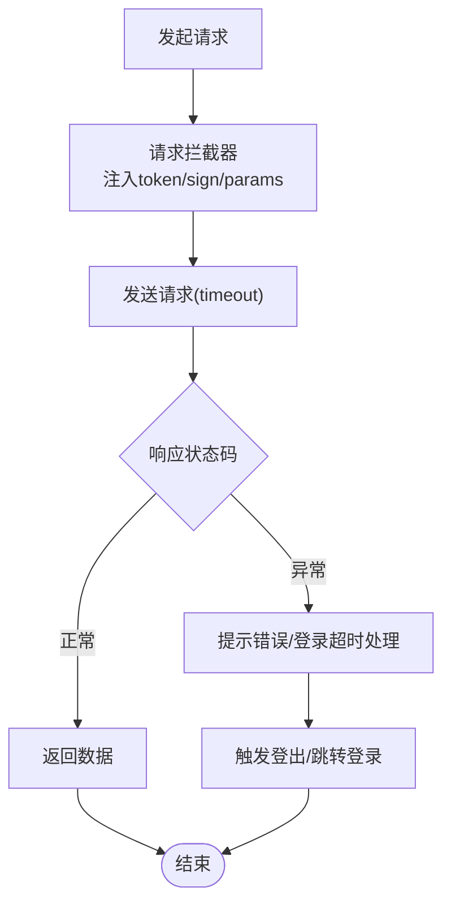
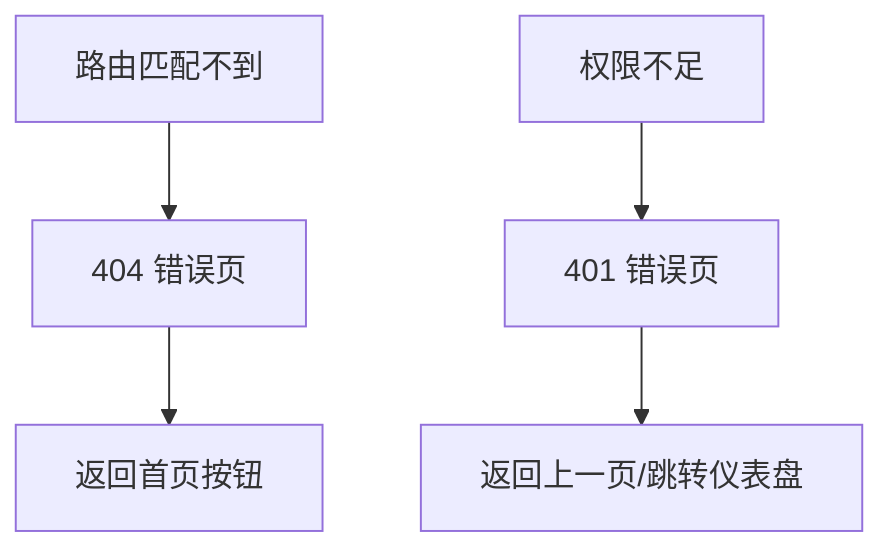
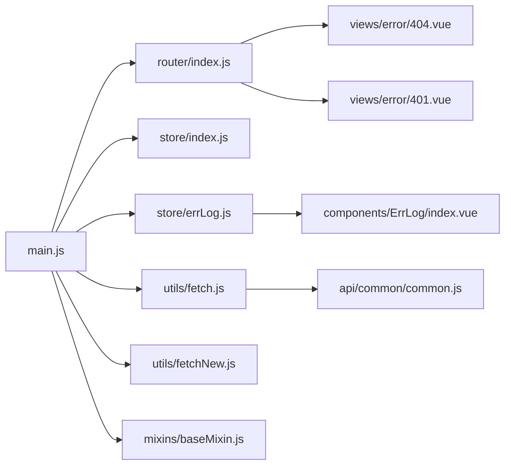

# 运行时错误

<cite>
**本文引用的文件**
- [src/main.js](file://src/main.js)
- [src/App.vue](file://src/App.vue)
- [src/router/index.js](file://src/router/index.js)
- [src/store/index.js](file://src/store/index.js)
- [src/store/errLog.js](file://src/store/errLog.js)
- [src/components/ErrLog/index.vue](file://src/components/ErrLog/index.vue)
- [src/utils/fetch.js](file://src/utils/fetch.js)
- [src/utils/fetchNew.js](file://src/utils/fetchNew.js)
- [src/api/common/common.js](file://src/api/common/common.js)
- [src/mixins/baseMixin.js](file://src/mixins/baseMixin.js)
- [src/views/error/404.vue](file://src/views/error/404.vue)
- [src/views/error/401.vue](file://src/views/error/401.vue)
</cite>

## 目录
1. [简介](#简介)
2. [项目结构](#项目结构)
3. [核心组件](#核心组件)
4. [架构总览](#架构总览)
5. [详细组件分析](#详细组件分析)
6. [依赖关系分析](#依赖关系分析)
7. [性能考量](#性能考量)
8. [故障排查指南](#故障排查指南)
9. [结论](#结论)
10. [附录](#附录)

## 简介
本文件聚焦于应用运行时错误的排查与治理，覆盖以下场景：
- Vue 组件渲染错误
- 路由跳转异常
- API 请求失败（含超时、跨域、数据格式错误）
- 状态管理错误
- 全局错误捕获、错误边界与用户体验优化
目标是帮助团队快速定位与修复运行时问题，提升应用稳定性。

## 项目结构
围绕运行时错误排查的关键模块包括：
- 应用入口与全局配置：初始化路由守卫、进度条、全局错误处理器
- 路由与权限控制：登录态校验、权限路径校验、白名单放行
- 网络层封装：统一请求/响应拦截、超时与错误提示、登录态失效处理
- 错误日志与可视化：生产环境全局错误收集与展示
- 视图层错误页：404/401 页面，引导用户回到安全路径
- 基础混入：通用路由跳转、分页、导出等能力

图表来源
- [src/main.js:1-221](file://src/main.js#L1-L221)
- [src/router/index.js:1-207](file://src/router/index.js#L1-L207)
- [src/store/index.js:1-20](file://src/store/index.js#L1-L20)
- [src/store/errLog.js:1-14](file://src/store/errLog.js#L1-L14)
- [src/components/ErrLog/index.vue:1-52](file://src/components/ErrLog/index.vue#L1-L52)
- [src/utils/fetch.js:1-240](file://src/utils/fetch.js#L1-L240)
- [src/utils/fetchNew.js:1-136](file://src/utils/fetchNew.js#L1-L136)
- [src/api/common/common.js:1-459](file://src/api/common/common.js#L1-L459)
- [src/views/error/404.vue:1-216](file://src/views/error/404.vue#L1-L216)
- [src/views/error/401.vue:1-85](file://src/views/error/401.vue#L1-L85)
- [src/mixins/baseMixin.js:1-103](file://src/mixins/baseMixin.js#L1-L103)

章节来源
- [src/main.js:1-221](file://src/main.js#L1-L221)
- [src/router/index.js:1-207](file://src/router/index.js#L1-L207)
- [src/store/index.js:1-20](file://src/store/index.js#L1-L20)
- [src/store/errLog.js:1-14](file://src/store/errLog.js#L1-L14)
- [src/components/ErrLog/index.vue:1-52](file://src/components/ErrLog/index.vue#L1-L52)
- [src/utils/fetch.js:1-240](file://src/utils/fetch.js#L1-L240)
- [src/utils/fetchNew.js:1-136](file://src/utils/fetchNew.js#L1-L136)
- [src/api/common/common.js:1-459](file://src/api/common/common.js#L1-L459)
- [src/views/error/404.vue:1-216](file://src/views/error/404.vue#L1-L216)
- [src/views/error/401.vue:1-85](file://src/views/error/401.vue#L1-L85)
- [src/mixins/baseMixin.js:1-103](file://src/mixins/baseMixin.js#L1-L103)

## 核心组件
- 全局错误捕获与上报
  - 生产环境设置 Vue.config.errorHandler，将错误、URL、组件上下文写入错误日志模块，并在开发环境可通过组件查看
- 路由守卫与权限控制
  - 白名单放行、token 校验、权限路径校验、登录态拉取与回退
- 网络层拦截与错误处理
  - 请求头注入 token/sign、统一超时、响应码判定与错误提示、登录超时自动登出
- 错误日志可视化
  - 提供错误列表弹窗，展示 message、stack、URL 等
- 视图级错误页
  - 404/401 页面，引导返回首页或上一页

章节来源
- [src/main.js:205-214](file://src/main.js#L205-L214)
- [src/store/errLog.js:1-14](file://src/store/errLog.js#L1-L14)
- [src/components/ErrLog/index.vue:1-52](file://src/components/ErrLog/index.vue#L1-L52)
- [src/router/index.js:40-207](file://src/router/index.js#L40-L207)
- [src/utils/fetch.js:104-169](file://src/utils/fetch.js#L104-L169)
- [src/utils/fetchNew.js:81-133](file://src/utils/fetchNew.js#L81-L133)
- [src/views/error/404.vue:1-216](file://src/views/error/404.vue#L1-L216)
- [src/views/error/401.vue:1-85](file://src/views/error/401.vue#L1-L85)

## 架构总览
运行时错误从“捕获—记录—反馈—恢复”闭环流转，关键节点如下：

图表来源
- [src/main.js:205-214](file://src/main.js#L205-L214)
- [src/store/errLog.js:1-14](file://src/store/errLog.js#L1-L14)
- [src/components/ErrLog/index.vue:1-52](file://src/components/ErrLog/index.vue#L1-L52)

## 详细组件分析

### 1) 全局错误捕获与日志
- 生产环境通过 errorHandler 捕获 Vue 渲染错误与组件错误，写入 errLog 模块
- 开发环境可结合组件查看最近错误，便于快速定位
- 建议在组件中暴露只读日志列表 props，或通过 getter 访问，避免直接修改内部状态

图表来源
- [src/main.js:205-214](file://src/main.js#L205-L214)
- [src/store/errLog.js:1-14](file://src/store/errLog.js#L1-L14)
- [src/components/ErrLog/index.vue:1-52](file://src/components/ErrLog/index.vue#L1-L52)

章节来源
- [src/main.js:205-214](file://src/main.js#L205-L214)
- [src/store/errLog.js:1-14](file://src/store/errLog.js#L1-L14)
- [src/components/ErrLog/index.vue:1-52](file://src/components/ErrLog/index.vue#L1-L52)

### 2) 路由跳转异常与权限控制
- 白名单放行：无需登录即可访问的路径
- token 校验：若存在 token，则拉取用户信息；否则重定向至登录页
- 权限路径校验：根据 meta.permissionPath 与用户权限比对决定放行或 401
- 登录态拉取失败：路由守卫内捕获错误并结束进度条，避免卡死

图表来源
- [src/main.js:73-198](file://src/main.js#L73-L198)
- [src/router/index.js:40-207](file://src/router/index.js#L40-L207)

章节来源
- [src/main.js:73-198](file://src/main.js#L73-L198)
- [src/router/index.js:40-207](file://src/router/index.js#L40-L207)

### 3) API 请求失败与网络层处理
- 超时与错误提示：请求拦截器设置超时；响应拦截器统一提示错误消息
- 登录超时处理：当服务端返回特定码时，触发登出并跳转登录页
- token/sign 注入：按配置列表自动追加 token 与签名参数
- 数据格式：支持 URLSearchParams 与 JSON 两种提交方式

图表来源
- [src/utils/fetch.js:13-171](file://src/utils/fetch.js#L13-L171)
- [src/utils/fetchNew.js:9-136](file://src/utils/fetchNew.js#L9-L136)

章节来源
- [src/utils/fetch.js:13-171](file://src/utils/fetch.js#L13-L171)
- [src/utils/fetchNew.js:9-136](file://src/utils/fetchNew.js#L9-L136)

### 4) 视图级错误页与用户体验
- 404 页面：友好提示与动画，引导用户回到首页
- 401 页面：无权限提示，支持返回上一页或跳转仪表盘

图表来源
- [src/views/error/404.vue:1-216](file://src/views/error/404.vue#L1-L216)
- [src/views/error/401.vue:1-85](file://src/views/error/401.vue#L1-L85)

章节来源
- [src/views/error/404.vue:1-216](file://src/views/error/404.vue#L1-L216)
- [src/views/error/401.vue:1-85](file://src/views/error/401.vue#L1-L85)

### 5) 基础混入与通用能力
- 路由跳转：支持 replace、刷新、延迟刷新
- 分页：默认每页大小、页码变更
- 导出：基于 Excel 工具生成并下载文件，异常时输出到控制台

章节来源
- [src/mixins/baseMixin.js:37-103](file://src/mixins/baseMixin.js#L37-L103)

## 依赖关系分析
- 入口依赖路由、状态、UI 组件与网络层
- 路由依赖状态管理进行权限与用户信息校验
- 网络层依赖 Cookie、状态管理与路由进行 token/sign 注入与登录态失效处理
- 错误日志模块被入口与组件共同消费

图表来源
- [src/main.js:1-221](file://src/main.js#L1-L221)
- [src/router/index.js:1-207](file://src/router/index.js#L1-L207)
- [src/store/index.js:1-20](file://src/store/index.js#L1-L20)
- [src/store/errLog.js:1-14](file://src/store/errLog.js#L1-L14)
- [src/components/ErrLog/index.vue:1-52](file://src/components/ErrLog/index.vue#L1-L52)
- [src/utils/fetch.js:1-240](file://src/utils/fetch.js#L1-L240)
- [src/utils/fetchNew.js:1-136](file://src/utils/fetchNew.js#L1-L136)
- [src/api/common/common.js:1-459](file://src/api/common/common.js#L1-L459)
- [src/views/error/404.vue:1-216](file://src/views/error/404.vue#L1-L216)
- [src/views/error/401.vue:1-85](file://src/views/error/401.vue#L1-L85)
- [src/mixins/baseMixin.js:1-103](file://src/mixins/baseMixin.js#L1-L103)

章节来源
- [src/main.js:1-221](file://src/main.js#L1-L221)
- [src/router/index.js:1-207](file://src/router/index.js#L1-L207)
- [src/store/index.js:1-20](file://src/store/index.js#L1-L20)
- [src/store/errLog.js:1-14](file://src/store/errLog.js#L1-L14)
- [src/components/ErrLog/index.vue:1-52](file://src/components/ErrLog/index.vue#L1-L52)
- [src/utils/fetch.js:1-240](file://src/utils/fetch.js#L1-L240)
- [src/utils/fetchNew.js:1-136](file://src/utils/fetchNew.js#L1-L136)
- [src/api/common/common.js:1-459](file://src/api/common/common.js#L1-L459)
- [src/views/error/404.vue:1-216](file://src/views/error/404.vue#L1-L216)
- [src/views/error/401.vue:1-85](file://src/views/error/401.vue#L1-L85)
- [src/mixins/baseMixin.js:1-103](file://src/mixins/baseMixin.js#L1-L103)

## 性能考量
- 路由守卫中避免重复拉取用户信息，结合状态缓存与白名单策略
- 网络层统一超时与重试策略需谨慎，防止雪崩效应
- 错误日志列表建议限制长度与快照字段，避免内存占用过大
- 图片与动画资源在错误页中应按需加载，减少首屏压力

## 故障排查指南

### 1) Vue 组件渲染错误
- 现象：页面空白、组件不显示、控制台报错
- 排查步骤：
  - 打开错误日志弹窗，查看最近错误的 message 与 stack
  - 定位到具体组件名与行号，核对模板语法、计算属性、生命周期钩子
  - 若为异步数据导致的渲染错误，增加空值保护与默认值
- 建议：
  - 在组件中使用 try/catch 包裹易错逻辑，降级显示
  - 对外部依赖（如第三方 SDK）做兜底加载与错误处理

章节来源
- [src/components/ErrLog/index.vue:1-52](file://src/components/ErrLog/index.vue#L1-L52)
- [src/store/errLog.js:1-14](file://src/store/errLog.js#L1-L14)

### 2) 路由跳转异常
- 现象：无法进入某些页面、频繁跳转 401 或 404
- 排查步骤：
  - 检查路由守卫中的白名单与权限路径配置
  - 确认 token 是否存在且有效，用户信息是否已拉取
  - 查看 meta.permissionPath 与用户权限集合的匹配结果
- 建议：
  - 在路由守卫中增加更细粒度的日志埋点，记录 to/from 与决策分支
  - 对 hash 模式下的进度条收尾逻辑保持一致

章节来源
- [src/main.js:73-198](file://src/main.js#L73-L198)
- [src/router/index.js:40-207](file://src/router/index.js#L40-L207)

### 3) API 请求失败
- 现象：接口报错、超时、跨域、数据格式错误
- 排查步骤：
  - 查看网络面板，确认请求头是否包含 token/sign
  - 检查响应码与提示信息，区分业务错误与网络错误
  - 针对登录超时，确认登出流程与跳转逻辑
- 建议：
  - 对关键接口增加重试与降级策略
  - 统一错误提示文案，避免泄露敏感信息
  - 对 JSON 提交场景，确保 content-type 正确

章节来源
- [src/utils/fetch.js:13-171](file://src/utils/fetch.js#L13-L171)
- [src/utils/fetchNew.js:9-136](file://src/utils/fetchNew.js#L9-L136)
- [src/api/common/common.js:1-459](file://src/api/common/common.js#L1-L459)

### 4) 状态管理错误
- 现象：权限不生效、用户信息缺失、页面状态异常
- 排查步骤：
  - 检查 GetInfo 的调用时机与成功回调
  - 核对权限集合与 meta.permissionPath 的映射
  - 确认登出后状态清空与路由跳转
- 建议：
  - 在状态模块中增加只读 getter 与受控 mutation
  - 对关键状态变更增加日志与断言

章节来源
- [src/store/index.js:1-20](file://src/store/index.js#L1-L20)
- [src/main.js:140-176](file://src/main.js#L140-L176)

### 5) 错误堆栈分析与调试
- 浏览器开发者工具：
  - Console：查看错误 message 与 stack
  - Sources：设置断点，逐步执行定位问题
  - Network：检查请求/响应、超时与跨域
  - Elements：验证 DOM 渲染与缓存命中
- 断点策略：
  - 在路由守卫、API 调用前后、组件 mounted/updated 钩子处设置断点
  - 对异步流程使用条件断点，仅在异常分支触发

章节来源
- [src/main.js:205-214](file://src/main.js#L205-L214)
- [src/utils/fetch.js:104-169](file://src/utils/fetch.js#L104-L169)

### 6) 用户体验优化
- 错误页：
  - 404/401 提供明确的返回路径与操作按钮
- 加载与进度：
  - 路由切换时显示进度条，避免长时间无响应
- 错误提示：
  - 统一使用消息组件提示，避免原生 alert
- 日志可见性：
  - 在开发环境提供错误日志弹窗，便于快速复现

章节来源
- [src/views/error/404.vue:1-216](file://src/views/error/404.vue#L1-L216)
- [src/views/error/401.vue:1-85](file://src/views/error/401.vue#L1-L85)
- [src/main.js:73-203](file://src/main.js#L73-L203)

## 结论
通过完善的全局错误捕获、路由权限控制、网络层拦截与错误页设计，本项目形成了较为完整的运行时错误闭环。建议在现有基础上进一步强化：
- 增强路由与 API 的埋点与可观测性
- 对关键路径引入重试与降级策略
- 优化错误日志的存储与检索能力
- 强化断言与单元测试，降低运行时风险

## 附录
- 常见错误码与处理策略可参考网络层拦截器中的 blockedCode 列表与对应分支
- 跨域与签名策略可参考请求拦截器中 token/sign 注入逻辑
- 登录超时处理可参考响应拦截器中对特定码的登出与跳转逻辑