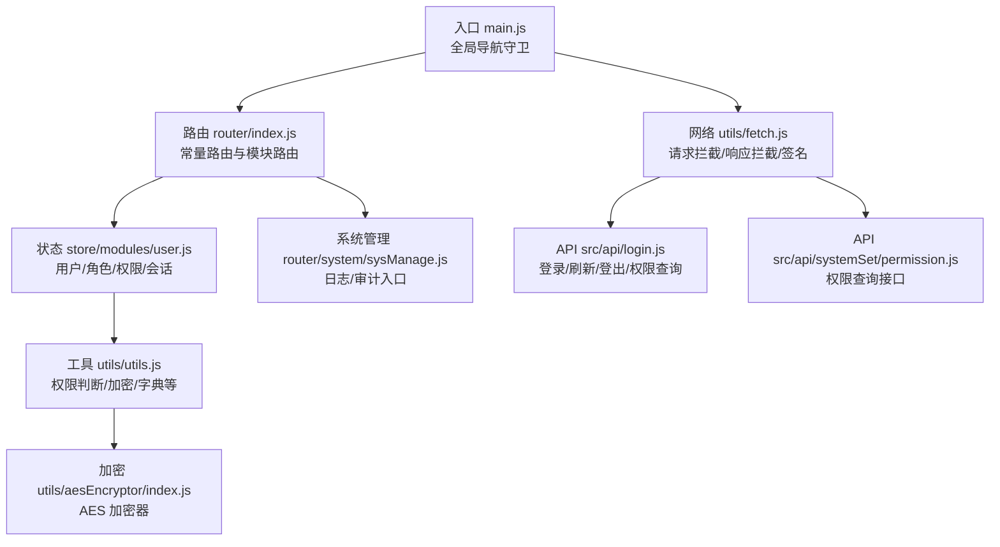
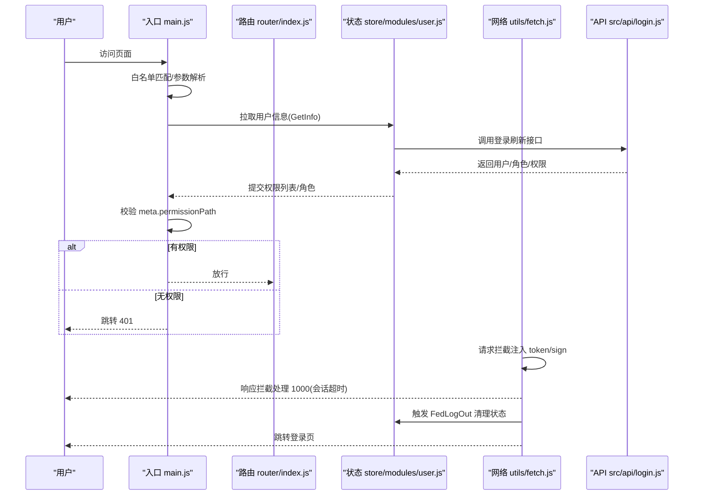
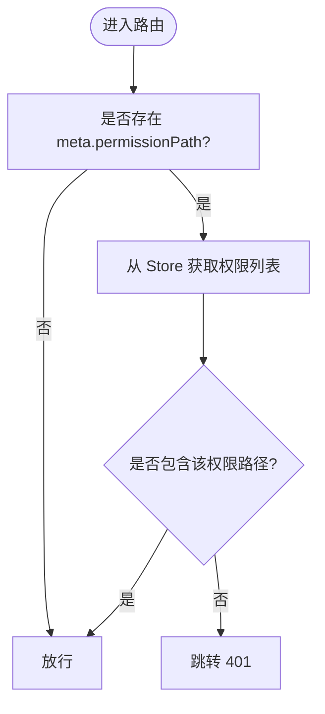
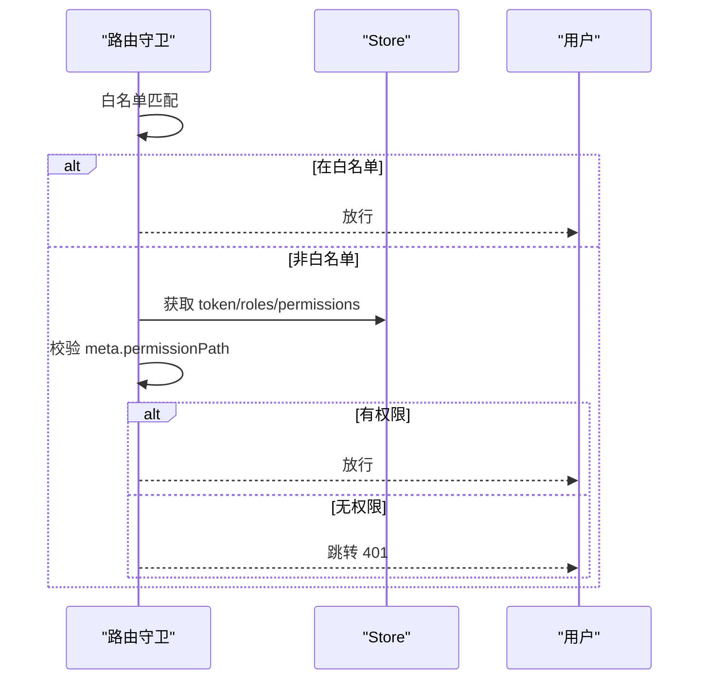
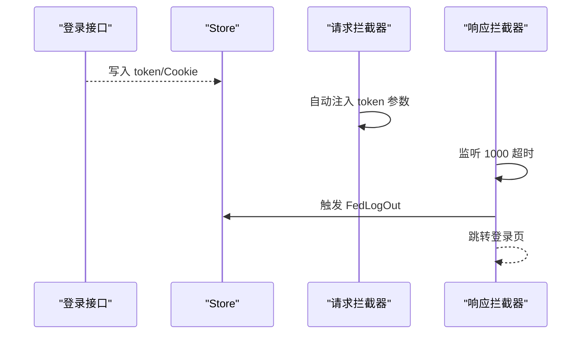
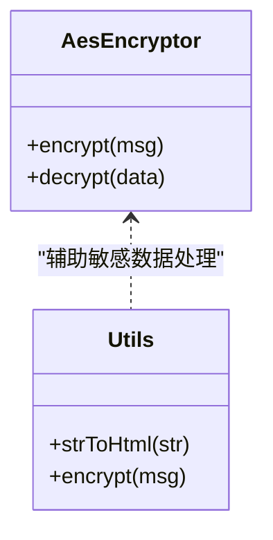
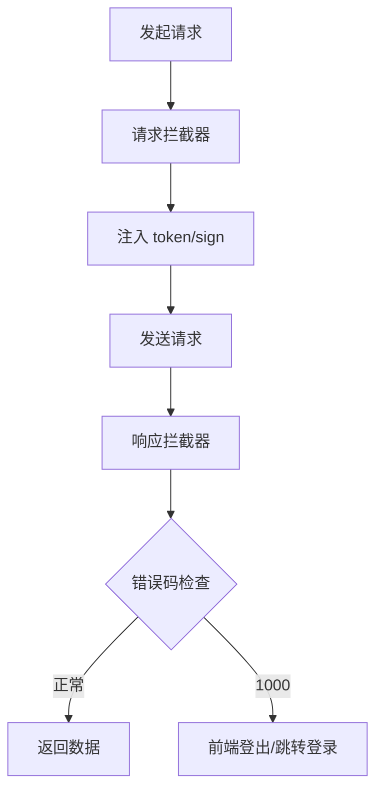
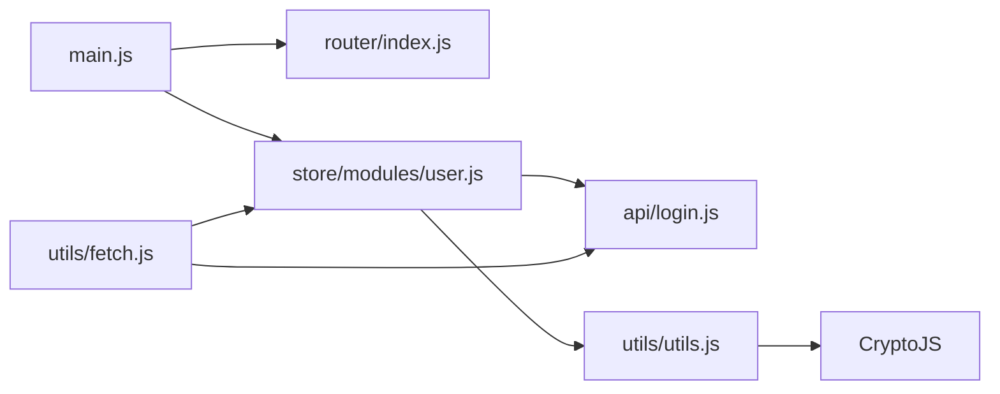

# 安全架构

<cite>
**本文引用的文件**
- [src/main.js](file://src/main.js)
- [src/router/index.js](file://src/router/index.js)
- [src/store/modules/user.js](file://src/store/modules/user.js)
- [src/utils/fetch.js](file://src/utils/fetch.js)
- [src/utils/aesEncryptor/index.js](file://src/utils/aesEncryptor/index.js)
- [src/utils/utils.js](file://src/utils/utils.js)
- [src/api/login.js](file://src/api/login.js)
- [src/api/systemSet/permission.js](file://src/api/systemSet/permission.js)
- [src/router/system/sysManage.js](file://src/router/system/sysManage.js)
</cite>

## 目录
1. [引言](#引言)
2. [项目结构](#项目结构)
3. [核心组件](#核心组件)
4. [架构总览](#架构总览)
5. [详细组件分析](#详细组件分析)
6. [依赖关系分析](#依赖关系分析)
7. [性能考量](#性能考量)
8. [故障排查指南](#故障排查指南)
9. [结论](#结论)
10. [附录](#附录)

## 引言
本文件面向校园管理系统，系统性梳理前端侧安全架构，重点覆盖以下方面：
- 权限控制体系：RBAC 权限模型实现、角色权限分配机制、动态权限验证
- 路由级权限控制：导航守卫实现、白名单机制、权限拦截策略
- 用户认证流程：JWT Token 管理、登录状态保持、会话超时处理
- 数据安全保护：敏感数据加密、SQL 注入防护、XSS 攻击防范
- 网络安全策略：API 安全设计、跨域与签名策略
- 日志审计机制：系统日志与操作审计入口

## 项目结构
本项目采用 Vue 单页应用架构，前端安全相关的关键模块分布如下：
- 入口与路由：在入口文件中实现全局导航守卫与白名单控制；路由定义集中于 router 模块
- 状态与认证：用户状态、角色与权限存储在 Vuex Store 中，并通过 API 拉取与刷新
- 网络层：统一 Axios 实例封装，负责请求头注入、签名与拦截器处理
- 工具与加密：提供通用工具函数与 AES 加密器，用于敏感数据处理
- 系统设置：系统管理路由包含日志与审计相关页面

图表来源
- [src/main.js:77-183](file://src/main.js#L77-L183)
- [src/router/index.js:40-207](file://src/router/index.js#L40-L207)
- [src/store/modules/user.js:20-447](file://src/store/modules/user.js#L20-L447)
- [src/utils/fetch.js:13-240](file://src/utils/fetch.js#L13-L240)
- [src/api/login.js:1-259](file://src/api/login.js#L1-L259)
- [src/api/systemSet/permission.js:1-40](file://src/api/systemSet/permission.js#L1-L40)
- [src/utils/utils.js:30-62](file://src/utils/utils.js#L30-L62)
- [src/utils/aesEncryptor/index.js:24-61](file://src/utils/aesEncryptor/index.js#L24-L61)
- [src/router/system/sysManage.js:93-95](file://src/router/system/sysManage.js#L93-L95)

章节来源
- [src/main.js:77-183](file://src/main.js#L77-L183)
- [src/router/index.js:40-207](file://src/router/index.js#L40-L207)
- [src/store/modules/user.js:20-447](file://src/store/modules/user.js#L20-L447)
- [src/utils/fetch.js:13-240](file://src/utils/fetch.js#L13-L240)
- [src/api/login.js:1-259](file://src/api/login.js#L1-L259)
- [src/api/systemSet/permission.js:1-40](file://src/api/systemSet/permission.js#L1-L40)
- [src/utils/utils.js:30-62](file://src/utils/utils.js#L30-L62)
- [src/utils/aesEncryptor/index.js:24-61](file://src/utils/aesEncryptor/index.js#L24-L61)
- [src/router/system/sysManage.js:93-95](file://src/router/system/sysManage.js#L93-L95)

## 核心组件
- 全局导航守卫与白名单：在入口文件中实现白名单匹配、Token 注入、权限路径校验与跳转
- 路由常量与模块路由：集中定义常量路由与各功能模块路由，便于统一权限控制
- 用户状态与权限：Store 中维护 token、角色、权限列表与映射，支持动态刷新与权限判断
- 网络层拦截器：请求拦截注入 token 与签名参数，响应拦截处理会话超时与错误提示
- 权限工具函数：提供基于权限列表的路径判断与显示控制
- 加密工具：提供 AES 加密器与通用加密方法，用于敏感数据传输与存储
- 系统管理与审计：系统管理路由包含日志与审计页面入口，便于落地审计机制

章节来源
- [src/main.js:77-183](file://src/main.js#L77-L183)
- [src/router/index.js:40-207](file://src/router/index.js#L40-L207)
- [src/store/modules/user.js:20-447](file://src/store/modules/user.js#L20-L447)
- [src/utils/fetch.js:13-240](file://src/utils/fetch.js#L13-L240)
- [src/utils/utils.js:30-62](file://src/utils/utils.js#L30-L62)
- [src/utils/aesEncryptor/index.js:24-61](file://src/utils/aesEncryptor/index.js#L24-L61)
- [src/router/system/sysManage.js:93-95](file://src/router/system/sysManage.js#L93-L95)

## 架构总览
下图展示从用户访问到权限校验、Token 管理与会话超时处理的整体流程。

图表来源
- [src/main.js:77-183](file://src/main.js#L77-L183)
- [src/router/index.js:40-207](file://src/router/index.js#L40-L207)
- [src/store/modules/user.js:218-237](file://src/store/modules/user.js#L218-L237)
- [src/utils/fetch.js:66-169](file://src/utils/fetch.js#L66-L169)
- [src/api/login.js:16-24](file://src/api/login.js#L16-L24)

## 详细组件分析

### 权限控制体系（RBAC）
- 权限模型
  - 用户拥有多个角色，角色具备权限集合，权限以 URL 或路径标识
  - 前端通过拉取权限列表并构建权限映射，用于动态校验与界面渲染
- 动态权限验证
  - 路由元信息中携带 permissionPath，进入路由前进行权限判断
  - 提供工具函数支持按路径判断与按权限列表判断两种方式
- 角色权限分配
  - 登录成功后拉取权限列表并写入 Store，后续路由守卫与组件渲染均基于该列表

图表来源
- [src/main.js:118-176](file://src/main.js#L118-L176)
- [src/store/modules/user.js:87-96](file://src/store/modules/user.js#L87-L96)
- [src/utils/utils.js:30-62](file://src/utils/utils.js#L30-L62)

章节来源
- [src/store/modules/user.js:87-96](file://src/store/modules/user.js#L87-L96)
- [src/utils/utils.js:30-62](file://src/utils/utils.js#L30-L62)
- [src/main.js:118-176](file://src/main.js#L118-L176)

### 路由级权限控制
- 导航守卫实现
  - 白名单：对特定路径直接放行
  - Token 注入：在请求参数中注入 token，避免重复传递
  - 权限拦截：根据 meta.permissionPath 与权限列表决定放行或跳转 401
- 白名单机制
  - 包含预登录页、二维码登录页等无需登录即可访问的路径
- 权限拦截策略
  - 未登录或权限不足时统一跳转至 401 页面
  - 对系统管理模块提供独立入口，便于后台权限控制

图表来源
- [src/main.js:77-183](file://src/main.js#L77-L183)
- [src/router/index.js:40-207](file://src/router/index.js#L40-L207)

章节来源
- [src/main.js:77-183](file://src/main.js#L77-L183)
- [src/router/index.js:40-207](file://src/router/index.js#L40-L207)

### 用户认证流程（JWT Token 管理）
- 登录与 Token 管理
  - 登录成功后将 token 写入 Cookie 并提交到 Store
  - 后续请求通过拦截器自动注入 token 参数
- 登录状态保持
  - 通过 Cookie 保存 token，刷新页面后仍可恢复登录状态
  - 首次单点登录场景支持通过 hash 参数注入 token 并完成初始化
- 会话超时处理
  - 响应拦截器检测到 1000（会话超时）时，触发前端登出并跳转登录页
  - 支持系统登录与普通登录的不同跳转策略

图表来源
- [src/store/modules/user.js:120-173](file://src/store/modules/user.js#L120-L173)
- [src/utils/fetch.js:66-169](file://src/utils/fetch.js#L66-L169)
- [src/api/login.js:25-37](file://src/api/login.js#L25-L37)

章节来源
- [src/store/modules/user.js:120-173](file://src/store/modules/user.js#L120-L173)
- [src/utils/fetch.js:66-169](file://src/utils/fetch.js#L66-L169)
- [src/api/login.js:25-37](file://src/api/login.js#L25-L37)

### 数据安全保护
- 敏感数据加密
  - 提供 AES 加密器与通用加密方法，用于传输或存储敏感数据
  - 加密器支持自定义 key/iv、模式与填充
- SQL 注入防护
  - 前端不直接拼接 SQL，仅通过后端接口传递参数，后端负责参数化与校验
- XSS 攻击防范
  - 提供 HTML 实体转换工具，用于渲染富文本或用户输入内容时的转义处理

图表来源
- [src/utils/aesEncryptor/index.js:24-61](file://src/utils/aesEncryptor/index.js#L24-L61)
- [src/utils/utils.js:136-194](file://src/utils/utils.js#L136-L194)

章节来源
- [src/utils/aesEncryptor/index.js:24-61](file://src/utils/aesEncryptor/index.js#L24-L61)
- [src/utils/utils.js:136-194](file://src/utils/utils.js#L136-L194)

### 网络安全策略与 API 设计
- 请求拦截
  - 自动注入 token 与签名参数，支持特定接口签名策略
  - 对特定域名参数进行 URLSearchParams 处理，避免非法值
- 响应拦截
  - 统一处理错误码，对会话超时进行前端登出与跳转
  - 对多种错误码进行提示与阻断
- 白名单与签名
  - withoutTokenList：明确无需 token 的接口
  - signApiList：需要签名的接口集合

图表来源
- [src/utils/fetch.js:13-240](file://src/utils/fetch.js#L13-L240)

章节来源
- [src/utils/fetch.js:13-240](file://src/utils/fetch.js#L13-L240)

### 日志审计机制
- 系统管理路由包含日志与审计页面入口，便于落地审计与合规要求
- 建议结合后端审计接口完善操作记录与追踪

章节来源
- [src/router/system/sysManage.js:93-95](file://src/router/system/sysManage.js#L93-L95)

## 依赖关系分析
- 组件耦合
  - 入口文件依赖路由与 Store，实现全局导航守卫
  - Store 依赖 API 与工具模块，提供权限与状态管理
  - 网络层拦截器依赖 Store 与 Cookie，实现统一 Token 管理
- 外部依赖
  - 使用 js-cookie 管理 Cookie
  - 使用 CryptoJS 进行加密处理
  - 使用 Element UI 的消息提示组件进行错误反馈

图表来源
- [src/main.js:77-183](file://src/main.js#L77-L183)
- [src/router/index.js:40-207](file://src/router/index.js#L40-L207)
- [src/store/modules/user.js:20-447](file://src/store/modules/user.js#L20-L447)
- [src/utils/fetch.js:13-240](file://src/utils/fetch.js#L13-L240)
- [src/api/login.js:1-259](file://src/api/login.js#L1-L259)
- [src/utils/utils.js:30-62](file://src/utils/utils.js#L30-L62)

章节来源
- [src/main.js:77-183](file://src/main.js#L77-L183)
- [src/router/index.js:40-207](file://src/router/index.js#L40-L207)
- [src/store/modules/user.js:20-447](file://src/store/modules/user.js#L20-L447)
- [src/utils/fetch.js:13-240](file://src/utils/fetch.js#L13-L240)
- [src/api/login.js:1-259](file://src/api/login.js#L1-L259)
- [src/utils/utils.js:30-62](file://src/utils/utils.js#L30-L62)

## 性能考量
- 路由守卫与权限判断
  - 权限列表为数组时，建议使用索引判断以降低复杂度
  - 对树形权限结构，建议缓存查找结果，减少重复遍历
- 请求拦截与签名
  - 对大量 GET 请求，建议合并参数并避免重复序列化
  - 签名计算应在必要时进行，避免对非签名接口产生额外开销
- 加密处理
  - 对大文本加密建议在服务端执行，前端仅处理必要字段

## 故障排查指南
- 登录后无法访问受控页面
  - 检查 meta.permissionPath 是否正确配置
  - 确认权限列表是否已拉取并写入 Store
- 会话超时频繁
  - 检查响应拦截器对 1000 错误的处理逻辑
  - 确认 Cookie 与 Store 中 token 是否存在且有效
- 接口报错或签名失败
  - 核对 withoutTokenList 与 signApiList 配置
  - 确认请求参数是否正确序列化与签名

章节来源
- [src/main.js:118-176](file://src/main.js#L118-L176)
- [src/utils/fetch.js:66-169](file://src/utils/fetch.js#L66-L169)

## 结论
本项目在前端侧实现了完善的权限控制与认证流程，通过路由级导航守卫、Store 状态管理与网络层拦截器，形成从入口到 API 的整体安全闭环。建议后续在后端完善权限校验与审计接口，前端补充更细粒度的权限缓存与错误处理，持续提升系统的安全性与稳定性。

## 附录
- 关键接口与路径
  - 登录/刷新/登出：见 [src/api/login.js:1-259](file://src/api/login.js#L1-L259)
  - 权限查询：见 [src/api/systemSet/permission.js:1-40](file://src/api/systemSet/permission.js#L1-L40)
- 工具函数
  - 权限判断与显示控制：见 [src/utils/utils.js:30-62](file://src/utils/utils.js#L30-L62)
  - 加密与 HTML 实体转换：见 [src/utils/utils.js:136-194](file://src/utils/utils.js#L136-L194) 与 [src/utils/aesEncryptor/index.js:24-61](file://src/utils/aesEncryptor/index.js#L24-L61)