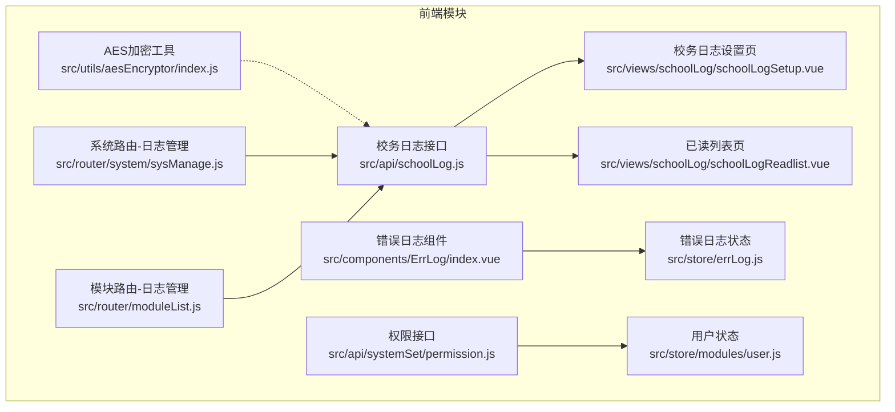
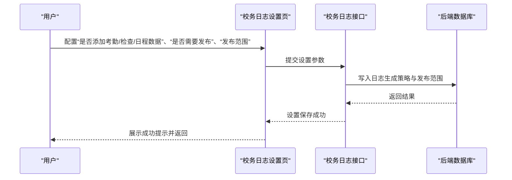
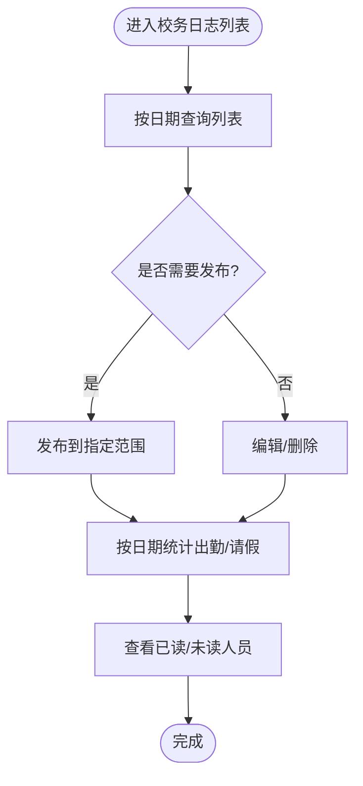
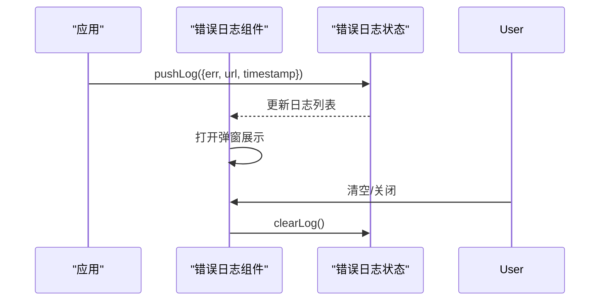
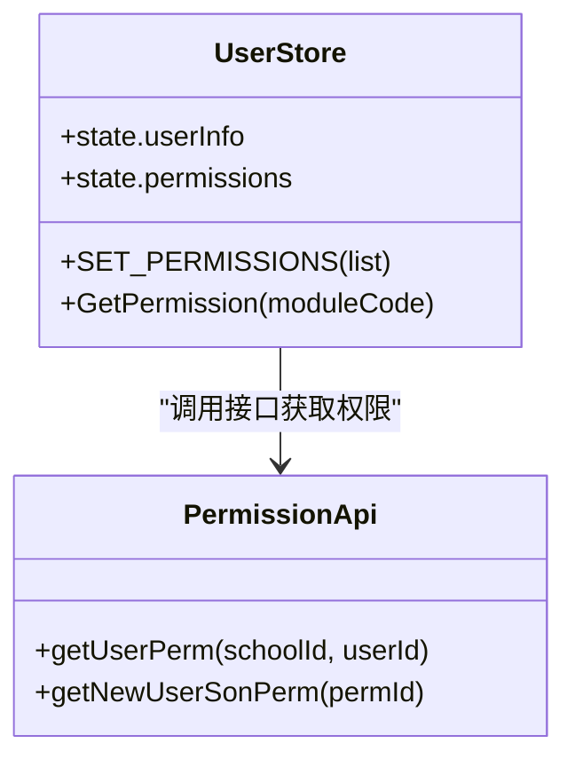
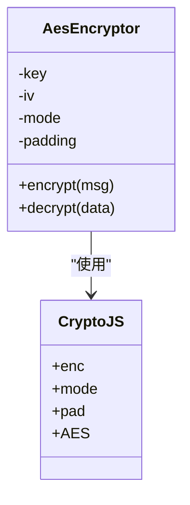
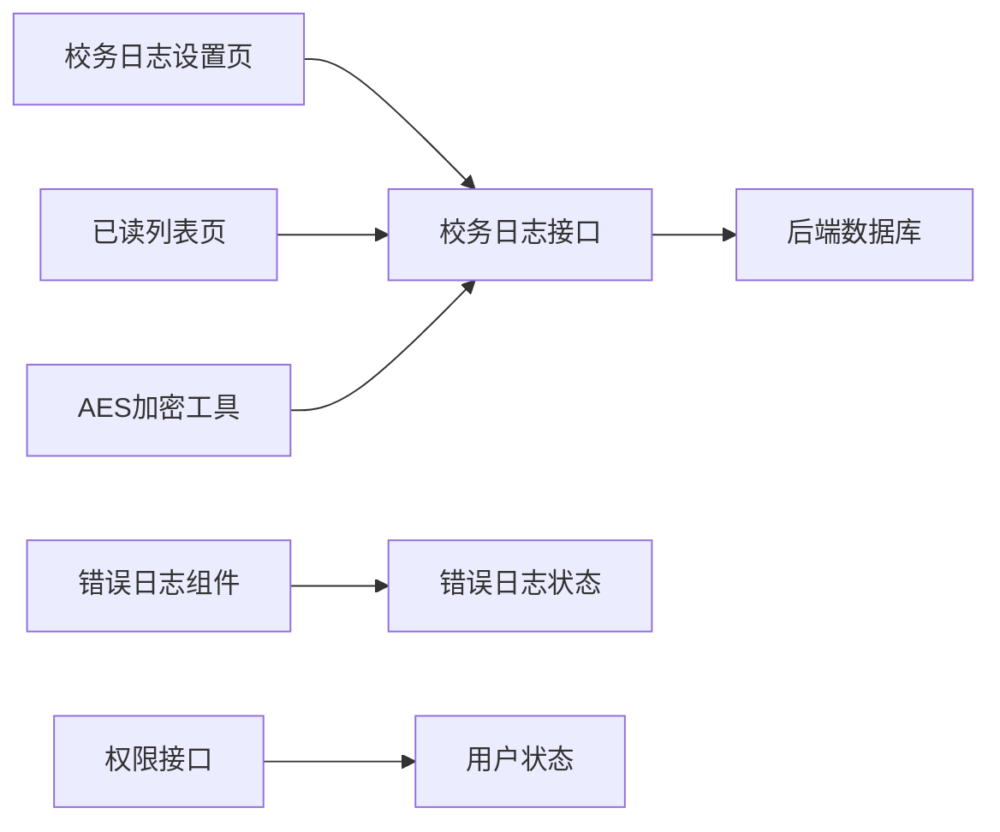

# 审计与监控

<cite>
**本文引用的文件**
- [src/api/schoolLog.js](file://src/api/schoolLog.js)
- [src/views/schoolLog/schoolLogSetup.vue](file://src/views/schoolLog/schoolLogSetup.vue)
- [src/views/schoolLog/schoolLogReadlist.vue](file://src/views/schoolLog/schoolLogReadlist.vue)
- [src/router/system/sysManage.js](file://src/router/system/sysManage.js)
- [src/router/moduleList.js](file://src/router/moduleList.js)
- [src/components/ErrLog/index.vue](file://src/components/ErrLog/index.vue)
- [src/store/errLog.js](file://src/store/errLog.js)
- [src/utils/aesEncryptor/index.js](file://src/utils/aesEncryptor/index.js)
- [src/store/modules/user.js](file://src/store/modules/user.js)
- [src/api/systemSet/permission.js](file://src/api/systemSet/permission.js)
</cite>

## 目录
1. [引言](#引言)
2. [项目结构](#项目结构)
3. [核心组件](#核心组件)
4. [架构总览](#架构总览)
5. [详细组件分析](#详细组件分析)
6. [依赖关系分析](#依赖关系分析)
7. [性能考量](#性能考量)
8. [故障排查指南](#故障排查指南)
9. [结论](#结论)
10. [附录](#附录)

## 引言
本文件面向校园管理系统，聚焦“审计与监控”主题，围绕系统日志记录机制、实时监控实现、日志分析与报表、审计追踪以及日志安全管理展开。通过对现有前端模块与接口的梳理，明确当前可落地的审计与监控能力边界，并给出可扩展的建议与最佳实践。

## 项目结构
本项目采用前端单页应用架构，审计与监控相关能力主要分布在以下区域：
- 日志采集与展示：校务日志模块（列表、发布、设置、已读/未读统计）
- 错误日志：前端错误弹窗组件与全局状态管理
- 权限与审计：权限接口与用户状态管理
- 数据安全：AES 加密工具类
- 路由与菜单：系统管理中的“日志管理”入口

图表来源
- [src/api/schoolLog.js:1-130](file://src/api/schoolLog.js#L1-L130)
- [src/views/schoolLog/schoolLogSetup.vue:1-180](file://src/views/schoolLog/schoolLogSetup.vue#L1-L180)
- [src/views/schoolLog/schoolLogReadlist.vue:1-98](file://src/views/schoolLog/schoolLogReadlist.vue#L1-L98)
- [src/components/ErrLog/index.vue:1-51](file://src/components/ErrLog/index.vue#L1-L51)
- [src/store/errLog.js:1-14](file://src/store/errLog.js#L1-L14)
- [src/api/systemSet/permission.js:1-39](file://src/api/systemSet/permission.js#L1-L39)
- [src/store/modules/user.js:1-447](file://src/store/modules/user.js#L1-L447)
- [src/utils/aesEncryptor/index.js:1-117](file://src/utils/aesEncryptor/index.js#L1-L117)
- [src/router/system/sysManage.js:1-407](file://src/router/system/sysManage.js#L1-L407)
- [src/router/moduleList.js:2287-2325](file://src/router/moduleList.js#L2287-L2325)

章节来源
- [src/api/schoolLog.js:1-130](file://src/api/schoolLog.js#L1-L130)
- [src/router/system/sysManage.js:364-367](file://src/router/system/sysManage.js#L364-L367)
- [src/router/moduleList.js:2287-2325](file://src/router/moduleList.js#L2287-L2325)

## 核心组件
- 校务日志接口层：提供分页查询、发布、新增、编辑、删除、按日期切换、已读/未读统计等能力，支撑“用户操作日志”的采集与存储。
- 校务日志设置页：支持是否添加考勤/检查/日程数据、是否需要发布、发布范围（地址簿）等配置，作为“日志生成策略”的入口。
- 已读列表页：以分页方式展示某条日志的已读人员清单，辅助“访问统计”与“用户行为分析”。
- 错误日志组件与状态：提供前端错误弹窗与全局错误日志数组，作为“系统错误日志”的前端采集点。
- 权限与用户状态：提供权限查询与用户信息持久化，为“权限使用跟踪”与“审计追踪”提供基础数据。
- AES 加密工具：提供对敏感字段的加解密能力，为“日志加密”提供基础工具。

章节来源
- [src/api/schoolLog.js:1-130](file://src/api/schoolLog.js#L1-L130)
- [src/views/schoolLog/schoolLogSetup.vue:1-180](file://src/views/schoolLog/schoolLogSetup.vue#L1-L180)
- [src/views/schoolLog/schoolLogReadlist.vue:1-98](file://src/views/schoolLog/schoolLogReadlist.vue#L1-L98)
- [src/components/ErrLog/index.vue:1-51](file://src/components/ErrLog/index.vue#L1-L51)
- [src/store/errLog.js:1-14](file://src/store/errLog.js#L1-L14)
- [src/store/modules/user.js:1-447](file://src/store/modules/user.js#L1-L447)
- [src/api/systemSet/permission.js:1-39](file://src/api/systemSet/permission.js#L1-L39)
- [src/utils/aesEncryptor/index.js:1-117](file://src/utils/aesEncryptor/index.js#L1-L117)

## 架构总览
系统审计与监控在前端侧的总体流程如下：
- 日志生成：通过校务日志设置页配置日志策略；发布后，系统调用接口写入后端数据库。
- 日志展示：列表页分页展示；已读/未读列表页展示访问情况。
- 错误日志：前端捕获错误并写入全局状态，供错误日志组件展示。
- 权限与用户：权限接口与用户状态为审计提供主体身份与权限维度。
- 数据安全：对敏感字段采用 AES 加密，提升日志安全性。

图表来源
- [src/views/schoolLog/schoolLogSetup.vue:94-146](file://src/views/schoolLog/schoolLogSetup.vue#L94-L146)
- [src/api/schoolLog.js:36-41](file://src/api/schoolLog.js#L36-L41)
- [src/api/schoolLog.js:25-34](file://src/api/schoolLog.js#L25-L34)

章节来源
- [src/views/schoolLog/schoolLogSetup.vue:1-180](file://src/views/schoolLog/schoolLogSetup.vue#L1-L180)
- [src/api/schoolLog.js:1-130](file://src/api/schoolLog.js#L1-L130)

## 详细组件分析

### 校务日志模块
- 功能职责
  - 列表分页与筛选：按日期查询日志列表，支持分页。
  - 发布与编辑：支持发布日志、编辑日志内容。
  - 新增与删除：支持新增日志与批量删除。
  - 访问统计：按日统计出勤与请假人数，支持按日期切换。
  - 已读/未读统计：查询某条日志的已读/未读人数与分页列表。
- 数据流
  - 前端通过接口层调用后端服务，后端返回分页数据与统计数据，前端渲染展示。
- 可扩展点
  - 在“发布”环节增加“日志类型”“来源模块”等字段，便于后续“日志分类分析”。
  - 在“编辑/删除/发布”等关键操作处埋点，形成“操作回溯”。

图表来源
- [src/api/schoolLog.js:3-130](file://src/api/schoolLog.js#L3-L130)
- [src/views/schoolLog/schoolLogReadlist.vue:57-62](file://src/views/schoolLog/schoolLogReadlist.vue#L57-L62)

章节来源
- [src/api/schoolLog.js:1-130](file://src/api/schoolLog.js#L1-L130)
- [src/views/schoolLog/schoolLogReadlist.vue:1-98](file://src/views/schoolLog/schoolLogReadlist.vue#L1-L98)

### 错误日志模块
- 功能职责
  - 前端错误弹窗组件：展示错误消息与堆栈信息。
  - 全局错误日志状态：维护错误日志数组，支持清空。
- 处理流程
  - 应用捕获错误后写入全局状态，打开弹窗展示；管理员可导出或上报。

图表来源
- [src/components/ErrLog/index.vue:1-51](file://src/components/ErrLog/index.vue#L1-L51)
- [src/store/errLog.js:1-14](file://src/store/errLog.js#L1-L14)

章节来源
- [src/components/ErrLog/index.vue:1-51](file://src/components/ErrLog/index.vue#L1-L51)
- [src/store/errLog.js:1-14](file://src/store/errLog.js#L1-L14)

### 权限与用户状态
- 功能职责
  - 权限查询：按用户ID与学校ID查询权限集合，构建权限白名单。
  - 用户信息：登录后持久化用户信息、角色、部门等，为审计提供主体身份。
- 审计价值
  - 将权限使用与操作行为关联，形成“权限使用跟踪”。

图表来源
- [src/store/modules/user.js:87-96](file://src/store/modules/user.js#L87-L96)
- [src/store/modules/user.js:287-303](file://src/store/modules/user.js#L287-L303)
- [src/api/systemSet/permission.js:15-39](file://src/api/systemSet/permission.js#L15-L39)

章节来源
- [src/store/modules/user.js:1-447](file://src/store/modules/user.js#L1-L447)
- [src/api/systemSet/permission.js:1-39](file://src/api/systemSet/permission.js#L1-L39)

### 数据安全与加密
- 功能职责
  - 提供 AES 加密/解密工具类，支持自定义 key、iv、模式与填充。
- 审计价值
  - 对日志中的敏感字段（如人员姓名、联系方式等）进行加密，满足“日志加密”要求。

图表来源
- [src/utils/aesEncryptor/index.js:24-61](file://src/utils/aesEncryptor/index.js#L24-L61)

章节来源
- [src/utils/aesEncryptor/index.js:1-117](file://src/utils/aesEncryptor/index.js#L1-L117)

### 路由与菜单集成
- 系统管理路由中包含“日志管理”入口，模块路由中也包含“日志管理”模块，便于统一导航与权限控制。

章节来源
- [src/router/system/sysManage.js:364-367](file://src/router/system/sysManage.js#L364-L367)
- [src/router/moduleList.js:2287-2325](file://src/router/moduleList.js#L2287-L2325)

## 依赖关系分析
- 组件耦合
  - 校务日志设置页依赖接口层与地址簿组件；已读列表页依赖接口层与分页组件。
  - 错误日志组件依赖全局状态；全局状态被组件消费。
  - 权限接口与用户状态共同构成审计主体身份基础。
- 外部依赖
  - AES 加密工具依赖浏览器 CryptoJS；权限接口依赖后端登录域。
- 循环依赖
  - 当前模块未发现循环依赖迹象。

图表来源
- [src/views/schoolLog/schoolLogSetup.vue:34-135](file://src/views/schoolLog/schoolLogSetup.vue#L34-L135)
- [src/views/schoolLog/schoolLogReadlist.vue:23-61](file://src/views/schoolLog/schoolLogReadlist.vue#L23-L61)
- [src/components/ErrLog/index.vue:1-51](file://src/components/ErrLog/index.vue#L1-L51)
- [src/store/errLog.js:1-14](file://src/store/errLog.js#L1-L14)
- [src/api/systemSet/permission.js:15-39](file://src/api/systemSet/permission.js#L15-L39)
- [src/store/modules/user.js:87-96](file://src/store/modules/user.js#L87-L96)
- [src/utils/aesEncryptor/index.js:1-117](file://src/utils/aesEncryptor/index.js#L1-L117)

章节来源
- [src/views/schoolLog/schoolLogSetup.vue:1-180](file://src/views/schoolLog/schoolLogSetup.vue#L1-L180)
- [src/views/schoolLog/schoolLogReadlist.vue:1-98](file://src/views/schoolLog/schoolLogReadlist.vue#L1-L98)
- [src/components/ErrLog/index.vue:1-51](file://src/components/ErrLog/index.vue#L1-L51)
- [src/store/errLog.js:1-14](file://src/store/errLog.js#L1-L14)
- [src/api/systemSet/permission.js:1-39](file://src/api/systemSet/permission.js#L1-L39)
- [src/store/modules/user.js:1-447](file://src/store/modules/user.js#L1-L447)
- [src/utils/aesEncryptor/index.js:1-117](file://src/utils/aesEncryptor/index.js#L1-L117)

## 性能考量
- 分页与懒加载
  - 列表与已读列表均采用分页，减少一次性渲染压力。
- 图片与布局
  - 已读列表使用固定尺寸头像与浮动布局，避免复杂计算。
- 加密成本
  - AES 加密仅针对必要字段，避免对高频日志路径造成明显延迟。
- 建议
  - 对高频接口增加缓存策略（如本地缓存最近查询结果），降低重复请求。
  - 对错误日志弹窗进行节流，避免短时间内大量错误导致 UI 卡顿。

## 故障排查指南
- 常见问题
  - 发布范围为空：设置页在“需要发布”时需选择至少一个部门/组/用户。
  - 已读列表为空：确认日志是否已发布且有实际阅读行为。
  - 错误日志未显示：检查前端错误捕获是否生效，确认全局状态是否写入。
- 排查步骤
  - 校务日志设置：核对“是否需要发布”与“发布范围”。
  - 已读列表：核对日志 ID、分页参数与后端返回。
  - 错误日志：查看全局状态数组长度与弹窗触发条件。
- 相关代码定位
  - 设置页保存逻辑与必填校验
  - 已读列表分页与数据绑定
  - 错误日志组件与状态管理

章节来源
- [src/views/schoolLog/schoolLogSetup.vue:114-146](file://src/views/schoolLog/schoolLogSetup.vue#L114-L146)
- [src/views/schoolLog/schoolLogReadlist.vue:57-62](file://src/views/schoolLog/schoolLogReadlist.vue#L57-L62)
- [src/components/ErrLog/index.vue:1-51](file://src/components/ErrLog/index.vue#L1-L51)
- [src/store/errLog.js:1-14](file://src/store/errLog.js#L1-L14)

## 结论
当前前端已具备“用户操作日志（校务日志）”“系统错误日志（前端错误弹窗）”“权限使用跟踪（权限接口+用户状态）”的基础能力，并通过“日志管理”路由入口实现统一导航。结合 AES 加密工具，可在不改变后端的前提下增强日志安全性。建议后续在“发布”环节增加审计字段、完善“操作回溯”埋点，并在后端补充“异常行为检测”“安全威胁预警”“合规性报告”等能力，以形成完整的审计与监控闭环。

## 附录
- 术语
  - 审计：对系统活动进行记录、检查与评估的过程。
  - 监控：对系统运行状态与行为进行持续观察与告警。
  - 回溯：基于日志与权限信息还原操作过程与责任人。
- 最佳实践
  - 明确日志分类与保留周期，确保合规。
  - 对敏感字段进行加密存储，最小化暴露面。
  - 在关键操作（新增/编辑/删除/发布）埋点，形成完整操作链路。
  - 建立统一的错误日志收集与分级处理机制。