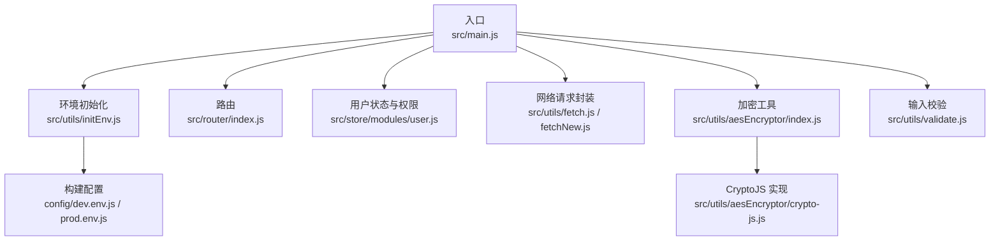
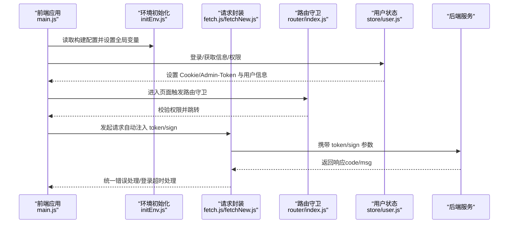
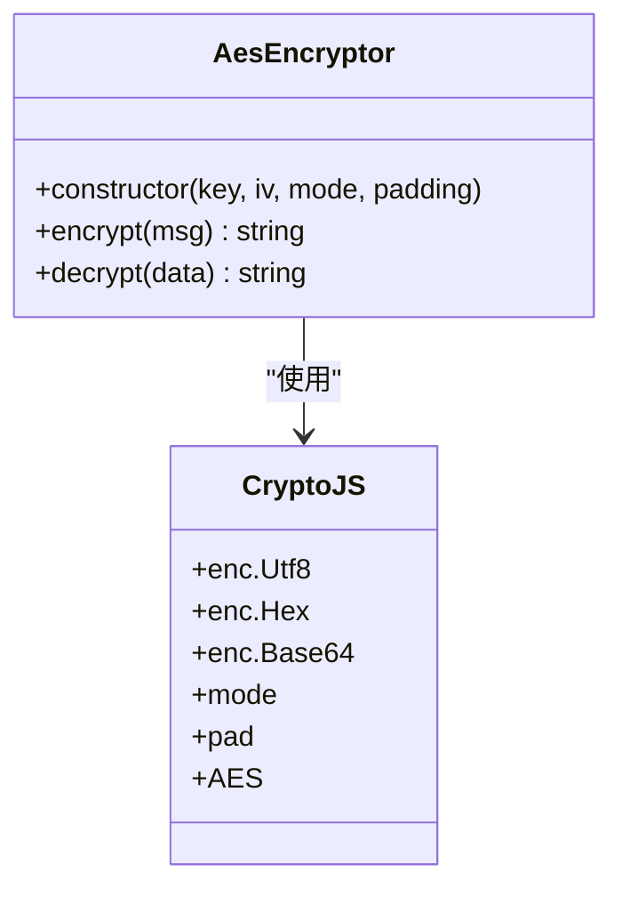
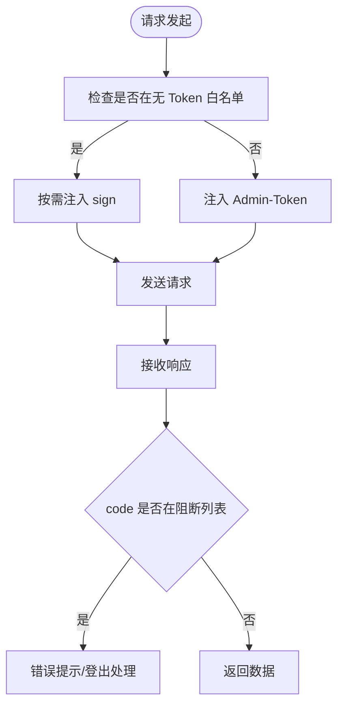
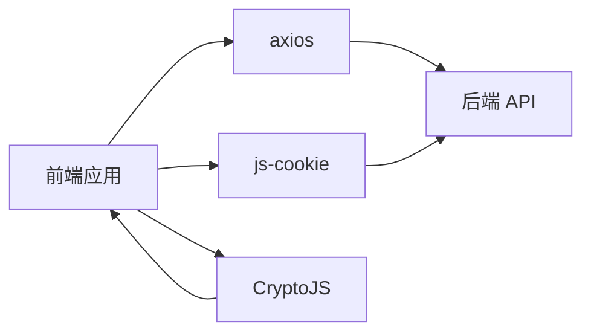

# 数据安全

<cite>
**本文引用的文件**
- [src/utils/aesEncryptor/index.js](file://src/utils/aesEncryptor/index.js)
- [src/utils/aesEncryptor/crypto-js.js](file://src/utils/aesEncryptor/crypto-js.js)
- [src/utils/fetch.js](file://src/utils/fetch.js)
- [src/utils/fetchNew.js](file://src/utils/fetchNew.js)
- [src/utils/validate.js](file://src/utils/validate.js)
- [src/store/modules/user.js](file://src/store/modules/user.js)
- [src/router/index.js](file://src/router/index.js)
- [src/main.js](file://src/main.js)
- [src/utils/initEnv.js](file://src/utils/initEnv.js)
- [config/dev.env.js](file://config/dev.env.js)
- [config/prod.env.js](file://config/prod.env.js)
</cite>

## 目录
1. [简介](#简介)
2. [项目结构](#项目结构)
3. [核心组件](#核心组件)
4. [架构总览](#架构总览)
5. [详细组件分析](#详细组件分析)
6. [依赖分析](#依赖分析)
7. [性能考虑](#性能考虑)
8. [故障排查指南](#故障排查指南)
9. [结论](#结论)
10. [附录](#附录)

## 简介
本文件面向校园管理系统，系统性梳理前端侧的数据安全保护现状与改进建议，覆盖以下主题：
- 敏感数据的加密存储与传输：AES 加密实现、密钥管理策略建议
- 输入验证与数据清理：XSS 防护、SQL 注入防护、CSRF 防护
- 数据访问控制：权限隔离、敏感信息脱敏、数据导出限制
- API 接口安全设计：请求签名验证、参数校验、频率限制
- 最佳实践与常见漏洞防范

说明：
- 本仓库前端采用 Vue 技术栈，使用 Axios 发起 HTTP 请求，全局环境变量通过构建配置注入，路由与权限在前端进行基础控制。
- 文档中的“已实现”基于仓库现有代码，“建议”为针对缺失或可增强的安全能力提出。

## 项目结构
- 安全相关代码主要集中在 utils 工具模块（加密、网络请求、校验）、store 用户状态与权限、router 路由守卫、main.js 入口与环境初始化等位置。
- 环境变量通过 config 下的开发/生产配置注入到运行时，影响 API 基础地址与登录路径等。

图表来源
- [src/main.js:104-131](file://src/main.js#L104-L131)
- [src/utils/initEnv.js:1-33](file://src/utils/initEnv.js#L1-L33)
- [src/router/index.js:1-207](file://src/router/index.js#L1-L207)
- [src/store/modules/user.js:1-447](file://src/store/modules/user.js#L1-L447)
- [src/utils/fetch.js:1-240](file://src/utils/fetch.js#L1-L240)
- [src/utils/fetchNew.js:1-136](file://src/utils/fetchNew.js#L1-L136)
- [src/utils/aesEncryptor/index.js:1-117](file://src/utils/aesEncryptor/index.js#L1-L117)
- [src/utils/aesEncryptor/crypto-js.js:1-800](file://src/utils/aesEncryptor/crypto-js.js#L1-L800)
- [src/utils/validate.js:1-72](file://src/utils/validate.js#L1-L72)
- [config/dev.env.js:1-9](file://config/dev.env.js#L1-L9)
- [config/prod.env.js:1-6](file://config/prod.env.js#L1-L6)

章节来源
- [src/main.js:104-131](file://src/main.js#L104-L131)
- [src/utils/initEnv.js:1-33](file://src/utils/initEnv.js#L1-L33)
- [src/router/index.js:1-207](file://src/router/index.js#L1-L207)
- [src/store/modules/user.js:1-447](file://src/store/modules/user.js#L1-L447)
- [src/utils/fetch.js:1-240](file://src/utils/fetch.js#L1-L240)
- [src/utils/fetchNew.js:1-136](file://src/utils/fetchNew.js#L1-L136)
- [src/utils/aesEncryptor/index.js:1-117](file://src/utils/aesEncryptor/index.js#L1-L117)
- [src/utils/aesEncryptor/crypto-js.js:1-800](file://src/utils/aesEncryptor/crypto-js.js#L1-L800)
- [src/utils/validate.js:1-72](file://src/utils/validate.js#L1-L72)
- [config/dev.env.js:1-9](file://config/dev.env.js#L1-L9)
- [config/prod.env.js:1-6](file://config/prod.env.js#L1-L6)

## 核心组件
- 加密与解密
  - AES 加密实现：提供字符串与十六进制互转、构造类 AesEncryptor、支持指定模式与填充方式。
  - 密钥与初始化向量：以十六进制编码形式内嵌在实现文件中，便于跨端复用。
- 网络请求与安全头
  - Axios 封装：统一设置 token、签名参数、请求体转换、响应错误处理。
  - 白名单与签名：对特定接口路径自动附加签名参数；对部分无需鉴权的接口白名单放行。
- 输入校验
  - 正则规则与通用校验器：提供手机号、身份证、URL、IP 等常用规则，支持表单联动校验。
- 权限与路由
  - 前端路由守卫：根据用户权限跳转 401/404 页面；登录态与角色信息存于 Cookie 与 Vuex。
- 环境与部署
  - 构建配置：通过环境变量切换不同域名与命令模式，影响登录与 API 地址。

章节来源
- [src/utils/aesEncryptor/index.js:1-117](file://src/utils/aesEncryptor/index.js#L1-L117)
- [src/utils/fetch.js:13-171](file://src/utils/fetch.js#L13-L171)
- [src/utils/fetchNew.js:8-78](file://src/utils/fetchNew.js#L8-L78)
- [src/utils/validate.js:10-72](file://src/utils/validate.js#L10-L72)
- [src/store/modules/user.js:20-118](file://src/store/modules/user.js#L20-L118)
- [src/router/index.js:40-199](file://src/router/index.js#L40-L199)
- [src/utils/initEnv.js:1-33](file://src/utils/initEnv.js#L1-L33)
- [config/dev.env.js:1-9](file://config/dev.env.js#L1-L9)
- [config/prod.env.js:1-6](file://config/prod.env.js#L1-L6)

## 架构总览
下图展示从前端到后端的关键交互与安全控制点，包括请求拦截、参数注入、签名与鉴权、响应处理与错误引导。

图表来源
- [src/main.js:104-131](file://src/main.js#L104-L131)
- [src/utils/initEnv.js:1-33](file://src/utils/initEnv.js#L1-L33)
- [src/utils/fetch.js:66-169](file://src/utils/fetch.js#L66-L169)
- [src/utils/fetchNew.js:35-133](file://src/utils/fetchNew.js#L35-L133)
- [src/router/index.js:40-199](file://src/router/index.js#L40-L199)
- [src/store/modules/user.js:120-443](file://src/store/modules/user.js#L120-L443)

## 详细组件分析

### 加密与密钥管理
- 实现要点
  - 提供字符串与十六进制互转函数，便于密钥与参数的跨端传递。
  - AesEncryptor 支持指定模式与填充，默认使用 CBC 与 ZeroPadding（注意：实际默认值来自构造函数参数解析）。
  - 密钥与 IV 以十六进制拼接形式内嵌在实现文件中，便于前端直接使用。
- 安全风险与建议
  - 密钥硬编码在前端代码中存在泄露风险，建议：
    - 后端下发一次性会话密钥或动态生成的临时密钥。
    - 使用更安全的密钥派生方案（如 PBKDF2）与随机 IV。
    - 对敏感字段仅在后端执行加解密，前端仅做必要展示。
  - 填充方式建议使用标准 PKCS7，避免 ZeroPadding 的兼容性与安全性问题。

图表来源
- [src/utils/aesEncryptor/index.js:24-61](file://src/utils/aesEncryptor/index.js#L24-L61)
- [src/utils/aesEncryptor/crypto-js.js:14-800](file://src/utils/aesEncryptor/crypto-js.js#L14-L800)

章节来源
- [src/utils/aesEncryptor/index.js:1-117](file://src/utils/aesEncryptor/index.js#L1-L117)
- [src/utils/aesEncryptor/crypto-js.js:1-800](file://src/utils/aesEncryptor/crypto-js.js#L1-L800)

### 网络请求与签名验证
- 实现要点
  - 自动注入 token：未命中白名单接口时，从 Cookie 注入 Admin-Token。
  - 自动注入签名：命中签名列表的接口自动附加 sign 参数（来自 sessionStorage）。
  - 统一错误处理：根据返回 code 判定是否需要登出或提示。
- 安全风险与建议
  - 仅前端注入 token/sign 不足以抵御中间人攻击与重放，建议：
    - 后端启用 HTTPS 强制策略（需服务端配置）。
    - 签名算法采用 HMAC-SHA256 并结合时间戳与随机 nonce，服务端严格校验。
    - 对高频接口增加限流与 IP 黑名单。
  - 当前实现未见 SQL 注入防护，建议在后端对所有输入进行参数化查询与白名单过滤。

图表来源
- [src/utils/fetch.js:66-169](file://src/utils/fetch.js#L66-L169)
- [src/utils/fetchNew.js:35-133](file://src/utils/fetchNew.js#L35-L133)

章节来源
- [src/utils/fetch.js:13-171](file://src/utils/fetch.js#L13-L171)
- [src/utils/fetchNew.js:8-78](file://src/utils/fetchNew.js#L8-L78)

### 输入验证与数据清理
- 实现要点
  - 提供常用正则（手机号、身份证、URL、IP、图片/附件扩展名等）与通用校验器。
  - 表单联动校验：支持必填与格式校验组合。
- 防护建议
  - XSS 防护：对富文本输入使用白名单 HTML 清洗库（如 DOMPurify），对输出进行 HTML 转义。
  - SQL 注入防护：仅在前端进行格式校验，后端必须使用参数化查询与输入白名单。
  - CSRF 防护：后端启用 SameSite Cookie、CSRF Token 校验，并在前端统一注入与提交。

章节来源
- [src/utils/validate.js:10-72](file://src/utils/validate.js#L10-L72)

### 数据访问控制与权限隔离
- 实现要点
  - 登录成功后写入 Cookie Admin-Token，提交至后端换取用户信息与权限列表。
  - 路由守卫根据用户权限决定是否允许访问目标页面，否则跳转 401。
  - 用户信息与权限持久化在 Vuex 中，支持切换学年等上下文。
- 建议
  - 前端仅作“可见性”控制，真实权限与资源访问应由后端严格校验。
  - 对敏感字段在前端进行脱敏显示（如隐藏身份证号中间位）。

章节来源
- [src/store/modules/user.js:120-443](file://src/store/modules/user.js#L120-L443)
- [src/router/index.js:40-199](file://src/router/index.js#L40-L199)

### 环境与部署安全
- 实现要点
  - 通过 process.env.ENV_TAREGT 切换不同环境的登录与 API 地址。
  - 开发/生产配置分别定义 NODE_ENV 与 ENV_TAREGT。
- 建议
  - 生产环境强制 HTTPS，关闭明文 HTTP。
  - 严格区分开发/测试/生产三套密钥与签名密钥，避免交叉污染。

章节来源
- [src/utils/initEnv.js:1-33](file://src/utils/initEnv.js#L1-L33)
- [config/dev.env.js:1-9](file://config/dev.env.js#L1-L9)
- [config/prod.env.js:1-6](file://config/prod.env.js#L1-L6)

## 依赖分析
- 外部依赖与安全相关点
  - js-cookie：用于读写 Admin-Token，建议设置 HttpOnly 与 SameSite 属性（需后端配合）。
  - axios：统一请求封装，建议在拦截器中增加签名与限流。
  - CryptoJS：前端加密实现，建议仅用于非敏感场景或与后端配合。
- 潜在耦合
  - 签名参数 sign 来自 sessionStorage，若被 XSS 攻击可能被窃取，建议改为后端签发与校验。

图表来源
- [src/utils/fetch.js:1-240](file://src/utils/fetch.js#L1-L240)
- [src/utils/fetchNew.js:1-136](file://src/utils/fetchNew.js#L1-L136)
- [src/utils/aesEncryptor/crypto-js.js:1-800](file://src/utils/aesEncryptor/crypto-js.js#L1-L800)

章节来源
- [src/utils/fetch.js:1-240](file://src/utils/fetch.js#L1-L240)
- [src/utils/fetchNew.js:1-136](file://src/utils/fetchNew.js#L1-L136)
- [src/utils/aesEncryptor/crypto-js.js:1-800](file://src/utils/aesEncryptor/crypto-js.js#L1-L800)

## 性能考虑
- 加密性能：前端 AES 加解密适合轻量数据，大批量敏感数据建议后端处理。
- 请求合并：对频繁小请求进行合并或缓存，减少签名计算与网络往返。
- 错误处理：统一错误提示与登出流程，避免重复请求与资源浪费。

## 故障排查指南
- 登录超时/鉴权失败
  - 现象：返回 code 为 1000 时触发登出并跳转登录页。
  - 排查：确认 Cookie Admin-Token 是否存在、签名参数是否正确、服务端时间同步。
- 签名无效
  - 现象：命中签名列表但未携带或签名不匹配。
  - 排查：核对 sign 生成算法、时间戳与随机数、请求参数顺序与编码。
- 参数校验失败
  - 现象：表单校验报错。
  - 排查：确认正则规则与输入类型一致，后端是否对相同字段进行二次校验。

章节来源
- [src/utils/fetch.js:104-169](file://src/utils/fetch.js#L104-L169)
- [src/utils/fetchNew.js:81-133](file://src/utils/fetchNew.js#L81-L133)
- [src/utils/validate.js:30-72](file://src/utils/validate.js#L30-L72)

## 结论
- 前端已具备基础的加密工具、请求拦截与签名注入、输入校验与路由权限控制能力。
- 面向生产环境，建议补齐后端签名校验、HTTPS 强制、CSRF 令牌、参数化查询与更严格的密钥管理策略，确保“最小暴露面、最大防护力”。

## 附录
- API 安全设计清单（建议）
  - 请求签名：HMAC-SHA256 + 时间戳 + 随机数 + 参数排序 + 服务端校验
  - 参数校验：白名单 + 类型约束 + 长度限制 + 范围校验
  - 频率限制：基于 IP/用户维度 + 滑动窗口计数
  - 传输安全：强制 HTTPS、HSTS、CSP
  - 存储安全：Cookie 设置 HttpOnly/Secure/SameSite；密钥轮换与最小化暴露
- 常见漏洞与防范
  - XSS：输出转义 + 内容安全策略 + 富文本白名单清洗
  - SQL 注入：参数化查询 + 输入白名单 + ORM/框架安全默认
  - CSRF：SameSite Cookie + 服务端 Token 校验 + Referer 校验
  - 信息泄露：敏感字段脱敏、最小化日志输出、错误页不暴露内部细节