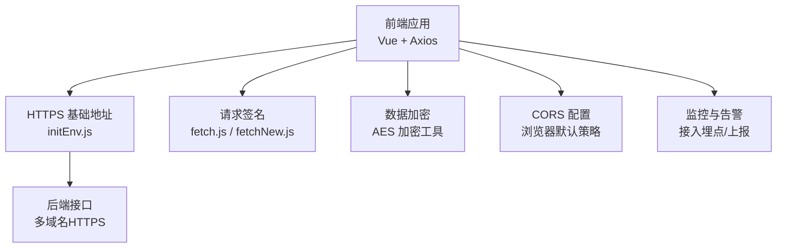
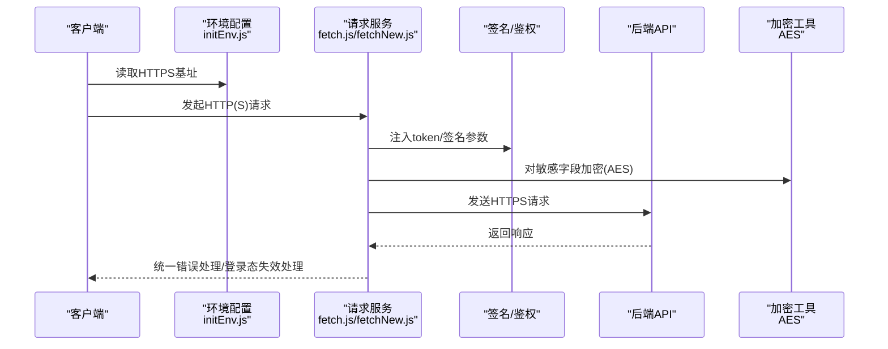
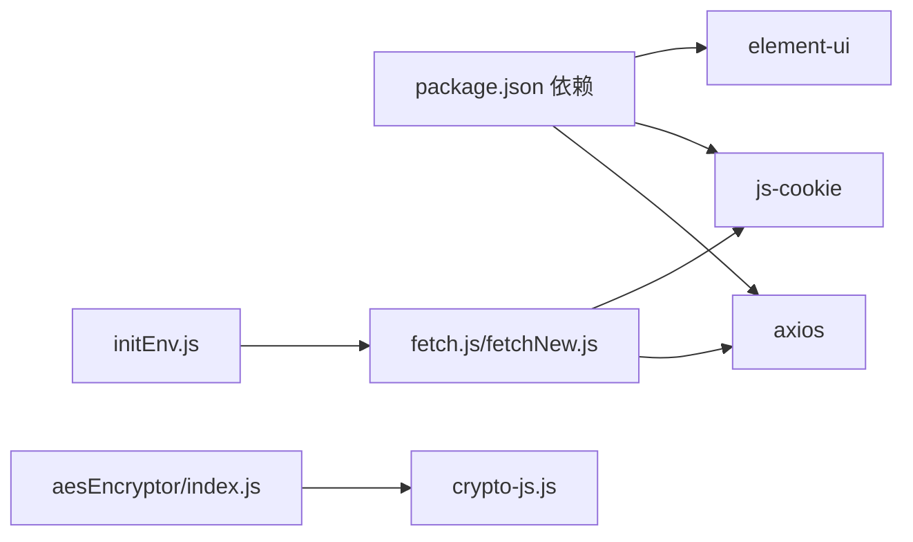

# 网络安全

<cite>
**本文引用的文件**
- [fetch.js](file://src/utils/fetch.js)
- [fetchNew.js](file://src/utils/fetchNew.js)
- [index.js（加密工具）](file://src/utils/aesEncryptor/index.js)
- [crypto-js.js（加密库）](file://src/utils/aesEncryptor/crypto-js.js)
- [initEnv.js](file://src/utils/initEnv.js)
- [index.js（构建配置）](file://config/index.js)
- [package.json](file://package.json)
- [validate.js](file://src/utils/validate.js)
- [dutyArrangement.js（示例API模块）](file://src/api/dutyArrangement.js)
</cite>

## 目录
1. [引言](#引言)
2. [项目结构](#项目结构)
3. [核心组件](#核心组件)
4. [架构总览](#架构总览)
5. [详细组件分析](#详细组件分析)
6. [依赖关系分析](#依赖关系分析)
7. [性能考虑](#性能考虑)
8. [故障排查指南](#故障排查指南)
9. [结论](#结论)
10. [附录](#附录)

## 引言
本文件面向校园管理系统前端侧的网络安全防护，聚焦HTTPS协议使用、SSL证书配置、中间人攻击防护；跨域资源共享（CORS）的安全配置与预检请求处理；API网关安全策略（请求限流、IP白名单、异常流量检测）；WebSocket连接安全（连接验证、消息加密、心跳检测）；以及网络安全监控与入侵检测的实现方案与应急响应流程。文档基于仓库现有代码进行分析，并给出可落地的建议与改进方向。

## 项目结构
- 前端采用Vue生态，网络请求通过统一的axios服务封装，集中注入token与签名参数，支持多环境基地址切换。
- 安全相关能力主要体现在：
  - HTTPS强制访问与多域名HTTPS基址
  - 请求参数签名与鉴权
  - 数据传输加密（AES）
  - 基础校验与输入过滤
- 构建配置与运行脚本位于config与package.json，便于在不同环境启用HTTPS与安全策略。

**图表来源**
- [initEnv.js:1-33](file://src/utils/initEnv.js#L1-L33)
- [fetch.js:13-171](file://src/utils/fetch.js#L13-L171)
- [fetchNew.js:8-78](file://src/utils/fetchNew.js#L8-L78)
- [index.js（加密工具）:24-61](file://src/utils/aesEncryptor/index.js#L24-L61)

**章节来源**
- [initEnv.js:1-33](file://src/utils/initEnv.js#L1-L33)
- [index.js（构建配置）:7-72](file://config/index.js#L7-L72)
- [package.json:1-98](file://package.json#L1-L98)

## 核心组件
- 统一请求服务与拦截器：在请求前注入token与签名参数，在响应中处理登录态失效与错误提示。
- 多环境HTTPS基址：开发测试与生产环境均指向HTTPS域名，降低明文传输风险。
- 数据加密工具：提供AES加解密封装，可用于敏感字段传输加密。
- 输入校验与规则：提供常用正则与校验器，减少恶意输入与XSS风险。
- API模块示例：展示标准的请求封装方式，便于统一接入安全策略。

**章节来源**
- [fetch.js:13-171](file://src/utils/fetch.js#L13-L171)
- [fetchNew.js:8-78](file://src/utils/fetchNew.js#L8-L78)
- [index.js（加密工具）:24-61](file://src/utils/aesEncryptor/index.js#L24-L61)
- [validate.js:10-72](file://src/utils/validate.js#L10-L72)
- [dutyArrangement.js:48-190](file://src/api/dutyArrangement.js#L48-L190)

## 架构总览
下图展示了前端与后端交互的关键路径，强调HTTPS、签名与加密在请求链路中的位置。

**图表来源**
- [initEnv.js:1-33](file://src/utils/initEnv.js#L1-L33)
- [fetch.js:66-101](file://src/utils/fetch.js#L66-L101)
- [fetchNew.js:36-78](file://src/utils/fetchNew.js#L36-L78)
- [index.js（加密工具）:24-61](file://src/utils/aesEncryptor/index.js#L24-L61)

## 详细组件分析

### HTTPS与SSL证书配置
- 多环境HTTPS基址：开发测试与生产环境均使用HTTPS域名，避免混合内容与中间人攻击。
- 建议：
  - 生产环境仅允许TLS 1.2及以上版本，禁用弱密码套件。
  - 启用HSTS，设置合理max-age并包含子域。
  - 使用证书透明度（CT）日志与自动续期，确保证书有效性。
  - 在反向代理层统一终止TLS，后端服务内部通信可按需选择加密。

**章节来源**
- [initEnv.js:1-33](file://src/utils/initEnv.js#L1-L33)
- [index.js（构建配置）:39-72](file://config/index.js#L39-L72)

### 中间人攻击防护
- HTTPS强制：所有API调用通过HTTPS发起，降低窃听与篡改风险。
- Token与签名：请求参数中注入token与sign，结合后端签名校验，抵御重放与伪造。
- Cookie安全：若使用Cookie存储令牌，应设置HttpOnly、Secure、SameSite等属性（建议在后端统一设置）。

**章节来源**
- [fetch.js:83-92](file://src/utils/fetch.js#L83-L92)
- [fetchNew.js:55-69](file://src/utils/fetchNew.js#L55-L69)

### CORS安全配置与预检请求
- 默认策略：浏览器默认遵循同源策略，跨域需后端明确允许。
- 建议：
  - 明确允许的源（Origin），避免通配符“*”，必要时使用动态匹配。
  - 严格控制暴露头与凭证（credentials）使用场景。
  - 对复杂请求（PUT/DELETE/自定义头）启用OPTIONS预检，后端返回明确的允许方法与头。
  - 限制最大缓存时间，避免长期缓存预检结果。

**章节来源**
- [fetch.js:40-62](file://src/utils/fetch.js#L40-L62)
- [fetchNew.js:12-33](file://src/utils/fetchNew.js#L12-L33)

### 安全头设置
- 建议在反向代理或服务端统一设置以下安全头：
  - X-Frame-Options：防止点击劫持
  - X-Content-Type-Options：阻止MIME类型嗅探
  - X-XSS-Protection：启用XSS保护（部分浏览器已弃用）
  - Content-Security-Policy：最小权限原则，限制资源加载来源
  - Referrer-Policy：控制引用信息泄露
  - Permissions-Policy：限制敏感特性使用
  - Strict-Transport-Security：强制HTTPS

[本节为通用安全建议，未直接分析具体文件，故无“章节来源”]

### API网关安全策略
- 请求限流：在网关层对IP与用户维度进行QPS/并发限制，结合滑动窗口算法。
- IP白名单：仅允许授权IP访问管理接口与敏感路由。
- 异常流量检测：基于请求模式、UA、Referer、频率分布识别异常行为，触发阻断与告警。
- 请求签名：前端注入sign参数，后端校验参数完整性与时效性。
- 速率限制与熔断：对第三方依赖（如支付、卡片）设置独立限流与熔断策略。

**章节来源**
- [fetch.js:87-92](file://src/utils/fetch.js#L87-L92)
- [fetchNew.js:65-69](file://src/utils/fetchNew.js#L65-L69)

### WebSocket连接安全
- 连接验证：使用HTTPS升级至WSS，携带短期有效的访问令牌与签名。
- 消息加密：对敏感字段进行AES加密后再传输。
- 心跳检测：固定间隔发送ping/pong，超时断开并触发重连。
- 权限控制：服务端校验用户身份与会话有效性，拒绝匿名或过期会话。

**章节来源**
- [index.js（加密工具）:24-61](file://src/utils/aesEncryptor/index.js#L24-L61)

### 网络安全监控与入侵检测
- 埋点与上报：记录异常请求（4xx/5xx、频繁失败、异常参数）、登录态失效事件。
- 实时告警：对高危行为（暴力破解、异常IP、异常UA）触发邮件/IM告警。
- 日志审计：保留访问日志与错误日志，支持回溯与取证。
- 应急响应流程：
  1) 触发告警 → 2) 自动封禁/限流 → 3) 审计日志取证 → 4) 修复漏洞/调整策略 → 5) 解除限制并复盘

[本节为通用安全建议，未直接分析具体文件，故无“章节来源”]

## 依赖关系分析
- 前端依赖axios进行HTTP请求，统一拦截器处理token与签名。
- 环境变量驱动HTTPS基址切换，保证开发/测试/生产一致性。
- 加密工具依赖CryptoJS库，提供AES加解密能力。
- 构建配置影响静态资源路径与生产优化，间接影响安全部署细节。

**图表来源**
- [package.json:12-43](file://package.json#L12-L43)
- [fetch.js:1-12](file://src/utils/fetch.js#L1-L12)
- [fetchNew.js:1-8](file://src/utils/fetchNew.js#L1-L8)
- [index.js（加密工具）:2-4](file://src/utils/aesEncryptor/index.js#L2-L4)
- [crypto-js.js:1-13](file://src/utils/aesEncryptor/crypto-js.js#L1-L13)
- [initEnv.js:1-11](file://src/utils/initEnv.js#L1-L11)

**章节来源**
- [package.json:12-43](file://package.json#L12-L43)
- [fetch.js:1-12](file://src/utils/fetch.js#L1-L12)
- [fetchNew.js:1-8](file://src/utils/fetchNew.js#L1-L8)
- [index.js（加密工具）:2-4](file://src/utils/aesEncryptor/index.js#L2-L4)
- [crypto-js.js:1-13](file://src/utils/aesEncryptor/crypto-js.js#L1-L13)
- [initEnv.js:1-11](file://src/utils/initEnv.js#L1-L11)

## 性能考虑
- HTTPS握手成本：启用ALPN、OCSP Stapling与会话复用，降低延迟。
- 请求合并与缓存：对非敏感静态资源启用强缓存，减少重复请求。
- 加密开销：AES加密适用于小量敏感字段，避免对大体积数据整体加密。
- 超时与重试：合理设置超时与指数退避重试，避免雪崩效应。

[本节为通用性能建议，未直接分析具体文件，故无“章节来源”]

## 故障排查指南
- 登录态失效：
  - 现象：返回特定错误码并触发登出与跳转。
  - 排查：检查token注入逻辑、Cookie有效期、后端会话状态。
- 签名错误：
  - 现象：后端返回签名校验失败。
  - 排查：确认参数排序、编码方式、时间戳与时效性。
- HTTPS证书问题：
  - 现象：浏览器报证书错误或Mixed Content。
  - 排查：确认证书链完整、域名匹配、HSTS配置。
- CORS失败：
  - 现象：浏览器控制台提示跨域被拒绝。
  - 排查：核对允许的Origin、方法、头与凭据设置。

**章节来源**
- [fetch.js:124-159](file://src/utils/fetch.js#L124-L159)
- [fetchNew.js:99-124](file://src/utils/fetchNew.js#L99-L124)

## 结论
本项目在前端侧已具备HTTPS基址、统一请求拦截与签名注入的基础安全能力。建议在后端与网关层进一步完善CORS策略、限流与异常检测、WSS与消息加密、以及统一安全头配置，形成端到端的网络安全体系。同时建立完善的监控与应急响应机制，持续提升系统抗风险能力。

## 附录
- 常用正则与校验器可用于输入过滤与基础安全防护，建议在表单与上传场景统一启用。
- API模块示例展示了标准化的请求封装，便于后续统一接入安全策略。

**章节来源**
- [validate.js:10-72](file://src/utils/validate.js#L10-L72)
- [dutyArrangement.js:48-190](file://src/api/dutyArrangement.js#L48-L190)