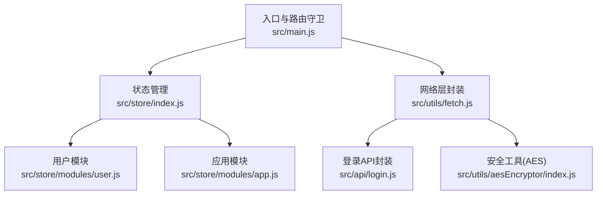
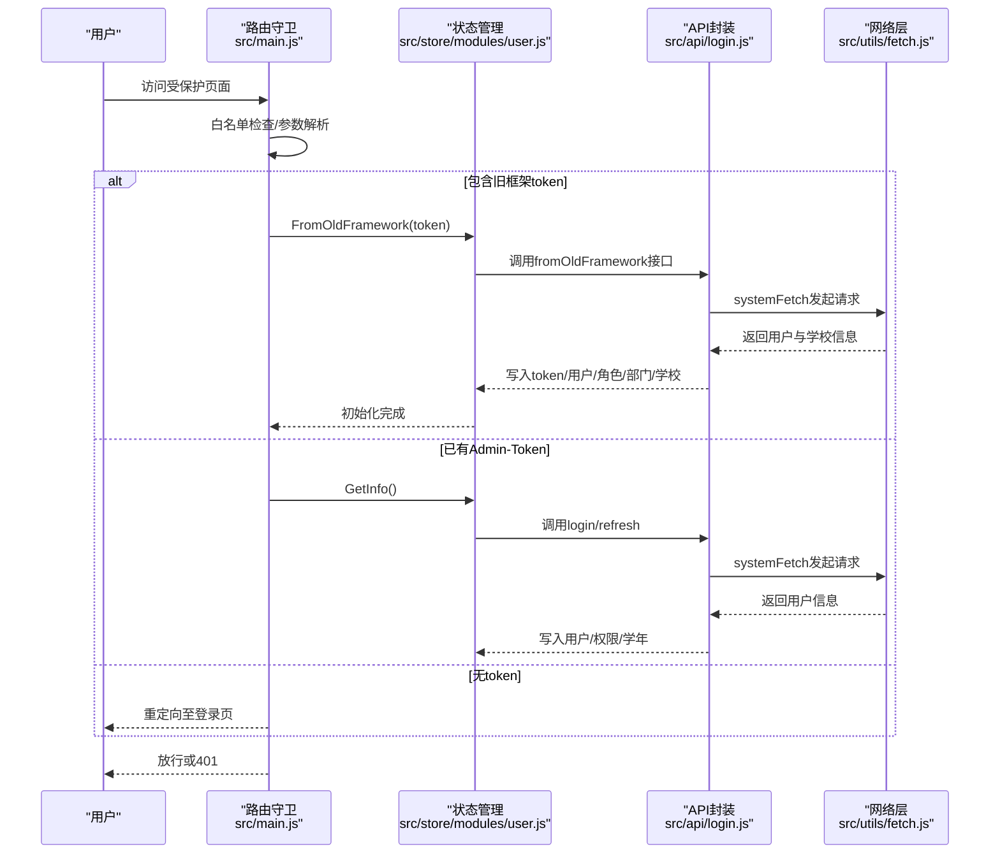
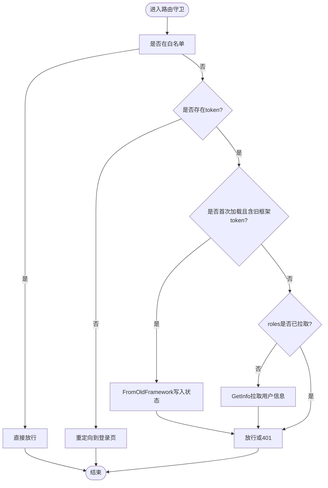
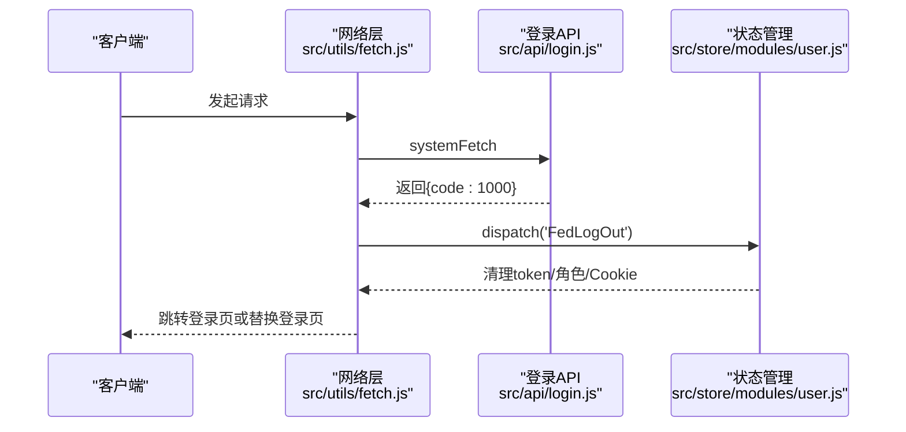
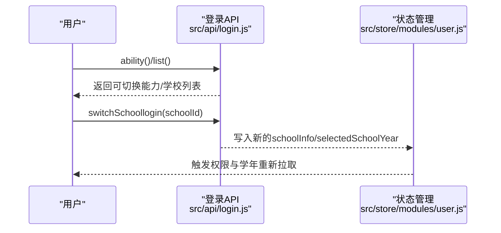
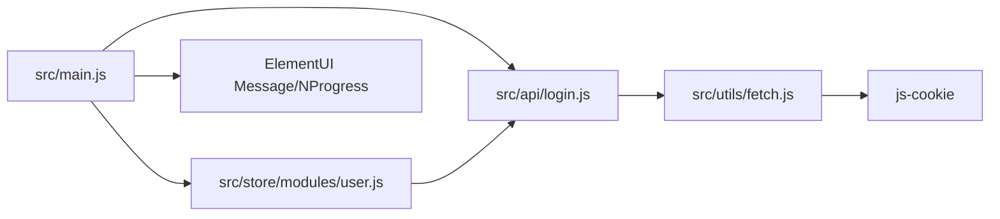

# 会话管理

<cite>
**本文引用的文件**
- [src/main.js](file://src/main.js)
- [src/store/modules/user.js](file://src/store/modules/user.js)
- [src/store/modules/app.js](file://src/store/modules/app.js)
- [src/store/index.js](file://src/store/index.js)
- [src/api/login.js](file://src/api/login.js)
- [src/utils/fetch.js](file://src/utils/fetch.js)
- [src/utils/aesEncryptor/index.js](file://src/utils/aesEncryptor/index.js)
</cite>

## 目录
1. [引言](#引言)
2. [项目结构](#项目结构)
3. [核心组件](#核心组件)
4. [架构总览](#架构总览)
5. [详细组件分析](#详细组件分析)
6. [依赖关系分析](#依赖关系分析)
7. [性能考量](#性能考量)
8. [故障排查指南](#故障排查指南)
9. [结论](#结论)

## 引言
本文件面向校园管理系统中的“会话管理”主题，系统化梳理用户会话的生命周期、存储策略、多学校支持、安全机制与异常处理。文档以仓库现有实现为依据，结合路由守卫、Vuex Store、API 层与工具模块，给出可落地的说明与图示，帮助开发者在不直接阅读源码的情况下理解并维护会话体系。

## 项目结构
围绕会话管理的关键文件分布如下：
- 路由守卫与入口：负责登录态判断、权限校验、旧框架迁移、跨页面跳转与白名单控制
- 状态管理：集中存放用户信息、角色、权限、学校信息、token 等
- API 层：提供登录、登出、刷新、权限、学校切换等接口封装
- 网络层：统一注入 token、签名参数、错误码处理与会话超时自动登出
- 安全工具：提供对特定场景的加解密能力（如公共业务加密）

图表来源
- [src/main.js:73-198](file://src/main.js#L73-L198)
- [src/store/index.js:10-17](file://src/store/index.js#L10-L17)
- [src/store/modules/user.js:20-447](file://src/store/modules/user.js#L20-L447)
- [src/store/modules/app.js:45-47](file://src/store/modules/app.js#L45-L47)
- [src/utils/fetch.js:66-169](file://src/utils/fetch.js#L66-L169)
- [src/api/login.js:1-259](file://src/api/login.js#L1-L259)
- [src/utils/aesEncryptor/index.js:24-61](file://src/utils/aesEncryptor/index.js#L24-L61)

章节来源
- [src/main.js:73-198](file://src/main.js#L73-L198)
- [src/store/index.js:10-17](file://src/store/index.js#L10-L17)

## 核心组件
- 路由守卫与会话初始化
  - 白名单放行、旧框架 token 注入、首次登录信息写入、权限路径校验、跳转回首页等
  - 关键位置参考：[src/main.js:73-198](file://src/main.js#L73-L198)
- 用户状态与会话存储
  - Cookie 存储 Admin-Token；Vuex 维护用户信息、角色、权限、学校信息；SessionStorage 保存部分运行态数据
  - 关键位置参考：[src/store/modules/user.js:20-447](file://src/store/modules/user.js#L20-L447)
- 登录/登出/刷新/权限/学校切换
  - API 封装统一 POST/GET 参数拼装与返回结构处理
  - 关键位置参考：[src/api/login.js:1-259](file://src/api/login.js#L1-L259)
- 网络层拦截与会话超时处理
  - 请求注入 token、签名参数；响应拦截统一处理 1000（登录超时）并触发前端登出
  - 关键位置参考：[src/utils/fetch.js:66-169](file://src/utils/fetch.js#L66-L169)
- 安全工具与敏感数据
  - 提供 AES 加解密实例，用于平台公共业务加密场景
  - 关键位置参考：[src/utils/aesEncryptor/index.js:24-61](file://src/utils/aesEncryptor/index.js#L24-L61)

章节来源
- [src/store/modules/user.js:20-447](file://src/store/modules/user.js#L20-L447)
- [src/api/login.js:1-259](file://src/api/login.js#L1-L259)
- [src/utils/fetch.js:66-169](file://src/utils/fetch.js#L66-L169)
- [src/utils/aesEncryptor/index.js:24-61](file://src/utils/aesEncryptor/index.js#L24-L61)

## 架构总览
下图展示了从用户访问到会话建立、状态维护与异常处理的整体流程。

图表来源
- [src/main.js:73-198](file://src/main.js#L73-L198)
- [src/store/modules/user.js:218-286](file://src/store/modules/user.js#L218-L286)
- [src/api/login.js:179-187](file://src/api/login.js#L179-L187)
- [src/utils/fetch.js:180-182](file://src/utils/fetch.js#L180-L182)

## 详细组件分析

### 1) 会话生命周期与初始化流程
- 登录态判定与白名单
  - 路由守卫对白名单放行；对带 token 的直连、旧框架 token 注入、系统管理直连等分支分别处理
  - 参考：[src/main.js:73-198](file://src/main.js#L73-L198)
- 旧框架迁移与首次初始化
  - 从 hash 中提取 userToken，写入 User-Token 并调用 FromOldFramework，随后写入 vuex_info、pc 类型、学校ID 等
  - 参考：[src/main.js:101-130](file://src/main.js#L101-L130)
- 正常登录后的信息拉取
  - 若已有 Admin-Token，则拉取用户信息、权限、学年等；若 roles 为空则再次拉取
  - 参考：[src/main.js:142-177](file://src/main.js#L142-L177)
- 信息写入与持久化
  - Vuex 中 SET_TOKEN/Cookies/Admin-Token；部分运行态写入 sessionStorage（如 standalone、selectedSchoolYear）
  - 参考：[src/store/modules/user.js:120-173](file://src/store/modules/user.js#L120-L173)

图表来源
- [src/main.js:73-198](file://src/main.js#L73-L198)

章节来源
- [src/main.js:73-198](file://src/main.js#L73-L198)
- [src/store/modules/user.js:120-173](file://src/store/modules/user.js#L120-L173)

### 2) 会话超时检测与自动登出机制
- 超时识别与自动登出
  - 响应拦截器对 code=1000（登录超时）进行捕获，触发 FedLogOut 清理本地状态，并根据上下文决定跳转或替换登录页
  - 参考：[src/utils/fetch.js:124-152](file://src/utils/fetch.js#L124-L152)
- 登出动作
  - 后端接口调用 logout；前端清理 token、角色、Cookies、Vuex 状态
  - 参考：[src/api/login.js:5-13](file://src/api/login.js#L5-L13)，[src/store/modules/user.js:408-434](file://src/store/modules/user.js#L408-L434)

图表来源
- [src/utils/fetch.js:124-152](file://src/utils/fetch.js#L124-L152)
- [src/store/modules/user.js:408-434](file://src/store/modules/user.js#L408-L434)
- [src/api/login.js:5-13](file://src/api/login.js#L5-L13)

章节来源
- [src/utils/fetch.js:124-152](file://src/utils/fetch.js#L124-L152)
- [src/store/modules/user.js:408-434](file://src/store/modules/user.js#L408-L434)

### 3) 会话存储策略：Cookie 与 localStorage/sessionStorage
- Token 存储
  - Admin-Token 写入 Cookie，作为后端鉴权凭证；User-Token 用于旧框架迁移场景
  - 参考：[src/store/modules/user.js:130](file://src/store/modules/user.js#L130)，[src/main.js:85-86](file://src/main.js#L85-L86)
- 运行态与业务数据
  - schoolId、selectedSchoolYear、standalone、vuex_info 等写入 sessionStorage
  - 参考：[src/store/modules/user.js:84](file://src/store/modules/user.js#L84)，[src/store/modules/user.js:105](file://src/store/modules/user.js#L105)，[src/main.js:109](file://src/main.js#L109)，[src/main.js:117](file://src/main.js#L117)
- 数据持久化方案
  - Cookie 适合跨标签页共享 token；sessionStorage 适合短期运行态数据；必要时可在登录后将关键信息写入 sessionStorage 以实现跨页同步
  - 参考：[src/main.js:101-130](file://src/main.js#L101-L130)，[src/store/modules/user.js:120-173](file://src/store/modules/user.js#L120-L173)

章节来源
- [src/store/modules/user.js:84](file://src/store/modules/user.js#L84)
- [src/store/modules/user.js:105](file://src/store/modules/user.js#L105)
- [src/main.js:85-86](file://src/main.js#L85-L86)
- [src/main.js:101-130](file://src/main.js#L101-L130)

### 4) 多学校支持下的会话处理：切换、隔离与数据切换
- 能力查询与学校列表
  - ability()/switchSchoollist() 接口用于判断是否具备切换能力与获取可切换学校列表
  - 参考：[src/api/login.js:238-249](file://src/api/login.js#L238-L249)
- 切换登录
  - switchSchoollogin(schoolId) 完成切换登录，随后写入新的 schoolInfo 与 selectedSchoolYear
  - 参考：[src/api/login.js:250-258](file://src/api/login.js#L250-L258)，[src/store/modules/user.js:84](file://src/store/modules/user.js#L84)，[src/store/modules/user.js:107-110](file://src/store/modules/user.js#L107-L110)
- 会话隔离
  - 通过不同 schoolId 与 selectedSchoolYear 实现业务数据隔离；切换后重新拉取权限与学年
  - 参考：[src/store/modules/user.js:305-324](file://src/store/modules/user.js#L305-L324)

图表来源
- [src/api/login.js:238-258](file://src/api/login.js#L238-L258)
- [src/store/modules/user.js:84](file://src/store/modules/user.js#L84)
- [src/store/modules/user.js:107-110](file://src/store/modules/user.js#L107-L110)
- [src/store/modules/user.js:305-324](file://src/store/modules/user.js#L305-L324)

章节来源
- [src/api/login.js:238-258](file://src/api/login.js#L238-L258)
- [src/store/modules/user.js:84](file://src/store/modules/user.js#L84)
- [src/store/modules/user.js:107-110](file://src/store/modules/user.js#L107-L110)
- [src/store/modules/user.js:305-324](file://src/store/modules/user.js#L305-L324)

### 5) 会话安全措施：token 刷新、会话劫持防护、敏感数据加密
- token 刷新
  - getInfo 接口用于刷新用户信息；网络层统一注入 token；对 1000 超时进行自动登出
  - 参考：[src/api/login.js:16-24](file://src/api/login.js#L16-L24)，[src/utils/fetch.js:83-85](file://src/utils/fetch.js#L83-L85)，[src/utils/fetch.js:124-152](file://src/utils/fetch.js#L124-L152)
- 会话劫持防护
  - 通过 Cookie 存储 Admin-Token 并在请求头注入；对特定接口开启签名参数（sign），并在拦截器中统一注入
  - 参考：[src/utils/fetch.js:24-34](file://src/utils/fetch.js#L24-L34)，[src/utils/fetch.js:87-92](file://src/utils/fetch.js#L87-L92)
- 敏感数据加密
  - 提供 AES 加密实例，用于平台公共业务加密场景（如特定字段传输）
  - 参考：[src/utils/aesEncryptor/index.js:24-61](file://src/utils/aesEncryptor/index.js#L24-L61)

章节来源
- [src/api/login.js:16-24](file://src/api/login.js#L16-L24)
- [src/utils/fetch.js:24-34](file://src/utils/fetch.js#L24-L34)
- [src/utils/fetch.js:83-85](file://src/utils/fetch.js#L83-L85)
- [src/utils/fetch.js:87-92](file://src/utils/fetch.js#L87-L92)
- [src/utils/fetch.js:124-152](file://src/utils/fetch.js#L124-L152)
- [src/utils/aesEncryptor/index.js:24-61](file://src/utils/aesEncryptor/index.js#L24-L61)

### 6) 会话状态监听与跨标签页同步
- 跨标签页同步建议
  - 使用 sessionStorage 存放关键运行态（如 schoolId、selectedSchoolYear、standalone），在路由守卫中读取并写入，实现跨页状态一致
  - 参考：[src/store/modules/user.js:84](file://src/store/modules/user.js#L84)，[src/store/modules/user.js:105](file://src/store/modules/user.js#L105)，[src/main.js:109](file://src/main.js#L109)
- 监听与更新
  - 在需要跨页联动的场景，可在页面初始化时读取 sessionStorage 并同步到 Vuex；对关键字段变更时及时写回
  - 参考：[src/main.js:101-130](file://src/main.js#L101-L130)，[src/store/modules/user.js:120-173](file://src/store/modules/user.js#L120-L173)

章节来源
- [src/store/modules/user.js:84](file://src/store/modules/user.js#L84)
- [src/store/modules/user.js:105](file://src/store/modules/user.js#L105)
- [src/main.js:101-130](file://src/main.js#L101-L130)
- [src/store/modules/user.js:120-173](file://src/store/modules/user.js#L120-L173)

## 依赖关系分析
- 组件耦合
  - 路由守卫依赖 store 的 token/permission；store 依赖 api 封装；api 依赖网络层注入 token/签名
- 外部依赖
  - js-cookie 用于 Cookie 管理；ElementUI Message 用于错误提示；NProgress 用于进度条

图表来源
- [src/main.js:73-198](file://src/main.js#L73-L198)
- [src/store/modules/user.js:20-447](file://src/store/modules/user.js#L20-L447)
- [src/api/login.js:1-259](file://src/api/login.js#L1-L259)
- [src/utils/fetch.js:9,23-34](file://src/utils/fetch.js#L9,L23-L34)

章节来源
- [src/main.js:73-198](file://src/main.js#L73-L198)
- [src/store/modules/user.js:20-447](file://src/store/modules/user.js#L20-L447)
- [src/api/login.js:1-259](file://src/api/login.js#L1-L259)
- [src/utils/fetch.js:9,23-34](file://src/utils/fetch.js#L9,L23-L34)

## 性能考量
- 减少重复拉取：在 roles 已存在时避免二次 GetInfo 请求
- 请求合并：登录成功后 Promise.all 并行拉取权限与学年，缩短首屏等待
- 超时与重试：统一超时时间与错误提示，避免频繁重试造成压力

## 故障排查指南
- 登录超时自动登出
  - 现象：出现“登录超时”提示并跳转登录页
  - 处理：检查响应 code=1000 分支，确认 FedLogOut 是否执行，核对路由跳转逻辑
  - 参考：[src/utils/fetch.js:124-152](file://src/utils/fetch.js#L124-L152)
- 权限不足 401
  - 现象：访问受控路由返回 401
  - 处理：检查 to.meta.permissionPath 与 store.getters.permission 的匹配
  - 参考：[src/main.js:118-137](file://src/main.js#L118-L137)
- 旧框架迁移失败
  - 现象：携带 userToken 但未写入 vuex_info 或 pc 类型异常
  - 处理：确认 FromOldFramework 流程与 sessionStorage 写入
  - 参考：[src/main.js:101-130](file://src/main.js#L101-L130)
- token 缺失或过期
  - 现象：被重定向到登录页
  - 处理：检查 Cookie 中 Admin-Token 是否存在，必要时重新登录
  - 参考：[src/main.js:177-193](file://src/main.js#L177-L193)

章节来源
- [src/utils/fetch.js:124-152](file://src/utils/fetch.js#L124-L152)
- [src/main.js:118-137](file://src/main.js#L118-L137)
- [src/main.js:101-130](file://src/main.js#L101-L130)
- [src/main.js:177-193](file://src/main.js#L177-L193)

## 结论
本项目的会话管理以路由守卫为入口、以 Vuex 为核心、以 API/网络层为支撑，实现了从登录、刷新、权限、学校切换到超时自动登出的完整闭环。通过 Cookie 与 sessionStorage 的合理分工、统一的 token 注入与签名机制、以及对 1000 超时的自动处理，系统在可用性与安全性之间取得了平衡。建议在后续迭代中进一步完善跨标签页事件监听与状态同步策略，以提升多标签页场景下的用户体验。