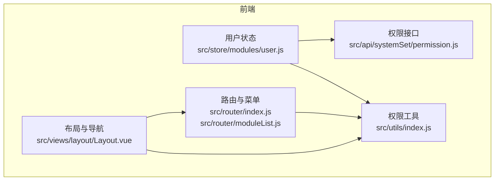
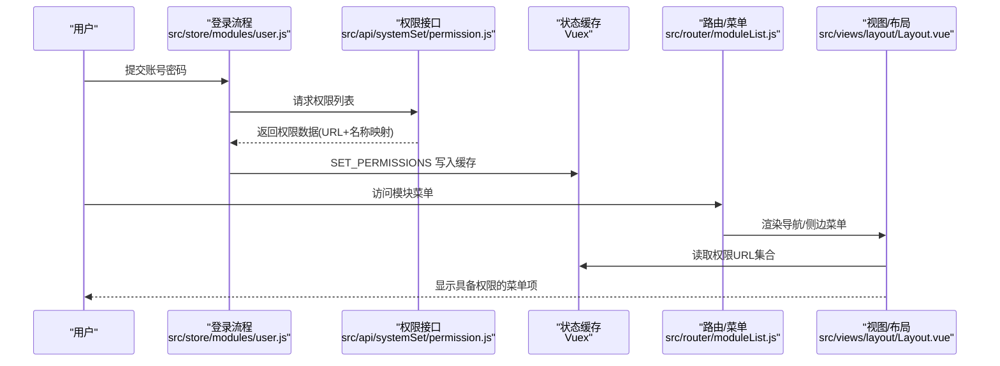
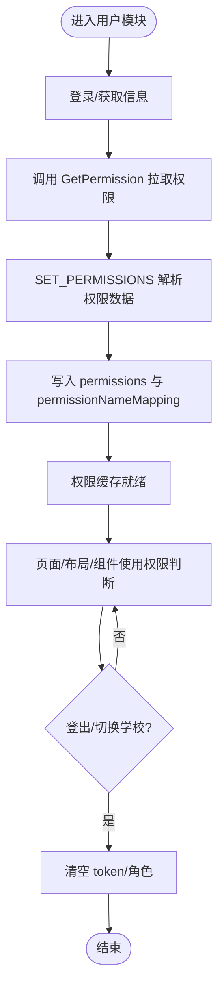
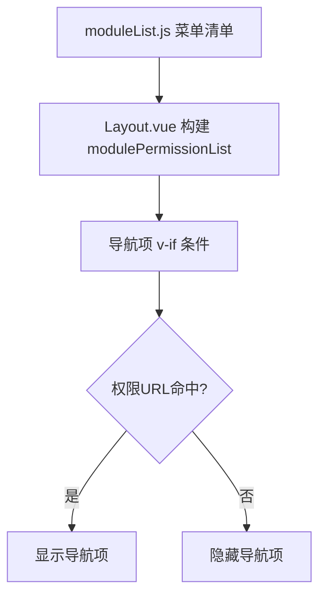
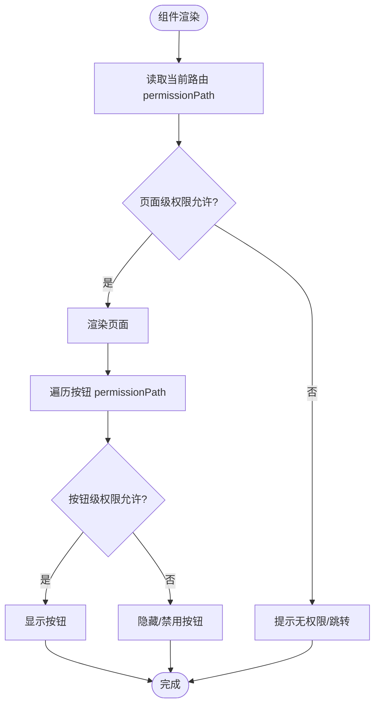
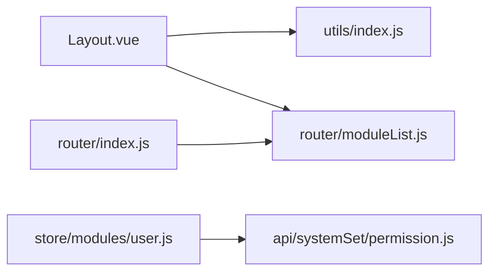

# 权限模型

<cite>
**本文引用的文件**
- [src/store/modules/user.js](file://src/store/modules/user.js)
- [src/api/systemSet/permission.js](file://src/api/systemSet/permission.js)
- [src/router/index.js](file://src/router/index.js)
- [src/router/moduleList.js](file://src/router/moduleList.js)
- [src/views/layout/Layout.vue](file://src/views/layout/Layout.vue)
- [src/utils/index.js](file://src/utils/index.js)
</cite>

## 目录
1. [引言](#引言)
2. [项目结构](#项目结构)
3. [核心组件](#核心组件)
4. [架构总览](#架构总览)
5. [详细组件分析](#详细组件分析)
6. [依赖分析](#依赖分析)
7. [性能考虑](#性能考虑)
8. [故障排查指南](#故障排查指南)
9. [结论](#结论)
10. [附录](#附录)

## 引言
本文件面向校园管理系统中的权限模型，围绕 RBAC（基于角色的访问控制）进行系统化说明。内容涵盖角色与权限的数据结构、权限下发与持久化、权限验证机制（按钮级与页面级）、动态菜单生成策略，以及权限缓存与失效处理。文档提供可追溯的“章节来源”与“图表来源”，帮助读者快速定位实现细节。

## 项目结构
权限相关能力主要分布在以下模块：
- 用户状态与权限缓存：Vuex 模块（用户信息、角色、权限列表、权限名称映射）
- 权限接口：系统设置模块下的权限查询接口
- 路由与菜单：常量路由与模块化菜单清单
- 权限工具：通用工具函数（权限判断、角色判断、页面显示控制）
- 布局与导航：顶部导航与模块权限映射

图表来源
- [src/store/modules/user.js:1-447](file://src/store/modules/user.js#L1-L447)
- [src/api/systemSet/permission.js:1-40](file://src/api/systemSet/permission.js#L1-L40)
- [src/router/index.js:1-207](file://src/router/index.js#L1-L207)
- [src/router/moduleList.js:1-800](file://src/router/moduleList.js#L1-L800)
- [src/utils/index.js:1-385](file://src/utils/index.js#L1-L385)
- [src/views/layout/Layout.vue:1-507](file://src/views/layout/Layout.vue#L1-L507)

章节来源
- [src/store/modules/user.js:1-447](file://src/store/modules/user.js#L1-L447)
- [src/router/index.js:1-207](file://src/router/index.js#L1-L207)
- [src/router/moduleList.js:1-800](file://src/router/moduleList.js#L1-L800)
- [src/utils/index.js:1-385](file://src/utils/index.js#L1-L385)
- [src/views/layout/Layout.vue:1-507](file://src/views/layout/Layout.vue#L1-L507)

## 核心组件
- 用户状态与权限缓存（Vuex）
  - 状态字段：用户信息、角色列表、部门列表、权限URL集合、权限名称映射、学年信息等
  - 关键方法：登录/获取信息后拉取权限并写入缓存；重置权限；登出清理
- 权限接口
  - 提供“查询用户所有权限”“根据上级权限ID获取子权限”等接口封装
- 路由与模块菜单
  - 常量路由与模块化菜单清单，每个菜单项包含 permissionPath
- 权限工具
  - 页面级权限判断：基于权限URL集合
  - 按钮级权限判断：基于 permissionPath 列表或单个路径
  - 角色级判断：基于角色常量标识
- 布局与导航
  - 将模块与权限URL映射，结合工具函数控制导航项显示

章节来源
- [src/store/modules/user.js:1-447](file://src/store/modules/user.js#L1-L447)
- [src/api/systemSet/permission.js:1-40](file://src/api/systemSet/permission.js#L1-L40)
- [src/router/moduleList.js:1-800](file://src/router/moduleList.js#L1-L800)
- [src/utils/index.js:1-385](file://src/utils/index.js#L1-L385)
- [src/views/layout/Layout.vue:1-507](file://src/views/layout/Layout.vue#L1-L507)

## 架构总览
RBAC 权限体系在前端的运行流程如下：
- 登录成功后，从后端获取权限列表（URL集合与名称映射），写入 Vuex
- 菜单与导航项通过 permissionPath 与权限URL集合比对，决定是否渲染
- 组件在渲染或交互时，使用工具函数进行按钮级权限判断
- 登出或切换学校时，清理权限缓存，触发重新拉取

图表来源
- [src/store/modules/user.js:287-304](file://src/store/modules/user.js#L287-L304)
- [src/api/systemSet/permission.js:15-39](file://src/api/systemSet/permission.js#L15-L39)
- [src/router/moduleList.js:1-800](file://src/router/moduleList.js#L1-L800)
- [src/views/layout/Layout.vue:100-175](file://src/views/layout/Layout.vue#L100-L175)

## 详细组件分析

### 用户状态与权限缓存（Vuex）
- 数据结构
  - 权限URL集合：permissions（数组，存储后端返回的URL，统一去除空白）
  - 权限名称映射：permissionNameMapping（对象，key为URL，value为描述/名称）
  - 角色列表：roles（用于角色级判断）
- 关键流程
  - 登录/获取信息：调用 GetPermission 拉取权限，SET_PERMISSIONS 写入缓存
  - 重置权限：ResetPermissions 支持二次菜单刷新场景
  - 登出：清空 token 与角色，保留权限缓存以便登出后快速跳转

图表来源
- [src/store/modules/user.js:120-304](file://src/store/modules/user.js#L120-L304)

章节来源
- [src/store/modules/user.js:1-447](file://src/store/modules/user.js#L1-L447)

### 权限接口
- 接口职责
  - 查询用户所有权限：getUserPerm
  - 根据上级权限ID获取子权限：getNewUserSonPerm
- 使用方式
  - 在用户模块的 GetPermission 中调用，将返回数据交给 SET_PERMISSIONS 处理

章节来源
- [src/api/systemSet/permission.js:1-40](file://src/api/systemSet/permission.js#L1-L40)
- [src/store/modules/user.js:287-304](file://src/store/modules/user.js#L287-L304)

### 路由与模块菜单
- 菜单清单
  - 模块化菜单位于 moduleList.js，每个菜单项包含 permissionPath 字段
  - 常量路由位于 router/index.js，作为全局入口与兜底
- 动态菜单生成
  - 布局组件在 created 阶段构建 modulePermissionList（模块Key -> 权限URL数组）
  - 导航项通过 isShowByPermissionList(permissionPath[]) 控制显示

图表来源
- [src/router/moduleList.js:1-800](file://src/router/moduleList.js#L1-L800)
- [src/views/layout/Layout.vue:100-175](file://src/views/layout/Layout.vue#L100-L175)

章节来源
- [src/router/index.js:1-207](file://src/router/index.js#L1-L207)
- [src/router/moduleList.js:1-800](file://src/router/moduleList.js#L1-L800)
- [src/views/layout/Layout.vue:1-507](file://src/views/layout/Layout.vue#L1-L507)

### 权限验证机制
- 页面级权限验证
  - 工具函数 isShowByPermission(permissionPath)：判断当前 URL 是否在权限集合中
  - 工具函数 isShowByPermissionList(permissionList, isOr)：支持“或/且”组合判断
- 按钮级权限控制
  - 在组件中使用工具函数对具体按钮的 permissionPath 进行判断，决定渲染或禁用
- 角色级控制
  - 工具函数 isShowByRole(value, key)：基于角色常量标识判断

图表来源
- [src/utils/index.js:217-340](file://src/utils/index.js#L217-L340)
- [src/views/layout/Layout.vue:100-175](file://src/views/layout/Layout.vue#L100-L175)

章节来源
- [src/utils/index.js:1-385](file://src/utils/index.js#L1-L385)
- [src/views/layout/Layout.vue:1-507](file://src/views/layout/Layout.vue#L1-L507)

### 权限数据结构与管理
- 权限URL映射
  - SET_PERMISSIONS 将后端返回的权限列表转换为 permissions（URL数组）与 permissionNameMapping（URL->名称/描述）
- 权限名称映射
  - 优先使用 description，否则回退到 name
- 权限列表管理
  - ResetPermissions 支持在权限变更后重新注入新的权限列表
- 角色定义与继承
  - roles 字段承载用户角色，配合 isShowByRole 实现角色级控制
  - 当前仓库未见显式“角色-权限”树形关系，继承关系以角色常量标识与业务判断为主

章节来源
- [src/store/modules/user.js:87-117](file://src/store/modules/user.js#L87-L117)
- [src/store/modules/user.js:435-442](file://src/store/modules/user.js#L435-L442)
- [src/utils/index.js:244-246](file://src/utils/index.js#L244-L246)

### 动态菜单生成与页面级验证
- 动态菜单
  - Layout.vue 在 created 中读取 moduleList.normal，构建 modulePermissionList（模块Key -> 权限URL数组）
  - 导航项通过 v-if 结合 isShowByPermissionList 控制显示
- 页面级验证
  - 页面组件在 created/mounted 生命周期中，使用 isShowByPermission 判断当前路由是否具备访问权限

章节来源
- [src/views/layout/Layout.vue:100-175](file://src/views/layout/Layout.vue#L100-L175)
- [src/utils/index.js:241-243](file://src/utils/index.js#L241-L243)

### 权限缓存策略与失效处理
- 缓存策略
  - 登录/获取信息后一次性拉取权限并写入 Vuex
  - permissionNameMapping 用于将 URL 映射为可读名称，便于提示与日志
- 更新机制
  - ResetPermissions 支持在权限变更后注入新权限列表
- 失效处理
  - 登出时清空 token 与角色，建议在登出后刷新页面，确保路由与菜单重新计算
  - 切换学校时，通过 SetLoginInfo 重新拉取权限并写入缓存

章节来源
- [src/store/modules/user.js:120-442](file://src/store/modules/user.js#L120-L442)
- [src/views/layout/Layout.vue:198-218](file://src/views/layout/Layout.vue#L198-L218)

## 依赖分析
- 组件耦合
  - Layout.vue 依赖 moduleList.js 的菜单清单与 utils 的权限判断函数
  - 用户模块依赖权限接口与 Vuex 状态
  - 路由层依赖模块菜单清单
- 外部依赖
  - 权限接口封装在 api/systemSet/permission.js，统一通过 fetch 发起请求
- 可能的循环依赖
  - 当前结构清晰，未发现模块间循环依赖

图表来源
- [src/views/layout/Layout.vue:100-175](file://src/views/layout/Layout.vue#L100-L175)
- [src/utils/index.js:1-385](file://src/utils/index.js#L1-385)
- [src/router/moduleList.js:1-800](file://src/router/moduleList.js#L1-L800)
- [src/store/modules/user.js:1-447](file://src/store/modules/user.js#L1-L447)
- [src/api/systemSet/permission.js:1-40](file://src/api/systemSet/permission.js#L1-L40)
- [src/router/index.js:1-207](file://src/router/index.js#L1-L207)

章节来源
- [src/views/layout/Layout.vue:1-507](file://src/views/layout/Layout.vue#L1-L507)
- [src/utils/index.js:1-385](file://src/utils/index.js#L1-L385)
- [src/router/moduleList.js:1-800](file://src/router/moduleList.js#L1-L800)
- [src/store/modules/user.js:1-447](file://src/store/modules/user.js#L1-L447)
- [src/api/systemSet/permission.js:1-40](file://src/api/systemSet/permission.js#L1-L40)
- [src/router/index.js:1-207](file://src/router/index.js#L1-L207)

## 性能考虑
- 权限判断复杂度
  - 页面级判断基于数组 indexOf，时间复杂度 O(n)，n 为权限URL数量
  - 建议在权限较多时，将 permissionNameMapping 改为 Set 或 Map，以降低查找成本
- 渲染优化
  - 导航项使用 v-if 控制显示，避免不必要的 DOM
  - 按钮级权限判断在组件内部进行，减少重复计算
- 缓存与复用
  - Vuex 缓存权限数据，避免重复请求
  - 切换学校时仅在必要时重新拉取权限

## 故障排查指南
- 现象：页面无法显示或跳转到 404
  - 排查：确认当前路由 permissionPath 是否在 permissions 中
  - 参考：工具函数 isShowByPermission 的判断逻辑
- 现象：按钮不显示或不可点击
  - 排查：确认按钮的 permissionPath 是否在权限集合中
  - 参考：isShowByPermission 与 isShowByPermissionList
- 现象：切换学校后权限未更新
  - 排查：确认是否调用了 SetLoginInfo 并重新拉取权限
  - 参考：Layout.vue 中的切换学校流程
- 现象：角色相关功能不可用
  - 排查：确认 roles 中是否存在对应角色常量标识
  - 参考：isShowByRole 的实现

章节来源
- [src/utils/index.js:217-340](file://src/utils/index.js#L217-L340)
- [src/views/layout/Layout.vue:198-218](file://src/views/layout/Layout.vue#L198-L218)

## 结论
本系统采用前端缓存 + 后端接口的 RBAC 权限模型：登录后一次性拉取权限并写入 Vuex，页面与导航通过 permissionPath 与权限集合进行匹配，实现页面级与按钮级的细粒度控制。模块化菜单清单与工具函数共同支撑动态菜单生成与权限判断。建议在权限规模扩大时，优化权限查找结构（如使用 Set/Map），并完善权限变更后的自动刷新策略，以提升性能与一致性。

## 附录
- 代码示例路径（不含具体代码内容）
  - 登录与权限拉取：[src/store/modules/user.js:120-304](file://src/store/modules/user.js#L120-L304)
  - 权限接口封装：[src/api/systemSet/permission.js:15-39](file://src/api/systemSet/permission.js#L15-L39)
  - 模块菜单清单：[src/router/moduleList.js:1-800](file://src/router/moduleList.js#L1-L800)
  - 权限判断工具：[src/utils/index.js:217-340](file://src/utils/index.js#L217-L340)
  - 布局与导航：[src/views/layout/Layout.vue:100-175](file://src/views/layout/Layout.vue#L100-L175)