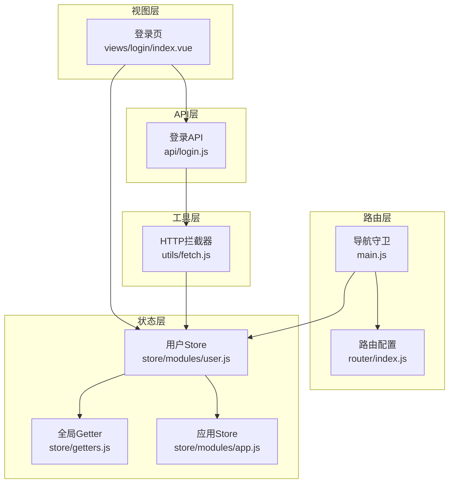
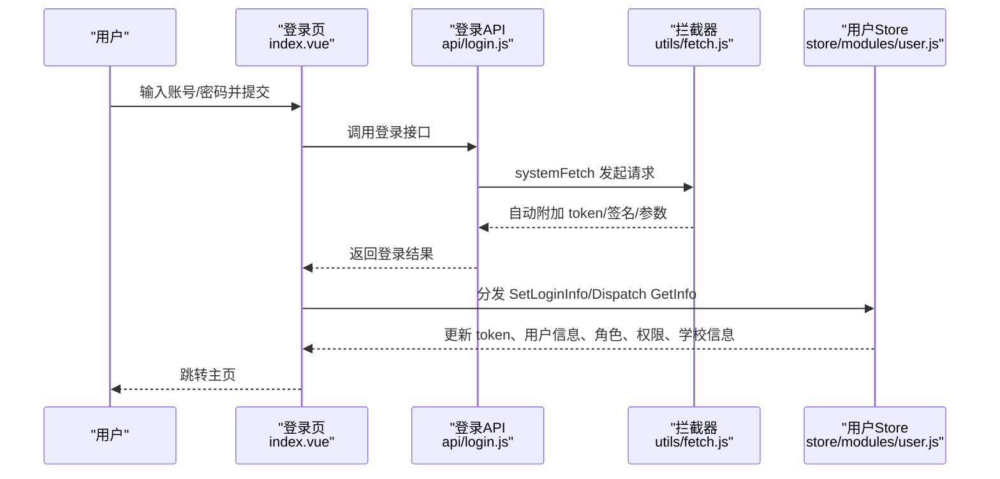
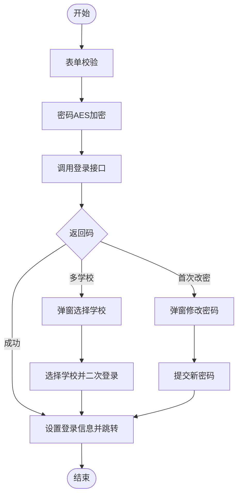
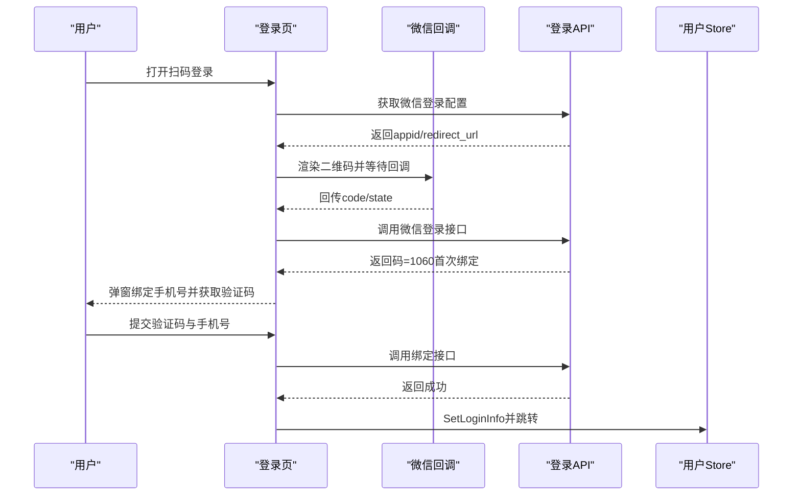
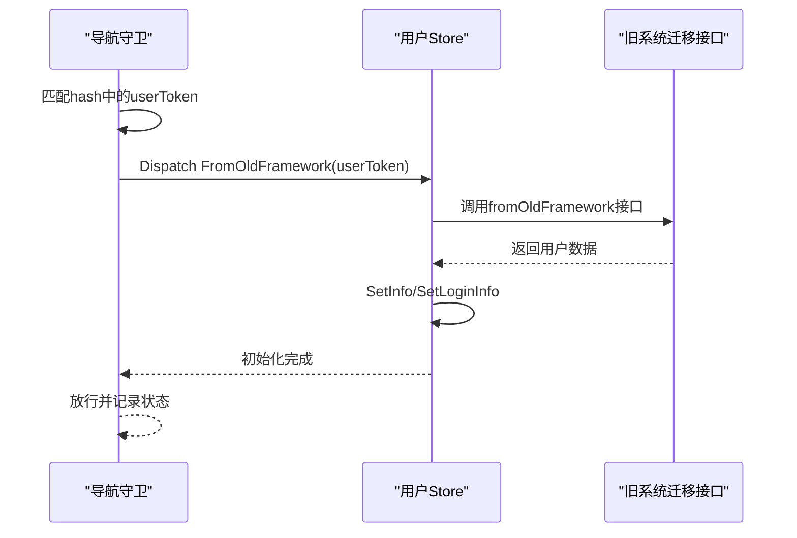
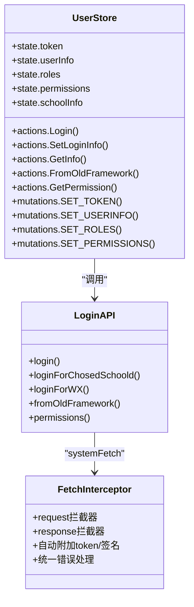
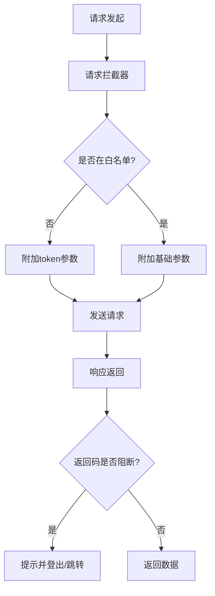
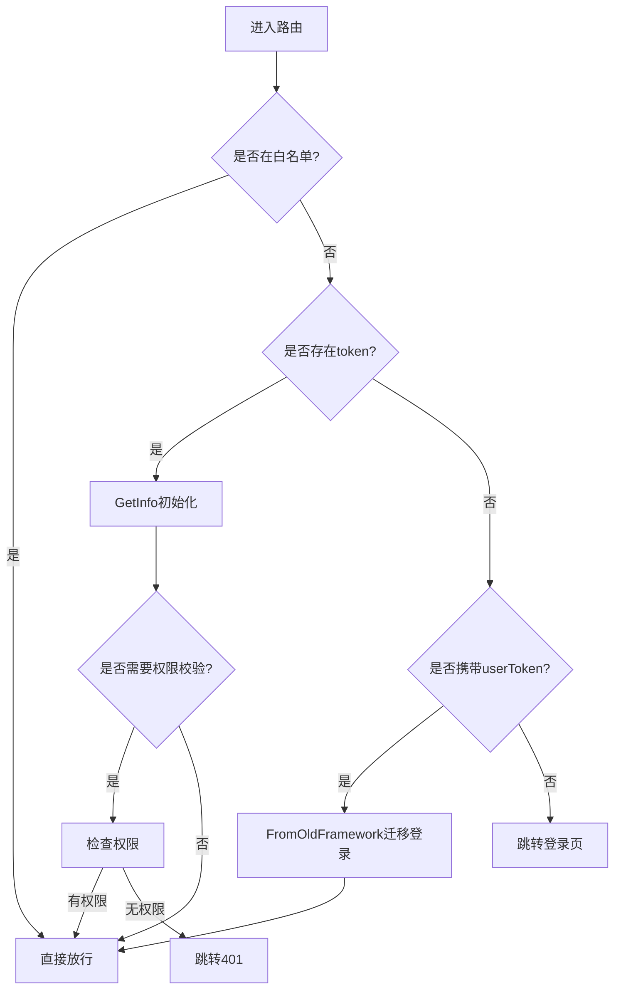
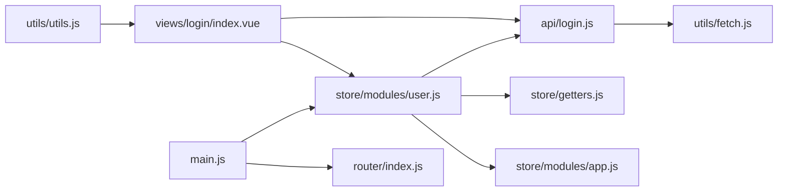

# 用户认证

<cite>
**本文引用的文件**
- [src/api/login.js](file://src/api/login.js)
- [src/store/modules/user.js](file://src/store/modules/user.js)
- [src/utils/fetch.js](file://src/utils/fetch.js)
- [src/router/index.js](file://src/router/index.js)
- [src/views/login/index.vue](file://src/views/login/index.vue)
- [src/main.js](file://src/main.js)
- [src/store/getters.js](file://src/store/getters.js)
- [src/store/modules/app.js](file://src/store/modules/app.js)
- [src/utils/utils.js](file://src/utils/utils.js)
</cite>

## 目录
1. [简介](#简介)
2. [项目结构](#项目结构)
3. [核心组件](#核心组件)
4. [架构总览](#架构总览)
5. [详细组件分析](#详细组件分析)
6. [依赖关系分析](#依赖关系分析)
7. [性能考量](#性能考量)
8. [故障排查指南](#故障排查指南)
9. [结论](#结论)
10. [附录](#附录)

## 简介
本文件面向校园管理系统中的用户认证模块，系统性梳理基于 Cookie 的 Token 认证机制与前端实现，覆盖以下主题：
- JWT Token 的生成与携带策略（Cookie + 请求拦截器）
- 多种登录方式：账号密码登录、第三方（微信）登录、旧系统迁移登录
- 认证状态管理：用户信息、角色、权限、学校信息、学年信息的初始化与缓存
- 认证失败处理：错误码映射、会话失效跳转、重试策略建议
- 实战示例：登录组件实现、认证拦截器使用、组件内访问认证状态

## 项目结构
认证相关的关键文件分布如下：
- API 层：封装登录、登出、刷新、权限、第三方登录等接口
- Store 层：集中管理用户 Token、角色、权限、学校信息、学年信息等
- 工具层：HTTP 请求拦截器、错误处理、权限判断工具
- 视图层：登录页面与路由守卫配合完成认证流程
- 路由层：定义常量路由与导航守卫，实现登录态校验与权限控制

图表来源
- [src/views/login/index.vue](file://src/views/login/index.vue)
- [src/router/index.js](file://src/router/index.js)
- [src/main.js](file://src/main.js)
- [src/utils/fetch.js](file://src/utils/fetch.js)
- [src/store/modules/user.js](file://src/store/modules/user.js)
- [src/store/getters.js](file://src/store/getters.js)
- [src/store/modules/app.js](file://src/store/modules/app.js)
- [src/api/login.js](file://src/api/login.js)

章节来源
- [src/api/login.js](file://src/api/login.js)
- [src/store/modules/user.js](file://src/store/modules/user.js)
- [src/utils/fetch.js](file://src/utils/fetch.js)
- [src/router/index.js](file://src/router/index.js)
- [src/views/login/index.vue](file://src/views/login/index.vue)
- [src/main.js](file://src/main.js)
- [src/store/getters.js](file://src/store/getters.js)
- [src/store/modules/app.js](file://src/store/modules/app.js)
- [src/utils/utils.js](file://src/utils/utils.js)

## 核心组件
- 登录 API 封装：提供账号登录、选择学校登录、微信登录、旧系统迁移登录、权限查询等方法
- 用户 Store：负责 Token 设置与持久化、用户信息与角色/权限/学校信息的初始化与缓存
- HTTP 拦截器：统一注入 token、签名、模块化请求参数；统一错误处理与会话失效处理
- 登录视图：支持账号密码登录、扫码登录、首次登录改密、微信绑定等交互
- 导航守卫：白名单放行、token 注入、旧系统迁移登录、权限校验
- Getter 与工具：提供权限判断、加密工具、常量映射等

章节来源
- [src/api/login.js](file://src/api/login.js)
- [src/store/modules/user.js](file://src/store/modules/user.js)
- [src/utils/fetch.js](file://src/utils/fetch.js)
- [src/views/login/index.vue](file://src/views/login/index.vue)
- [src/main.js](file://src/main.js)
- [src/store/getters.js](file://src/store/getters.js)
- [src/utils/utils.js](file://src/utils/utils.js)

## 架构总览
前端采用“Cookie + Axios 拦截器”的 Token 认证模式：
- 登录成功后，服务端返回 token，前端以 Cookie 方式保存（键名 Admin-Token）
- 每次请求通过拦截器自动附加 token 参数，避免显式传参
- 对特定接口（如旧系统迁移）配置无需 token 的白名单
- 统一错误处理：当返回码命中阻断列表时，提示并触发登出与跳转

图表来源
- [src/views/login/index.vue](file://src/views/login/index.vue)
- [src/api/login.js](file://src/api/login.js)
- [src/utils/fetch.js](file://src/utils/fetch.js)
- [src/store/modules/user.js](file://src/store/modules/user.js)

## 详细组件分析

### 登录组件（账号密码登录）
- 功能要点
  - 表单校验与加密：对密码进行 AES 加密后再提交
  - 登录流程：调用登录 API，根据返回码处理多学校、首次改密、成功跳转
  - 成功后通过 Store 设置登录信息，并拉取权限与学年信息
- 关键路径
  - 登录调用与结果处理：[handleLogin → login → loginPackge → loginSuccess](file://src/views/login/index.vue)
  - Store 设置登录信息：[SetLoginInfo → SET_TOKEN/SET_USERINFO/SET_ROLES/SET_DEPARTS](file://src/store/modules/user.js)
  - 权限与学年初始化：[GetPermission → permissions](file://src/store/modules/user.js)

图表来源
- [src/views/login/index.vue](file://src/views/login/index.vue)
- [src/store/modules/user.js](file://src/store/modules/user.js)

章节来源
- [src/views/login/index.vue](file://src/views/login/index.vue)
- [src/store/modules/user.js](file://src/store/modules/user.js)

### 第三方登录（微信登录）
- 功能要点
  - 初始化微信登录参数，渲染二维码
  - 通过 code/state 调用微信登录接口；若返回首次绑定，弹窗引导绑定手机号并获取验证码
  - 绑定成功后自动登录，设置 Token 并初始化用户信息
- 关键路径
  - 微信初始化与二维码渲染：[mounted → getWXInitData](file://src/views/login/index.vue)
  - 微信登录与绑定流程：[loginForWX → wxBind → loginWx](file://src/api/login.js)
  - 登录结果处理与跳转：[loginPackge → loginSuccess](file://src/views/login/index.vue)

图表来源
- [src/views/login/index.vue](file://src/views/login/index.vue)
- [src/api/login.js](file://src/api/login.js)
- [src/store/modules/user.js](file://src/store/modules/user.js)

章节来源
- [src/views/login/index.vue](file://src/views/login/index.vue)
- [src/api/login.js](file://src/api/login.js)
- [src/store/modules/user.js](file://src/store/modules/user.js)

### 旧系统迁移登录
- 功能要点
  - 从 URL hash 中提取 userToken，写入 Cookie 并调用旧系统迁移接口
  - 成功后设置 Token 与用户信息，区分独立窗口场景并记录状态
- 关键路径
  - 导航守卫中识别 userToken 并调用迁移登录：[router beforeEach → FromOldFramework](file://src/main.js)
  - Store 设置登录信息与初始化：[FromOldFramework → SetInfo](file://src/store/modules/user.js)

图表来源
- [src/main.js](file://src/main.js)
- [src/store/modules/user.js](file://src/store/modules/user.js)
- [src/api/login.js](file://src/api/login.js)

章节来源
- [src/main.js](file://src/main.js)
- [src/store/modules/user.js](file://src/store/modules/user.js)
- [src/api/login.js](file://src/api/login.js)

### 认证状态管理与权限初始化
- Token 管理
  - 登录成功后写入 Cookie（Admin-Token），Store 同步更新
  - 请求拦截器自动附加 token 参数（白名单除外）
- 用户信息与角色
  - Store 写入 userInfo、roles、departs、schoolInfo 等
  - 通过 Getter 暴露给组件使用
- 权限与菜单
  - 登录后拉取权限列表，构建权限 URL 映射，供路由守卫与组件判断
- 学年信息
  - 拉取学年列表并设置当前学年与选择学年

图表来源
- [src/store/modules/user.js](file://src/store/modules/user.js)
- [src/utils/fetch.js](file://src/utils/fetch.js)
- [src/api/login.js](file://src/api/login.js)

章节来源
- [src/store/modules/user.js](file://src/store/modules/user.js)
- [src/utils/fetch.js](file://src/utils/fetch.js)
- [src/api/login.js](file://src/api/login.js)
- [src/store/getters.js](file://src/store/getters.js)

### 认证拦截器与错误处理
- 请求拦截
  - 自动拼接 token 参数（白名单接口除外）
  - 对特定接口追加签名参数
- 响应拦截
  - 统一错误码映射，命中阻断码时提示并触发前端登出与跳转
  - 登录超时（1000）时清除本地状态并跳转登录页或外部登录页
- 白名单
  - 旧系统迁移登录、部分公共接口无需 token

图表来源
- [src/utils/fetch.js](file://src/utils/fetch.js)

章节来源
- [src/utils/fetch.js](file://src/utils/fetch.js)

### 路由守卫与权限控制
- 白名单放行：预登录页、二维码登录、部分公开页面
- token 注入：支持通过 query.token 注入并拉取用户信息
- 旧系统迁移：匹配 hash 中 userToken，调用迁移登录并设置状态
- 权限校验：根据 meta.permissionPath 与用户权限列表判断放行或 401

图表来源
- [src/main.js](file://src/main.js)
- [src/router/index.js](file://src/router/index.js)

章节来源
- [src/main.js](file://src/main.js)
- [src/router/index.js](file://src/router/index.js)

## 依赖关系分析
- 登录视图依赖 API 层与 Store，同时受路由守卫影响
- Store 依赖 API 层与工具层（如加密、常量映射）
- 拦截器作为横切能力贯穿 API 层
- Getter 为组件提供只读访问入口

图表来源
- [src/views/login/index.vue](file://src/views/login/index.vue)
- [src/api/login.js](file://src/api/login.js)
- [src/store/modules/user.js](file://src/store/modules/user.js)
- [src/utils/fetch.js](file://src/utils/fetch.js)
- [src/main.js](file://src/main.js)
- [src/router/index.js](file://src/router/index.js)
- [src/store/getters.js](file://src/store/getters.js)
- [src/store/modules/app.js](file://src/store/modules/app.js)
- [src/utils/utils.js](file://src/utils/utils.js)

章节来源
- [src/views/login/index.vue](file://src/views/login/index.vue)
- [src/api/login.js](file://src/api/login.js)
- [src/store/modules/user.js](file://src/store/modules/user.js)
- [src/utils/fetch.js](file://src/utils/fetch.js)
- [src/main.js](file://src/main.js)
- [src/router/index.js](file://src/router/index.js)
- [src/store/getters.js](file://src/store/getters.js)
- [src/store/modules/app.js](file://src/store/modules/app.js)
- [src/utils/utils.js](file://src/utils/utils.js)

## 性能考量
- 请求合并：登录成功后并发拉取权限与学年信息，减少等待时间
- 缓存策略：Cookie 保存 Token，SessionStorage 缓存地图 Key、学年选择等，降低重复请求
- 加密成本：密码加密在前端执行，注意避免重复加密与不必要的重算
- 白名单优化：将无需 token 的接口放入白名单，减少参数拼接与签名计算

## 故障排查指南
- 常见错误码与处理
  - 登录超时（1000）：触发前端登出、清理状态并跳转登录页或外部登录页
  - 账号/密码错误（1050）、禁用（1051）、学校异常（1053）、身份不允许（1054）、不存在（1056）：提示并阻止继续
- 重试策略建议
  - 对网络抖动导致的 5xx 错误，可在拦截器中增加有限次数的重试
  - 对 401/403，优先引导重新登录
- 会话失效处理
  - 拦截器命中阻断码时，自动清除本地状态并跳转登录页
  - 登录页与路由守卫共同确保迁移登录场景下的状态一致性

章节来源
- [src/utils/fetch.js](file://src/utils/fetch.js)
- [src/main.js](file://src/main.js)

## 结论
本系统采用 Cookie + Axios 拦截器的 Token 认证方案，结合 Store 的集中状态管理与路由守卫的权限控制，实现了账号密码、微信扫码、旧系统迁移等多种登录方式的统一接入。通过白名单、错误码映射与会话失效处理，保障了安全性与用户体验。建议在后续迭代中进一步完善重试策略、埋点监控与权限细粒度控制。

## 附录
- 认证状态在组件中的访问方式
  - 通过 mapGetters 或直接读取 store.getters 获取 token、角色、权限、学校信息等
  - 参考路径：[store/getters.js](file://src/store/getters.js)
- 权限判断工具
  - 提供 isShowByPermission、checkIndexPermission 等方法，便于组件内快速判断
  - 参考路径：[utils/utils.js](file://src/utils/utils.js)
- 登录组件实现参考
  - 登录页模板与交互逻辑：[views/login/index.vue](file://src/views/login/index.vue)
- API 接口清单
  - 登录、权限、微信登录、旧系统迁移等接口定义：[api/login.js](file://src/api/login.js)