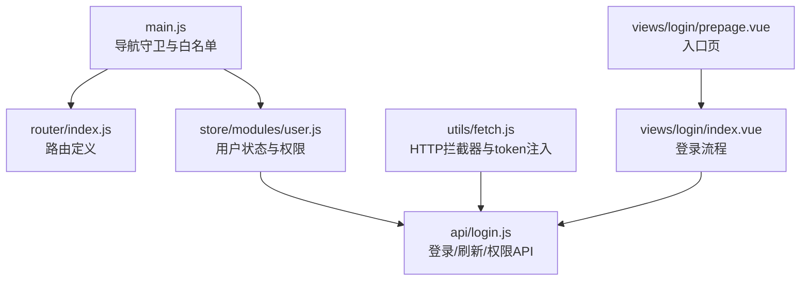
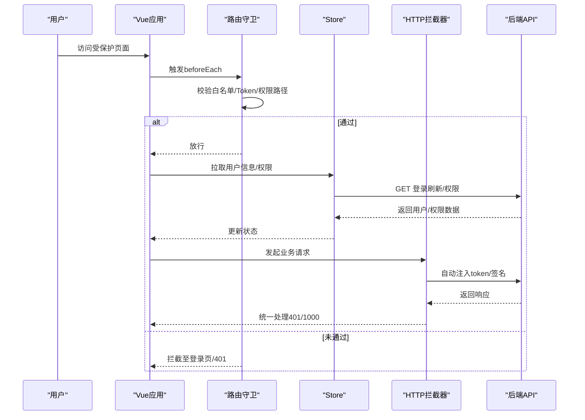
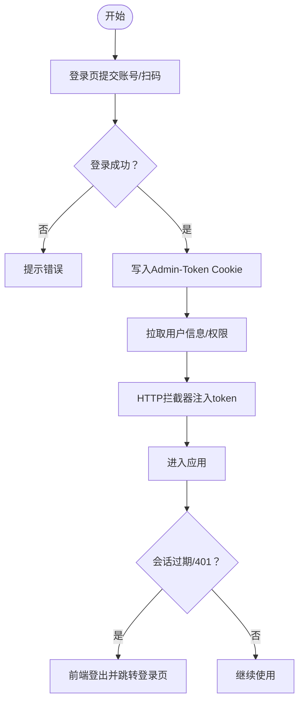
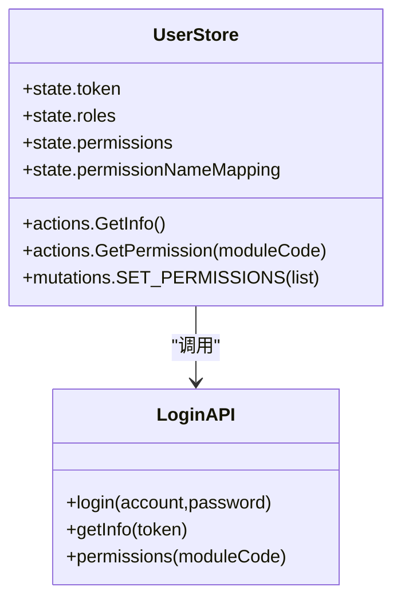
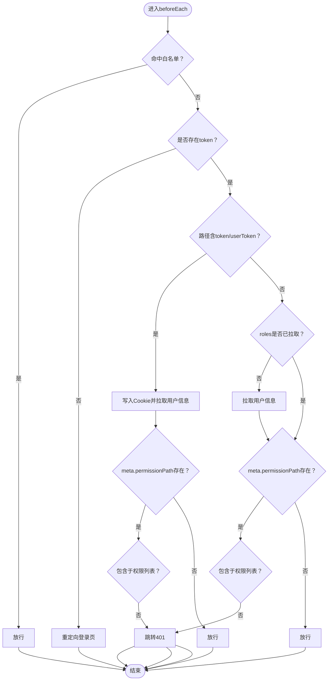
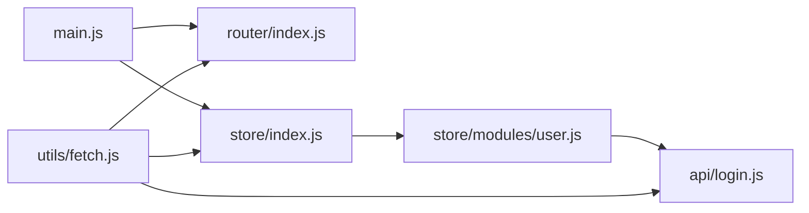

# 认证与授权

<cite>
**本文引用的文件**
- [src/main.js](file://src/main.js)
- [src/router/index.js](file://src/router/index.js)
- [src/store/index.js](file://src/store/index.js)
- [src/store/modules/user.js](file://src/store/modules/user.js)
- [src/utils/fetch.js](file://src/utils/fetch.js)
- [src/api/login.js](file://src/api/login.js)
- [src/views/login/index.vue](file://src/views/login/index.vue)
- [src/views/login/prepage.vue](file://src/views/login/prepage.vue)
</cite>

## 目录
1. [简介](#简介)
2. [项目结构](#项目结构)
3. [核心组件](#核心组件)
4. [架构总览](#架构总览)
5. [详细组件分析](#详细组件分析)
6. [依赖分析](#依赖分析)
7. [性能考虑](#性能考虑)
8. [故障排查指南](#故障排查指南)
9. [结论](#结论)
10. [附录](#附录)

## 简介
本文件面向校园管理系统中的“认证与授权”主题，系统性梳理前端侧的 JWT Token 认证机制、用户角色与权限模型、路由级权限控制、会话管理策略，并提供在组件中进行权限验证与处理权限不足的实践路径。文档基于仓库现有实现进行归纳总结，避免臆测，确保可追溯性。

## 项目结构
围绕认证与授权的关键文件分布如下：
- 路由与导航守卫：src/main.js 中的 beforeEach 导航守卫；路由定义位于 src/router/index.js
- 状态与用户信息：Vuex Store 的 user 模块（src/store/modules/user.js），全局 store 初始化（src/store/index.js）
- HTTP 服务与拦截器：统一请求封装与拦截器（src/utils/fetch.js）
- 登录与权限 API：登录、刷新、权限查询等（src/api/login.js）
- 登录页面与入口：登录页组件（src/views/login/index.vue）、入口页（src/views/login/prepage.vue）

图表来源
- [src/main.js:57-198](file://src/main.js#L57-L198)
- [src/router/index.js:40-199](file://src/router/index.js#L40-L199)
- [src/store/modules/user.js:20-447](file://src/store/modules/user.js#L20-L447)
- [src/utils/fetch.js:13-240](file://src/utils/fetch.js#L13-L240)
- [src/api/login.js:1-259](file://src/api/login.js#L1-L259)
- [src/views/login/index.vue:112-539](file://src/views/login/index.vue#L112-L539)
- [src/views/login/prepage.vue:5-20](file://src/views/login/prepage.vue#L5-L20)

章节来源
- [src/main.js:57-198](file://src/main.js#L57-L198)
- [src/router/index.js:40-199](file://src/router/index.js#L40-L199)
- [src/store/index.js:10-19](file://src/store/index.js#L10-L19)
- [src/store/modules/user.js:20-447](file://src/store/modules/user.js#L20-L447)
- [src/utils/fetch.js:13-240](file://src/utils/fetch.js#L13-L240)
- [src/api/login.js:1-259](file://src/api/login.js#L1-L259)
- [src/views/login/index.vue:112-539](file://src/views/login/index.vue#L112-L539)
- [src/views/login/prepage.vue:5-20](file://src/views/login/prepage.vue#L5-L20)

## 核心组件
- 导航守卫与白名单：在 main.js 中定义了全局 beforeEach 导航守卫，结合白名单数组实现免登录直通与权限路径校验
- 用户状态与权限：store/modules/user.js 统一管理 token、角色、权限列表、学校信息等，并提供登录、刷新、权限获取等动作
- HTTP 拦截器：utils/fetch.js 注入 token 参数、签名参数、处理 401/1000 等会话失效场景
- 登录与权限 API：api/login.js 提供登录、刷新、权限查询等接口封装
- 登录页组件：views/login/index.vue 实现账号登录、扫码登录、多学校选择、首次登录改密等流程

章节来源
- [src/main.js:57-198](file://src/main.js#L57-L198)
- [src/store/modules/user.js:20-447](file://src/store/modules/user.js#L20-L447)
- [src/utils/fetch.js:13-240](file://src/utils/fetch.js#L13-L240)
- [src/api/login.js:1-259](file://src/api/login.js#L1-L259)
- [src/views/login/index.vue:112-539](file://src/views/login/index.vue#L112-L539)

## 架构总览
整体认证与授权流程如下：
- 登录阶段：登录页发起登录请求，成功后写入 Cookie 并提交至 store，拉取用户信息与权限
- 导航阶段：每次路由跳转前，根据白名单、token、权限路径进行放行或拦截
- 请求阶段：HTTP 层自动注入 token，统一处理 401/1000 等会话失效并跳转登录

图表来源
- [src/main.js:73-197](file://src/main.js#L73-L197)
- [src/store/modules/user.js:217-324](file://src/store/modules/user.js#L217-L324)
- [src/utils/fetch.js:65-169](file://src/utils/fetch.js#L65-L169)
- [src/api/login.js:16-24](file://src/api/login.js#L16-L24)

## 详细组件分析

### JWT Token 认证机制
- Token 获取与存储
  - 登录成功后写入 Cookie 并提交至 store，同时持久化用户信息、角色、部门、权限等
  - 登录页组件负责账号/扫码登录、多学校选择、首次改密等流程
- Token 注入与刷新
  - HTTP 拦截器在请求参数中注入 token；登录刷新接口用于拉取最新用户信息
  - 会话失效（如 401/1000）时，前端主动登出并跳转登录页
- 单点登录支持
  - 对特定路径携带 userToken 时放行；从旧框架迁移时写入 User-Token 并完成信息同步

图表来源
- [src/views/login/index.vue:313-443](file://src/views/login/index.vue#L313-L443)
- [src/store/modules/user.js:120-173](file://src/store/modules/user.js#L120-L173)
- [src/utils/fetch.js:65-169](file://src/utils/fetch.js#L65-L169)
- [src/api/login.js:16-24](file://src/api/login.js#L16-L24)

章节来源
- [src/views/login/index.vue:112-539](file://src/views/login/index.vue#L112-L539)
- [src/store/modules/user.js:120-173](file://src/store/modules/user.js#L120-L173)
- [src/utils/fetch.js:65-169](file://src/utils/fetch.js#L65-L169)
- [src/api/login.js:16-24](file://src/api/login.js#L16-L24)

### 用户角色与权限模型
- 角色与权限来源
  - 登录成功后，后端返回角色列表与权限列表；前端将权限 URL 规范化为数组并建立名称映射
- 权限模型
  - 权限以 URL 列表形式存在，支持通过 meta.permissionPath 与之比对，实现细粒度路由权限控制
- 权限获取
  - 通过 moduleCode 拉取当前模块权限，更新 store 中的权限集合

图表来源
- [src/store/modules/user.js:20-447](file://src/store/modules/user.js#L20-L447)
- [src/api/login.js:16-200](file://src/api/login.js#L16-L200)

章节来源
- [src/store/modules/user.js:87-96](file://src/store/modules/user.js#L87-L96)
- [src/store/modules/user.js:287-304](file://src/store/modules/user.js#L287-L304)
- [src/api/login.js:189-200](file://src/api/login.js#L189-L200)

### 路由级权限控制
- 白名单机制
  - 白名单数组包含无需登录即可访问的路径；命中即放行
- 导航守卫逻辑
  - 若路径携带 token 或 userToken，则写入 Cookie 并拉取用户信息，再按 meta.permissionPath 校验
  - 已有 token 且 roles 未拉取时，先拉取用户信息，再进行权限校验
  - 无 token 时，根据登录类型重定向至相应登录页
- 单点登录
  - 对特定系统管理路径携带 userToken 时放行

图表来源
- [src/main.js:58-197](file://src/main.js#L58-L197)

章节来源
- [src/main.js:58-197](file://src/main.js#L58-L197)

### 用户会话管理
- 登录状态保持
  - 通过 Cookie 存储 Admin-Token；HTTP 拦截器自动注入 token 参数
- 会话超时处理
  - 响应拦截器捕获 401/1000 等状态，执行前端登出并跳转登录页；支持系统登录/单点登录场景的特殊处理
- 单点登录支持
  - 旧框架迁移时写入 User-Token 并完成信息同步；系统管理路径携带 userToken 时放行

章节来源
- [src/utils/fetch.js:124-152](file://src/utils/fetch.js#L124-L152)
- [src/main.js:85-129](file://src/main.js#L85-L129)
- [src/store/modules/user.js:239-286](file://src/store/modules/user.js#L239-L286)

### 在组件中进行权限验证与处理权限不足
- 路由级权限
  - 在路由元信息中设置 permissionPath 字段，导航守卫会自动校验
- 组件内权限判断
  - 可通过 this.$store.getters.permission 获取权限列表，自行判断当前页面所需权限
- 权限不足处理
  - 当导航守卫拦截时跳转 401 页面；也可在组件中自行判断后跳转或提示

章节来源
- [src/main.js:88-96](file://src/main.js#L88-L96)
- [src/store/modules/user.js:87-96](file://src/store/modules/user.js#L87-L96)

## 依赖分析
- 组件耦合
  - main.js 依赖 router、store；store 依赖 api/login；utils/fetch 依赖 store 与 router
- 外部依赖
  - js-cookie 用于 Cookie 存取；Element UI 用于交互反馈；NProgress 用于进度条

图表来源
- [src/main.js:3-4](file://src/main.js#L3-L4)
- [src/store/index.js:3-6](file://src/store/index.js#L3-L6)
- [src/store/modules/user.js:1-7](file://src/store/modules/user.js#L1-L7)
- [src/utils/fetch.js:5-8](file://src/utils/fetch.js#L5-L8)

章节来源
- [src/main.js:3-4](file://src/main.js#L3-L4)
- [src/store/index.js:3-6](file://src/store/index.js#L3-L6)
- [src/store/modules/user.js:1-7](file://src/store/modules/user.js#L1-L7)
- [src/utils/fetch.js:5-8](file://src/utils/fetch.js#L5-L8)

## 性能考虑
- 请求批处理：登录成功后并行拉取权限与学年信息，减少首屏等待
- 白名单命中快速放行：避免不必要的 token 校验与用户信息拉取
- 进度条与错误提示：统一的响应拦截器提升用户体验与可观测性

章节来源
- [src/store/modules/user.js:162-169](file://src/store/modules/user.js#L162-L169)
- [src/main.js:58-72](file://src/main.js#L58-L72)
- [src/utils/fetch.js:104-169](file://src/utils/fetch.js#L104-L169)

## 故障排查指南
- 登录后仍被重定向到登录页
  - 检查 Cookie 是否写入 Admin-Token；确认导航守卫中白名单与 token 判断逻辑
- 访问页面出现 401
  - 检查 meta.permissionPath 是否在权限列表中；确认权限拉取是否成功
- 会话过期频繁
  - 检查响应拦截器对 401/1000 的处理；确认刷新接口是否正常返回
- 单点登录无法进入
  - 检查系统管理路径是否携带 userToken；确认旧框架迁移流程是否写入 User-Token

章节来源
- [src/main.js:73-197](file://src/main.js#L73-L197)
- [src/utils/fetch.js:124-152](file://src/utils/fetch.js#L124-L152)
- [src/store/modules/user.js:239-286](file://src/store/modules/user.js#L239-L286)

## 结论
本系统采用“路由守卫 + Vuex 状态 + HTTP 拦截器”的组合实现认证与授权，具备以下特点：
- 明确的白名单机制与细粒度的路由权限控制
- 基于 URL 的权限模型便于扩展与维护
- 统一的会话失效处理与单点登录支持
建议在后续迭代中补充权限缓存与刷新策略、权限变更的动态生效机制，以进一步提升安全性与可用性。

## 附录
- 关键实现位置参考
  - 导航守卫与白名单：[src/main.js:58-197](file://src/main.js#L58-L197)
  - 用户状态与权限：[src/store/modules/user.js:20-447](file://src/store/modules/user.js#L20-L447)
  - HTTP 拦截器与会话处理：[src/utils/fetch.js:65-169](file://src/utils/fetch.js#L65-L169)
  - 登录与权限 API：[src/api/login.js:16-200](file://src/api/login.js#L16-L200)
  - 登录页流程：[src/views/login/index.vue:313-443](file://src/views/login/index.vue#L313-L443)
  - 入口页跳转：[src/views/login/prepage.vue:11-19](file://src/views/login/prepage.vue#L11-L19)