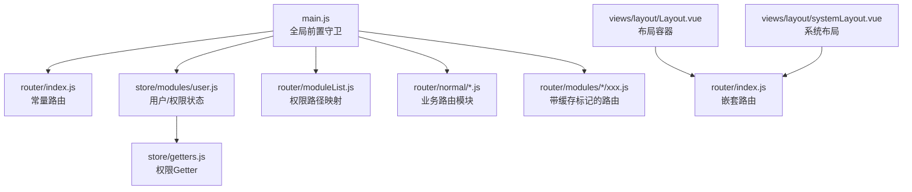
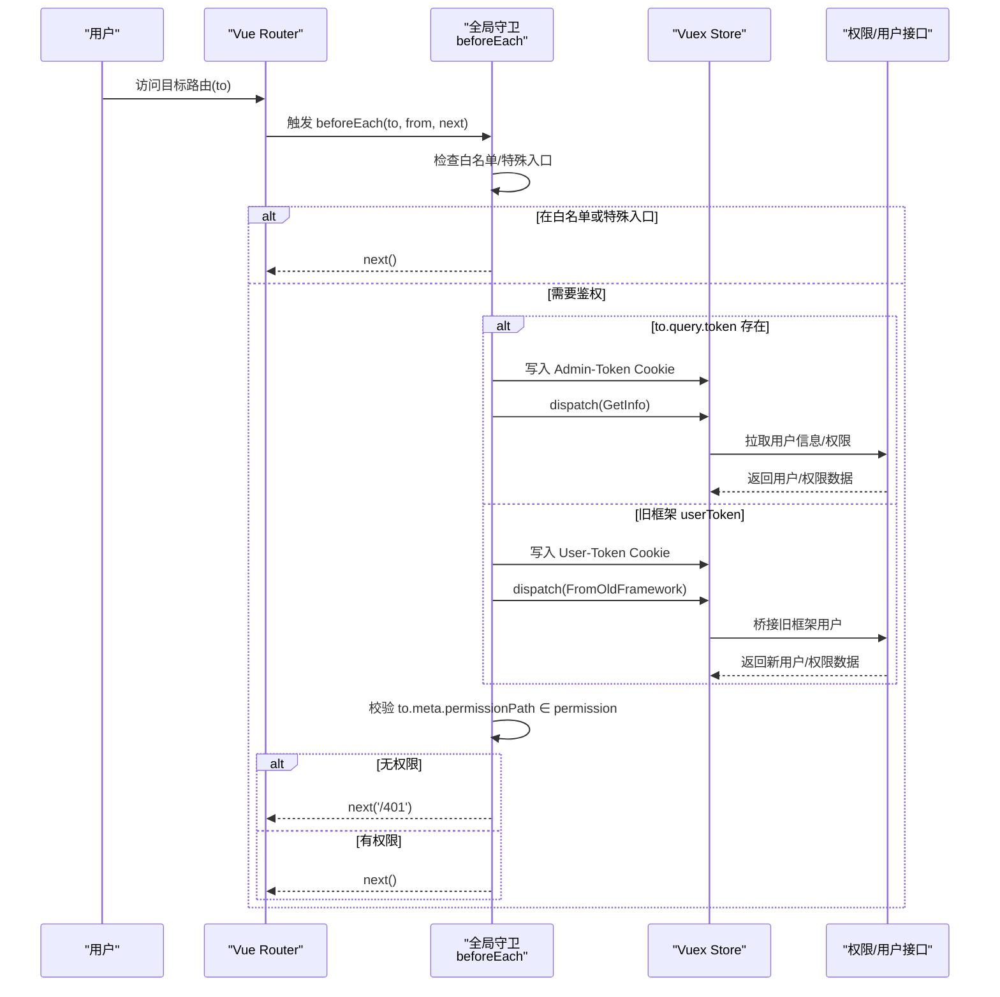
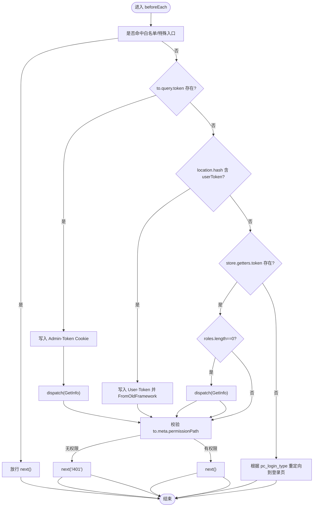
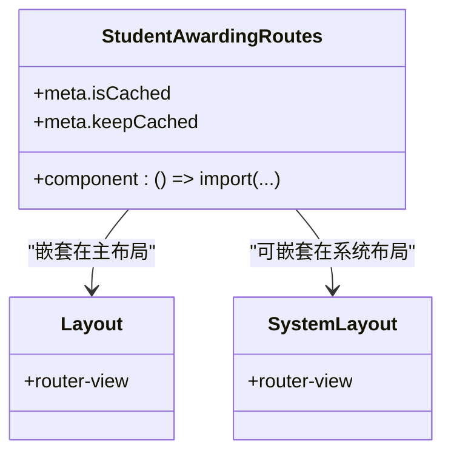
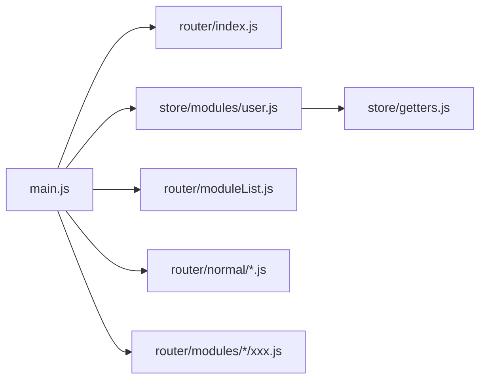

# 路由守卫

<cite>
**本文引用的文件**
- [main.js](file://src/main.js)
- [index.js](file://src/router/index.js)
- [user.js](file://src/store/modules/user.js)
- [getters.js](file://src/store/getters.js)
- [homePage.js](file://src/router/normal/homePage.js)
- [sysManage.js](file://src/router/normal/sysManage.js)
- [moduleList.js](file://src/router/moduleList.js)
- [studentAwarding.js](file://src/router/modules/studentAwarding/studentAwarding.js)
- [Layout.vue](file://src/views/layout/Layout.vue)
- [systemLayout.vue](file://src/views/layout/systemLayout.vue)
- [permission.js](file://src/api/systemSet/permission.js)
</cite>

## 目录
1. [简介](#简介)
2. [项目结构](#项目结构)
3. [核心组件](#核心组件)
4. [架构总览](#架构总览)
5. [详细组件分析](#详细组件分析)
6. [依赖分析](#依赖分析)
7. [性能考虑](#性能考虑)
8. [故障排查指南](#故障排查指南)
9. [结论](#结论)
10. [附录](#附录)

## 简介
本文件面向校园管理系统，系统性梳理并文档化 Vue Router 导航守卫的实现与运行机制，重点覆盖：
- 全局前置守卫 beforeEach 的完整逻辑与分支
- 权限验证流程与 401 无权限跳转
- 白名单机制与特殊场景（如单点登录、旧框架桥接）
- 动态路由与权限路由的注册策略
- 路由缓存与预加载（keep-alive、懒加载、缓存开关）
- 异常与边界条件的处理方式

## 项目结构
围绕路由守卫的关键文件分布如下：
- 路由定义与常量路由：src/router/index.js
- 全局前置守卫与白名单：src/main.js
- 权限与用户状态：src/store/modules/user.js、src/store/getters.js
- 路由模块与权限路径映射：src/router/normal/*.js、src/router/moduleList.js
- 路由缓存与懒加载：src/router/modules/*/xxx.js、视图层布局与系统布局
- 权限接口：src/api/systemSet/permission.js

图表来源
- [main.js:73-198](file://src/main.js#L73-L198)
- [index.js:40-200](file://src/router/index.js#L40-L200)
- [user.js:20-447](file://src/store/modules/user.js#L20-L447)
- [getters.js:1-26](file://src/store/getters.js#L1-L26)
- [moduleList.js:1-800](file://src/router/moduleList.js#L1-L800)
- [Layout.vue:1-507](file://src/views/layout/Layout.vue#L1-L507)
- [systemLayout.vue:1-48](file://src/views/layout/systemLayout.vue#L1-L48)

章节来源
- [index.js:40-200](file://src/router/index.js#L40-L200)
- [main.js:58-198](file://src/main.js#L58-L198)
- [user.js:20-447](file://src/store/modules/user.js#L20-L447)
- [getters.js:1-26](file://src/store/getters.js#L1-L26)
- [moduleList.js:1-800](file://src/router/moduleList.js#L1-L800)
- [Layout.vue:1-507](file://src/views/layout/Layout.vue#L1-L507)
- [systemLayout.vue:1-48](file://src/views/layout/systemLayout.vue#L1-L48)

## 核心组件
- 全局前置守卫 beforeEach
  - 白名单放行、单点登录放行、旧框架桥接放行
  - Token 注入与用户信息拉取
  - 权限路径校验与 401 跳转
  - 登录状态与重定向策略
- 常量路由与业务路由模块
  - 常量路由包含登录、仪表盘、错误页等
  - 业务路由模块按功能域拆分，支持懒加载
- 权限与状态
  - 用户信息、角色、权限集合、权限名称映射
  - 权限 Getter 暴露给守卫使用
- 路由缓存与懒加载
  - 路由 meta 中的 isCached/keepCached 控制缓存
  - 懒加载采用动态 import

章节来源
- [main.js:58-198](file://src/main.js#L58-L198)
- [index.js:40-200](file://src/router/index.js#L40-L200)
- [user.js:20-447](file://src/store/modules/user.js#L20-L447)
- [getters.js:14-18](file://src/store/getters.js#L14-L18)
- [studentAwarding.js:1-176](file://src/router/modules/studentAwarding/studentAwarding.js#L1-L176)

## 架构总览
全局前置守卫在每次路由变更前执行，主要职责：
- 快速放行白名单与特殊入口
- 从查询参数或旧框架 hash 中提取 token 并拉取用户信息
- 校验 to.meta.permissionPath 是否在用户权限集合中
- 未登录统一重定向至登录页

图表来源
- [main.js:73-198](file://src/main.js#L73-L198)
- [user.js:120-304](file://src/store/modules/user.js#L120-L304)
- [permission.js:1-39](file://src/api/systemSet/permission.js#L1-L39)

章节来源
- [main.js:73-198](file://src/main.js#L73-L198)
- [user.js:120-304](file://src/store/modules/user.js#L120-L304)
- [permission.js:1-39](file://src/api/systemSet/permission.js#L1-L39)

## 详细组件分析

### 全局前置守卫 beforeEach 实现
- 白名单与特殊入口
  - 包含登录页、扫码登录、独立运行模式、部分公开页面等
  - 单点登录入口：/system/sysManage 且携带 userToken
- Token 注入与用户信息拉取
  - 优先从 to.query.token 注入 Admin-Token
  - 旧框架桥接：从 location.hash 提取 userToken，写入 User-Token，并调用 FromOldFramework
  - 拉取用户信息后，再进行权限校验
- 权限校验
  - 若路由 meta 中存在 permissionPath，则与用户权限集合比对
  - 无权限跳转至 401 页面
- 登录状态与重定向
  - 未登录根据 pc_login_type 重定向至不同入口
  - 已登录访问 /login 自动重定向至首页

图表来源
- [main.js:73-198](file://src/main.js#L73-L198)

章节来源
- [main.js:58-198](file://src/main.js#L58-L198)

### 路由白名单机制
- 白名单数组包含：
  - 登录相关：/login、/pcLogin、/abcLogin、/qrcodeLogin、/prepage
  - 公开页面：/databoard*、/leaveBoardindex、/visitorDashboardindex、/readBookBeiyouDisplay、/refunRegisterLogin、/addRefunRegister、/signupStuTalentTable 等
  - 特殊入口：/system/sysManage 且携带 userToken
- 匹配策略：使用 includes 判断 to.path 是否包含白名单项，命中即放行

章节来源
- [main.js:58-82](file://src/main.js#L58-L82)

### 权限验证与角色匹配
- 权限来源
  - 用户登录后通过 GetInfo 拉取权限集合
  - 权限集合存储在 Vuex 中，并暴露为 getter.permission
- 权限路径
  - 路由 meta.permissionPath 与用户权限集合进行包含判断
  - 若未提供 permissionPath，默认放行
- 无权限处理
  - 未通过权限校验时，统一跳转至 401 错误页

章节来源
- [user.js:287-304](file://src/store/modules/user.js#L287-L304)
- [getters.js:14-18](file://src/store/getters.js#L14-L18)
- [main.js:87-139](file://src/main.js#L87-L139)

### 动态路由与权限路由注册
- 常量路由
  - 登录页、错误页、仪表盘、模块管理等固定路由
- 业务路由模块
  - 通过模块聚合（如 homePage、sysManage）注入到主路由
  - 支持懒加载与子路由嵌套
- 权限路由映射
  - moduleList.js 定义模块与权限路径的映射关系
  - 布局组件根据模块权限过滤导航项显示

章节来源
- [index.js:24-36](file://src/router/index.js#L24-L36)
- [homePage.js:1-18](file://src/router/normal/homePage.js#L1-L18)
- [sysManage.js:1-800](file://src/router/normal/sysManage.js#L1-L800)
- [moduleList.js:1-800](file://src/router/moduleList.js#L1-L800)
- [Layout.vue:170-175](file://src/views/layout/Layout.vue#L170-L175)

### 路由缓存与预加载
- 懒加载
  - 路由组件普遍采用动态 import 实现按需加载
- 缓存控制
  - 路由 meta 中的 isCached/keepCached 标记决定是否启用缓存
  - 典型场景：学生荣誉、招生报名、活动管理等模块路由开启缓存
- 布局与容器
  - 主布局 Layout.vue 作为容器承载子路由
  - 系统布局 systemLayout.vue 用于系统管理模块

图表来源
- [studentAwarding.js:1-176](file://src/router/modules/studentAwarding/studentAwarding.js#L1-L176)
- [Layout.vue:77-77](file://src/views/layout/Layout.vue#L77-L77)
- [systemLayout.vue:3-3](file://src/views/layout/systemLayout.vue#L3-L3)

章节来源
- [studentAwarding.js:1-176](file://src/router/modules/studentAwarding/studentAwarding.js#L1-L176)
- [Layout.vue:77-77](file://src/views/layout/Layout.vue#L77-L77)
- [systemLayout.vue:3-3](file://src/views/layout/systemLayout.vue#L3-L3)

### 异常与边界处理
- NProgress 进度条
  - 进入守卫时启动，离开时结束；hash 模式下回退时通过 catch hack 结束
- 旧框架桥接
  - 仅在首次进入时执行桥接逻辑，避免重复登录
- 登录状态与重定向
  - 未登录根据 pc_login_type 重定向至不同入口（普通/系统/BOE）

章节来源
- [main.js:73-198](file://src/main.js#L73-L198)
- [main.js:201-203](file://src/main.js#L201-L203)

## 依赖分析
- 守卫依赖
  - 白名单数组与路由元信息（permissionPath）
  - Vuex 用户状态与权限 Getter
  - 接口：GetInfo、FromOldFramework、permissions
- 路由模块依赖
  - 常量路由与业务模块路由的组合
  - 模块权限映射用于导航过滤

图表来源
- [main.js:73-198](file://src/main.js#L73-L198)
- [index.js:40-200](file://src/router/index.js#L40-L200)
- [user.js:20-447](file://src/store/modules/user.js#L20-L447)
- [getters.js:1-26](file://src/store/getters.js#L1-L26)
- [moduleList.js:1-800](file://src/router/moduleList.js#L1-L800)

章节来源
- [main.js:73-198](file://src/main.js#L73-L198)
- [index.js:40-200](file://src/router/index.js#L40-L200)
- [user.js:20-447](file://src/store/modules/user.js#L20-L447)
- [getters.js:1-26](file://src/store/getters.js#L1-L26)
- [moduleList.js:1-800](file://src/router/moduleList.js#L1-L800)

## 性能考虑
- 懒加载与缓存
  - 路由组件懒加载减少首屏体积
  - 合理使用 isCached/keepCached，避免不必要的内存占用
- 请求去重
  - 旧框架桥接仅首次执行，避免重复请求
- 进度条与异常处理
  - NProgress 精准开始/结束，减少 UI 卡顿感知

## 故障排查指南
- 无法进入受控页面
  - 检查 to.meta.permissionPath 是否正确配置
  - 确认用户权限集合是否包含该路径
- 旧框架桥接失败
  - 确认 location.hash 中 userToken 是否存在
  - 检查 FromOldFramework 接口返回与 Vuex 状态更新
- 登录后仍被重定向
  - 检查 pc_login_type 与重定向逻辑
  - 确认 Cookie 中 token 是否正确写入
- 401 页面频繁出现
  - 核对权限接口返回与 moduleList.js 映射一致性

章节来源
- [main.js:73-198](file://src/main.js#L73-L198)
- [user.js:287-304](file://src/store/modules/user.js#L287-L304)
- [moduleList.js:1-800](file://src/router/moduleList.js#L1-L800)

## 结论
本系统通过全局前置守卫实现了完善的登录态与权限控制，结合白名单与特殊入口，兼顾了易用性与安全性。配合模块化的业务路由与缓存策略，既保证了用户体验，也提升了性能表现。建议在后续迭代中持续完善权限路径映射与异常处理，确保权限体系的完整性与可维护性。

## 附录
- 关键实现位置参考
  - 全局守卫与白名单：[main.js:58-198](file://src/main.js#L58-L198)
  - 常量路由与业务模块：[index.js:40-200](file://src/router/index.js#L40-L200)、[homePage.js:1-18](file://src/router/normal/homePage.js#L1-L18)、[sysManage.js:1-800](file://src/router/normal/sysManage.js#L1-L800)
  - 权限与状态：[user.js:20-447](file://src/store/modules/user.js#L20-L447)、[getters.js:1-26](file://src/store/getters.js#L1-L26)
  - 权限路径映射：[moduleList.js:1-800](file://src/router/moduleList.js#L1-L800)
  - 路由缓存与懒加载：[studentAwarding.js:1-176](file://src/router/modules/studentAwarding/studentAwarding.js#L1-L176)
  - 布局容器：[Layout.vue:77-77](file://src/views/layout/Layout.vue#L77-L77)、[systemLayout.vue:3-3](file://src/views/layout/systemLayout.vue#L3-L3)
  - 权限接口：[permission.js:1-39](file://src/api/systemSet/permission.js#L1-L39)