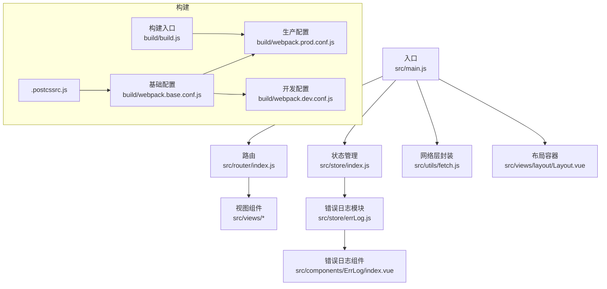
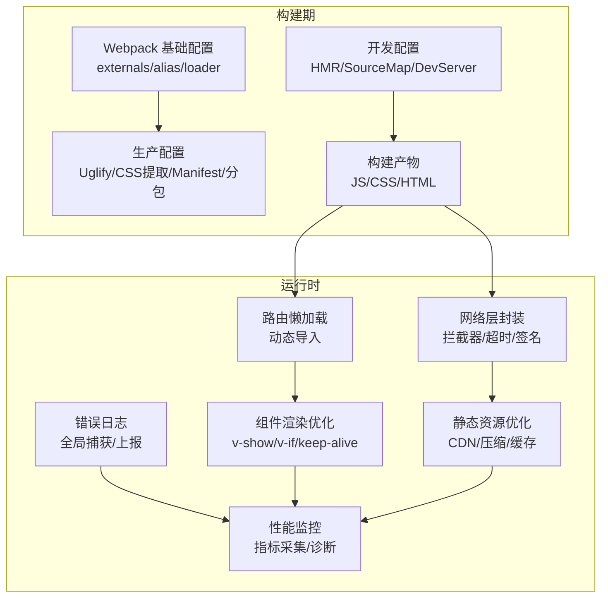
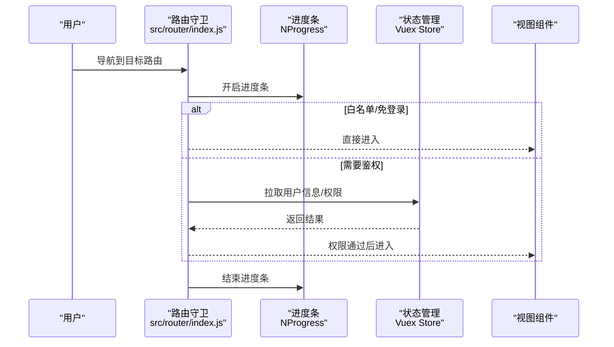
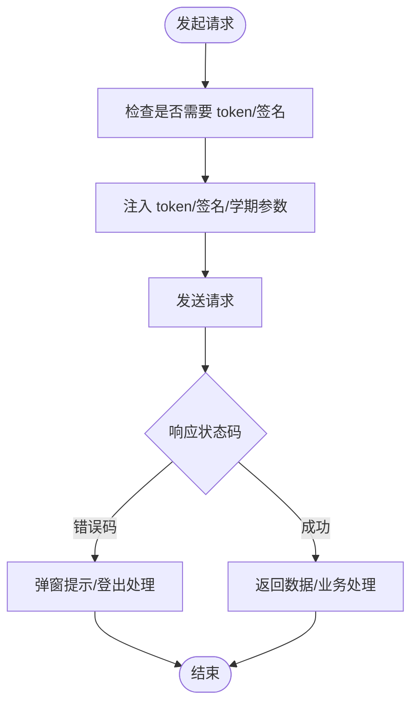
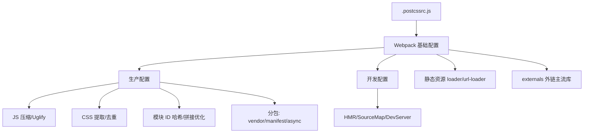
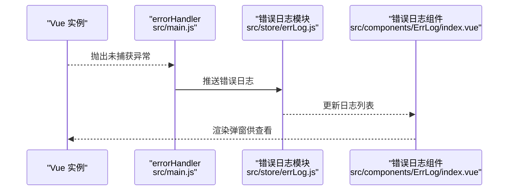
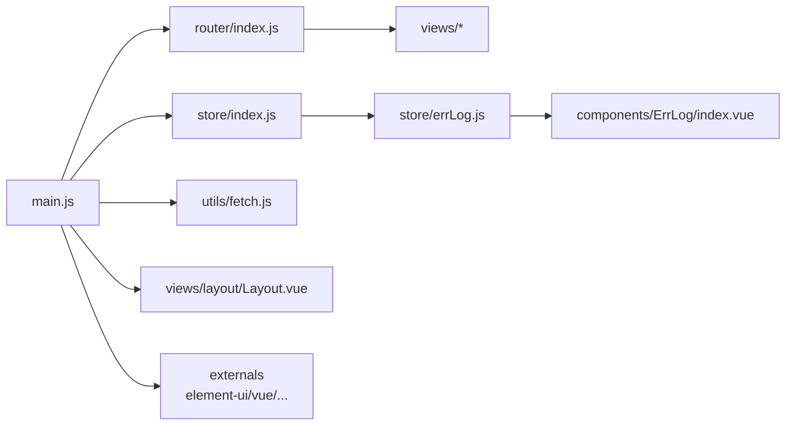

# 性能架构

<cite>
**本文引用的文件**
- [package.json](file://package.json)
- [build/build.js](file://build/build.js)
- [config/index.js](file://config/index.js)
- [build/webpack.base.conf.js](file://build/webpack.base.conf.js)
- [build/webpack.prod.conf.js](file://build/webpack.prod.conf.js)
- [build/webpack.dev.conf.js](file://build/webpack.dev.conf.js)
- [.postcssrc.js](file://.postcssrc.js)
- [src/main.js](file://src/main.js)
- [src/router/index.js](file://src/router/index.js)
- [src/utils/fetch.js](file://src/utils/fetch.js)
- [src/store/index.js](file://src/store/index.js)
- [src/store/errLog.js](file://src/store/errLog.js)
- [src/components/ErrLog/index.vue](file://src/components/ErrLog/index.vue)
- [src/views/layout/Layout.vue](file://src/views/layout/Layout.vue)
</cite>

## 目录
1. [引言](#引言)
2. [项目结构](#项目结构)
3. [核心组件](#核心组件)
4. [架构总览](#架构总览)
5. [详细组件分析](#详细组件分析)
6. [依赖分析](#依赖分析)
7. [性能考虑](#性能考虑)
8. [故障排查指南](#故障排查指南)
9. [结论](#结论)
10. [附录](#附录)

## 引言
本性能架构文档面向校园管理系统（基于 Vue 2.x + Webpack 3）的前端性能优化，覆盖以下方面：
- 前端性能优化策略：代码分割、懒加载、按需引入
- 构建优化方案：Webpack 配置优化、资源压缩、缓存策略
- 运行时性能优化：组件渲染优化、内存管理、事件处理优化
- 网络性能优化：请求合并、CDN 使用、静态资源优化
- 性能监控方案：性能指标采集与问题诊断方法

## 项目结构
该项目采用典型的 Vue CLI 早期模板风格，构建脚本位于 build 目录，开发与生产配置分离；路由采用动态导入实现按需加载；全局状态通过 Vuex 管理；网络层封装在 Axios 之上。

图表来源
- [src/main.js:1-221](file://src/main.js#L1-L221)
- [src/router/index.js:1-207](file://src/router/index.js#L1-L207)
- [src/store/index.js:1-20](file://src/store/index.js#L1-L20)
- [src/store/errLog.js:1-14](file://src/store/errLog.js#L1-L14)
- [src/components/ErrLog/index.vue:1-52](file://src/components/ErrLog/index.vue#L1-L52)
- [src/utils/fetch.js:1-240](file://src/utils/fetch.js#L1-L240)
- [src/views/layout/Layout.vue:1-507](file://src/views/layout/Layout.vue#L1-L507)
- [build/webpack.base.conf.js:1-102](file://build/webpack.base.conf.js#L1-L102)
- [build/webpack.prod.conf.js:1-149](file://build/webpack.prod.conf.js#L1-L149)
- [build/webpack.dev.conf.js:1-96](file://build/webpack.dev.conf.js#L1-L96)
- [build/build.js:1-42](file://build/build.js#L1-L42)
- [.postcssrc.js:1-11](file://.postcssrc.js#L1-L11)

章节来源
- [package.json:1-98](file://package.json#L1-L98)
- [config/index.js:1-72](file://config/index.js#L1-L72)

## 核心组件
- 入口与生命周期：初始化 Vue 实例、注册全局插件、挂载进度条与错误处理、路由守卫控制登录态与权限。
- 路由与代码分割：使用动态导入实现页面级懒加载，减少首屏包体。
- 状态与错误：集中管理错误日志并通过全局组件展示。
- 网络层：统一拦截器、签名与令牌注入、错误码处理与登出逻辑。
- 构建链路：基础配置、生产/开发差异化配置、产物输出与缓存策略。

章节来源
- [src/main.js:1-221](file://src/main.js#L1-L221)
- [src/router/index.js:1-207](file://src/router/index.js#L1-L207)
- [src/store/errLog.js:1-14](file://src/store/errLog.js#L1-L14)
- [src/components/ErrLog/index.vue:1-52](file://src/components/ErrLog/index.vue#L1-L52)
- [src/utils/fetch.js:1-240](file://src/utils/fetch.js#L1-L240)
- [build/webpack.base.conf.js:1-102](file://build/webpack.base.conf.js#L1-L102)
- [build/webpack.prod.conf.js:1-149](file://build/webpack.prod.conf.js#L1-L149)
- [build/webpack.dev.conf.js:1-96](file://build/webpack.dev.conf.js#L1-L96)

## 架构总览
前端性能架构围绕“构建期优化 + 运行时优化 + 网络优化 + 监控诊断”四条主线展开，结合路由懒加载、代码分包、资源压缩与缓存策略，降低首屏与交互延迟，提升稳定性与可观测性。

图表来源
- [build/webpack.base.conf.js:1-102](file://build/webpack.base.conf.js#L1-L102)
- [build/webpack.prod.conf.js:1-149](file://build/webpack.prod.conf.js#L1-L149)
- [build/webpack.dev.conf.js:1-96](file://build/webpack.dev.conf.js#L1-L96)
- [src/router/index.js:1-207](file://src/router/index.js#L1-L207)
- [src/utils/fetch.js:1-240](file://src/utils/fetch.js#L1-L240)
- [src/store/errLog.js:1-14](file://src/store/errLog.js#L1-L14)

## 详细组件分析

### 路由与代码分割
- 页面级懒加载：通过动态导入实现按需加载，避免一次性打包所有页面。
- 路由守卫：在导航前注入进度条、校验白名单与权限，减少无效渲染。
- 首屏优化建议：对高频入口页面进行预加载；对低频页面采用预获取；拆分第三方库至独立 chunk 并启用 CDN。

图表来源
- [src/router/index.js:1-207](file://src/router/index.js#L1-L207)
- [src/main.js:73-203](file://src/main.js#L73-L203)

章节来源
- [src/router/index.js:1-207](file://src/router/index.js#L1-L207)
- [src/main.js:73-203](file://src/main.js#L73-L203)

### 网络层与请求优化
- 统一拦截器：自动注入 token 与签名参数；对特定接口设置归档学期；统一错误提示与登出处理。
- 超时与序列化：合理设置超时时间；对不同服务 baseURL 分离，避免不必要的参数污染。
- 请求合并建议：对同页面多次调用的接口进行合并或缓存；对列表类接口支持分页与增量更新。

图表来源
- [src/utils/fetch.js:1-240](file://src/utils/fetch.js#L1-L240)

章节来源
- [src/utils/fetch.js:1-240](file://src/utils/fetch.js#L1-L240)

### 构建配置与资源优化
- 基础配置：externals 外链主流库，减少打包体积；alias 缩短路径；loader 规则处理图片/字体等静态资源。
- 生产配置：Uglify 压缩 JS；ExtractText 提取 CSS；HashedModuleIds 与 ModuleConcatenation 提升缓存命中与 Tree Shaking；CommonsChunkPlugin 拆分 vendor/manifest 与异步 chunk。
- 开发配置：HotModuleReplacement、SourceMap、友好的错误提示与代理。
- PostCSS：autoprefixer 自动补全浏览器前缀，减少手写冗余。

图表来源
- [build/webpack.base.conf.js:1-102](file://build/webpack.base.conf.js#L1-L102)
- [build/webpack.prod.conf.js:1-149](file://build/webpack.prod.conf.js#L1-L149)
- [build/webpack.dev.conf.js:1-96](file://build/webpack.dev.conf.js#L1-L96)
- [.postcssrc.js:1-11](file://.postcssrc.js#L1-L11)

章节来源
- [build/webpack.base.conf.js:1-102](file://build/webpack.base.conf.js#L1-L102)
- [build/webpack.prod.conf.js:1-149](file://build/webpack.prod.conf.js#L1-L149)
- [build/webpack.dev.conf.js:1-96](file://build/webpack.dev.conf.js#L1-L96)
- [.postcssrc.js:1-11](file://.postcssrc.js#L1-L11)

### 错误日志与运行时监控
- 全局错误捕获：在生产环境设置 Vue errorHandler，统一推送错误日志。
- 日志存储与展示：通过 Vuex 模块维护错误队列，并提供可视化弹窗查看。
- 监控建议：接入性能 API（如 Navigation Timing、Resource Timing），记录首屏时间、交互延迟、错误率等指标。

图表来源
- [src/main.js:205-214](file://src/main.js#L205-L214)
- [src/store/errLog.js:1-14](file://src/store/errLog.js#L1-L14)
- [src/components/ErrLog/index.vue:1-52](file://src/components/ErrLog/index.vue#L1-L52)

章节来源
- [src/main.js:205-214](file://src/main.js#L205-L214)
- [src/store/errLog.js:1-14](file://src/store/errLog.js#L1-L14)
- [src/components/ErrLog/index.vue:1-52](file://src/components/ErrLog/index.vue#L1-L52)

### 布局与渲染优化
- 布局容器：提供顶部导航、侧边栏、用户下拉菜单等结构，减少重复渲染。
- 渲染优化建议：对大型列表使用虚拟滚动；对频繁切换的面板使用 keep-alive；对条件渲染使用 v-show 控制显示隐藏。

章节来源
- [src/views/layout/Layout.vue:1-507](file://src/views/layout/Layout.vue#L1-L507)

## 依赖分析
- 外链库：通过 externals 将 element-ui、vue、vue-router、vuex、moment、jquery、echarts 等声明为外部依赖，配合 CDN 加速与缓存复用。
- 第三方 SDK：上传组件通过异步加载，避免阻塞主包。
- 依赖关系：入口依赖路由与状态；路由依赖视图；网络层依赖工具与状态；错误日志依赖状态与组件。

图表来源
- [src/main.js:1-221](file://src/main.js#L1-L221)
- [src/router/index.js:1-207](file://src/router/index.js#L1-L207)
- [src/store/index.js:1-20](file://src/store/index.js#L1-L20)
- [src/store/errLog.js:1-14](file://src/store/errLog.js#L1-L14)
- [src/components/ErrLog/index.vue:1-52](file://src/components/ErrLog/index.vue#L1-L52)
- [src/utils/fetch.js:1-240](file://src/utils/fetch.js#L1-L240)
- [src/views/layout/Layout.vue:1-507](file://src/views/layout/Layout.vue#L1-L507)
- [build/webpack.base.conf.js:26-36](file://build/webpack.base.conf.js#L26-L36)

章节来源
- [build/webpack.base.conf.js:26-36](file://build/webpack.base.conf.js#L26-L36)

## 性能考虑
- 代码分割与懒加载
  - 已实现：路由级动态导入；第三方上传组件异步加载。
  - 建议：对大组件（图表、富文本编辑器）进一步拆分；对首屏关键路径优先加载。
- 构建优化
  - 已实现：Uglify 压缩、CSS 提取、模块 ID 哈希、模块拼接、分包策略。
  - 建议：开启 Gzip/Brotli 压缩；使用 Bundle Analyzer 定期分析体积；启用长期缓存策略（contenthash）。
- 资源与缓存
  - 已实现：externals 外链主流库；publicPath 与静态资源目录配置。
  - 建议：CDN 承载静态资源；HTTP 缓存头策略；字体/图标资源按需加载。
- 运行时渲染
  - 建议：对高频组件使用 v-memo（若升级到更高版本）；列表虚拟化；避免不必要的深度监听。
- 事件与内存
  - 建议：移除事件监听与定时器；组件销毁时清理订阅；避免闭包持有大对象。
- 网络
  - 建议：请求合并与节流；长列表分页；离线缓存策略；失败重试与降级。

## 故障排查指南
- 构建阶段
  - 若出现打包缓慢或内存溢出，检查 Uglify 并行数与 SourceMap 开关；确认未将 node_modules 中的非 ES 模块加入 babel include。
- 运行阶段
  - 使用错误日志组件查看最近错误堆栈；结合路由守卫中的进度条判断卡顿位置；通过网络面板观察请求耗时与错误码。
- 性能诊断
  - 使用浏览器性能面板录制交互过程；关注首屏时间、首次有效绘制、可交互时间；结合错误日志定位异常。

章节来源
- [build/webpack.prod.conf.js:38-46](file://build/webpack.prod.conf.js#L38-L46)
- [src/store/errLog.js:1-14](file://src/store/errLog.js#L1-L14)
- [src/components/ErrLog/index.vue:1-52](file://src/components/ErrLog/index.vue#L1-L52)
- [src/router/index.js:1-207](file://src/router/index.js#L1-L207)

## 结论
本项目已具备较为完善的前端性能基础：路由懒加载、externals 外链、生产压缩与分包策略、全局错误日志与进度条体验。后续可在 CDN 缓存、长期缓存策略、Bundle Analyzer、性能 API 采集等方面持续优化，以获得更优的首屏与交互体验。

## 附录
- 关键配置参考
  - 构建入口与输出：[build/build.js:1-42](file://build/build.js#L1-L42)
  - 开发/生产路径与 SourceMap：[config/index.js:1-72](file://config/index.js#L1-L72)
  - 基础与生产/开发配置：[build/webpack.base.conf.js:1-102](file://build/webpack.base.conf.js#L1-L102)、[build/webpack.prod.conf.js:1-149](file://build/webpack.prod.conf.js#L1-L149)、[build/webpack.dev.conf.js:1-96](file://build/webpack.dev.conf.js#L1-L96)
  - PostCSS 插件：[.postcssrc.js:1-11](file://.postcssrc.js#L1-L11)
- 运行时关键文件
  - 入口与路由守卫：[src/main.js:1-221](file://src/main.js#L1-L221)
  - 路由与懒加载：[src/router/index.js:1-207](file://src/router/index.js#L1-L207)
  - 网络层封装：[src/utils/fetch.js:1-240](file://src/utils/fetch.js#L1-L240)
  - 状态与错误日志：[src/store/index.js:1-20](file://src/store/index.js#L1-L20)、[src/store/errLog.js:1-14](file://src/store/errLog.js#L1-L14)
  - 错误日志组件：[src/components/ErrLog/index.vue:1-52](file://src/components/ErrLog/index.vue#L1-L52)
  - 布局容器：[src/views/layout/Layout.vue:1-507](file://src/views/layout/Layout.vue#L1-L507)