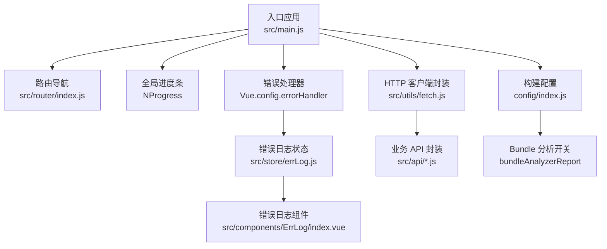
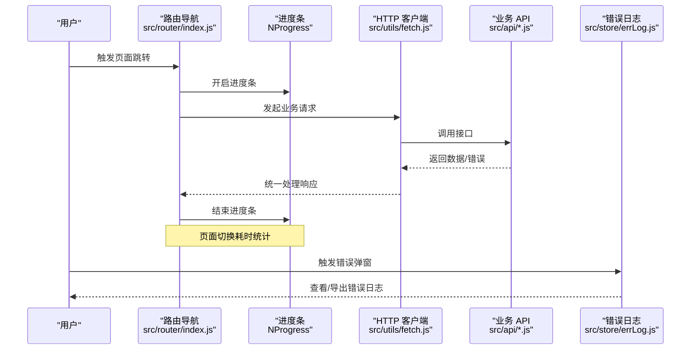
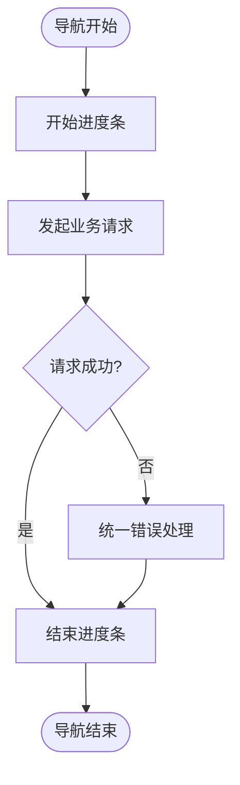
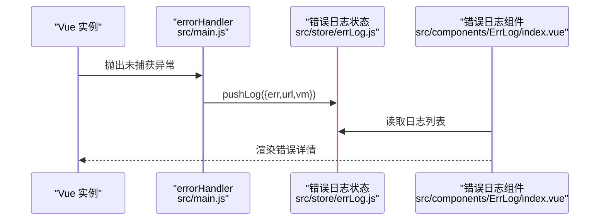
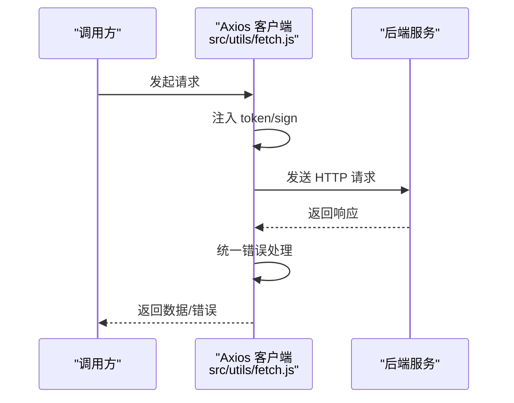
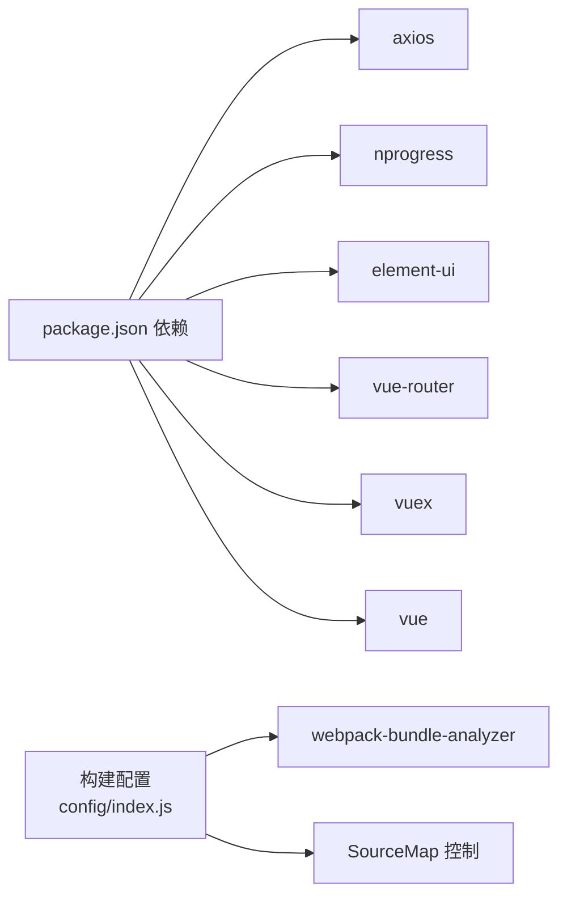

# 性能监控

<cite>
**本文引用的文件**
- [package.json](file://package.json)
- [main.js](file://src/main.js)
- [index.js](file://config/index.js)
- [fetch.js](file://src/utils/fetch.js)
- [router/index.js](file://src/router/index.js)
- [errLog.js](file://src/store/errLog.js)
- [ErrLog/index.vue](file://src/components/ErrLog/index.vue)
- [performance.js](file://src/api/performance.js)
- [fiveEducationSetup.js](file://src/api/fiveEducationSetup.js)
- [teacherleave.js](file://src/api/teacherleave.js)
</cite>

## 目录
1. [引言](#引言)
2. [项目结构](#项目结构)
3. [核心组件](#核心组件)
4. [架构总览](#架构总览)
5. [详细组件分析](#详细组件分析)
6. [依赖分析](#依赖分析)
7. [性能考虑](#性能考虑)
8. [故障排查指南](#故障排查指南)
9. [结论](#结论)
10. [附录](#附录)

## 引言
本文件面向校园管理系统前端，构建一套完整的性能监控体系，覆盖关键性能指标（KPI）定义、性能数据采集、实时监控与告警、用户行为分析（页面访问统计、用户路径追踪、功能使用频率）、性能问题诊断流程（错误日志收集、性能瓶颈定位、异常处理），以及监控工具集成建议（性能分析工具、错误监控平台、用户体验监控）。文档同时提供可落地的监控配置、报警规则与性能报告生成思路。

## 项目结构
本项目采用 Vue 2 + Vue-Router + Vuex + Element UI 技术栈，构建于 webpack 3 基础之上。前端性能监控的关键落点包括：
- 路由导航进度条（NProgress）用于感知页面切换耗时
- Axios 请求拦截器用于统一注入令牌、签名参数与错误处理
- 错误日志模块与可视化弹窗组件，用于收集运行期错误
- 构建配置中的 SourceMap 与 Bundle 分析工具，用于离线分析
- API 层对后端接口的封装，便于在业务层埋点与统计

图表来源
- [main.js:73-203](file://src/main.js#L73-L203)
- [router/index.js:1-207](file://src/router/index.js#L1-L207)
- [fetch.js:13-171](file://src/utils/fetch.js#L13-L171)
- [errLog.js:1-14](file://src/store/errLog.js#L1-L14)
- [ErrLog/index.vue:1-52](file://src/components/ErrLog/index.vue#L1-L52)
- [index.js:69-70](file://config/index.js#L69-L70)

章节来源
- [main.js:1-221](file://src/main.js#L1-L221)
- [router/index.js:1-207](file://src/router/index.js#L1-L207)
- [fetch.js:1-240](file://src/utils/fetch.js#L1-L240)
- [index.js:1-72](file://config/index.js#L1-L72)

## 核心组件
- 路由导航与进度条
  - 在路由 beforeEach 中开启进度条，在 afterEach 中结束，形成页面切换的“开始/结束”事件，可用于计算页面渲染耗时与导航耗时。
- 错误日志收集
  - 生产环境下通过 errorHandler 捕获未处理异常，并写入 Vuex 状态；配套组件提供查看与导出能力。
- HTTP 客户端封装
  - 统一注入 token、sign 参数，集中处理响应码与错误提示，便于在请求生命周期埋点与统计。
- 构建与分析
  - 通过构建配置开启/关闭 SourceMap 与 Bundle 分析报告，辅助定位打包体积与加载性能问题。

章节来源
- [main.js:73-203](file://src/main.js#L73-L203)
- [errLog.js:1-14](file://src/store/errLog.js#L1-L14)
- [ErrLog/index.vue:1-52](file://src/components/ErrLog/index.vue#L1-L52)
- [fetch.js:13-171](file://src/utils/fetch.js#L13-L171)
- [index.js:54-69](file://config/index.js#L54-L69)

## 架构总览
前端性能监控体系由“采集-传输-存储-展示-告警”闭环构成。采集层包括路由事件、网络请求、错误事件；传输层通过统一 API 或第三方 SDK 发送；存储层可对接后端或云服务；展示层提供仪表盘与报表；告警层基于阈值触发。

图表来源
- [router/index.js:73-203](file://src/router/index.js#L73-L203)
- [fetch.js:104-169](file://src/utils/fetch.js#L104-L169)
- [errLog.js:1-14](file://src/store/errLog.js#L1-L14)

## 详细组件分析

### 路由与导航性能（KPI：首屏/切换耗时）
- 关键点
  - beforeEach 开始进度条，afterEach 结束进度条，形成页面切换的“开始/结束”事件。
  - 可在此处记录页面路径、查询参数、模块编码等上下文，作为后续用户行为分析的数据源。
- KPI 建议
  - 页面切换耗时（Navigation Duration）= afterEach - beforeEach
  - 首屏渲染耗时（TTI）= 首个可交互时间 - 导航开始时间
  - 白屏时间（FP/FCP）可通过浏览器 Performance API 与资源加载时间估算
- 埋点建议
  - 在 beforeEach/afterEach 中记录时间戳与页面路径，上报至埋点平台或本地缓存队列
  - 对异常路由（401/404）单独打点，便于定位权限与路由问题

图表来源
- [main.js:73-203](file://src/main.js#L73-L203)

章节来源
- [main.js:73-203](file://src/main.js#L73-L203)

### 错误日志与异常监控（KPI：错误率、错误分布）
- 关键点
  - 生产环境设置 errorHandler，捕获未处理异常并写入错误日志状态
  - 提供可视化组件查看错误堆栈、URL、时间等
- KPI 建议
  - 错误率 = 未捕获异常数 / 请求总数
  - 错误 Top-N = 按消息/URL/堆栈聚合
- 埋点建议
  - 上报字段：错误消息、堆栈、页面 URL、用户 Token、设备信息、时间戳
  - 可结合白名单过滤（如特定 401/404）避免噪声

图表来源
- [main.js:205-214](file://src/main.js#L205-L214)
- [errLog.js:1-14](file://src/store/errLog.js#L1-L14)
- [ErrLog/index.vue:1-52](file://src/components/ErrLog/index.vue#L1-L52)

章节来源
- [main.js:205-214](file://src/main.js#L205-L214)
- [errLog.js:1-14](file://src/store/errLog.js#L1-L14)
- [ErrLog/index.vue:1-52](file://src/components/ErrLog/index.vue#L1-L52)

### HTTP 请求与网络性能（KPI：请求耗时、成功率、失败原因）
- 关键点
  - 请求拦截器统一注入 token/sign，响应拦截器集中处理错误码与提示
  - 可在请求/响应阶段记录开始时间、结束时间、URL、方法、状态码、响应大小
- KPI 建议
  - 平均/分位请求耗时（P50/P90/P95）
  - 请求失败率（4xx/5xx）与失败原因分布
  - 接口成功率与超时率
- 埋点建议
  - 在请求前记录开始时间，响应后记录结束时间与状态码
  - 对超时、跨域、鉴权失败等场景单独打点

图表来源
- [fetch.js:66-169](file://src/utils/fetch.js#L66-L169)

章节来源
- [fetch.js:13-171](file://src/utils/fetch.js#L13-L171)

### 用户行为分析（页面访问统计、用户路径追踪、功能使用频率）
- 页面访问统计
  - 在路由 beforeEach/afterEach 中记录页面路径、模块编码、停留时长（结合 Performance API）
- 用户路径追踪
  - 以“页面A -> 页面B”的序列记录用户路径，识别热门路径与断点
- 功能使用频率
  - 在业务 API 调用处埋点，统计各接口调用次数与成功率
- 建议实现方式
  - 使用本地存储或内存队列缓存事件，定时批量上报
  - 对高频事件进行采样（如 10%）降低开销

章节来源
- [router/index.js:73-203](file://src/router/index.js#L73-L203)
- [performance.js:92-673](file://src/api/performance.js#L92-L673)
- [fiveEducationSetup.js:1-51](file://src/api/fiveEducationSetup.js#L1-L51)
- [teacherleave.js:75-107](file://src/api/teacherleave.js#L75-L107)

### 监控工具集成
- 性能分析工具
  - 浏览器开发者工具 Performance/Timeline、Coverage
  - 构建分析：webpack-bundle-analyzer（已在构建配置中预留开关）
- 错误监控平台
  - Sentry、Bugsnag、阿里云 ARMS 等，支持自动上报与分类统计
- 用户体验监控（UEM）
  - 使用 Web Vitals 指标（CLS、INP、LCP、FCP、FID）衡量真实用户体验
  - 结合埋点平台（如神策、GrowingIO）进行用户路径与转化分析

章节来源
- [index.js:69-70](file://config/index.js#L69-L70)
- [package.json:82](file://package.json#L82)

## 依赖分析
- 外部依赖与性能相关
  - axios：统一网络请求与错误处理
  - nprogress：导航进度条，直观反映页面切换耗时
  - element-ui：组件库，影响首屏渲染与交互体验
  - vue、vue-router、vuex：应用骨架，决定路由与状态管理性能
- 构建与分析
  - webpack-bundle-analyzer：用于分析包体组成，指导按需加载与拆分策略
  - SourceMap：开发调试与错误回溯，生产环境可按需开启

图表来源
- [package.json:12-42](file://package.json#L12-L42)
- [index.js:54-69](file://config/index.js#L54-L69)

章节来源
- [package.json:1-98](file://package.json#L1-L98)
- [index.js:1-72](file://config/index.js#L1-L72)

## 性能考虑
- 打包与加载
  - 合理拆分 vendor 与业务代码，启用懒加载与异步组件
  - 压缩与 Tree Shaking，减少无效代码
- 运行时性能
  - 避免在渲染周期做重型计算，使用防抖/节流处理高频事件
  - 图片与静态资源 CDN 化，合理设置缓存策略
- 监控成本控制
  - 对高频事件采样上报，降低带宽与存储压力
  - 仅在必要场景开启高精度监控（如 INP）

## 故障排查指南
- 错误日志收集
  - 生产环境通过 errorHandler 自动收集未捕获异常
  - 使用错误日志组件查看与导出，定位堆栈与上下文
- 性能瓶颈定位
  - 使用浏览器 Performance 面板录制页面切换，观察主线程阻塞点
  - 结合网络面板检查慢请求与资源加载
- 异常处理
  - 对 401/403 等鉴权异常进行重定向与提示
  - 对 5xx 错误进行降级与重试策略

章节来源
- [main.js:205-214](file://src/main.js#L205-L214)
- [fetch.js:104-169](file://src/utils/fetch.js#L104-L169)

## 结论
本项目已具备前端性能监控的基础能力：路由导航进度条、统一 HTTP 客户端、错误日志收集与可视化。建议在此基础上扩展用户行为埋点、引入专业监控平台与 UEM 指标，完善实时告警与性能报告，持续优化用户体验与系统稳定性。

## 附录

### KPI 定义与计算
- 页面切换耗时（Navigation Duration）：afterEach 时间戳 - beforeEach 时间戳
- 首屏渲染耗时（TTI）：首个可交互时间 - 导航开始时间
- 请求平均耗时（Avg Request Duration）：Σ(请求结束-开始) / 请求总数
- 错误率（Error Rate）：未捕获异常数 / 请求总数
- 接口成功率（Success Rate）：成功响应数 / 总请求数

### 监控配置与报警规则（示例）
- 配置
  - 路由事件：在 beforeEach/afterEach 记录时间戳与页面路径
  - 请求事件：在请求拦截器记录开始时间、URL、方法；在响应拦截器记录结束时间、状态码
  - 错误事件：在 errorHandler 记录错误消息、堆栈、URL
- 报警规则
  - 页面切换耗时超过阈值（如 P95 > 3s）触发告警
  - 错误率连续 5 分钟内上升超过阈值（如 > 1%）触发告警
  - 接口成功率低于阈值（如 < 95%）触发告警

### 性能报告生成
- 报告维度
  - 时间维度：日/周/月趋势
  - 地域/设备维度：不同浏览器/机型表现
  - 页面维度：页面切换耗时、首屏耗时排行
  - 接口维度：接口成功率、耗时排行
- 呈现形式
  - 仪表盘：KPI 指标卡片与趋势图
  - 事件回放：错误堆栈与用户操作路径
  - 下载与分享：CSV/Excel 报表与链接分享