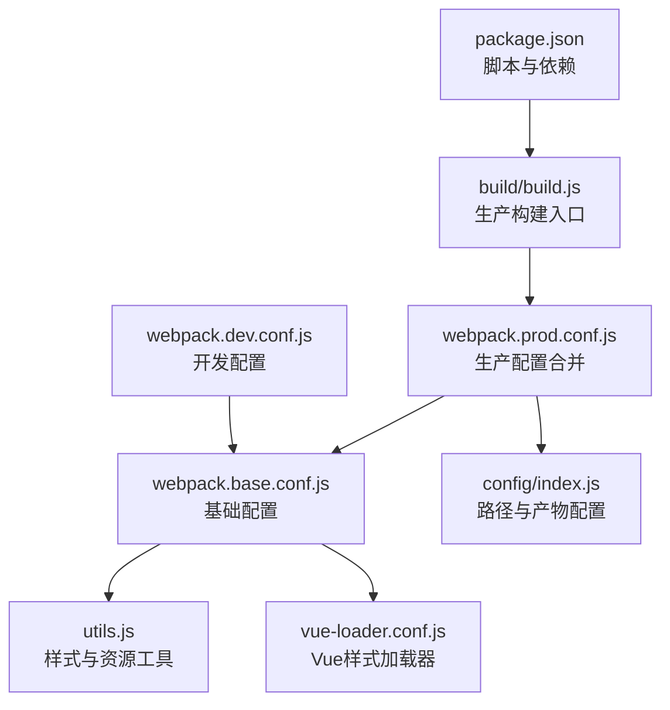
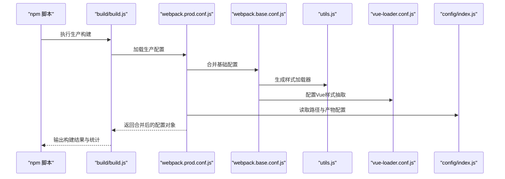
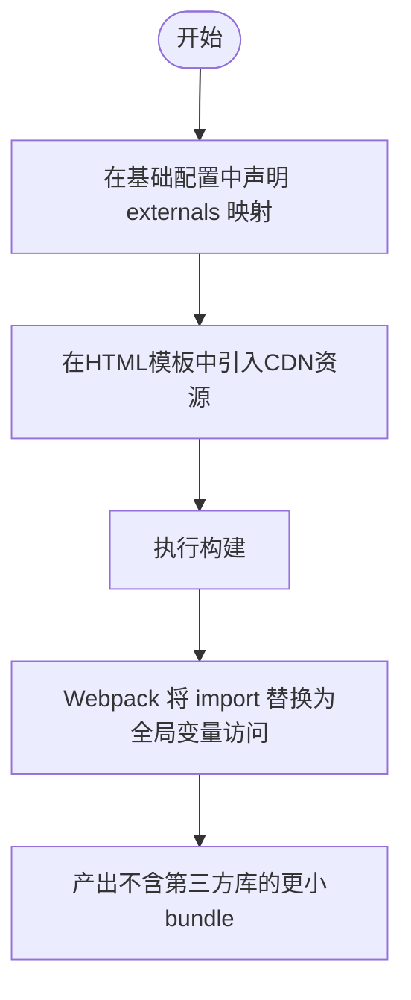
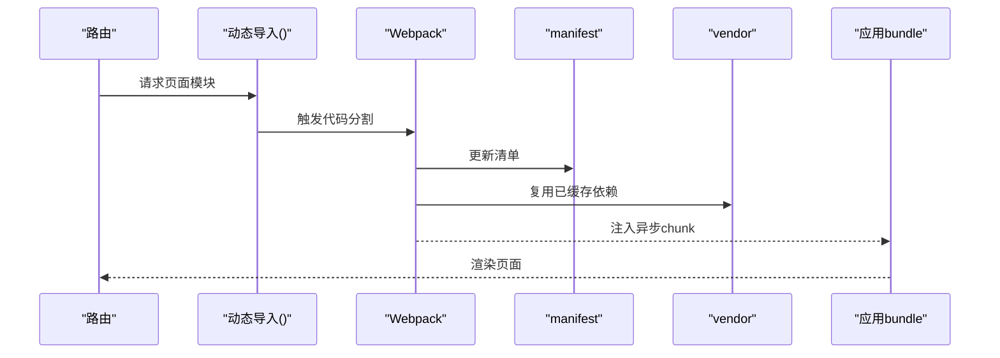
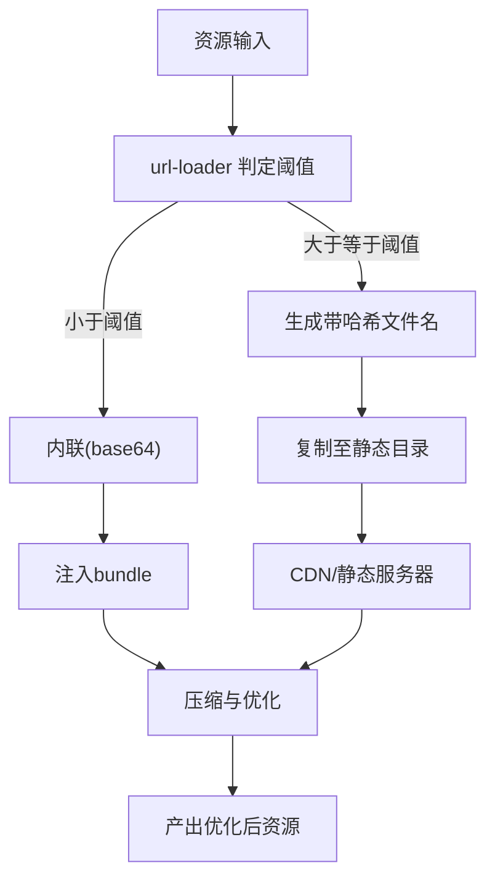
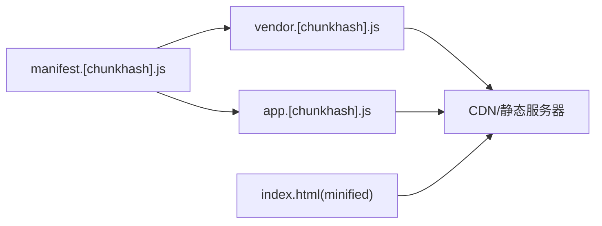
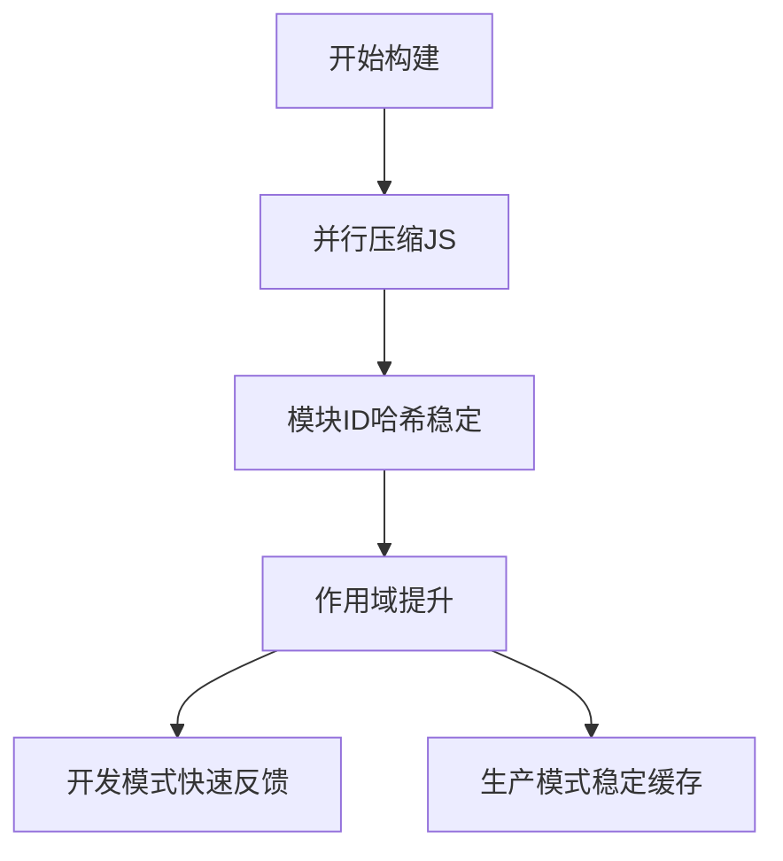
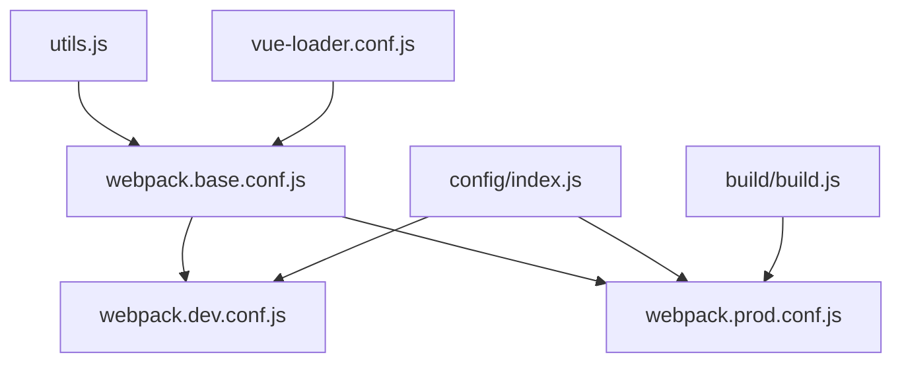

# 构建优化

<cite>
**本文引用的文件**
- [package.json](file://package.json)
- [build/webpack.base.conf.js](file://build/webpack.base.conf.js)
- [build/webpack.dev.conf.js](file://build/webpack.dev.conf.js)
- [build/webpack.prod.conf.js](file://build/webpack.prod.conf.js)
- [config/index.js](file://config/index.js)
- [build/utils.js](file://build/utils.js)
- [build/vue-loader.conf.js](file://build/vue-loader.conf.js)
- [build/build.js](file://build/build.js)
</cite>

## 目录
1. [引言](#引言)
2. [项目结构](#项目结构)
3. [核心组件](#核心组件)
4. [架构总览](#架构总览)
5. [详细组件分析](#详细组件分析)
6. [依赖关系分析](#依赖关系分析)
7. [性能考量](#性能考量)
8. [故障排查指南](#故障排查指南)
9. [结论](#结论)
10. [附录](#附录)

## 引言
本文件面向校园管理系统前端工程，系统性梳理与优化Webpack构建流程，覆盖以下主题：
- 外部依赖（externals）以减少打包体积
- 代码分割与懒加载策略
- 资源压缩与优化（图片、字体、CSS、JS）
- 缓存策略（浏览器缓存、CDN、静态资源版本控制）
- 构建性能优化（并行、缓存、增量编译）
- 具体配置示例与性能对比建议

目标是帮助开发者在保证功能与可维护性的前提下，显著降低首屏体积、提升构建速度与运行时性能。

## 项目结构
该工程采用基于模板的多环境配置组织方式：基础配置位于 build 目录，开发与生产环境分别由独立配置继承；公共工具函数与Vue加载器配置位于 build 子目录；环境变量与路径配置位于 config 目录；入口与脚本定义于根目录 package.json。

图表来源
- [package.json:1-98](file://package.json#L1-L98)
- [build/build.js:1-42](file://build/build.js#L1-L42)
- [build/webpack.prod.conf.js:1-149](file://build/webpack.prod.conf.js#L1-L149)
- [build/webpack.base.conf.js:1-102](file://build/webpack.base.conf.js#L1-L102)
- [build/utils.js:1-102](file://build/utils.js#L1-L102)
- [build/vue-loader.conf.js:1-23](file://build/vue-loader.conf.js#L1-L23)
- [config/index.js:1-72](file://config/index.js#L1-L72)

章节来源
- [package.json:1-98](file://package.json#L1-L98)
- [config/index.js:1-72](file://config/index.js#L1-L72)

## 核心组件
- 基础配置（webpack.base.conf.js）
  - 定义入口、输出、externals、解析规则、资源加载器、Node兼容性占位与插件注册。
  - 关键点：externals 将常用库暴露为全局变量，避免打入包体；url-loader 对小资源进行内联或命名带哈希；resolve.alias 提升模块解析效率。
- 开发配置（webpack.dev.conf.js）
  - 合并基础配置，启用热更新、友好的错误提示、代理与源码映射；提供静态资源拷贝。
- 生产配置（webpack.prod.conf.js）
  - 合并基础配置，启用JS/CSS压缩、CSS抽取、HTML最小化、模块ID哈希稳定、作用域提升、CommonsChunkPlugin进行代码分割，并支持Gzip与包体分析。
- 工具与加载器（utils.js、vue-loader.conf.js）
  - 统一样式加载器生成逻辑，支持PostCSS与多种预处理；Vue组件样式抽取与缓存控制。
- 环境与路径（config/index.js）
  - 定义开发/生产环境的资源路径、publicPath、Gzip开关与分析报告开关等。
- 构建入口（build/build.js）
  - 清理输出目录、执行Webpack构建、输出统计信息。

章节来源
- [build/webpack.base.conf.js:1-102](file://build/webpack.base.conf.js#L1-L102)
- [build/webpack.dev.conf.js:1-96](file://build/webpack.dev.conf.js#L1-L96)
- [build/webpack.prod.conf.js:1-149](file://build/webpack.prod.conf.js#L1-L149)
- [build/utils.js:1-102](file://build/utils.js#L1-L102)
- [build/vue-loader.conf.js:1-23](file://build/vue-loader.conf.js#L1-L23)
- [config/index.js:1-72](file://config/index.js#L1-L72)
- [build/build.js:1-42](file://build/build.js#L1-L42)

## 架构总览
下图展示从脚本到最终产物的关键流程与关键配置节点：

图表来源
- [build/build.js:1-42](file://build/build.js#L1-L42)
- [build/webpack.prod.conf.js:1-149](file://build/webpack.prod.conf.js#L1-L149)
- [build/webpack.base.conf.js:1-102](file://build/webpack.base.conf.js#L1-L102)
- [build/utils.js:1-102](file://build/utils.js#L1-L102)
- [build/vue-loader.conf.js:1-23](file://build/vue-loader.conf.js#L1-L23)
- [config/index.js:1-72](file://config/index.js#L1-L72)

## 详细组件分析

### 外部依赖（externals）优化
- 目标：将大型第三方库（如Vue、Element-UI、ECharts、jQuery等）排除在打包之外，通过CDN引入，从而显著减小bundle体积。
- 现状：基础配置中已声明 externals 映射，生产配置中保留了空的 externals 覆盖块（可按需扩展）。
- 建议实践：
  - 在HTML模板中引入对应CDN资源，确保全局变量名与 externals 映射一致。
  - 对于业务代码中的 import，保持原写法不变，Webpack 会将其替换为全局变量访问。
  - 对于需要本地备份的场景，可在开发环境保留本地依赖，生产环境切换CDN。

图表来源
- [build/webpack.base.conf.js:26-36](file://build/webpack.base.conf.js#L26-L36)
- [build/webpack.prod.conf.js:17-19](file://build/webpack.prod.conf.js#L17-L19)

章节来源
- [build/webpack.base.conf.js:26-36](file://build/webpack.base.conf.js#L26-L36)
- [build/webpack.prod.conf.js:17-19](file://build/webpack.prod.conf.js#L17-L19)

### 代码分割与懒加载
- 现状：生产配置使用 CommonsChunkPlugin 进行代码分割，提取 vendor、manifest 以及异步共享块。
- 建议实践：
  - 使用路由级懒加载（动态 import）拆分页面bundle，结合 async: 'vendor-async' 的策略进一步优化复用。
  - 对于大组件或按需使用的模块，采用动态导入以降低首屏体积。
  - 结合 ModuleConcatenationPlugin 与 HashedModuleIdsPlugin，确保长缓存稳定性。

图表来源
- [build/webpack.prod.conf.js:84-112](file://build/webpack.prod.conf.js#L84-L112)

章节来源
- [build/webpack.prod.conf.js:84-112](file://build/webpack.prod.conf.js#L84-L112)

### 资源压缩与优化
- 图片与媒体资源
  - url-loader 限制阈值内联，阈值外命名带哈希；建议对图标、小图启用内联，大图走CDN或静态服务器。
- 字体资源
  - 同样使用 url-loader 控制内联与命名，建议统一字体格式（如WOFF2）以提升兼容性与体积。
- CSS 与 JS
  - JS：UglifyJsPlugin 并行压缩，开启 sourceMap 便于回溯。
  - CSS：ExtractTextPlugin 抽取CSS，OptimizeCSSPlugin 去重与压缩，生产环境关闭按需抽取以避免sourcemap问题。
- HTML
  - HtmlWebpackPlugin 最小化输出，移除注释与多余空白。

图表来源
- [build/webpack.base.conf.js:61-83](file://build/webpack.base.conf.js#L61-L83)
- [build/webpack.prod.conf.js:38-62](file://build/webpack.prod.conf.js#L38-L62)
- [build/utils.js:15-83](file://build/utils.js#L15-L83)

章节来源
- [build/webpack.base.conf.js:61-83](file://build/webpack.base.conf.js#L61-L83)
- [build/webpack.prod.conf.js:38-62](file://build/webpack.prod.conf.js#L38-L62)
- [build/utils.js:15-83](file://build/utils.js#L15-L83)

### 缓存策略
- 浏览器缓存
  - JS/CSS 文件名含 contenthash/chunkhash，确保内容变更才失效；HTML经最小化处理。
- CDN配置
  - 将静态资源部署至CDN，结合长期缓存策略与按需回源；配合 externals 减少CDN压力。
- 版本控制
  - 通过哈希文件名与 Manifest 分离（manifest/vendor/app），降低主包更新频率。
- 路径与publicPath
  - 生产环境 publicPath 指向 /app/，注意与服务器部署路径匹配，避免资源404。

图表来源
- [build/webpack.prod.conf.js:28-32](file://build/webpack.prod.conf.js#L28-L32)
- [build/webpack.prod.conf.js:84-112](file://build/webpack.prod.conf.js#L84-L112)
- [config/index.js:47-48](file://config/index.js#L47-L48)

章节来源
- [build/webpack.prod.conf.js:28-32](file://build/webpack.prod.conf.js#L28-L32)
- [build/webpack.prod.conf.js:84-112](file://build/webpack.prod.conf.js#L84-L112)
- [config/index.js:47-48](file://config/index.js#L47-L48)

### 构建性能优化
- 并行构建
  - UglifyJsPlugin 启用 parallel 以充分利用多核CPU。
- 缓存利用
  - 开启模块ID哈希稳定（HashedModuleIdsPlugin）与作用域提升（ModuleConcatenationPlugin）。
- 增量编译
  - 开发环境使用热更新与快速源码映射（cheap-module-eval-source-map），缩短反馈周期。
- 资源内联与拆分
  - 合理设置 url-loader 阈值，平衡HTTP请求数与单文件大小。

图表来源
- [build/webpack.prod.conf.js:45-83](file://build/webpack.prod.conf.js#L45-L83)
- [build/webpack.dev.conf.js:20-21](file://build/webpack.dev.conf.js#L20-L21)

章节来源
- [build/webpack.prod.conf.js:45-83](file://build/webpack.prod.conf.js#L45-L83)
- [build/webpack.dev.conf.js:20-21](file://build/webpack.dev.conf.js#L20-L21)

## 依赖关系分析
- 组件耦合
  - 生产配置强依赖基础配置与工具函数；开发配置同样依赖基础配置与环境变量。
  - 插件之间存在顺序依赖：DefinePlugin、UglifyJsPlugin、ExtractTextPlugin、HtmlWebpackPlugin、CommonsChunkPlugin 等。
- 外部依赖
  - 通过 externals 与CDN解耦，避免打包体积膨胀。
- 可能的循环依赖
  - 当前配置未见显式循环依赖迹象；若后续新增自定义插件，应避免相互require。

图表来源
- [build/webpack.base.conf.js:1-102](file://build/webpack.base.conf.js#L1-L102)
- [build/webpack.dev.conf.js:1-96](file://build/webpack.dev.conf.js#L1-L96)
- [build/webpack.prod.conf.js:1-149](file://build/webpack.prod.conf.js#L1-L149)
- [build/utils.js:1-102](file://build/utils.js#L1-L102)
- [build/vue-loader.conf.js:1-23](file://build/vue-loader.conf.js#L1-L23)
- [config/index.js:1-72](file://config/index.js#L1-L72)
- [build/build.js:1-42](file://build/build.js#L1-L42)

章节来源
- [build/webpack.base.conf.js:1-102](file://build/webpack.base.conf.js#L1-L102)
- [build/webpack.dev.conf.js:1-96](file://build/webpack.dev.conf.js#L1-L96)
- [build/webpack.prod.conf.js:1-149](file://build/webpack.prod.conf.js#L1-L149)
- [build/utils.js:1-102](file://build/utils.js#L1-L102)
- [build/vue-loader.conf.js:1-23](file://build/vue-loader.conf.js#L1-L23)
- [config/index.js:1-72](file://config/index.js#L1-L72)
- [build/build.js:1-42](file://build/build.js#L1-L42)

## 性能考量
- 体积优化
  - 通过 externals 减少约 200KB~1MB（视库而定），结合按需加载可进一步降低首屏体积。
  - 合理设置 url-loader 阈值，避免过多小图导致HTTP开销。
- 构建速度
  - 并行压缩与模块ID稳定可减少重复工作；开发模式使用快速映射与HMR提升迭代效率。
- 运行时性能
  - 代码分割与CDN结合可显著提升缓存命中率；contenthash确保变更最小化。

## 故障排查指南
- 构建失败
  - 查看构建日志与错误堆栈；确认依赖安装完整、路径配置正确。
- 资源404
  - 检查 config/index.js 中的 assetsPublicPath 与实际部署路径是否一致。
- 缓存不生效
  - 确认文件名含哈希且未被手动修改；检查CDN缓存策略与TTL。
- 源码映射问题
  - 生产环境关闭按需抽取CSS以避免sourcemap混入；开发环境使用 cheap-module-eval-source-map。

章节来源
- [build/build.js:17-40](file://build/build.js#L17-L40)
- [config/index.js:47-48](file://config/index.js#L47-L48)
- [build/webpack.prod.conf.js:50-62](file://build/webpack.prod.conf.js#L50-L62)
- [build/webpack.dev.conf.js:20-21](file://build/webpack.dev.conf.js#L20-L21)

## 结论
通过对 externals、代码分割、资源压缩与缓存策略的系统化优化，校园管理系统可在保证开发体验的同时，显著降低首屏体积、提升构建与运行性能。建议在现有基础上继续推进路由级懒加载与CDN策略落地，并持续监控构建产物体积与缓存命中率。

## 附录
- 常用配置要点速查
  - externals：在基础配置中维护全局变量映射，生产环境HTML引入CDN资源。
  - 代码分割：使用 CommonsChunkPlugin 提取 vendor/manifest/异步共享块。
  - 资源优化：合理设置 url-loader 阈值；生产环境启用JS/CSS压缩与抽取。
  - 缓存策略：contenthash/chunkhash 文件名 + Manifest分离 + CDN长期缓存。
  - 构建性能：并行压缩、模块ID稳定、作用域提升、开发模式快速映射。