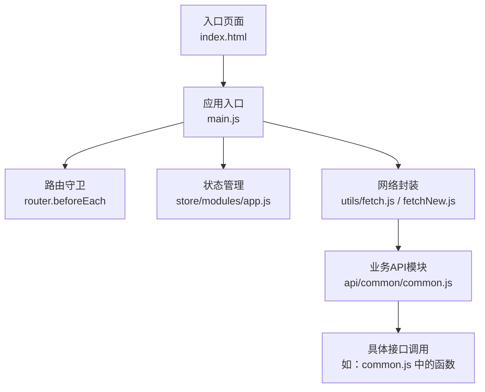
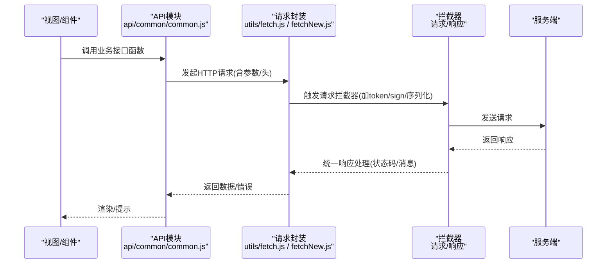
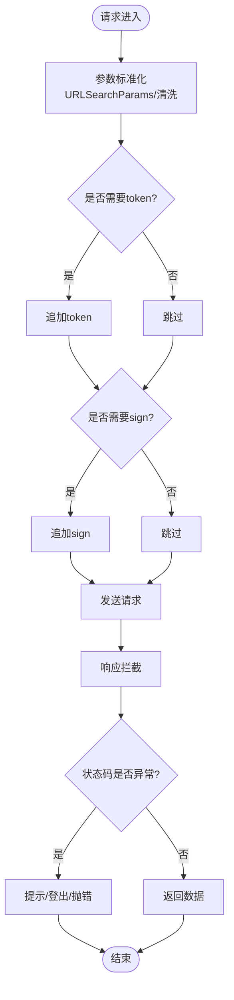
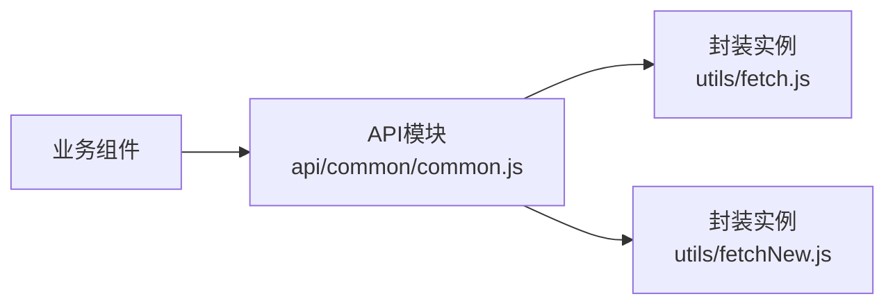
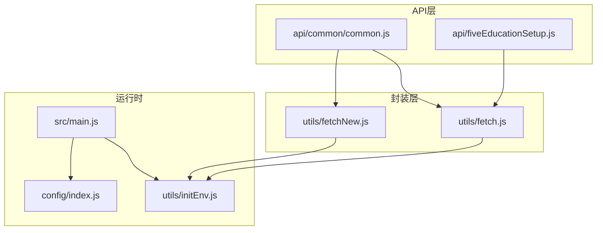

# 网络优化

<cite>
**本文引用的文件**
- [fetch.js](file://src/utils/fetch.js)
- [fetchNew.js](file://src/utils/fetchNew.js)
- [common.js](file://src/api/common/common.js)
- [index.html](file://index.html)
- [index.js](file://config/index.js)
- [initEnv.js](file://src/utils/initEnv.js)
- [main.js](file://src/main.js)
- [app.js](file://src/store/modules/app.js)
- [fiveEducationSetup.js](file://src/api/fiveEducationSetup.js)
</cite>

## 目录
1. [引言](#引言)
2. [项目结构](#项目结构)
3. [核心组件](#核心组件)
4. [架构总览](#架构总览)
5. [详细组件分析](#详细组件分析)
6. [依赖关系分析](#依赖关系分析)
7. [性能考量](#性能考量)
8. [故障排查指南](#故障排查指南)
9. [结论](#结论)
10. [附录](#附录)

## 引言
本文件面向校园管理系统前端网络层，聚焦HTTP请求优化与网络性能提升，覆盖请求合并/批量请求/请求去重、缓存策略（浏览器/服务端/本地）、资源加载优化（CDN/预加载/懒加载）、网络错误处理与重试、监控与诊断等主题。通过对现有请求封装与API调用方式的分析，提出可落地的优化建议与最佳实践。

## 项目结构
- 前端基于Vue生态，通过axios封装统一发起HTTP请求，并在多个API模块中按需调用。
- 构建配置采用webpack模板，生产环境输出路径与静态资源路径可配置。
- 全局运行环境通过initEnv根据环境变量注入不同域名与路径，便于区分开发/测试/生产。

图表来源
- [index.html:1-41](file://index.html#L1-L41)
- [main.js:1-221](file://src/main.js#L1-L221)
- [app.js:1-54](file://src/store/modules/app.js#L1-L54)
- [fetch.js:1-240](file://src/utils/fetch.js#L1-L240)
- [fetchNew.js:1-136](file://src/utils/fetchNew.js#L1-L136)
- [common.js:1-459](file://src/api/common/common.js#L1-L459)

章节来源
- [index.html:1-41](file://index.html#L1-L41)
- [main.js:1-221](file://src/main.js#L1-L221)
- [app.js:1-54](file://src/store/modules/app.js#L1-L54)
- [fetch.js:1-240](file://src/utils/fetch.js#L1-L240)
- [fetchNew.js:1-136](file://src/utils/fetchNew.js#L1-L136)
- [common.js:1-459](file://src/api/common/common.js#L1-L459)

## 核心组件
- 请求封装与拦截器
  - 统一设置baseURL、超时、参数序列化、鉴权头、签名参数等。
  - 统一响应处理与错误提示，登录态失效时触发登出流程。
- API模块
  - 以功能域划分API文件，集中导出接口方法，便于复用与替换。
- 构建与环境
  - 通过initEnv注入全局常量，配合config/index.js控制静态资源路径与打包行为。

章节来源
- [fetch.js:13-171](file://src/utils/fetch.js#L13-L171)
- [fetchNew.js:9-135](file://src/utils/fetchNew.js#L9-L135)
- [common.js:1-459](file://src/api/common/common.js#L1-L459)
- [initEnv.js:1-33](file://src/utils/initEnv.js#L1-L33)
- [index.js:39-70](file://config/index.js#L39-L70)

## 架构总览
下图展示从前端到后端的关键交互链路，以及当前实现中的关键节点（鉴权、签名、超时、错误处理）。

图表来源
- [common.js:1-459](file://src/api/common/common.js#L1-L459)
- [fetch.js:66-169](file://src/utils/fetch.js#L66-L169)
- [fetchNew.js:36-133](file://src/utils/fetchNew.js#L36-L133)

## 详细组件分析

### 请求封装与拦截器（axios）
- 请求阶段
  - 参数标准化：统一使用URLSearchParams，过滤空值；对特定baseURL进行参数清洗。
  - 鉴权：自动追加token；部分接口追加sign签名参数。
  - 超时：默认10秒（多实例），另有长超时实例（30秒）。
- 响应阶段
  - 统一错误码判定与提示；登录态失效时触发登出与跳转。
  - 可配置返回原始data或完整response。

图表来源
- [fetch.js:66-169](file://src/utils/fetch.js#L66-L169)
- [fetchNew.js:36-133](file://src/utils/fetchNew.js#L36-L133)

章节来源
- [fetch.js:13-171](file://src/utils/fetch.js#L13-L171)
- [fetchNew.js:9-135](file://src/utils/fetchNew.js#L9-L135)

### API模块与调用
- 功能域划分：common.js集中管理通用类接口（字典、课程、教师班级、视频等）。
- 调用方式：各模块导出函数，内部统一通过封装实例发起请求，支持GET/POST与JSON体。
- 扩展点：新增接口只需在对应模块添加函数并复用封装实例。

图表来源
- [common.js:1-459](file://src/api/common/common.js#L1-L459)
- [fetch.js:1-240](file://src/utils/fetch.js#L1-L240)
- [fetchNew.js:1-136](file://src/utils/fetchNew.js#L1-L136)

章节来源
- [common.js:1-459](file://src/api/common/common.js#L1-L459)

### 构建与环境配置
- initEnv根据ENV_TAREGT注入不同域名与路径，便于切换环境。
- config/index.js控制生产环境静态资源路径与打包策略，影响资源加载性能。

章节来源
- [initEnv.js:1-33](file://src/utils/initEnv.js#L1-L33)
- [index.js:39-70](file://config/index.js#L39-L70)

## 依赖关系分析
- 组件耦合
  - API模块依赖封装实例，封装实例依赖全局环境配置。
  - 页面通过路由守卫与状态管理间接影响请求时机与上下文。
- 外部依赖
  - axios、element-ui、js-cookie、nprogress等。

图表来源
- [fetch.js:1-240](file://src/utils/fetch.js#L1-L240)
- [fetchNew.js:1-136](file://src/utils/fetchNew.js#L1-L136)
- [common.js:1-459](file://src/api/common/common.js#L1-L459)
- [fiveEducationSetup.js:1-51](file://src/api/fiveEducationSetup.js#L1-L51)
- [initEnv.js:1-33](file://src/utils/initEnv.js#L1-L33)
- [index.js:39-70](file://config/index.js#L39-L70)
- [main.js:1-221](file://src/main.js#L1-L221)

章节来源
- [fetch.js:1-240](file://src/utils/fetch.js#L1-L240)
- [fetchNew.js:1-136](file://src/utils/fetchNew.js#L1-L136)
- [common.js:1-459](file://src/api/common/common.js#L1-L459)
- [fiveEducationSetup.js:1-51](file://src/api/fiveEducationSetup.js#L1-L51)
- [initEnv.js:1-33](file://src/utils/initEnv.js#L1-L33)
- [index.js:39-70](file://config/index.js#L39-L70)
- [main.js:1-221](file://src/main.js#L1-L221)

## 性能考量

### HTTP请求优化策略
- 请求合并/批量请求
  - 在API层聚合同类请求，减少并发与往返次数；例如批量获取字典、课程等列表时，优先合并为单次请求。
  - 对于高频小请求，建议在服务端提供批量接口或在客户端做队列合并。
- 批量请求
  - 对于分页/列表场景，统一使用分页参数，避免一次性拉取过多数据；结合懒加载与虚拟滚动降低首屏压力。
- 请求去重
  - 对相同参数的请求进行去重，避免重复发送；可在请求前生成唯一键，利用内存缓存或Promise缓存避免重复。

章节来源
- [common.js:1-459](file://src/api/common/common.js#L1-L459)

### 缓存策略实现
- 浏览器缓存
  - 静态资源通过CDN与强缓存策略（长缓存、版本化）提升命中率；HTML与动态接口避免强缓存。
- 服务端缓存
  - 对稳定数据（如字典、课程表）启用服务端缓存，设置合理TTL；对热点接口开启Redis缓存。
- 本地存储缓存
  - 对轻量且不敏感的数据（如用户选择的分页参数、筛选条件）使用localStorage/sessionStorage短期缓存，减少重复请求。

章节来源
- [index.html:1-41](file://index.html#L1-L41)
- [index.js:39-70](file://config/index.js#L39-L70)

### 资源加载优化
- CDN使用
  - 将第三方库与静态资源指向CDN，缩短首字节时间；确保CDN可用性与回退策略。
- 资源预加载
  - 对关键首屏资源使用<link rel="preload">或预连接（preconnect）；对字体、图标等关键资源进行预加载。
- 懒加载
  - 图片、富文本内容、大组件按需加载；结合IntersectionObserver实现可视区域再加载。

章节来源
- [index.html:12-33](file://index.html#L12-L33)

### 网络错误处理与重试机制
- 超时处理
  - 已有默认超时与长超时实例，建议对不同接口设置差异化超时；对弱网环境增加重试。
- 断线重连
  - 监测离线状态，自动重连并提示用户；对关键操作进行本地记录与补发。
- 降级策略
  - 服务不可用时返回兜底数据或提示；对非关键接口降级为本地缓存或简化渲染。

章节来源
- [fetch.js:14-16](file://src/utils/fetch.js#L14-L16)
- [fetchNew.js:10-11](file://src/utils/fetchNew.js#L10-L11)

### 网络监控与诊断
- 监控方案
  - 埋点统计：请求耗时、成功率、失败原因、超时次数；结合NProgress观察整体请求节奏。
  - 错误上报：捕获未处理异常与网络错误，上报至监控平台。
- 性能指标
  - TTFB、首屏时间、资源体积、缓存命中率、重试率等。
- 诊断方法
  - 使用浏览器开发者工具Network面板分析请求链路；结合后端日志定位慢请求与错误。

章节来源
- [main.js:10-11](file://src/main.js#L10-L11)
- [main.js:206-214](file://src/main.js#L206-L214)

## 故障排查指南
- 常见问题
  - 登录态失效：响应拦截器检测到1000码，触发登出与跳转；检查token与sign参数是否正确注入。
  - 参数为空：统一参数清洗逻辑可能移除null/undefined；确认调用方传参完整性。
  - 跨域/签名：涉及签名的接口需确保sign参数存在；检查签名生成与传递流程。
- 排查步骤
  - 打开Network面板，确认请求头、参数、响应状态码与消息。
  - 查看控制台错误与拦截器日志，定位失败环节。
  - 核对环境配置与baseURL，确保指向正确的服务端地址。

章节来源
- [fetch.js:104-169](file://src/utils/fetch.js#L104-L169)
- [fetchNew.js:81-133](file://src/utils/fetchNew.js#L81-L133)

## 结论
通过统一的请求封装、清晰的API模块划分与合理的构建/环境配置，系统已具备良好的网络层基础。后续可在请求合并/去重、缓存策略、资源加载与监控诊断等方面进一步优化，以显著提升用户体验与系统稳定性。

## 附录
- 相关实现位置
  - 请求封装与拦截器：[fetch.js:13-171](file://src/utils/fetch.js#L13-L171)、[fetchNew.js:9-135](file://src/utils/fetchNew.js#L9-L135)
  - API模块示例：[common.js:1-459](file://src/api/common/common.js#L1-L459)、[fiveEducationSetup.js:1-51](file://src/api/fiveEducationSetup.js#L1-L51)
  - 构建与环境：[index.js:39-70](file://config/index.js#L39-L70)、[initEnv.js:1-33](file://src/utils/initEnv.js#L1-L33)
  - 资源与入口：[index.html:1-41](file://index.html#L1-L41)、[main.js:1-221](file://src/main.js#L1-L221)