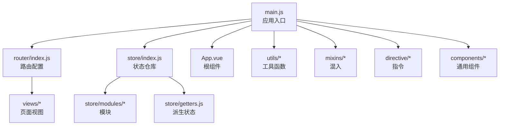
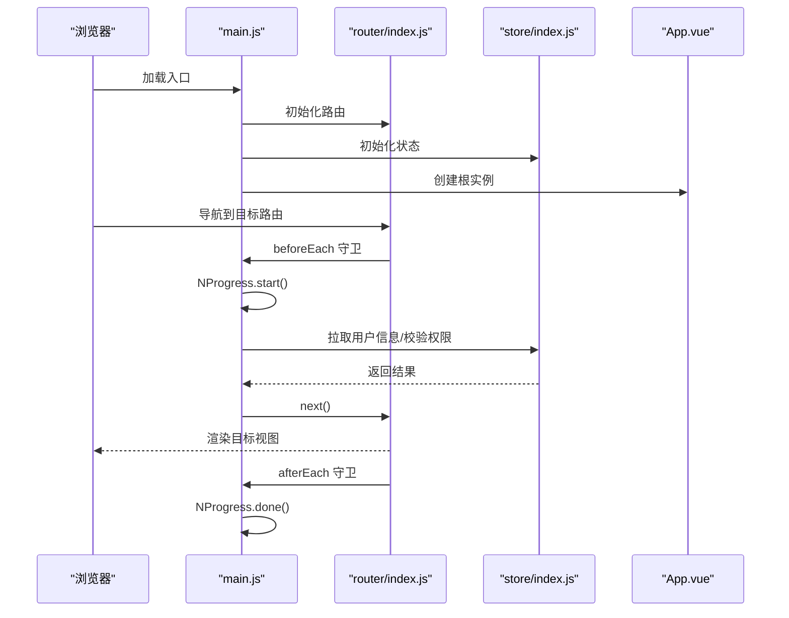
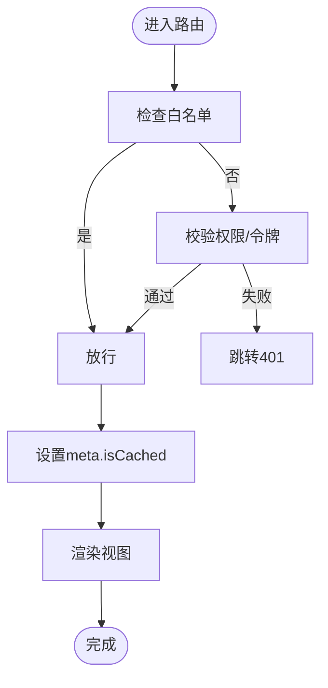
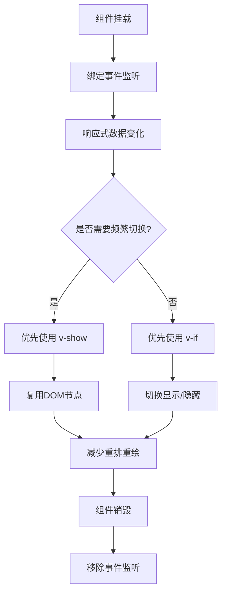
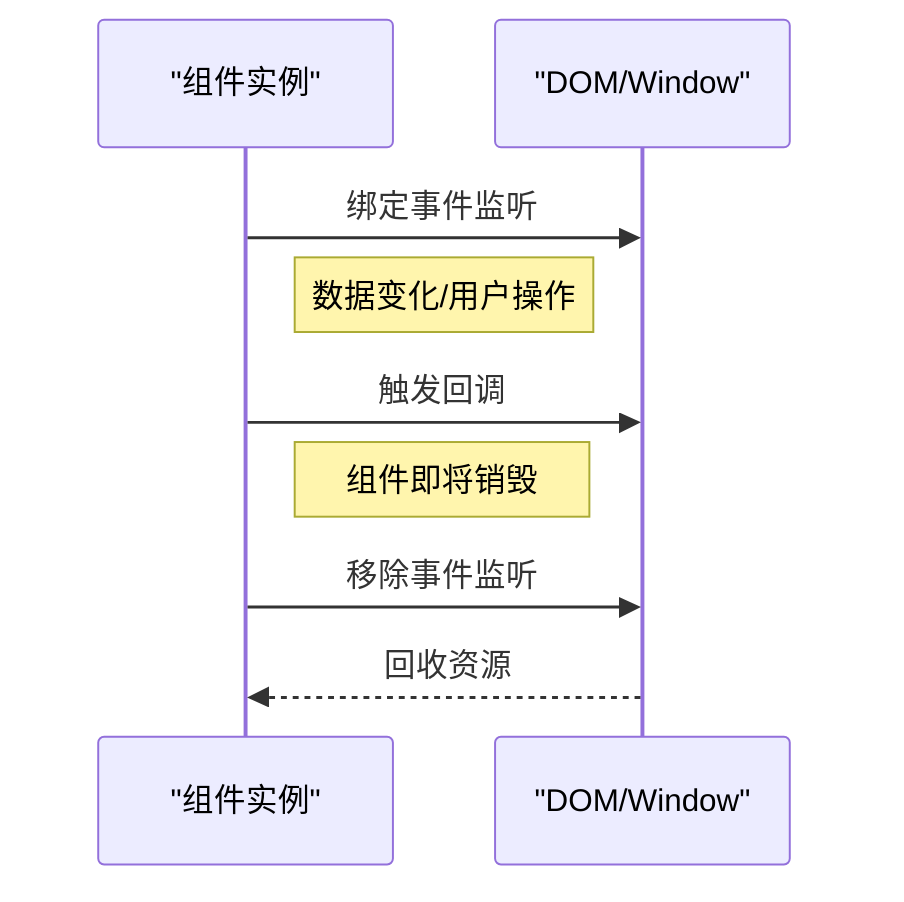
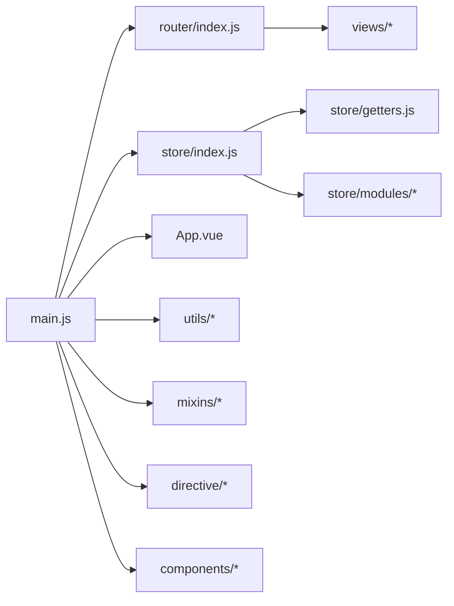

# 运行时优化

<cite>
**本文引用的文件**
- [main.js](file://src/main.js)
- [router/index.js](file://src/router/index.js)
- [store/index.js](file://src/store/index.js)
- [store/modules/app.js](file://src/store/modules/app.js)
- [store/getters.js](file://src/store/getters.js)
- [utils/utils.js](file://src/utils/utils.js)
- [mixins/windowResize.js](file://src/mixins/windowResize.js)
- [directive/sticky.js](file://src/directive/sticky.js)
- [components/Sticky/index.vue](file://src/components/Sticky/index.vue)
- [components/DefaultPage/index.vue](file://src/components/DefaultPage/index.vue)
- [views/sidebarLayout.vue](file://src/views/sidebarLayout.vue)
- [App.vue](file://src/App.vue)
- [package.json](file://package.json)
</cite>

## 目录
1. [简介](#简介)
2. [项目结构](#项目结构)
3. [核心组件](#核心组件)
4. [架构总览](#架构总览)
5. [详细组件分析](#详细组件分析)
6. [依赖关系分析](#依赖关系分析)
7. [性能考量](#性能考量)
8. [故障排查指南](#故障排查指南)
9. [结论](#结论)
10. [附录](#附录)

## 简介
本文件面向校园管理系统在运行时的性能优化，聚焦以下方面：
- 组件懒加载与路由懒加载
- 渲染性能：v-show/v-if 选择、计算属性缓存、watcher 优化
- 内存管理：组件销毁、事件监听器清理、内存泄漏预防
- 虚拟滚动与防抖节流实践建议
- 路由导航优化：懒加载、keep-alive 缓存、预加载策略
- 性能监控指标与分析工具使用
- 常见性能问题与解决方案

## 项目结构
本项目采用典型的 Vue 2 单页应用结构，核心运行时入口为 main.js，路由配置位于 router/index.js，状态管理位于 store，通用工具与混入分布在 utils 与 mixins，UI 组件与指令位于 components 与 directive，页面视图位于 views。

图表来源
- [main.js:1-221](file://src/main.js#L1-L221)
- [router/index.js:1-207](file://src/router/index.js#L1-L207)
- [store/index.js:1-20](file://src/store/index.js#L1-L20)
- [App.vue:1-183](file://src/App.vue#L1-L183)

章节来源
- [main.js:1-221](file://src/main.js#L1-L221)
- [router/index.js:1-207](file://src/router/index.js#L1-L207)
- [store/index.js:1-20](file://src/store/index.js#L1-L20)
- [App.vue:1-183](file://src/App.vue#L1-L183)

## 核心组件
- 应用入口与全局初始化：注册 ElementUI、打印插件、资源请求插件、全局过滤器、进度条、错误日志等；配置路由守卫与进度条联动。
- 路由系统：采用动态导入实现路由级懒加载；常量路由集中管理；支持按模块拆分。
- 状态管理：Vuex 模块化组织，提供权限、用户、机构等派生状态。
- 根组件与缓存策略：通过 meta.isCached 控制 keep-alive 缓存命中。
- 工具与混入：窗口尺寸适配、权限判断、脚本/样式动态加载、字典查询等；混入统一处理 resize 事件绑定与解绑。
- 指令与组件：粘性布局指令与组件，避免滚动事件泄漏。

章节来源
- [main.js:1-221](file://src/main.js#L1-L221)
- [router/index.js:1-207](file://src/router/index.js#L1-L207)
- [store/index.js:1-20](file://src/store/index.js#L1-L20)
- [store/getters.js:1-26](file://src/store/getters.js#L1-L26)
- [App.vue:1-183](file://src/App.vue#L1-L183)
- [mixins/windowResize.js:1-63](file://src/mixins/windowResize.js#L1-L63)
- [directive/sticky.js:78-99](file://src/directive/sticky.js#L78-L99)
- [components/Sticky/index.vue:53-73](file://src/components/Sticky/index.vue#L53-L73)

## 架构总览
应用启动流程与路由守卫、进度条、错误日志的关键交互如下：

图表来源
- [main.js:73-203](file://src/main.js#L73-L203)
- [router/index.js:1-207](file://src/router/index.js#L1-L207)
- [store/index.js:1-20](file://src/store/index.js#L1-L20)

## 详细组件分析

### 路由懒加载与导航优化
- 路由懒加载：大量页面通过动态导入实现按需加载，减少首屏包体与初次渲染压力。
- 常量路由与模块化：常量路由集中于 constantRouterMap，业务模块路由按功能拆分，便于维护与按需加载。
- 进度条与导航守卫：在 beforeEach 中开启进度条，在 afterEach 中结束；结合权限校验与白名单控制，避免无效渲染。
- keep-alive 缓存：根组件通过 meta.isCached 控制是否进入 keep-alive，减少重复创建与销毁成本。

图表来源
- [router/index.js:40-199](file://src/router/index.js#L40-L199)
- [App.vue:3-6](file://src/App.vue#L3-L6)

章节来源
- [router/index.js:1-207](file://src/router/index.js#L1-L207)
- [main.js:73-203](file://src/main.js#L73-L203)
- [App.vue:1-183](file://src/App.vue#L1-L183)

### 渲染性能优化：v-show/v-if、计算属性与 watcher
- v-if 与 v-show 选择：v-if 适合条件不频繁切换且初始隐藏的场景；v-show 适合频繁切换但初始可见的场景。根组件通过条件渲染避免未缓存视图的重复挂载。
- 计算属性缓存：利用 store/getters 提供的派生状态，避免在模板中重复计算；如权限集合、当前学年等。
- watcher 优化：在混入中对 resize 事件进行统一绑定与解绑，防止组件销毁后仍持有监听导致内存泄漏。

图表来源
- [mixins/windowResize.js:17-32](file://src/mixins/windowResize.js#L17-L32)
- [components/Sticky/index.vue:65-71](file://src/components/Sticky/index.vue#L65-L71)
- [directive/sticky.js:78-99](file://src/directive/sticky.js#L78-L99)

章节来源
- [App.vue:3-6](file://src/App.vue#L3-L6)
- [store/getters.js:1-26](file://src/store/getters.js#L1-L26)
- [mixins/windowResize.js:1-63](file://src/mixins/windowResize.js#L1-L63)
- [components/Sticky/index.vue:53-73](file://src/components/Sticky/index.vue#L53-L73)
- [directive/sticky.js:78-99](file://src/directive/sticky.js#L78-L99)

### 内存管理优化：组件销毁、事件清理、内存泄漏预防
- 组件生命周期：在 beforeDestroy 中移除全局事件与滚动监听，确保组件卸载时释放资源。
- 指令与组件：粘性布局指令与组件均在 unbind/destroyed 生命周期移除监听，避免泄漏。
- 混入统一处理：windowResize 混入在 mounted 绑定监听，在 beforeDestroy 解绑，降低遗漏风险。

图表来源
- [mixins/windowResize.js:30-32](file://src/mixins/windowResize.js#L30-L32)
- [components/Sticky/index.vue:69-71](file://src/components/Sticky/index.vue#L69-L71)
- [directive/sticky.js:85-87](file://src/directive/sticky.js#L85-L87)

章节来源
- [mixins/windowResize.js:1-63](file://src/mixins/windowResize.js#L1-L63)
- [components/Sticky/index.vue:53-73](file://src/components/Sticky/index.vue#L53-L73)
- [directive/sticky.js:78-99](file://src/directive/sticky.js#L78-L99)

### 虚拟滚动与防抖节流实践建议
- 虚拟滚动：对于长列表（如人员列表、设备列表），建议引入虚拟滚动组件或实现虚拟滚动逻辑，仅渲染可视区域元素，显著降低 DOM 节点数量与重排开销。
- 防抖节流：对高频事件（如窗口 resize、滚动、输入）使用防抖/节流，减少计算与渲染频率。可在混入或工具函数中封装统一的防抖/节流方法，复用到各页面。
- 图片与资源：对图片懒加载与资源按需加载，避免一次性加载过多资源造成首屏阻塞。

说明：本节为通用优化建议，未直接分析具体代码文件，故不附“章节来源”。

### 路由导航优化：懒加载、keep-alive、预加载
- 路由懒加载：通过动态导入实现按需加载，降低首屏体积与解析时间。
- keep-alive 缓存：通过 meta.isCached 控制缓存命中，避免重复创建与数据拉取。
- 预加载策略：对高频访问的路由或关键路径，可考虑使用路由级别的预加载（prefetch）或在导航前触发数据预取，提升感知速度。

章节来源
- [router/index.js:1-207](file://src/router/index.js#L1-L207)
- [App.vue:3-6](file://src/App.vue#L3-L6)

### 性能监控指标与分析工具
- 指标建议：首屏时间、路由切换耗时、组件渲染耗时、内存占用峰值、GC 次数与回收时间、网络请求耗时与失败率。
- 分析工具：使用浏览器开发者工具的时间线（Performance）、内存快照（Memory）与网络面板；结合 Vue DevTools 观察组件渲染次数与响应式数据变更；打包分析工具（webpack-bundle-analyzer）评估包体构成。
- 日志与错误：生产环境记录错误日志并上报，辅助定位性能瓶颈与异常。

章节来源
- [main.js:205-214](file://src/main.js#L205-L214)
- [package.json:82-82](file://package.json#L82-L82)

## 依赖关系分析
- 入口依赖：main.js 依赖 router、store、App，并注册全局插件与过滤器。
- 路由依赖：router/index.js 依赖 views 与模块化路由文件，实现按需加载。
- 状态依赖：store/index.js 引入 modules 与 getters，提供全局派生状态。
- 组件与指令：App.vue 依赖 keep-alive 与 router-view；粘性组件与指令依赖 window 事件。

图表来源
- [main.js:1-221](file://src/main.js#L1-L221)
- [router/index.js:1-207](file://src/router/index.js#L1-L207)
- [store/index.js:1-20](file://src/store/index.js#L1-L20)
- [store/getters.js:1-26](file://src/store/getters.js#L1-L26)
- [App.vue:1-183](file://src/App.vue#L1-L183)

章节来源
- [main.js:1-221](file://src/main.js#L1-L221)
- [router/index.js:1-207](file://src/router/index.js#L1-L207)
- [store/index.js:1-20](file://src/store/index.js#L1-L20)
- [store/getters.js:1-26](file://src/store/getters.js#L1-L26)
- [App.vue:1-183](file://src/App.vue#L1-L183)

## 性能考量
- 包体与加载：利用路由懒加载与按需导入减少首屏体积；对第三方库进行按需引入与 Tree Shaking。
- 渲染与更新：合理使用 v-if/v-show；避免在模板中执行复杂计算；使用计算属性缓存与 watchers 优化。
- 事件与内存：统一在 beforeDestroy/beforeUnmount 生命周期移除事件监听；避免闭包持有大型对象。
- 资源与网络：对图片与静态资源启用压缩与懒加载；对 API 请求进行去抖与合并；缓存可复用数据。
- 可观测性：埋点关键指标，结合错误日志与性能分析工具持续优化。

说明：本节为通用指导，未直接分析具体代码文件，故不附“章节来源”。

## 故障排查指南
- 路由白名单与权限：若出现无权限跳转或循环重定向，检查白名单数组与权限校验逻辑。
- 进度条卡顿：确认 beforeEach/afterEach 是否正确配对调用，避免异常未触发 afterEach 导致进度条停滞。
- 内存泄漏：若发现页面切换后内存不降，检查组件与指令是否在销毁钩子中移除监听；关注长列表未使用虚拟滚动的情况。
- 粘性布局异常：确认粘性组件与指令的滚动监听是否正确绑定与解绑。
- 默认占位页：当数据为空时使用默认页组件，避免空 DOM 造成的布局抖动。

章节来源
- [main.js:58-198](file://src/main.js#L58-L198)
- [mixins/windowResize.js:30-32](file://src/mixins/windowResize.js#L30-L32)
- [components/Sticky/index.vue:69-71](file://src/components/Sticky/index.vue#L69-L71)
- [directive/sticky.js:85-87](file://src/directive/sticky.js#L85-L87)
- [components/DefaultPage/index.vue:1-35](file://src/components/DefaultPage/index.vue#L1-L35)

## 结论
本项目已在路由懒加载、keep-alive 缓存、事件监听统一管理等方面具备良好基础。建议进一步引入虚拟滚动、防抖节流、资源懒加载与缓存策略，并完善性能监控与分析体系，持续迭代以获得更佳的用户体验与运行效率。

## 附录
- 关键实现位置参考：
  - 路由懒加载与常量路由：[router/index.js:1-207](file://src/router/index.js#L1-L207)
  - 进度条与导航守卫：[main.js:73-203](file://src/main.js#L73-L203)
  - keep-alive 缓存策略：[App.vue:3-6](file://src/App.vue#L3-L6)
  - 事件监听统一管理：[mixins/windowResize.js:17-32](file://src/mixins/windowResize.js#L17-L32)、[components/Sticky/index.vue:65-71](file://src/components/Sticky/index.vue#L65-L71)、[directive/sticky.js:78-99](file://src/directive/sticky.js#L78-L99)
  - 全局工具与字典查询：[utils/utils.js:1-320](file://src/utils/utils.js#L1-L320)
  - 状态与派生状态：[store/index.js:1-20](file://src/store/index.js#L1-L20)、[store/getters.js:1-26](file://src/store/getters.js#L1-L26)、[store/modules/app.js:1-54](file://src/store/modules/app.js#L1-L54)
  - 页面布局容器：[views/sidebarLayout.vue:1-5](file://src/views/sidebarLayout.vue#L1-L5)