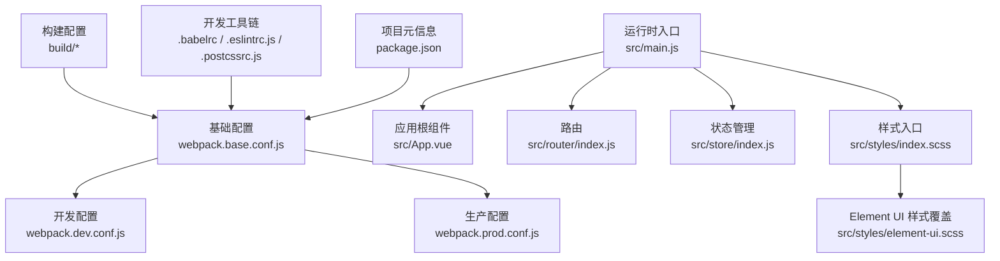
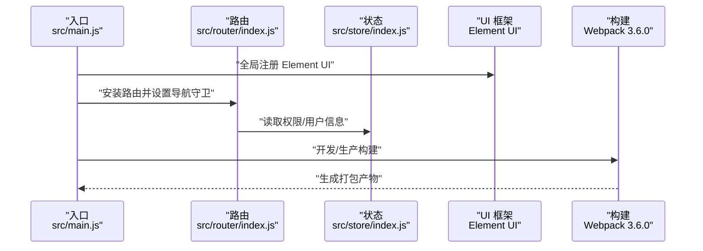
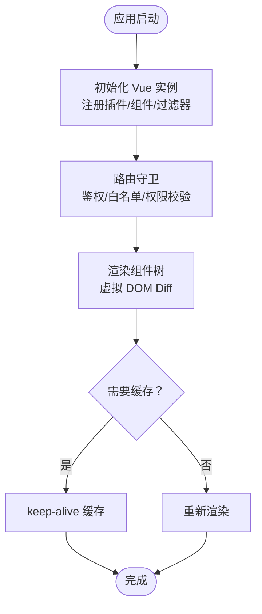
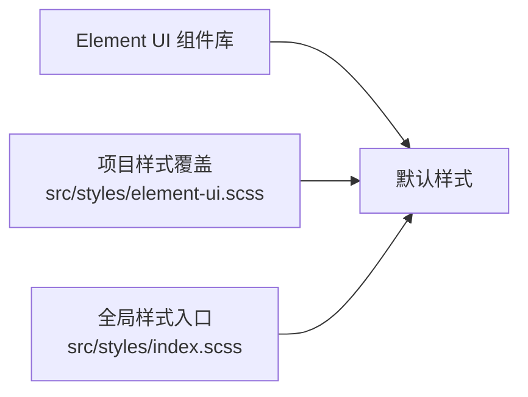
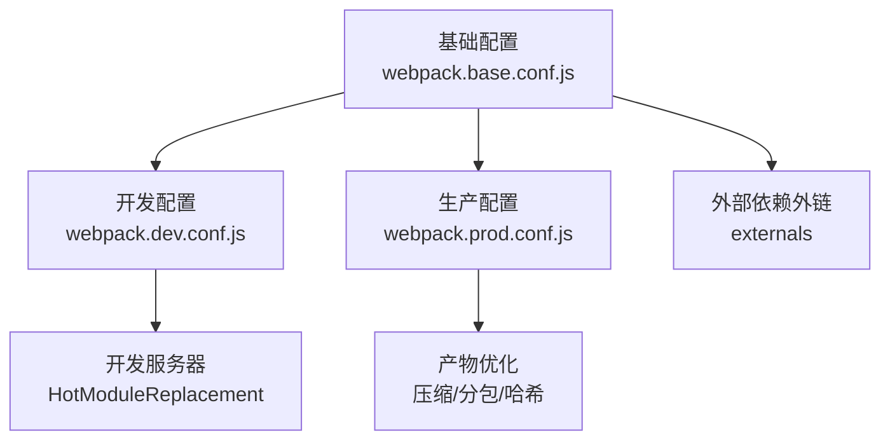
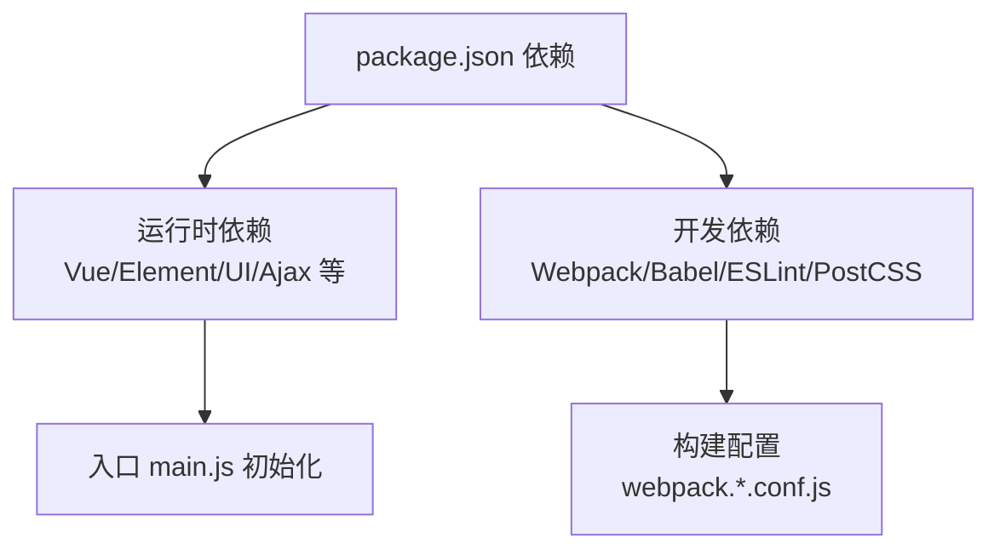

# 技术选型

<cite>
**本文引用的文件**
- [package.json](file://package.json)
- [main.js](file://src/main.js)
- [App.vue](file://src/App.vue)
- [index.js（构建配置）](file://config/index.js)
- [webpack.base.conf.js](file://build/webpack.base.conf.js)
- [webpack.dev.conf.js](file://build/webpack.dev.conf.js)
- [webpack.prod.conf.js](file://build/webpack.prod.conf.js)
- [.babelrc](file://.babelrc)
- [.eslintrc.js](file://.eslintrc.js)
- [.postcssrc.js](file://.postcssrc.js)
- [element-ui.scss](file://src/styles/element-ui.scss)
- [index.scss](file://src/styles/index.scss)
- [router/index.js](file://src/router/index.js)
- [store/index.js](file://src/store/index.js)
</cite>

## 目录
1. [简介](#简介)
2. [项目结构](#项目结构)
3. [核心组件](#核心组件)
4. [架构总览](#架构总览)
5. [详细组件分析](#详细组件分析)
6. [依赖分析](#依赖分析)
7. [性能考量](#性能考量)
8. [故障排查指南](#故障排查指南)
9. [结论](#结论)
10. [附录](#附录)

## 简介
本技术选型文档围绕校园管理系统的技术栈进行系统化说明，重点解释以下选择的理由与实现方式：
- Vue.js 2.5.2 作为核心框架：组件化开发能力、生态成熟度、虚拟 DOM 性能与开发体验。
- Element UI 2.9.1 的集成：组件丰富度、主题定制与国际化支持现状。
- Webpack 3.6.0 构建体系：模块打包、代码分割、开发调试能力与产物优化。
- 开发工具链：ESLint 规范、Babel 转译、PostCSS 样式处理。
- 第三方库集成策略、版本兼容性与性能优化实践。

## 项目结构
项目采用典型的 Vue CLI 早期脚手架风格，按“构建配置、源码、静态资源、样式、路由与状态管理”分层组织。核心入口为 src/main.js，应用挂载于 #app；路由与状态管理分别位于 src/router 与 src/store；样式通过 scss 统一引入，Element UI 样式覆盖集中于 src/styles 下。

图表来源
- [webpack.base.conf.js:14-102](file://build/webpack.base.conf.js#L14-L102)
- [webpack.dev.conf.js:16-96](file://build/webpack.dev.conf.js#L16-L96)
- [webpack.prod.conf.js:16-149](file://build/webpack.prod.conf.js#L16-L149)
- [main.js:1-221](file://src/main.js#L1-L221)
- [App.vue:1-183](file://src/App.vue#L1-L183)
- [index.js（构建配置）:7-72](file://config/index.js#L7-L72)
- [.babelrc:1-16](file://.babelrc#L1-L16)
- [.eslintrc.js:1-28](file://.eslintrc.js#L1-L28)
- [.postcssrc.js:1-11](file://.postcssrc.js#L1-L11)
- [index.scss:1-349](file://src/styles/index.scss#L1-L349)
- [element-ui.scss:1-85](file://src/styles/element-ui.scss#L1-L85)

章节来源
- [package.json:1-98](file://package.json#L1-L98)
- [main.js:1-221](file://src/main.js#L1-L221)
- [index.js（构建配置）:7-72](file://config/index.js#L7-L72)

## 核心组件
- Vue.js 2.5.2：作为 MVVM 框架，提供响应式数据绑定、组件化开发与虚拟 DOM 渲染。项目在入口处引入并全局注册 Element UI、打印插件与过滤器，统一注入原型方法与全局组件，形成一致的开发体验。
- Element UI 2.9.1：提供丰富的业务组件（表格、表单、弹窗、分页等），并与项目样式体系结合，通过 scss 覆盖默认样式以适配界面需求。
- 路由与状态：Vue Router 3.x 提供模块化路由拆分与懒加载；Vuex 3.x 管理应用状态与权限信息。
- 构建与工具链：Webpack 3.6.0 打包 JS/CSS/资源；Babel 6.x 负责语法转译；ESLint 与 PostCSS 提升代码质量与样式一致性。

章节来源
- [main.js:1-221](file://src/main.js#L1-L221)
- [router/index.js:1-207](file://src/router/index.js#L1-L207)
- [store/index.js:1-20](file://src/store/index.js#L1-L20)
- [element-ui.scss:1-85](file://src/styles/element-ui.scss#L1-L85)
- [index.scss:1-349](file://src/styles/index.scss#L1-L349)

## 架构总览
下图展示从入口到构建产物的关键流程：入口初始化、路由守卫与权限控制、Element UI 注册、样式与第三方库加载、以及开发/生产构建差异。

图表来源
- [main.js:1-221](file://src/main.js#L1-L221)
- [router/index.js:1-207](file://src/router/index.js#L1-L207)
- [store/index.js:1-20](file://src/store/index.js#L1-L20)
- [webpack.base.conf.js:14-102](file://build/webpack.base.conf.js#L14-L102)

## 详细组件分析

### Vue.js 2.5.2 选型分析
- 组件化与生态：项目广泛使用 .vue 单文件组件与第三方组件（如 Element UI、vue-multiselect），体现组件化开发优势。
- 虚拟 DOM 性能：通过 keep-alive 缓存路由视图、按需懒加载路由模块，降低首屏与切换开销。
- 开发体验：配合 ESLint、Babel、PostCSS，形成统一的编码与构建规范。

图表来源
- [main.js:57-203](file://src/main.js#L57-L203)
- [App.vue:3-8](file://src/App.vue#L3-L8)

章节来源
- [main.js:1-221](file://src/main.js#L1-L221)
- [App.vue:1-183](file://src/App.vue#L1-L183)

### Element UI 2.9.1 集成分析
- 组件丰富度：大量使用 el-table、el-form、el-dialog、el-pagination 等，满足校园管理复杂业务场景。
- 主题定制：通过 scss 覆盖默认样式，统一按钮、表格、滚动条等视觉规范。
- 国际化支持：当前未见国际化相关配置与语言包引入，若未来有国际化需求，可在入口处按 Element UI 官方方案接入。

图表来源
- [element-ui.scss:1-85](file://src/styles/element-ui.scss#L1-L85)
- [index.scss:1-349](file://src/styles/index.scss#L1-L349)

章节来源
- [main.js:7-49](file://src/main.js#L7-L49)
- [element-ui.scss:1-85](file://src/styles/element-ui.scss#L1-L85)
- [index.scss:1-349](file://src/styles/index.scss#L1-L349)

### Webpack 3.6.0 构建配置分析
- 基础配置：entry 指向 main.js，output 输出到 dist，externals 对外部库（如 Vue、Element UI、jQuery、ECharts）进行 CDN 外链优化，减少包体。
- 开发配置：启用热更新、友好错误提示、开发源码映射，自动打开浏览器，代理与静态资源拷贝。
- 生产配置：UglifyJS 压缩、ExtractTextPlugin 提取 CSS、OptimizeCSSPlugin 去重压缩、CommonsChunkPlugin 进行 vendor、manifest、async 分包，HashModuleIds 与 ModuleConcatenation 提升缓存与体积表现。

图表来源
- [webpack.base.conf.js:14-102](file://build/webpack.base.conf.js#L14-L102)
- [webpack.dev.conf.js:16-96](file://build/webpack.dev.conf.js#L16-L96)
- [webpack.prod.conf.js:16-149](file://build/webpack.prod.conf.js#L16-L149)

章节来源
- [webpack.base.conf.js:14-102](file://build/webpack.base.conf.js#L14-L102)
- [webpack.dev.conf.js:16-96](file://build/webpack.dev.conf.js#L16-L96)
- [webpack.prod.conf.js:16-149](file://build/webpack.prod.conf.js#L16-L149)

### 开发工具链
- ESLint：基于 eslint:recommended 与 plugin:vue/essential，强制缩进、相等性判断与引号策略，对 *.vue 文件关闭缩进规则以避免冲突。
- Babel：preset-env 与 stage-2，动态导入插件，目标浏览器列表与模块化策略与构建配置保持一致。
- PostCSS：postcss-import、postcss-url、autoprefixer，配合 extract-text-webpack-plugin 在生产环境提取 CSS 并自动补全前缀。

章节来源
- [.eslintrc.js:1-28](file://.eslintrc.js#L1-L28)
- [.babelrc:1-16](file://.babelrc#L1-L16)
- [.postcssrc.js:1-11](file://.postcssrc.js#L1-L11)
- [webpack.prod.conf.js:48-62](file://build/webpack.prod.conf.js#L48-L62)

### 第三方库集成策略与版本兼容性
- Vue 相关：vue@2.5.2、vue-router@3.x、vuex@3.x，版本组合稳定，与 vue-loader、babel 插件链路兼容。
- UI 与图表：element-ui@2.9.1、echarts^4.2.1，均通过 CDN 外链优化，减少主包体积。
- 工具库：moment、js-cookie、lodash、html2canvas、Swiper 等，按需引入，避免冗余。
- 兼容性：browserslist 与 babel-preset-env 指定目标浏览器，确保语法与特性降级。

章节来源
- [package.json:12-43](file://package.json#L12-L43)
- [package.json:92-96](file://package.json#L92-L96)
- [webpack.base.conf.js:26-36](file://build/webpack.base.conf.js#L26-L36)

### 性能优化技术
- 代码分割：生产环境通过 CommonsChunkPlugin 拆分 vendor、manifest 与异步 chunk，提升缓存命中率。
- 外部依赖外链：externals 将 Vue、Element UI、jQuery、ECharts 等标记为外部，显著减小主包体积。
- 压缩与去重：UglifyJS 压缩 JS，OptimizeCSSPlugin 去重压缩 CSS，ExtractTextPlugin 提取独立样式文件。
- 源码映射：开发使用 cheap-module-eval-source-map，生产关闭 source-map 以减小体积，必要时可开启 bundle 分析报告定位体积热点。

章节来源
- [webpack.prod.conf.js:84-112](file://build/webpack.prod.conf.js#L84-L112)
- [webpack.base.conf.js:26-36](file://build/webpack.base.conf.js#L26-L36)
- [config/index.js:29, 56](file://config/index.js#L29,L56)

## 依赖分析
- 运行时依赖：Vue 生态（router、store）、Element UI、axios、moment、nprogress、normalize.css 等。
- 开发依赖：Webpack 3.6.0、babel-loader、vue-loader、extract-text-webpack-plugin、autoprefixer、eslint、postcss 等。
- 构建脚本：dev/test/build 命令通过 cross-env 控制环境变量，分别对应不同构建目标。

图表来源
- [package.json:12-91](file://package.json#L12-L91)
- [main.js:1-221](file://src/main.js#L1-L221)
- [webpack.base.conf.js:14-102](file://build/webpack.base.conf.js#L14-L102)

章节来源
- [package.json:12-91](file://package.json#L12-L91)
- [main.js:1-221](file://src/main.js#L1-L221)

## 性能考量
- 包体优化：externals 外链与 CommonsChunkPlugin 分包是主要手段；建议持续监控第三方库体积占比，评估按需引入与动态导入。
- 渲染性能：keep-alive 缓存高频页面；路由懒加载减少初始包；Element UI 组件按需使用，避免一次性引入过多样式。
- 构建效率：生产环境启用并行压缩与模块合并，缩短构建时间；开发环境启用 HMR 与友好错误提示，提升迭代效率。
- 可观测性：生产环境错误上报与路由守卫进度条（NProgress）有助于定位问题与用户体验优化。

## 故障排查指南
- 路由鉴权失败：检查白名单与权限路径匹配逻辑，确认用户信息拉取与角色缓存状态。
- 样式覆盖失效：确认 scss 导入顺序与作用域，避免 !important 滥用导致难以维护。
- 构建报错：核对 ESLint 规则与 Babel 预设，确保与 browserslist 一致；生产环境关闭 source-map 或开启 bundle 分析定位体积异常。
- 外链依赖缺失：确认 CDN 是否正确加载外部库，或回退到内联打包以验证功能可用性。

章节来源
- [main.js:58-198](file://src/main.js#L58-L198)
- [index.scss:1-349](file://src/styles/index.scss#L1-L349)
- [webpack.prod.conf.js:125-146](file://build/webpack.prod.conf.js#L125-L146)

## 结论
本项目以 Vue.js 2.5.2 为核心，结合 Element UI 2.9.1 与完善的构建工具链，形成了稳定、可扩展且具备良好开发体验的前端架构。通过 externals 外链、代码分割与样式提取等策略，兼顾了首屏性能与长期维护性。建议后续在国际化、按需加载与体积监控方面进一步完善，以支撑更大规模的业务演进。

## 附录
- 浏览器兼容：browserslist 指定 > 1%、last 2 versions、不支持 IE<=8。
- 开发端口：开发服务器默认端口 8080，支持自动查找空闲端口。
- 构建产物：生产环境输出至 dist，静态资源路径可通过 config/index.js 调整。

章节来源
- [package.json:92-96](file://package.json#L92-L96)
- [config/index.js:17, 47](file://config/index.js#L17,L47)