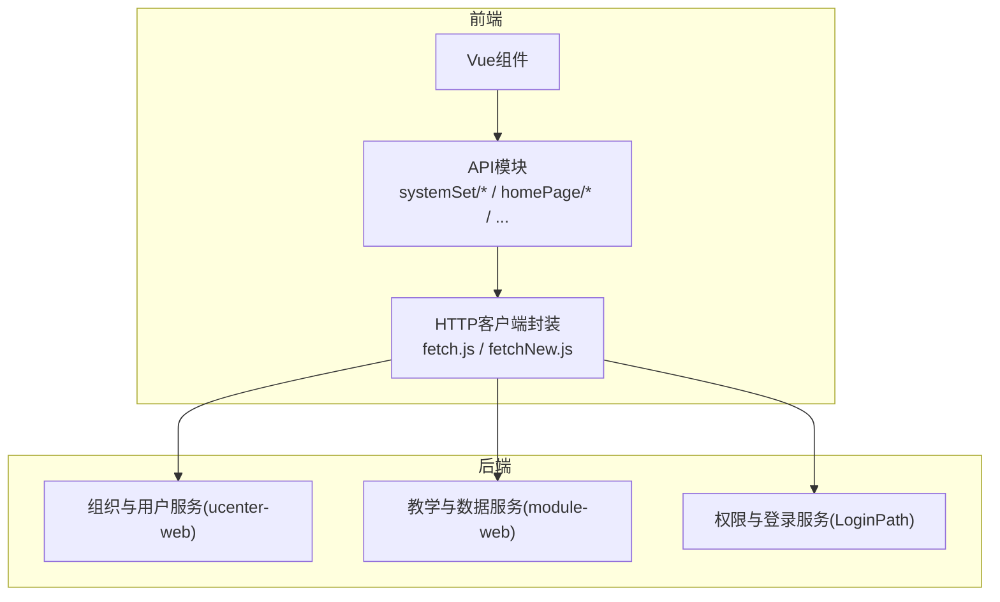
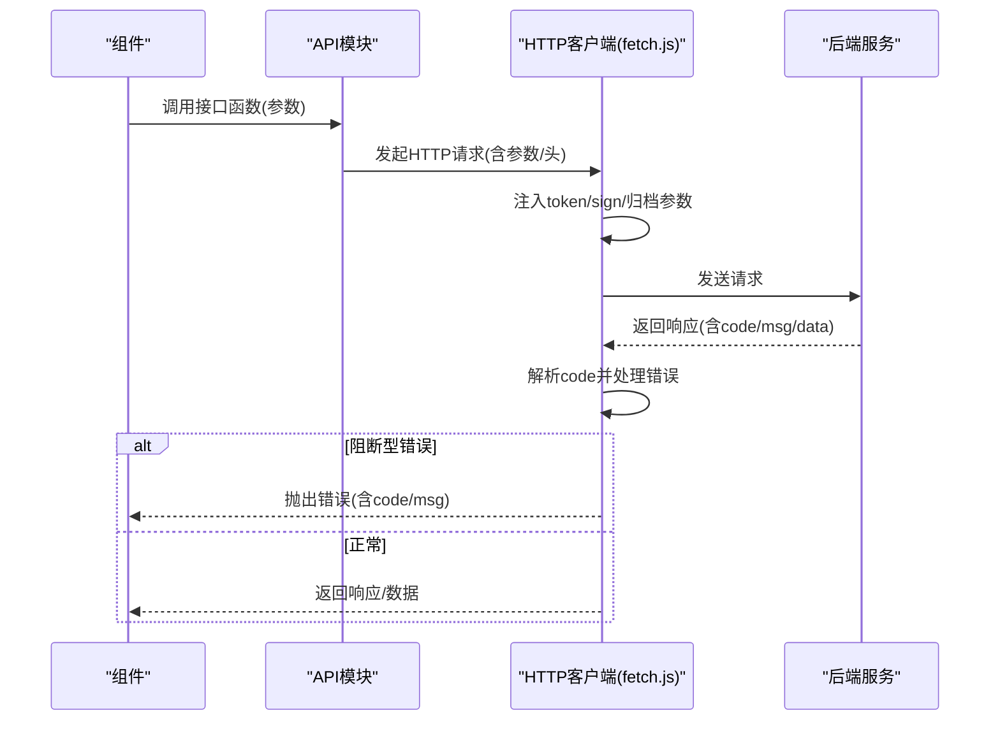
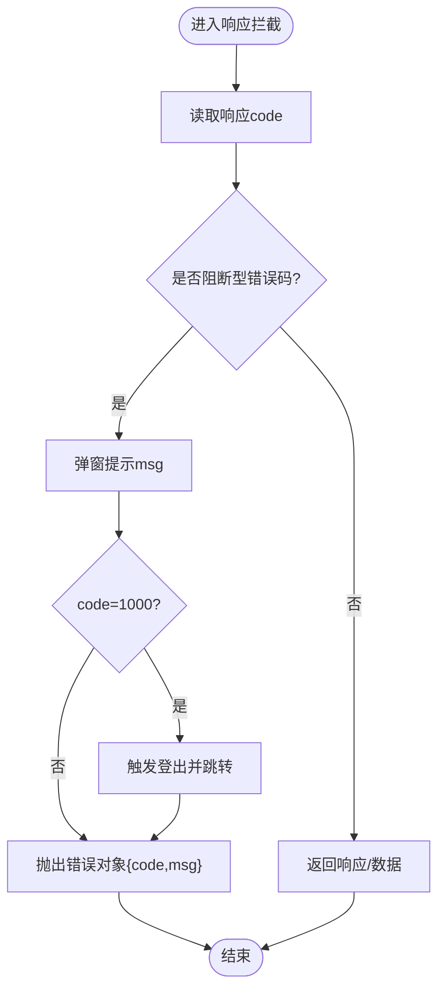
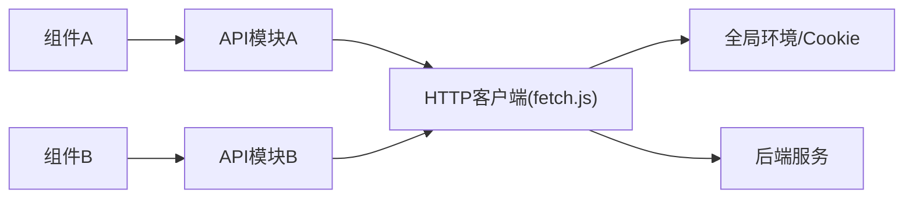

# API设计

<cite>
**本文引用的文件**
- [fetch.js](file://src/utils/fetch.js)
- [fetchNew.js](file://src/utils/fetchNew.js)
- [org.js](file://src/api/systemSet/org.js)
- [permission.js](file://src/api/systemSet/permission.js)
- [danyang.js](file://src/api/homePage/danyang.js)
- [courseSet.js](file://src/api/systemSet/courseSet.js)
- [exam.js](file://src/api/systemSet/exam.js)
- [schoolDictionary.js](file://src/api/systemSet/schoolDictionary.js)
- [dataReport.js](file://src/api/systemSet/dataReport.js)
- [teacherLeave4Setting.js](file://src/api/systemSet/teacherLeave4Setting.js)
- [index.vue](file://src/components/LocationSelector/index.vue)
</cite>

## 目录
1. [引言](#引言)
2. [项目结构](#项目结构)
3. [核心组件](#核心组件)
4. [架构总览](#架构总览)
5. [详细组件分析](#详细组件分析)
6. [依赖分析](#依赖分析)
7. [性能考虑](#性能考虑)
8. [故障排查指南](#故障排查指南)
9. [结论](#结论)
10. [附录](#附录)

## 引言
本文件面向校园管理系统前端团队与后端服务对接方，系统性梳理API设计原则与实现规范，覆盖URL设计、HTTP方法使用、状态码约定、请求/响应格式、错误处理机制、版本管理策略、接口文档生成与接口测试方法，并结合Vue组件中的实际调用示例，给出在组件中正确使用API、异步数据加载与错误恢复的最佳实践。

## 项目结构
- 前端通过统一的HTTP客户端封装发起请求，按功能域拆分为多类API模块，例如系统设置、主页数据、教学管理等。
- 统一的请求/响应拦截器负责注入鉴权参数、签名参数、错误提示与登出逻辑。
- 多个fetch实例适配不同业务域或不同基础路径，确保隔离与复用。

图表来源
- [fetch.js:13-171](file://src/utils/fetch.js#L13-L171)
- [fetchNew.js:8-135](file://src/utils/fetchNew.js#L8-L135)
- [org.js:13-16](file://src/api/systemSet/org.js#L13-L16)

章节来源
- [fetch.js:13-171](file://src/utils/fetch.js#L13-L171)
- [fetchNew.js:8-135](file://src/utils/fetchNew.js#L8-L135)
- [org.js:13-16](file://src/api/systemSet/org.js#L13-L16)

## 核心组件
- HTTP客户端封装
  - 提供统一的axios实例，配置baseURL、超时、请求/响应拦截器。
  - 自动注入token与签名参数；对特定路由进行签名处理；对部分场景自动附加schoolYear归档参数。
  - 统一错误处理：识别阻断型错误码，弹窗提示，必要时触发登出与跳转。
- API模块
  - 按业务域划分，如系统设置、主页、教学、考务、字典、数据报表、请假设置等。
  - 统一采用URLSearchParams传递参数，或在需要时以JSON方式提交。
  - 对跨域或特殊场景提供独立fetch实例（如systemFetch）。

章节来源
- [fetch.js:13-171](file://src/utils/fetch.js#L13-L171)
- [fetchNew.js:8-135](file://src/utils/fetchNew.js#L8-L135)
- [org.js:21-26](file://src/api/systemSet/org.js#L21-L26)
- [courseSet.js:13-25](file://src/api/systemSet/courseSet.js#L13-L25)
- [exam.js:6-11](file://src/api/systemSet/exam.js#L6-L11)

## 架构总览
- 请求流程
  - 组件调用API模块函数 → API模块构造参数并调用HTTP客户端 → 客户端注入token/sign → 发起HTTP请求 → 后端返回响应 → 客户端拦截器解析code并处理错误或透传数据。
- 错误处理
  - 当响应code属于阻断型错误码时，弹窗提示并触发登出；否则返回原始响应或仅返回data（取决于具体封装）。

图表来源
- [fetch.js:66-169](file://src/utils/fetch.js#L66-L169)
- [org.js:21-26](file://src/api/systemSet/org.js#L21-L26)

## 详细组件分析

### 统一HTTP客户端封装（fetch.js）
- 功能要点
  - 创建axios实例，设置baseURL、timeout、transformRequest。
  - 请求拦截：自动拼接token、签名参数；对ucenter-web做URLSearchParams过滤；可附加schoolYear。
  - 响应拦截：根据code判定阻断型错误，弹窗提示并触发登出；正常则返回data或完整响应。
  - 提供多个命名实例：systemFetch、xjlyuanFetch、newcharge、newcard、homeworkfetch、wxcepInterface、archivedFetch等，用于不同域或业务线。
- 参数与头
  - 默认使用URLSearchParams；当headers显式声明content-type为json时，以JSON方式提交。
- 错误码
  - 阻断型错误码集合包含[-1, 400, 401, 403, 404, 500, 1000, 1001, 1002, 1003, 1004, 1050, 1051, 1053, 1054, 1056]，其中1000触发登出流程。

图表来源
- [fetch.js:104-169](file://src/utils/fetch.js#L104-L169)

章节来源
- [fetch.js:13-171](file://src/utils/fetch.js#L13-L171)
- [fetch.js:176-240](file://src/utils/fetch.js#L176-L240)

### 统一HTTP客户端封装（fetchNew.js）
- 功能要点
  - 与fetch.js类似，但针对新的基础路径global.BaseNewPath，提供独立的拦截器与token/sign注入策略。
  - 适用于部分新域或新模块的接口调用。
- 参数与头
  - 默认使用URLSearchParams；当headers显式声明content-type为json时，以JSON方式提交。
- 错误处理
  - 与阻断型错误码集合一致，1000触发登出流程。

章节来源
- [fetchNew.js:8-135](file://src/utils/fetchNew.js#L8-L135)

### 系统设置-组织与用户（org.js）
- 设计原则
  - 使用URLSearchParams传递参数，保持REST风格的查询参数与表单提交一致性。
  - 对需要JSON提交的场景，显式设置headers为application/json并序列化data。
- 典型接口
  - 查询部门树、分页获取部门用户、新增/更新/删除部门、同步部门与用户、用户移动/移除/流出/启用/禁用、获取用户详情、角色管理、教师/学生/家长新增/更新/删除、档案信息维护、导入进度与结果查询等。
- 示例路径
  - 查询部门树：[queryDeparts:21-26](file://src/api/systemSet/org.js#L21-L26)
  - 新增部门：[departAdd:66-88](file://src/api/systemSet/org.js#L66-L88)
  - 修改部门：[departUpdate:94-110](file://src/api/systemSet/org.js#L94-L110)
  - 获取用户详情：[getdetail:387-397](file://src/api/systemSet/org.js#L387-L397)
  - 新增教师（JSON提交）：[addTeacher:504-512](file://src/api/systemSet/org.js#L504-L512)
  - 修改教师（JSON提交）：[updateTeacher:576-584](file://src/api/systemSet/org.js#L576-L584)

章节来源
- [org.js:21-26](file://src/api/systemSet/org.js#L21-L26)
- [org.js:66-88](file://src/api/systemSet/org.js#L66-L88)
- [org.js:94-110](file://src/api/systemSet/org.js#L94-L110)
- [org.js:387-397](file://src/api/systemSet/org.js#L387-L397)
- [org.js:504-512](file://src/api/systemSet/org.js#L504-L512)
- [org.js:576-584](file://src/api/systemSet/org.js#L576-L584)

### 权限接口（permission.js）
- 设计原则
  - 使用URLSearchParams传递参数，POST提交。
- 典型接口
  - 查询用户所有权限：[getUserPerm:15-25](file://src/api/systemSet/permission.js#L15-L25)
  - 根据上级权限id获取子权限：[getNewUserSonPerm:31-39](file://src/api/systemSet/permission.js#L31-L39)

章节来源
- [permission.js:15-25](file://src/api/systemSet/permission.js#L15-L25)
- [permission.js:31-39](file://src/api/systemSet/permission.js#L31-L39)

### 主页数据（danyang.js）
- 设计原则
  - 统一参数过滤函数，使用URLSearchParams。
  - GET与POST混合使用，视后端接口而定。
- 典型接口
  - 用户登录统计（按角色）：[getUserLoginCountByRole:14-19](file://src/api/homePage/danyang.js#L14-L19)
  - 按班级查询检查记录：[getCheckItemAndScoreByPage:22-27](file://src/api/homePage/danyang.js#L22-L27)
  - 根据时间段查询外出日程数量：[getCalendarOutCount:30-35](file://src/api/homePage/danyang.js#L30-L35)
  - 学校考勤总统计：[attendanceAnalysis:38-43](file://src/api/homePage/danyang.js#L38-L43)
  - 老师请假次数：[getThAskleaveFourCountByTeacherId:46-51](file://src/api/homePage/danyang.js#L46-L51)

章节来源
- [danyang.js:14-52](file://src/api/homePage/danyang.js#L14-L52)

### 教学设置-课程（courseSet.js）
- 设计原则
  - 列表/详情/编辑/删除等操作遵循REST风格，参数统一使用URLSearchParams。
  - 导入平台课程采用JSON提交。
- 典型接口
  - 课程列表：[getCourseList:13-25](file://src/api/systemSet/courseSet.js#L13-L25)
  - 选择课程列表：[getChooseCourseList:35-42](file://src/api/systemSet/courseSet.js#L35-L42)
  - 编辑课程：[editCourse:52-61](file://src/api/systemSet/courseSet.js#L52-L61)
  - 新增课程：[addCourse:71-80](file://src/api/systemSet/courseSet.js#L71-L80)
  - 删除课程：[delCourse:90-99](file://src/api/systemSet/courseSet.js#L90-L99)
  - 课程详情：[getCourseDetailById:108-116](file://src/api/systemSet/courseSet.js#L108-L116)
  - 平台课程导入（JSON）：[curriculumSettingImport:161-169](file://src/api/systemSet/courseSet.js#L161-L169)

章节来源
- [courseSet.js:13-25](file://src/api/systemSet/courseSet.js#L13-L25)
- [courseSet.js:52-61](file://src/api/systemSet/courseSet.js#L52-L61)
- [courseSet.js:71-80](file://src/api/systemSet/courseSet.js#L71-L80)
- [courseSet.js:90-99](file://src/api/systemSet/courseSet.js#L90-L99)
- [courseSet.js:108-116](file://src/api/systemSet/courseSet.js#L108-L116)
- [courseSet.js:161-169](file://src/api/systemSet/courseSet.js#L161-L169)

### 考务管理（exam.js）
- 设计原则
  - 考试设置、考试列表、考试详情、成绩维护、写入成绩、成绩分析、评语模板等接口均采用URLSearchParams或JSON提交。
- 典型接口
  - 成绩设置列表：[examSetList:6-11](file://src/api/systemSet/exam.js#L6-L11)
  - 添加考试：[insertExam:143-161](file://src/api/systemSet/exam.js#L143-L161)
  - 写入学生成绩：[writeScore:232-250](file://src/api/systemSet/exam.js#L232-L250)
  - 成绩分析：[examScoreAnalysis:256-265](file://src/api/systemSet/exam.js#L256-L265)
  - 保存评语：[saveStuComment:355-365](file://src/api/systemSet/exam.js#L355-L365)
  - 录入评语模板：[insertTeacherComment:370-380](file://src/api/systemSet/exam.js#L370-L380)
  - 获取当前学期：[getCurrentSchoolTimeBySchoolId:411-418](file://src/api/systemSet/exam.js#L411-L418)

章节来源
- [exam.js:6-11](file://src/api/systemSet/exam.js#L6-L11)
- [exam.js:143-161](file://src/api/systemSet/exam.js#L143-L161)
- [exam.js:232-250](file://src/api/systemSet/exam.js#L232-L250)
- [exam.js:256-265](file://src/api/systemSet/exam.js#L256-L265)
- [exam.js:355-365](file://src/api/systemSet/exam.js#L355-L365)
- [exam.js:370-380](file://src/api/systemSet/exam.js#L370-L380)
- [exam.js:411-418](file://src/api/systemSet/exam.js#L411-L418)

### 字典管理（schoolDictionary.js）
- 设计原则
  - 字典类型、字典项、字典值的增删改查均采用URLSearchParams。
- 典型接口
  - 加载字典类型列表：[loadSchoolDicTypeList:9-18](file://src/api/systemSet/schoolDictionary.js#L9-L18)
  - 保存字典类型：[saveSchoolDicType:23-37](file://src/api/systemSet/schoolDictionary.js#L23-L37)
  - 删除字典类型：[deleteSchoolDicType:56-65](file://src/api/systemSet/schoolDictionary.js#L56-L65)
  - 保存字典项：[saveDicDetail:72-87](file://src/api/systemSet/schoolDictionary.js#L72-L87)
  - 保存字典值：[saveDicValue:122-138](file://src/api/systemSet/schoolDictionary.js#L122-L138)

章节来源
- [schoolDictionary.js:9-18](file://src/api/systemSet/schoolDictionary.js#L9-L18)
- [schoolDictionary.js:23-37](file://src/api/systemSet/schoolDictionary.js#L23-L37)
- [schoolDictionary.js:56-65](file://src/api/systemSet/schoolDictionary.js#L56-L65)
- [schoolDictionary.js:72-87](file://src/api/systemSet/schoolDictionary.js#L72-L87)
- [schoolDictionary.js:122-138](file://src/api/systemSet/schoolDictionary.js#L122-L138)

### 数据报表初始化（dataReport.js）
- 设计原则
  - 初始化设置采用POST；新增/修改设置采用JSON提交。
- 典型接口
  - 查询初始化设置：[getDataReportInit:6-11](file://src/api/systemSet/dataReport.js#L6-L11)
  - 新增/修改初始化设置（JSON）：[addAndUpdateDataReportInit:16-25](file://src/api/systemSet/dataReport.js#L16-L25)

章节来源
- [dataReport.js:6-11](file://src/api/systemSet/dataReport.js#L6-L11)
- [dataReport.js:16-25](file://src/api/systemSet/dataReport.js#L16-L25)

### 请假设置（teacherLeave4Setting.js）
- 设计原则
  - 设置与规则的增删改查采用URLSearchParams或JSON提交。
- 典型接口
  - 新增/修改请假设置（JSON）：[addAndUpdateThAskLeaveFourInit:4-14](file://src/api/systemSet/teacherLeave4Setting.js#L4-L14)
  - 新增请假规则（JSON）：[addThAskleaveFourRule:16-26](file://src/api/systemSet/teacherLeave4Setting.js#L16-L26)
  - 更新请假规则（JSON）：[updateThAskleaveFourRule:28-38](file://src/api/systemSet/teacherLeave4Setting.js#L28-L38)
  - 删除请假规则：[delThAskleaveFourRule:39-47](file://src/api/systemSet/teacherLeave4Setting.js#L39-L47)
  - 获取请假规则详情：[getThAskleaveFourRule:48-56](file://src/api/systemSet/teacherLeave4Setting.js#L48-L56)
  - 获取请假规则列表：[getThAskleaveFourRuleList:57-62](file://src/api/systemSet/teacherLeave4Setting.js#L57-L62)
  - 查询请假设置：[getThAskLeaveFourInit:63-71](file://src/api/systemSet/teacherLeave4Setting.js#L63-L71)

章节来源
- [teacherLeave4Setting.js:4-14](file://src/api/systemSet/teacherLeave4Setting.js#L4-L14)
- [teacherLeave4Setting.js:16-26](file://src/api/systemSet/teacherLeave4Setting.js#L16-L26)
- [teacherLeave4Setting.js:28-38](file://src/api/systemSet/teacherLeave4Setting.js#L28-L38)
- [teacherLeave4Setting.js:39-47](file://src/api/systemSet/teacherLeave4Setting.js#L39-L47)
- [teacherLeave4Setting.js:48-56](file://src/api/systemSet/teacherLeave4Setting.js#L48-L56)
- [teacherLeave4Setting.js:57-62](file://src/api/systemSet/teacherLeave4Setting.js#L57-L62)
- [teacherLeave4Setting.js:63-71](file://src/api/systemSet/teacherLeave4Setting.js#L63-L71)

### 在Vue组件中正确使用API（示例：地区选择器）
- 调用模式
  - 在组件生命周期内调用API函数，使用Promise链式处理，先取数据再赋值。
  - 对于阻断型错误，统一由HTTP客户端拦截器处理，组件无需重复处理。
- 示例路径
  - 地区联动：[initData:87-104](file://src/components/LocationSelector/index.vue#L87-L104)

章节来源
- [index.vue:87-104](file://src/components/LocationSelector/index.vue#L87-L104)

## 依赖分析
- 组件依赖API模块，API模块依赖HTTP客户端封装。
- HTTP客户端封装依赖全局环境变量（baseURL、token、sign、schoolYear）与Cookie。
- 不同业务域通过不同fetch实例隔离，避免相互影响。

图表来源
- [fetch.js:13-171](file://src/utils/fetch.js#L13-L171)
- [org.js:13-16](file://src/api/systemSet/org.js#L13-L16)

章节来源
- [fetch.js:13-171](file://src/utils/fetch.js#L13-L171)
- [org.js:13-16](file://src/api/systemSet/org.js#L13-L16)

## 性能考虑
- 超时控制：默认10秒（fetch.js），部分场景可调整（如系统设置模块可达60秒）。
- 参数过滤：对URLSearchParams进行过滤，避免无效参数导致后端压力。
- 重试与批量：对于导入/同步等耗时操作，建议后端提供进度查询接口，前端轮询或事件通知，避免阻塞UI。
- 缓存策略：对静态字典、课程列表等高频读取数据，可在组件层引入轻量缓存，减少重复请求。

## 故障排查指南
- 常见错误码
  - 1000：登录超时，触发登出与跳转。
  - 401/403：未授权或权限不足，检查token与签名参数。
  - 400/404：请求参数不合法或资源不存在，检查URL与参数。
  - 500：服务器内部错误，查看后端日志。
- 处理步骤
  - 组件侧：捕获Promise reject，显示友好提示，允许用户重试。
  - 客户端侧：拦截器已统一处理阻断型错误，组件无需重复处理。
- 登录态与签名
  - 确认Cookie中Admin-Token存在且有效。
  - 对命中签名白名单的路由，确认URL中包含sign参数。

章节来源
- [fetch.js:104-169](file://src/utils/fetch.js#L104-L169)

## 结论
本设计文档基于现有代码实现了统一的HTTP客户端封装与清晰的API模块划分，明确了URL设计、HTTP方法使用、状态码约定、请求/响应格式与错误处理机制。建议后续补充接口文档生成与接口测试方法，持续完善版本管理策略与回归测试流程，以保障系统长期演进的稳定性与可维护性。

## 附录

### API设计原则与规范
- URL设计
  - 使用名词复数形式，体现资源语义；路径层级清晰，避免过深嵌套。
  - 查询参数使用URLSearchParams，保证可读性与可缓存性。
- HTTP方法
  - GET：安全、幂等，用于查询；POST：用于创建；PUT/DELETE：用于更新与删除。
- 状态码
  - 200：成功；400：参数错误；401/403：未授权/权限不足；404：资源不存在；500：服务器错误；1000：登录超时。
- 请求/响应格式
  - 默认JSON字符串化；对上传/大文件场景使用multipart/form-data。
  - 响应统一包含code、msg、data三段式结构，便于前端统一处理。
- 错误处理
  - 阻断型错误码触发登出与提示；非阻断型错误由组件自行处理。
- 版本管理
  - 建议在URL中加入版本前缀（如/v1），或通过Accept头协商版本，避免破坏性变更。
- 文档生成与测试
  - 使用Swagger/OpenAPI生成接口文档；对关键接口编写单元测试与集成测试，覆盖正常/异常路径。

### 接口调用示例（Vue组件）
- 地区联动示例
  - 在组件created/mounted中调用API函数，使用.then获取data并赋值，错误由拦截器统一处理。
  - 参考路径：[initData:87-104](file://src/components/LocationSelector/index.vue#L87-L104)

章节来源
- [index.vue:87-104](file://src/components/LocationSelector/index.vue#L87-L104)