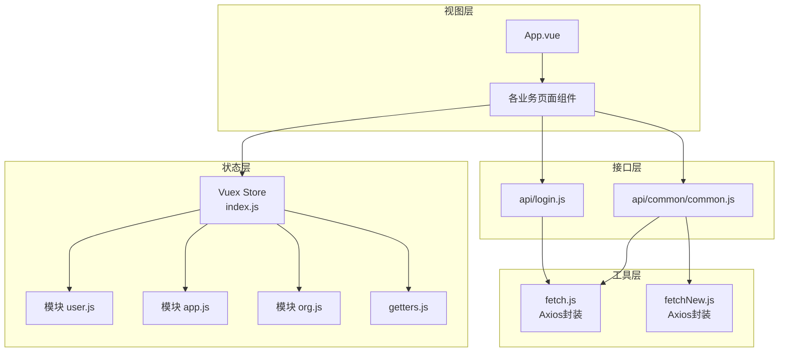
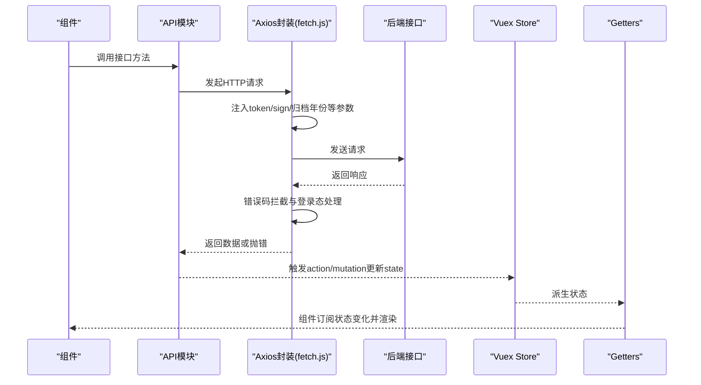
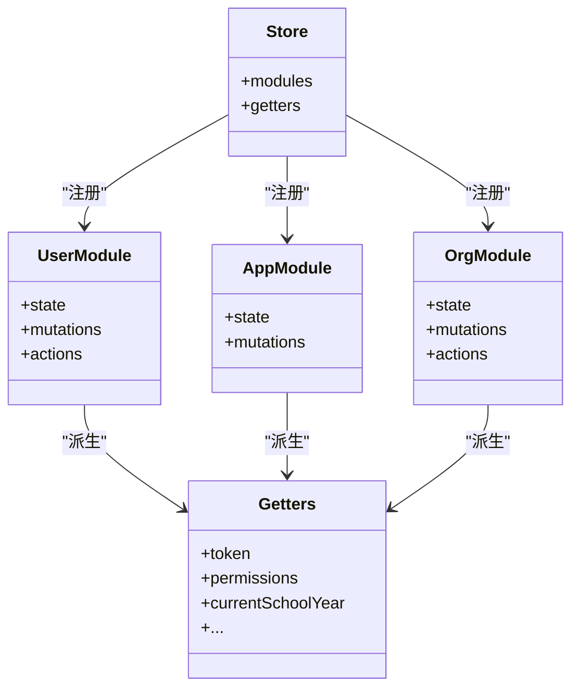
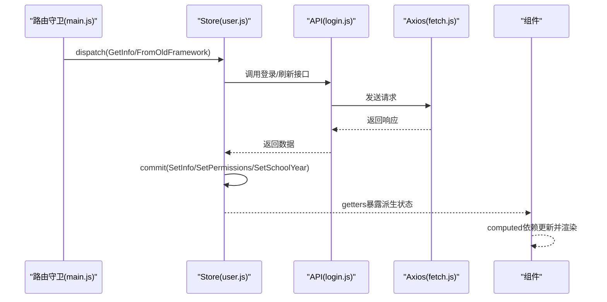
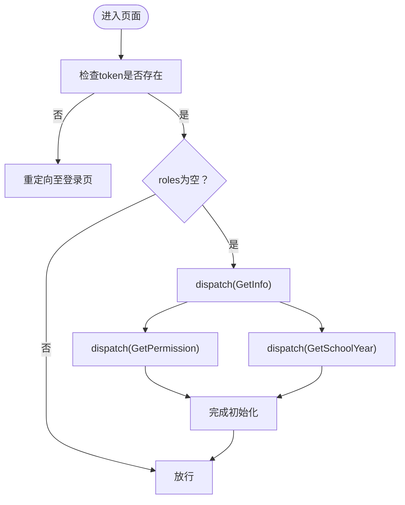
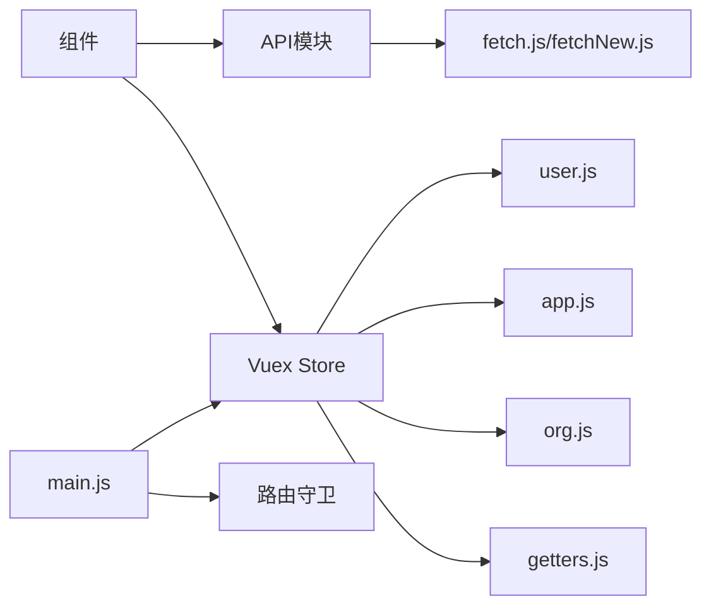

# 数据架构

<cite>
**本文引用的文件**
- [src/store/index.js](file://src/store/index.js)
- [src/store/getters.js](file://src/store/getters.js)
- [src/store/modules/user.js](file://src/store/modules/user.js)
- [src/store/modules/app.js](file://src/store/modules/app.js)
- [src/store/modules/org.js](file://src/store/modules/org.js)
- [src/utils/fetch.js](file://src/utils/fetch.js)
- [src/utils/fetchNew.js](file://src/utils/fetchNew.js)
- [src/api/login.js](file://src/api/login.js)
- [src/api/common/common.js](file://src/api/common/common.js)
- [src/main.js](file://src/main.js)
- [src/App.vue](file://src/App.vue)
</cite>

## 目录
1. [引言](#引言)
2. [项目结构](#项目结构)
3. [核心组件](#核心组件)
4. [架构总览](#架构总览)
5. [详细组件分析](#详细组件分析)
6. [依赖分析](#依赖分析)
7. [性能考虑](#性能考虑)
8. [故障排查指南](#故障排查指南)
9. [结论](#结论)

## 引言
本文件面向校园管理系统，聚焦“数据架构”，围绕以下目标展开：
- 数据流向设计：从API获取数据到组件渲染的完整流程
- Vuex状态管理设计：state、mutations、actions、getters的职责划分
- 数据持久化策略：本地存储、缓存机制、数据同步方案
- API接口设计规范：REST风格、请求/响应格式、错误处理
- 数据验证与转换：参数校验、数据清洗与转换、异步处理模式

## 项目结构
本项目采用典型的前端单页应用分层：
- 视图层：Vue 组件与路由
- 状态层：Vuex Store（modules/user、modules/app、modules/org）
- 工具层：HTTP 客户端封装（fetch.js、fetchNew.js）
- 接口层：API 模块（如登录、通用字典等）
- 应用入口：main.js、App.vue

图表来源
- [src/App.vue:1-183](file://src/App.vue#L1-L183)
- [src/store/index.js:1-20](file://src/store/index.js#L1-L20)
- [src/store/modules/user.js:1-447](file://src/store/modules/user.js#L1-L447)
- [src/store/modules/app.js:1-54](file://src/store/modules/app.js#L1-L54)
- [src/store/modules/org.js:1-34](file://src/store/modules/org.js#L1-L34)
- [src/store/getters.js:1-26](file://src/store/getters.js#L1-L26)
- [src/utils/fetch.js:1-240](file://src/utils/fetch.js#L1-L240)
- [src/utils/fetchNew.js:1-136](file://src/utils/fetchNew.js#L1-L136)
- [src/api/login.js:1-259](file://src/api/login.js#L1-L259)
- [src/api/common/common.js:1-459](file://src/api/common/common.js#L1-L459)

章节来源
- [src/store/index.js:1-20](file://src/store/index.js#L1-L20)
- [src/store/getters.js:1-26](file://src/store/getters.js#L1-L26)
- [src/utils/fetch.js:1-240](file://src/utils/fetch.js#L1-L240)
- [src/utils/fetchNew.js:1-136](file://src/utils/fetchNew.js#L1-L136)
- [src/api/login.js:1-259](file://src/api/login.js#L1-L259)
- [src/api/common/common.js:1-459](file://src/api/common/common.js#L1-L459)
- [src/main.js:1-221](file://src/main.js#L1-L221)
- [src/App.vue:1-183](file://src/App.vue#L1-L183)

## 核心组件
- Vuex Store：集中管理用户、组织、应用等状态，并提供派生状态（getters）供组件使用
- Axios 封装：统一请求头、鉴权参数、签名参数、错误拦截与登录态失效处理
- API 模块：按功能域拆分，如登录、通用字典、上传等
- 应用入口：路由守卫控制登录态与权限，组件渲染由路由驱动

章节来源
- [src/store/index.js:1-20](file://src/store/index.js#L1-L20)
- [src/store/getters.js:1-26](file://src/store/getters.js#L1-L26)
- [src/utils/fetch.js:1-240](file://src/utils/fetch.js#L1-L240)
- [src/utils/fetchNew.js:1-136](file://src/utils/fetchNew.js#L1-L136)
- [src/api/login.js:1-259](file://src/api/login.js#L1-L259)
- [src/api/common/common.js:1-459](file://src/api/common/common.js#L1-L459)
- [src/main.js:1-221](file://src/main.js#L1-L221)

## 架构总览
数据从API到组件渲染的典型路径如下：
- 组件发起API调用（通过API模块）
- Axios封装注入token/sign等参数并发送请求
- 服务端返回响应，Axios拦截器统一处理错误码与登录态
- 成功响应进入Store（actions/mutations），更新state
- 组件通过mapState/mapGetters订阅状态变化，触发重新渲染

图表来源
- [src/api/login.js:1-259](file://src/api/login.js#L1-L259)
- [src/api/common/common.js:1-459](file://src/api/common/common.js#L1-L459)
- [src/utils/fetch.js:1-240](file://src/utils/fetch.js#L1-L240)
- [src/store/modules/user.js:1-447](file://src/store/modules/user.js#L1-L447)
- [src/store/getters.js:1-26](file://src/store/getters.js#L1-L26)

## 详细组件分析

### Vuex 状态管理设计
- 模块划分
  - user：用户信息、角色、权限、学校信息、学年选择等
  - app：应用级分页与页面状态（如食谱、打卡、作业）
  - org：组织架构过滤参数与结构
- getters：提供派生状态，如token、权限列表、当前学年等
- 数据流
  - actions：异步获取用户信息、权限、学年；并发多个初始化任务
  - mutations：同步更新state字段
  - state：集中存放用户态与应用态数据

图表来源
- [src/store/modules/user.js:1-447](file://src/store/modules/user.js#L1-L447)
- [src/store/modules/app.js:1-54](file://src/store/modules/app.js#L1-L54)
- [src/store/modules/org.js:1-34](file://src/store/modules/org.js#L1-L34)
- [src/store/getters.js:1-26](file://src/store/getters.js#L1-L26)
- [src/store/index.js:1-20](file://src/store/index.js#L1-L20)

章节来源
- [src/store/modules/user.js:1-447](file://src/store/modules/user.js#L1-L447)
- [src/store/modules/app.js:1-54](file://src/store/modules/app.js#L1-L54)
- [src/store/modules/org.js:1-34](file://src/store/modules/org.js#L1-L34)
- [src/store/getters.js:1-26](file://src/store/getters.js#L1-L26)
- [src/store/index.js:1-20](file://src/store/index.js#L1-L20)

### 数据流向与组件渲染
- 登录与权限加载
  - 路由守卫在进入受控页面前检查token与权限
  - 若无token或token失效，触发登出动作并重定向
  - 成功后并发拉取权限与学年，再进入目标页面
- 页面渲染
  - 组件通过mapState/mapGetters订阅store
  - 当state变化时，computed依赖自动更新，触发重新渲染

图表来源
- [src/main.js:73-198](file://src/main.js#L73-L198)
- [src/store/modules/user.js:120-324](file://src/store/modules/user.js#L120-L324)
- [src/api/login.js:16-24](file://src/api/login.js#L16-L24)
- [src/utils/fetch.js:104-169](file://src/utils/fetch.js#L104-L169)

章节来源
- [src/main.js:73-198](file://src/main.js#L73-L198)
- [src/store/modules/user.js:120-324](file://src/store/modules/user.js#L120-L324)
- [src/api/login.js:16-24](file://src/api/login.js#L16-L24)
- [src/utils/fetch.js:104-169](file://src/utils/fetch.js#L104-L169)

### 数据持久化策略
- 本地存储
  - Cookie：保存Admin-Token（登录态）
  - sessionStorage：保存pc登录类型、学校ID、选中学年、独立窗口标记、地图密钥等
- 缓存机制
  - 通过Vuex模块缓存用户信息、权限、学校信息、学年列表
  - 通过路由守卫避免重复拉取用户信息
- 数据同步
  - 并发初始化：登录成功后同时拉取权限与学年，减少首屏等待
  - 归档场景：在归档请求中自动附加selectedSchoolYear

图表来源
- [src/main.js:142-176](file://src/main.js#L142-L176)
- [src/store/modules/user.js:120-324](file://src/store/modules/user.js#L120-L324)

章节来源
- [src/main.js:142-176](file://src/main.js#L142-L176)
- [src/store/modules/user.js:120-324](file://src/store/modules/user.js#L120-L324)

### API 接口设计规范
- REST 风格
  - GET/POST 方法区分资源读写
  - URL 以模块/功能命名，如“login”、“common/schoolDictionary”
- 请求/响应格式
  - 默认使用URLSearchParams传输参数
  - 部分接口使用JSON传输（通过headers指定content-type）
- 鉴权与签名
  - 自动注入token（除白名单接口）
  - 对特定接口自动注入sign参数（基于sessionStorage.sign）
  - 归档场景自动注入schoolYear（来自selectedSchoolYear）
- 错误处理
  - 统一拦截常见错误码（如1000登录超时），弹窗提示并触发登出
  - 非阻断型错误返回Promise.reject，便于上层捕获

章节来源
- [src/utils/fetch.js:13-240](file://src/utils/fetch.js#L13-L240)
- [src/utils/fetchNew.js:8-136](file://src/utils/fetchNew.js#L8-L136)
- [src/api/login.js:1-259](file://src/api/login.js#L1-L259)
- [src/api/common/common.js:1-459](file://src/api/common/common.js#L1-L459)

### 数据验证与转换
- 参数校验
  - 登录接口对账户名trim处理
  - 路由守卫对白名单与权限路径进行校验
- 数据转换
  - Axios请求拦截器对参数进行URLSearchParams标准化
  - 特定后端（ucenter-web）对params进行二次序列化
  - JSON接口显式设置headers为application/json
- 异步处理
  - 并发初始化：Promise.all聚合权限与学年
  - 登录成功后设置地图安全配置与密钥

章节来源
- [src/store/modules/user.js:120-172](file://src/store/modules/user.js#L120-L172)
- [src/utils/fetch.js:40-62](file://src/utils/fetch.js#L40-L62)
- [src/utils/fetchNew.js:12-32](file://src/utils/fetchNew.js#L12-L32)
- [src/api/common/common.js:295-304](file://src/api/common/common.js#L295-L304)

## 依赖分析
- 组件依赖
  - 组件通过API模块间接依赖Axios封装
  - 组件通过store的getters订阅状态
- Store 依赖
  - user模块依赖API模块（登录、权限、学年）
  - app/org模块提供应用态与组织态数据
- 工具依赖
  - fetch.js/fetchNew.js依赖axios、Cookies、ElementUI消息提示
  - main.js依赖路由守卫与NProgress

图表来源
- [src/main.js:1-221](file://src/main.js#L1-L221)
- [src/store/modules/user.js:1-447](file://src/store/modules/user.js#L1-L447)
- [src/store/modules/app.js:1-54](file://src/store/modules/app.js#L1-L54)
- [src/store/modules/org.js:1-34](file://src/store/modules/org.js#L1-L34)
- [src/store/getters.js:1-26](file://src/store/getters.js#L1-L26)
- [src/utils/fetch.js:1-240](file://src/utils/fetch.js#L1-L240)
- [src/utils/fetchNew.js:1-136](file://src/utils/fetchNew.js#L1-L136)
- [src/api/login.js:1-259](file://src/api/login.js#L1-L259)
- [src/api/common/common.js:1-459](file://src/api/common/common.js#L1-L459)

章节来源
- [src/main.js:1-221](file://src/main.js#L1-L221)
- [src/store/modules/user.js:1-447](file://src/store/modules/user.js#L1-L447)
- [src/store/modules/app.js:1-54](file://src/store/modules/app.js#L1-L54)
- [src/store/modules/org.js:1-34](file://src/store/modules/org.js#L1-L34)
- [src/store/getters.js:1-26](file://src/store/getters.js#L1-L26)
- [src/utils/fetch.js:1-240](file://src/utils/fetch.js#L1-L240)
- [src/utils/fetchNew.js:1-136](file://src/utils/fetchNew.js#L1-L136)
- [src/api/login.js:1-259](file://src/api/login.js#L1-L259)
- [src/api/common/common.js:1-459](file://src/api/common/common.js#L1-L459)

## 性能考虑
- 减少重复请求
  - 路由守卫避免重复拉取用户信息
  - 并发初始化权限与学年
- 降低网络开销
  - 对特定接口自动注入sign，避免重复签名计算
  - 归档场景统一注入schoolYear，避免每页重复传参
- 渲染优化
  - keep-alive缓存路由视图（需配合meta.isCached）

章节来源
- [src/main.js:142-176](file://src/main.js#L142-L176)
- [src/store/modules/user.js:162-168](file://src/store/modules/user.js#L162-L168)
- [src/App.vue:3-6](file://src/App.vue#L3-L6)

## 故障排查指南
- 登录超时/无权限
  - 现象：返回码1000或401/403等
  - 处理：自动登出、清除token、跳转登录页
- 参数缺失
  - 现象：缺少token或sign导致鉴权失败
  - 处理：确认Axios拦截器是否正确注入token/sign
- 归档数据为空
  - 现象：查询不到历史数据
  - 处理：确认selectedSchoolYear是否正确设置并传递
- 组件未更新
  - 现象：状态已变更但界面不变
  - 处理：确认组件是否通过mapState/mapGetters订阅对应状态

章节来源
- [src/utils/fetch.js:104-169](file://src/utils/fetch.js#L104-L169)
- [src/store/modules/user.js:103-110](file://src/store/modules/user.js#L103-L110)
- [src/main.js:73-198](file://src/main.js#L73-L198)

## 结论
本项目通过清晰的模块化Store、统一的Axios封装与严格的路由守卫，构建了稳定的数据流与状态管理机制。建议在后续迭代中：
- 明确API返回结构与错误码约定，完善统一响应拦截
- 对高频接口引入本地缓存策略（如localStorage/sessionStorage）
- 在复杂页面引入分页与懒加载，进一步优化性能