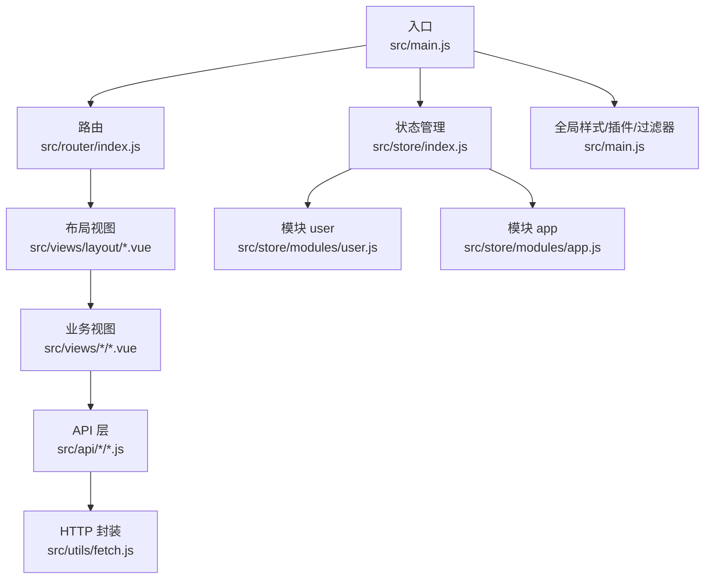
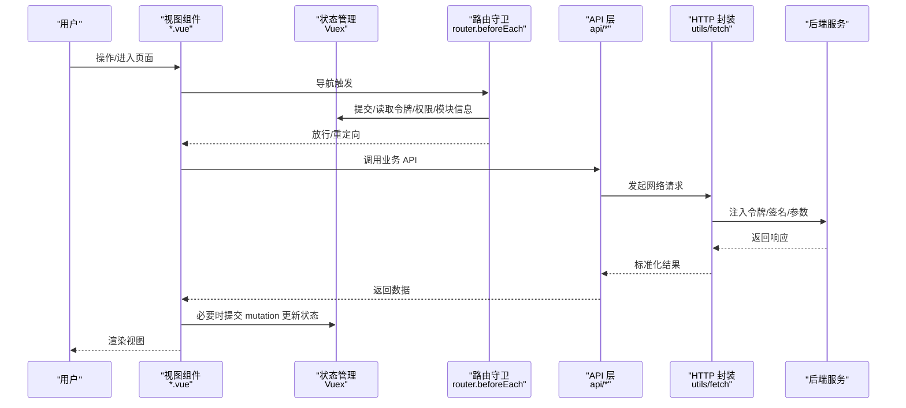
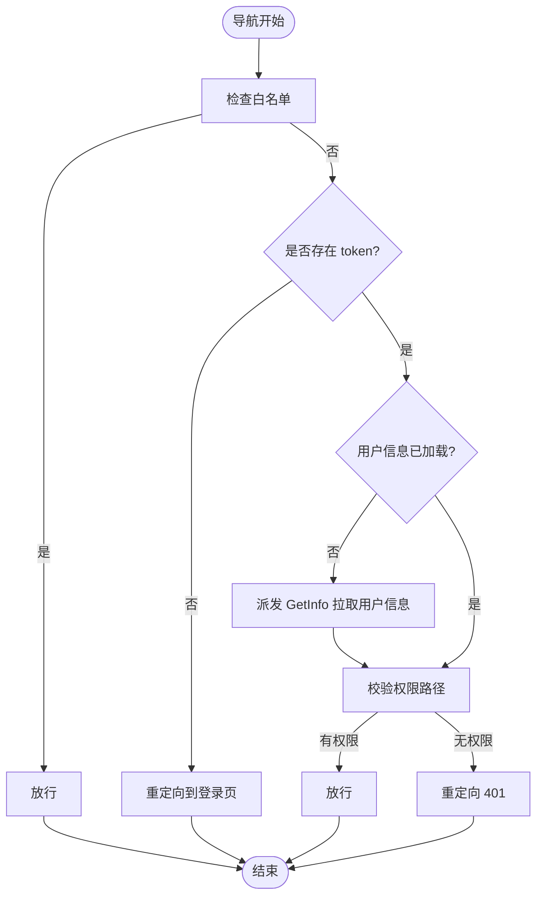
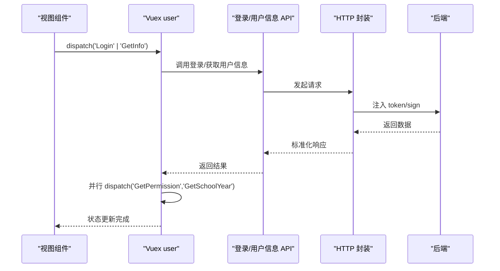
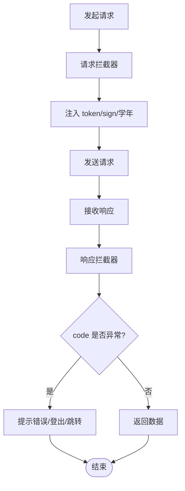
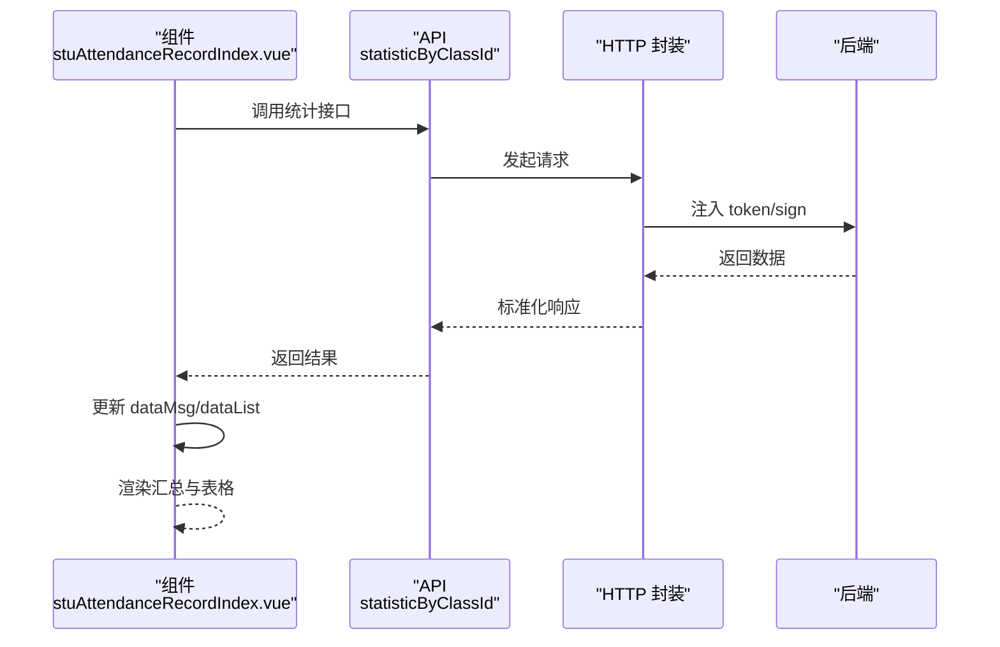
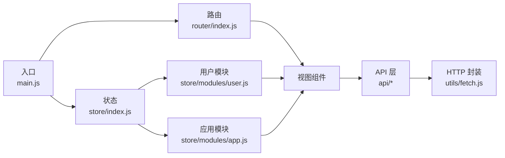

# 数据流设计

<cite>
**本文引用的文件**
- [main.js](file://src/main.js)
- [App.vue](file://src/App.vue)
- [router/index.js](file://src/router/index.js)
- [store/index.js](file://src/store/index.js)
- [store/modules/user.js](file://src/store/modules/user.js)
- [store/modules/app.js](file://src/store/modules/app.js)
- [utils/fetch.js](file://src/utils/fetch.js)
- [api/common/common.js](file://src/api/common/common.js)
- [views/stuRecordSet/stuAttendanceRecordIndex.vue](file://src/views/stuRecordSet/stuAttendanceRecordIndex.vue)
</cite>

## 目录
1. [引言](#引言)
2. [项目结构](#项目结构)
3. [核心组件](#核心组件)
4. [架构总览](#架构总览)
5. [详细组件分析](#详细组件分析)
6. [依赖关系分析](#依赖关系分析)
7. [性能考量](#性能考量)
8. [故障排查指南](#故障排查指南)
9. [结论](#结论)
10. [附录](#附录)

## 引言
本文件面向校园管理系统，聚焦“从用户操作到数据渲染”的完整数据流设计，覆盖以下主题：
- 数据获取：API 层封装与拦截器配置
- 状态更新：Vuex 模块与路由守卫联动
- 视图渲染：组件生命周期与模板绑定
- 组件间数据传递：props 向下、events 向上、Vuex 全局状态
- 异步处理：Promise 链式调用、async/await 使用、错误处理策略
- 缓存与同步：分页状态、页面级缓存、跨模块数据一致性
- 实时更新：轮询与事件驱动的建议方案
- 典型场景：表单提交、列表加载、详情展示的完整数据流转

## 项目结构
系统采用经典的前端单页应用架构：入口初始化、路由导航、状态管理、API 封装、视图组件协同工作。

图表来源
- [main.js:1-221](file://src/main.js#L1-L221)
- [router/index.js:1-207](file://src/router/index.js#L1-L207)
- [store/index.js:1-20](file://src/store/index.js#L1-L20)
- [store/modules/user.js:1-447](file://src/store/modules/user.js#L1-L447)
- [store/modules/app.js:1-54](file://src/store/modules/app.js#L1-L54)
- [utils/fetch.js:1-240](file://src/utils/fetch.js#L1-L240)
- [api/common/common.js:1-459](file://src/api/common/common.js#L1-L459)

章节来源
- [main.js:1-221](file://src/main.js#L1-L221)
- [router/index.js:1-207](file://src/router/index.js#L1-L207)
- [store/index.js:1-20](file://src/store/index.js#L1-L20)

## 核心组件
- 入口与全局配置：初始化路由守卫、进度条、ElementUI、打印工具、上传组件、错误日志等。
- 路由系统：常量路由与模块化路由组合，支持权限与模块码控制。
- 状态管理：用户信息、角色权限、学校学年、页面分页状态等。
- HTTP 封装：统一请求头、签名、令牌注入、错误拦截与登出处理。
- API 层：通用字典、课程、班级、人员、文件上传等接口。
- 视图组件：业务页面通过 API 获取数据并渲染，结合混入处理窗口尺寸等通用逻辑。

章节来源
- [main.js:1-221](file://src/main.js#L1-L221)
- [store/modules/user.js:1-447](file://src/store/modules/user.js#L1-L447)
- [store/modules/app.js:1-54](file://src/store/modules/app.js#L1-L54)
- [utils/fetch.js:1-240](file://src/utils/fetch.js#L1-L240)
- [api/common/common.js:1-459](file://src/api/common/common.js#L1-L459)

## 架构总览
系统数据流遵循“视图 -> API -> HTTP -> 服务端”的单向链路，并在必要节点进行状态更新与视图刷新。

图表来源
- [main.js:73-198](file://src/main.js#L73-L198)
- [router/index.js:40-199](file://src/router/index.js#L40-L199)
- [store/modules/user.js:120-324](file://src/store/modules/user.js#L120-L324)
- [utils/fetch.js:65-169](file://src/utils/fetch.js#L65-L169)
- [api/common/common.js:14-459](file://src/api/common/common.js#L14-L459)

## 详细组件分析

### 路由与权限控制（导航守卫）
- 白名单直通、免登录场景处理。
- 首次进入系统管理时携带 token 的处理。
- 旧框架迁移登录时的令牌注入与状态写入。
- 用户信息拉取后根据权限路径判断放行。
- 登录超时统一拦截并触发登出流程。

图表来源
- [main.js:58-198](file://src/main.js#L58-L198)

章节来源
- [main.js:58-198](file://src/main.js#L58-L198)

### 用户状态管理（Vuex）
- 状态字段：令牌、用户信息、角色、权限映射、学校信息、学年列表与当前选择。
- 动作：
  - 登录：写入 Cookie 与状态，拉取权限与学年。
  - 获取用户信息：调用后并行拉取权限与学年。
  - 旧框架迁移：写入令牌与状态，拉取地图密钥与权限。
  - 权限与学年：按模块码拉取权限，学年列表排序并设置当前学年。
  - 登出：清除状态与 Cookie。
- 提示：登录与用户信息获取均使用 Promise 并行处理，提升首屏体验。

图表来源
- [store/modules/user.js:120-324](file://src/store/modules/user.js#L120-L324)
- [utils/fetch.js:65-169](file://src/utils/fetch.js#L65-L169)

章节来源
- [store/modules/user.js:1-447](file://src/store/modules/user.js#L1-L447)

### HTTP 封装与错误处理
- 请求拦截：自动注入 token、签名、学年参数；对特定域名参数做 URLSearchParams 转换。
- 响应拦截：统一错误码判定，触发登出与路由跳转；成功返回标准化数据。
- 多实例：按业务域划分 baseURL，便于隔离与扩展。

图表来源
- [utils/fetch.js:65-169](file://src/utils/fetch.js#L65-L169)

章节来源
- [utils/fetch.js:1-240](file://src/utils/fetch.js#L1-L240)

### API 层与通用能力
- 字典与组织：按字典码/类型码查询字典项、学校班级/年级列表、部门负责人等。
- 文件与媒体：上传签名、视频点播、附件解析等。
- 人员与角色：根据 ID 查询用户、判断角色、查询家长与学生信息。
- 通用方法：提供多种 fetch 实例与参数构造工具。

章节来源
- [api/common/common.js:1-459](file://src/api/common/common.js#L1-L459)

### 视图组件数据流示例：考勤统计列表
- 生命周期：created 钩子触发数据拉取。
- 数据来源：调用 API 获取统计汇总与列表数据。
- 渲染：模板绑定 dataMsg 与 dataList，计算属性/样式按需显示。
- 路由跳转：点击卡片或按钮跳转详情/列表页。

图表来源
- [views/stuRecordSet/stuAttendanceRecordIndex.vue:56-76](file://src/views/stuRecordSet/stuAttendanceRecordIndex.vue#L56-L76)
- [utils/fetch.js:65-169](file://src/utils/fetch.js#L65-L169)

章节来源
- [views/stuRecordSet/stuAttendanceRecordIndex.vue:1-153](file://src/views/stuRecordSet/stuAttendanceRecordIndex.vue#L1-L153)

## 依赖关系分析
- 入口依赖：路由、状态、ElementUI、打印、上传、过滤器、错误日志。
- 路由依赖：常量路由与模块化路由，配合权限路径控制访问。
- 状态依赖：用户模块与应用模块，前者负责认证与权限，后者负责页面级分页与全局标识。
- API 依赖：视图组件依赖 API 层，API 层依赖 HTTP 封装。
- HTTP 依赖：axios 实例、Cookies、全局环境变量与路由实例。

图表来源
- [main.js:1-221](file://src/main.js#L1-L221)
- [router/index.js:1-207](file://src/router/index.js#L1-L207)
- [store/index.js:1-20](file://src/store/index.js#L1-L20)
- [store/modules/user.js:1-447](file://src/store/modules/user.js#L1-L447)
- [store/modules/app.js:1-54](file://src/store/modules/app.js#L1-L54)
- [utils/fetch.js:1-240](file://src/utils/fetch.js#L1-L240)
- [api/common/common.js:1-459](file://src/api/common/common.js#L1-L459)

章节来源
- [main.js:1-221](file://src/main.js#L1-L221)
- [router/index.js:1-207](file://src/router/index.js#L1-L207)
- [store/index.js:1-20](file://src/store/index.js#L1-L20)

## 性能考量
- 并行加载：用户信息获取时并行拉取权限与学年，减少首屏等待。
- 请求去抖与节流：在高频交互场景（搜索、筛选）建议在组件内使用防抖/节流。
- 分页与懒加载：应用模块维护分页状态，建议在长列表组件中结合虚拟滚动与分页加载。
- 缓存策略：页面级 keep-alive 缓存（App.vue 中对 meta.isCached 的处理），适合频繁切换但无需重复请求的页面。
- 图片与媒体：使用签名直传与 CDN，避免阻塞主线程。

## 故障排查指南
- 登录超时与无权限：
  - 现象：响应 code 为 1000 或权限不足。
  - 处理：统一错误提示、触发登出、跳转登录页或 401 页面。
- 网络异常：
  - 现象：请求拦截器报错或响应拦截器错误提示。
  - 处理：检查 baseURL、token、签名参数；确认跨域与证书。
- 路由白名单与权限：
  - 现象：无法进入受控页面。
  - 处理：确认白名单配置、模块码与权限路径匹配。
- 状态未更新：
  - 现象：视图未刷新。
  - 处理：确认 action 是否提交了对应 mutation；组件是否监听了 getter 或本地 data。

章节来源
- [utils/fetch.js:124-169](file://src/utils/fetch.js#L124-L169)
- [main.js:134-150](file://src/main.js#L134-L150)

## 结论
本系统通过“路由守卫 + Vuex + HTTP 封装 + API 层 + 视图组件”的清晰分层，实现了稳定的数据流闭环。建议在后续迭代中：
- 明确异步处理规范（优先使用 async/await，错误统一捕获）。
- 对高频接口引入缓存与预取策略。
- 对实时数据场景设计轮询或事件订阅方案。
- 完善组件间通信契约（props/events/vuex），降低耦合。

## 附录

### 典型数据流场景示例

#### 场景一：列表加载
- 步骤：路由进入 -> created 生命周期 -> 调用 API -> HTTP 封装 -> 后端 -> 返回数据 -> 更新本地 data -> 渲染表格。
- 关键点：分页状态由应用模块维护；错误统一提示与登出处理。

章节来源
- [views/stuRecordSet/stuAttendanceRecordIndex.vue:56-76](file://src/views/stuRecordSet/stuAttendanceRecordIndex.vue#L56-L76)
- [store/modules/app.js:26-47](file://src/store/modules/app.js#L26-L47)
- [utils/fetch.js:65-169](file://src/utils/fetch.js#L65-L169)

#### 场景二：详情展示
- 步骤：列表点击 -> push 路由携带参数 -> 新页面 created 钩子 -> 调用详情 API -> 渲染详情。
- 关键点：路由参数传递与组件 props 接收；注意参数校验与空值处理。

章节来源
- [views/stuRecordSet/stuAttendanceRecordIndex.vue:60-65](file://src/views/stuRecordSet/stuAttendanceRecordIndex.vue#L60-L65)

#### 场景三：表单提交
- 步骤：用户填写 -> 校验 -> 调用新增/编辑 API -> 成功提示 -> 刷新列表或跳转详情。
- 关键点：统一错误提示；提交成功后刷新本地状态或触发重新拉取。

章节来源
- [api/common/common.js:393-413](file://src/api/common/common.js#L393-L413)
- [utils/fetch.js:216-239](file://src/utils/fetch.js#L216-L239)