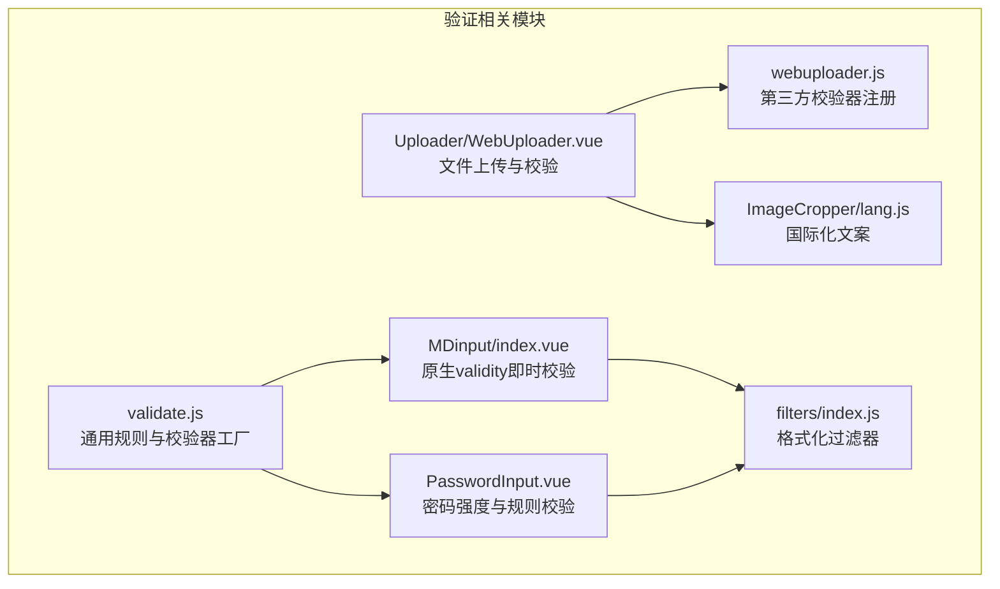
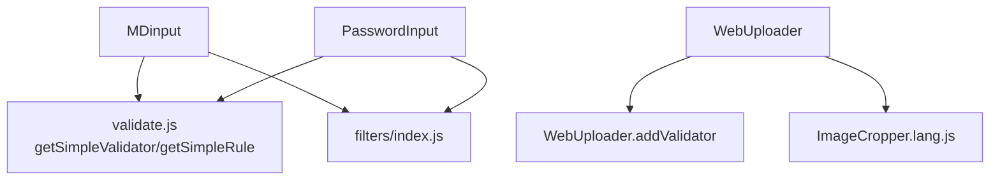
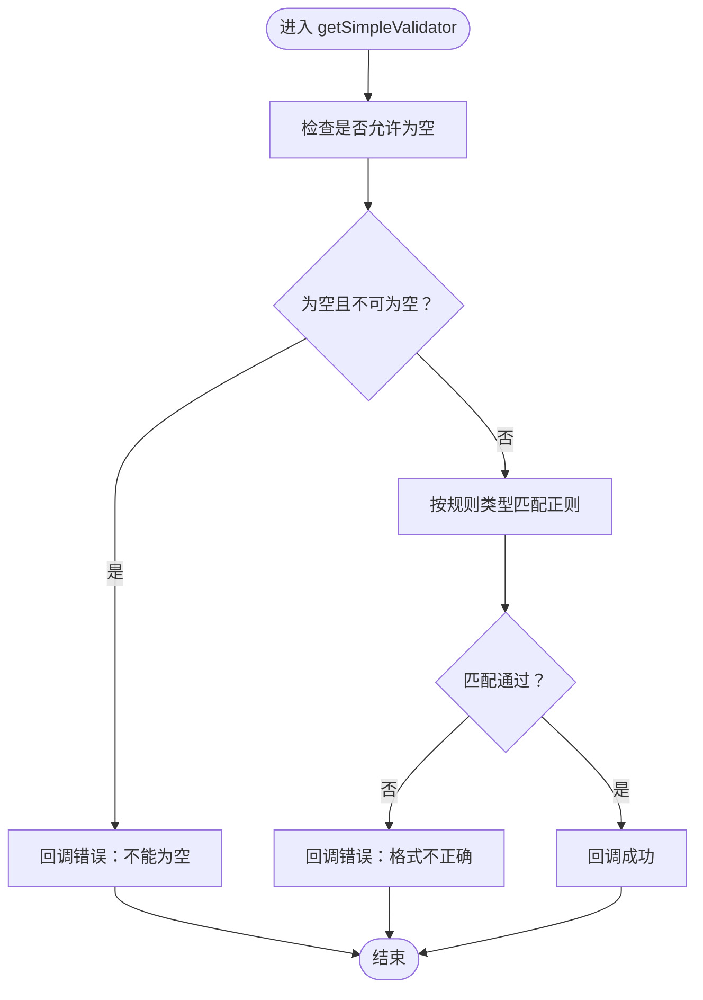
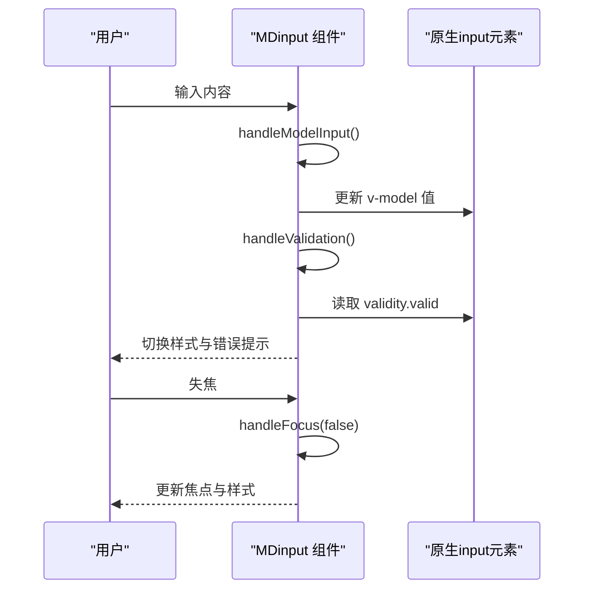
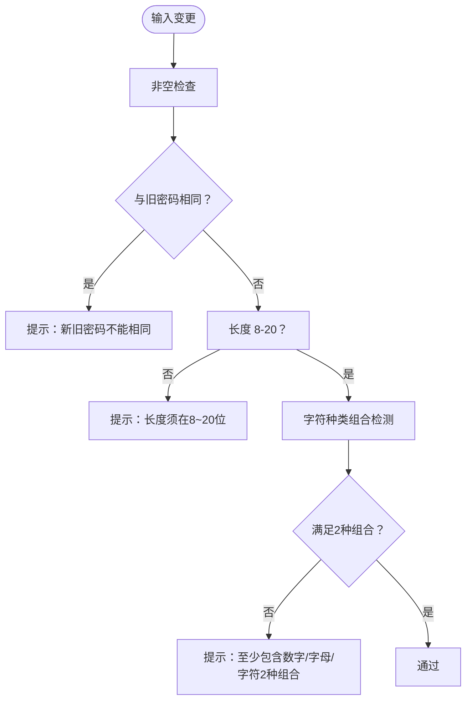
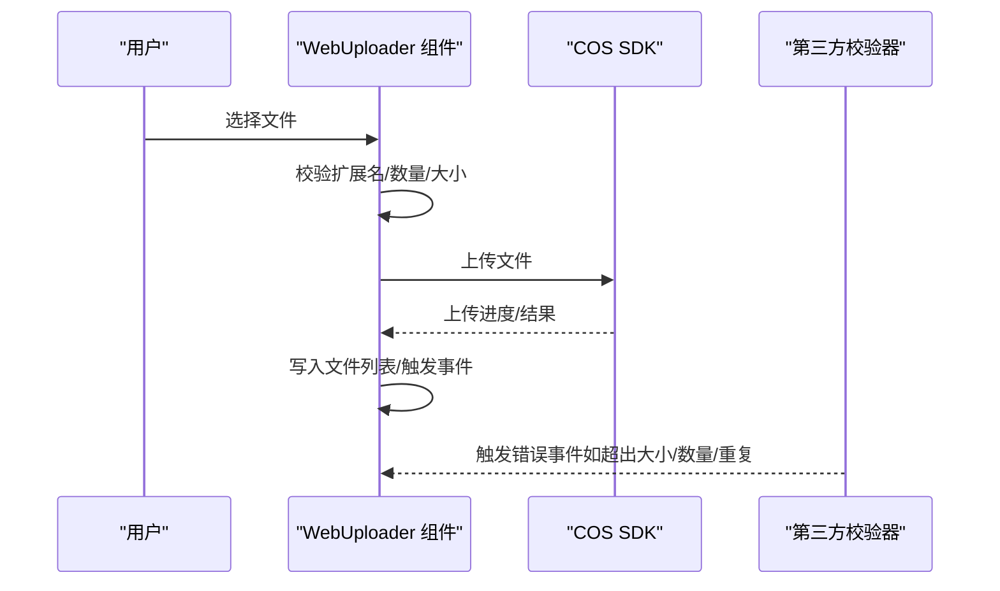
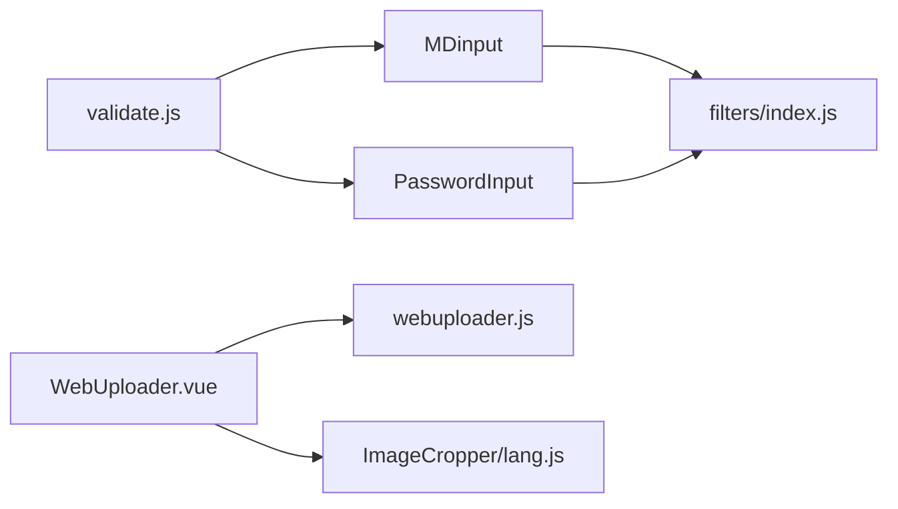

# 数据验证

<cite>
**本文引用的文件**
- [src/utils/validate.js](file://src/utils/validate.js)
- [src/components/MDinput/index.vue](file://src/components/MDinput/index.vue)
- [src/components/PasswordInput/PasswordInput.vue](file://src/components/PasswordInput/PasswordInput.vue)
- [src/components/Uploader/WebUploader.vue](file://src/components/Uploader/WebUploader.vue)
- [src/components/ImageCropper/lang.js](file://src/components/ImageCropper/lang.js)
- [static/ueditor1_4_3_3/third-party/webuploader/webuploader.js](file://static/ueditor1_4_3_3/third-party/webuploader/webuploader.js)
- [src/filters/index.js](file://src/filters/index.js)
</cite>

## 目录
1. [引言](#引言)
2. [项目结构](#项目结构)
3. [核心组件](#核心组件)
4. [架构总览](#架构总览)
5. [详细组件分析](#详细组件分析)
6. [依赖关系分析](#依赖关系分析)
7. [性能考量](#性能考量)
8. [故障排查指南](#故障排查指南)
9. [结论](#结论)
10. [附录](#附录)

## 引言
本文件面向校园管理系统前端的数据验证实践，系统性梳理了表单验证、输入校验与业务规则验证的实现策略，覆盖正则表达式、自定义验证函数、异步验证与文件上传校验，并对验证时机（即时、失焦、提交）进行说明。文档还涵盖错误信息国际化、验证状态可视化反馈以及性能优化建议，提供多种数据类型的验证示例与完整流程设计，帮助开发者在保证用户体验的同时提升数据质量。

## 项目结构
围绕数据验证的关键位置如下：
- 工具与规则：src/utils/validate.js 提供通用正则与简单校验器工厂
- 表单输入组件：src/components/MDinput/index.vue 基于原生 validity 的即时校验
- 密码强度组件：src/components/PasswordInput/PasswordInput.vue 自定义复杂规则与可视化反馈
- 文件上传组件：src/components/Uploader/WebUploader.vue 与第三方 WebUploader 校验器结合，实现文件类型、大小、去重等校验
- 国际化文案：src/components/ImageCropper/lang.js 提供多语言错误提示
- 过滤器与格式化：src/filters/index.js 提供时间、数值等格式化，辅助显示层校验结果

图表来源
- [src/utils/validate.js:1-72](file://src/utils/validate.js#L1-L72)
- [src/components/MDinput/index.vue:1-124](file://src/components/MDinput/index.vue#L1-L124)
- [src/components/PasswordInput/PasswordInput.vue:1-123](file://src/components/PasswordInput/PasswordInput.vue#L1-L123)
- [src/components/Uploader/WebUploader.vue:1-651](file://src/components/Uploader/WebUploader.vue#L1-L651)
- [static/ueditor1_4_3_3/third-party/webuploader/webuploader.js:3731-3912](file://static/ueditor1_4_3_3/third-party/webuploader/webuploader.js#L3731-L3912)
- [src/components/ImageCropper/lang.js:1-41](file://src/components/ImageCropper/lang.js#L1-L41)
- [src/filters/index.js:1-121](file://src/filters/index.js#L1-L121)

章节来源
- [src/utils/validate.js:1-72](file://src/utils/validate.js#L1-L72)
- [src/components/MDinput/index.vue:1-124](file://src/components/MDinput/index.vue#L1-L124)
- [src/components/PasswordInput/PasswordInput.vue:1-123](file://src/components/PasswordInput/PasswordInput.vue#L1-L123)
- [src/components/Uploader/WebUploader.vue:1-651](file://src/components/Uploader/WebUploader.vue#L1-L651)
- [src/components/ImageCropper/lang.js:1-41](file://src/components/ImageCropper/lang.js#L1-L41)
- [src/filters/index.js:1-121](file://src/filters/index.js#L1-L121)

## 核心组件
- 通用验证工具 validate.js
  - 定义常用正则（整数、浮点、手机号、身份证、URL、IP、图片/附件扩展名等）
  - 提供 getSimpleValidator 与 getSimpleRule 工厂，统一“必填+格式”校验逻辑与触发时机（默认 blur）
  - 提供手机号与身份证专用校验器，前者基于正则，后者引入外部库进行校验
- Material 输入组件 MDinput
  - 基于原生 input.validity 实现即时校验，监听 input 与 blur 事件
  - 通过 computedClasses 将“有效/无效/错误”状态映射到样式，实现视觉反馈
- 密码强度组件 PasswordInput
  - 自定义复杂规则：长度、字符种类组合、与旧密码差异
  - 可视化等级反馈（弱/中/强），错误信息实时展示
- 文件上传组件 WebUploader
  - 结合第三方 WebUploader 的 addValidator 注册机制，实现文件数量、单文件大小、去重等校验
  - 组件内部也进行扩展名白名单校验与批量上传处理
- 国际化文案 ImageCropper/lang.js
  - 提供中英文错误文案，便于切换语言环境下的错误提示一致性
- 过滤器 filters/index.js
  - 提供时间、数值等格式化能力，辅助在界面层直观呈现校验结果与数据

章节来源
- [src/utils/validate.js:1-72](file://src/utils/validate.js#L1-L72)
- [src/components/MDinput/index.vue:1-124](file://src/components/MDinput/index.vue#L1-L124)
- [src/components/PasswordInput/PasswordInput.vue:1-123](file://src/components/PasswordInput/PasswordInput.vue#L1-L123)
- [src/components/Uploader/WebUploader.vue:1-651](file://src/components/Uploader/WebUploader.vue#L1-L651)
- [src/components/ImageCropper/lang.js:1-41](file://src/components/ImageCropper/lang.js#L1-L41)
- [src/filters/index.js:1-121](file://src/filters/index.js#L1-L121)

## 架构总览
前端数据验证采用“组件级即时校验 + 规则工厂 + 第三方校验器 + 国际化文案”的分层架构：
- 组件层：MDinput、PasswordInput、WebUploader 等直接消费规则与校验器
- 工具层：validate.js 提供可复用的正则与校验器工厂
- 外部层：WebUploader 的 addValidator 机制用于文件类校验
- 展示层：filters 与 lang 提供格式化与国际化文案

图表来源
- [src/utils/validate.js:1-72](file://src/utils/validate.js#L1-L72)
- [src/components/MDinput/index.vue:1-124](file://src/components/MDinput/index.vue#L1-L124)
- [src/components/PasswordInput/PasswordInput.vue:1-123](file://src/components/PasswordInput/PasswordInput.vue#L1-L123)
- [src/components/Uploader/WebUploader.vue:1-651](file://src/components/Uploader/WebUploader.vue#L1-L651)
- [src/components/ImageCropper/lang.js:1-41](file://src/components/ImageCropper/lang.js#L1-L41)
- [src/filters/index.js:1-121](file://src/filters/index.js#L1-L121)
- [static/ueditor1_4_3_3/third-party/webuploader/webuploader.js:3731-3912](file://static/ueditor1_4_3_3/third-party/webuploader/webuploader.js#L3731-L3912)

## 详细组件分析

### 组件 A：通用验证工具 validate.js
- 正则集合：提供无符号/有符号整数、浮点、中文、拼音、手机号、身份证、邮箱、图片/附件扩展名、IP、URL 等
- 简单校验器工厂：
  - getSimpleValidator：支持“是否允许为空”与“按规则类型校验”，回调中抛出 Error 即视为校验失败
  - getSimpleRule：返回 async-validator 规则对象，默认 trigger 为 blur
- 专用校验器：
  - mobileValidator：手机号必填与格式校验
  - idcardValidator：空值提示 + 外部库校验（大写与校验位）

图表来源
- [src/utils/validate.js:30-49](file://src/utils/validate.js#L30-L49)

章节来源
- [src/utils/validate.js:1-72](file://src/utils/validate.js#L1-L72)

### 组件 B：Material 输入组件 MDinput
- 即时校验：监听 input 事件更新值并调用 handleValidation，后者读取原生 input.validity.valid 并更新组件状态
- 失焦反馈：blur 事件切换 focus 状态，computedClasses 将“活动/禁用/错误/抬起”状态映射到样式
- 错误展示：当存在 errorMessages 或 validity 不合法时，显示 material-errors 区域

图表来源
- [src/components/MDinput/index.vue:67-80](file://src/components/MDinput/index.vue#L67-L80)

章节来源
- [src/components/MDinput/index.vue:1-124](file://src/components/MDinput/index.vue#L1-L124)

### 组件 C：密码强度组件 PasswordInput
- 规则要点：
  - 非空校验
  - 新旧密码一致校验
  - 长度 8-20 字符
  - 至少包含数字/字母/字符中的 2 种组合
- 可视化反馈：
  - 错误信息实时显示
  - 等级指示条（弱/中/强），激活态颜色区分

图表来源
- [src/components/PasswordInput/PasswordInput.vue:45-73](file://src/components/PasswordInput/PasswordInput.vue#L45-L73)

章节来源
- [src/components/PasswordInput/PasswordInput.vue:1-123](file://src/components/PasswordInput/PasswordInput.vue#L1-L123)

### 组件 D：文件上传组件 WebUploader 与第三方校验器
- 组件内校验：
  - 扩展名白名单校验（extList），支持强制全量过滤
  - 成功回调后写入文件列表，触发外部事件与存储记录
- 第三方校验器（WebUploader.addValidator）：
  - 文件数量限制（fileNumLimit）
  - 单文件大小限制（fileSingleSizeLimit）
  - 去重（duplicate）：基于文件名、大小与修改时间生成哈希
- 国际化文案：
  - ImageCropper.lang.js 提供中英文错误文案，便于统一提示

图表来源
- [src/components/Uploader/WebUploader.vue:296-440](file://src/components/Uploader/WebUploader.vue#L296-L440)
- [static/ueditor1_4_3_3/third-party/webuploader/webuploader.js:3731-3912](file://static/ueditor1_4_3_3/third-party/webuploader/webuploader.js#L3731-L3912)
- [src/components/ImageCropper/lang.js:1-41](file://src/components/ImageCropper/lang.js#L1-L41)

章节来源
- [src/components/Uploader/WebUploader.vue:1-651](file://src/components/Uploader/WebUploader.vue#L1-L651)
- [static/ueditor1_4_3_3/third-party/webuploader/webuploader.js:3731-3912](file://static/ueditor1_4_3_3/third-party/webuploader/webuploader.js#L3731-L3912)
- [src/components/ImageCropper/lang.js:1-41](file://src/components/ImageCropper/lang.js#L1-L41)

## 依赖关系分析
- 组件与工具
  - MDinput 与 PasswordInput 直接依赖 validate.js 的规则工厂
  - WebUploader 与第三方 WebUploader 校验器协作，实现文件维度的校验
- 国际化与展示
  - ImageCropper.lang.js 为文件上传类错误提供多语言文案
  - filters/index.js 为界面层提供格式化能力，辅助校验结果的可读性

图表来源
- [src/utils/validate.js:1-72](file://src/utils/validate.js#L1-L72)
- [src/components/MDinput/index.vue:1-124](file://src/components/MDinput/index.vue#L1-L124)
- [src/components/PasswordInput/PasswordInput.vue:1-123](file://src/components/PasswordInput/PasswordInput.vue#L1-L123)
- [src/components/Uploader/WebUploader.vue:1-651](file://src/components/Uploader/WebUploader.vue#L1-L651)
- [src/components/ImageCropper/lang.js:1-41](file://src/components/ImageCropper/lang.js#L1-L41)
- [src/filters/index.js:1-121](file://src/filters/index.js#L1-L121)

章节来源
- [src/utils/validate.js:1-72](file://src/utils/validate.js#L1-L72)
- [src/components/MDinput/index.vue:1-124](file://src/components/MDinput/index.vue#L1-L124)
- [src/components/PasswordInput/PasswordInput.vue:1-123](file://src/components/PasswordInput/PasswordInput.vue#L1-L123)
- [src/components/Uploader/WebUploader.vue:1-651](file://src/components/Uploader/WebUploader.vue#L1-L651)
- [src/components/ImageCropper/lang.js:1-41](file://src/components/ImageCropper/lang.js#L1-L41)
- [src/filters/index.js:1-121](file://src/filters/index.js#L1-L121)

## 性能考量
- 即时校验的节流与防抖
  - 对高频输入（如文本框）建议在组件内部增加防抖，避免每次输入都触发复杂校验
- 正则与外部库校验
  - 对身份证等外部库校验应尽量在必要时触发（如失焦或提交），减少不必要的计算
- 文件上传校验
  - 扩展名与大小校验优先在前端完成，避免无效请求
  - 使用 Promise.all 并发上传时注意错误聚合与进度反馈
- 样式与渲染
  - 将错误状态与样式分离，避免频繁重排
  - 使用虚拟滚动或分页展示大量校验结果，降低渲染压力

## 故障排查指南
- 表单输入组件未显示错误
  - 检查是否传入 errorMessages 或组件内部 validity 判断逻辑
  - 确认 computedClasses 是否正确映射到样式
- 密码强度组件未生效
  - 确认 input 事件是否触发 inputHandler
  - 检查旧密码对比与字符种类检测逻辑
- 文件上传失败
  - 查看第三方校验器是否触发错误事件（超出大小/数量/重复）
  - 检查扩展名白名单与强制过滤逻辑
  - 确认 COS SDK 初始化与签名流程是否成功
- 国际化文案未生效
  - 检查 lang.js 的中英文键值是否与组件使用一致

章节来源
- [src/components/MDinput/index.vue:40-80](file://src/components/MDinput/index.vue#L40-L80)
- [src/components/PasswordInput/PasswordInput.vue:40-73](file://src/components/PasswordInput/PasswordInput.vue#L40-L73)
- [src/components/Uploader/WebUploader.vue:296-440](file://src/components/Uploader/WebUploader.vue#L296-L440)
- [src/components/ImageCropper/lang.js:1-41](file://src/components/ImageCropper/lang.js#L1-L41)

## 结论
本系统通过“组件即时校验 + 规则工厂 + 第三方校验器 + 国际化文案”的组合，实现了覆盖用户输入、密码强度与文件上传的多场景数据验证。建议在实际项目中：
- 明确验证时机：即时校验用于体验，失焦与提交校验用于关键路径
- 将复杂校验延迟至失焦或提交，减少性能开销
- 统一错误文案与视觉反馈，提升可读性与一致性
- 对文件类校验充分利用第三方校验器，确保边界条件完备

## 附录
- 验证时机参考
  - 即时验证：MDinput 的 input 事件、PasswordInput 的 input 事件
  - 失焦验证：MDinput 的 blur 事件、validate.js 默认 trigger 为 blur
  - 提交验证：在表单提交阶段统一调用各组件的 validate 方法或触发规则校验
- 数据类型示例
  - 用户输入：手机号、邮箱、URL、IP、中文、拼音等，使用 validate.js 的正则与规则工厂
  - 密码输入：长度与字符种类组合校验，结合旧密码差异
  - 文件上传：扩展名白名单、单文件大小、文件总数、去重等，结合 WebUploader 校验器与组件内校验