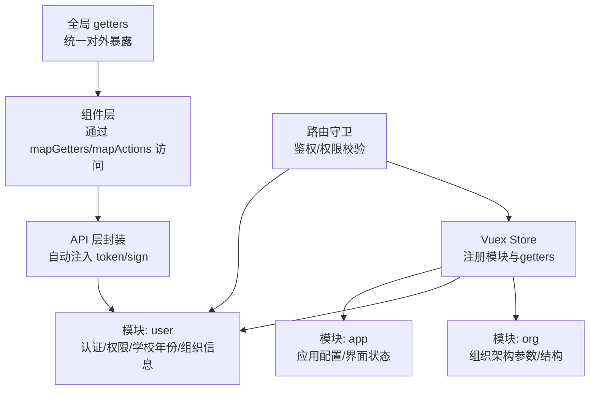
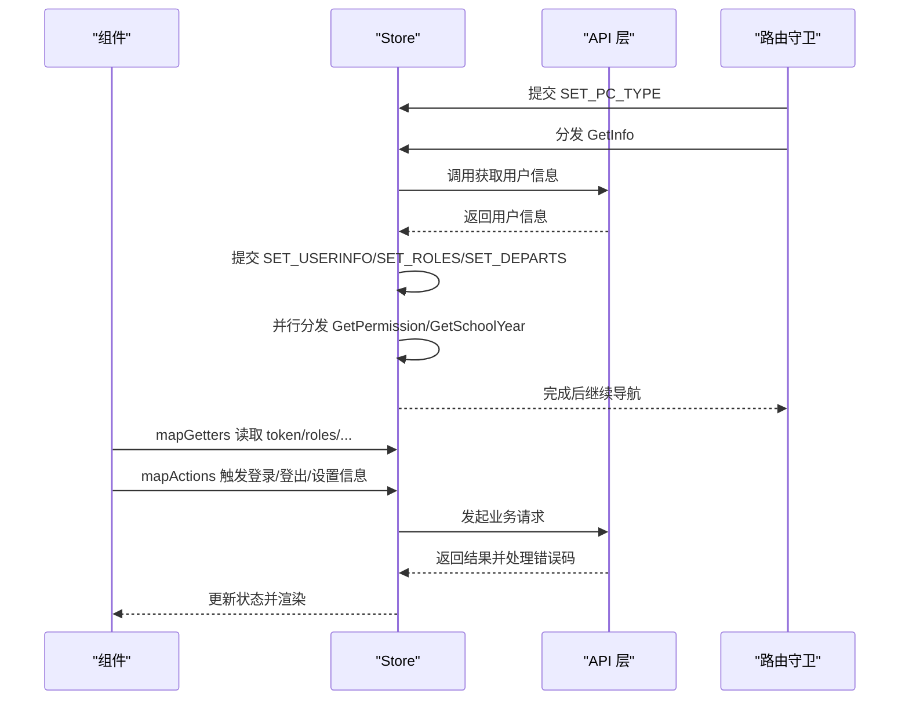
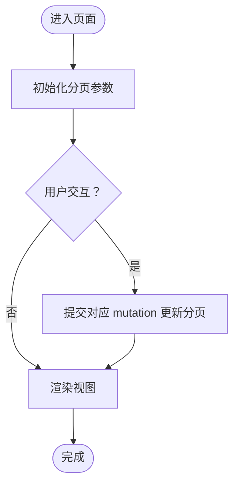
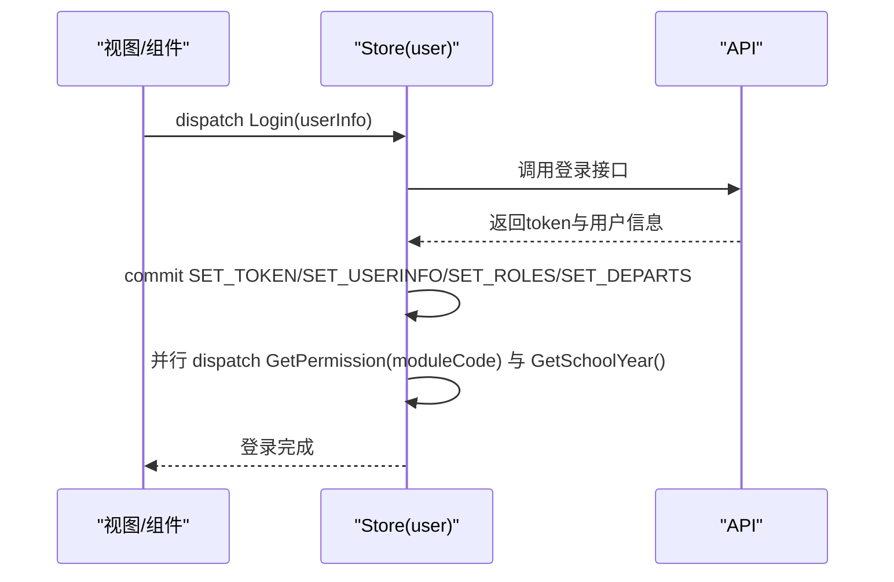
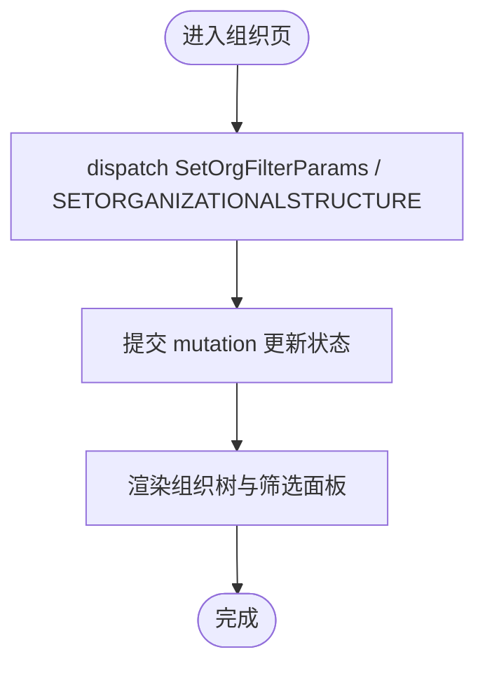
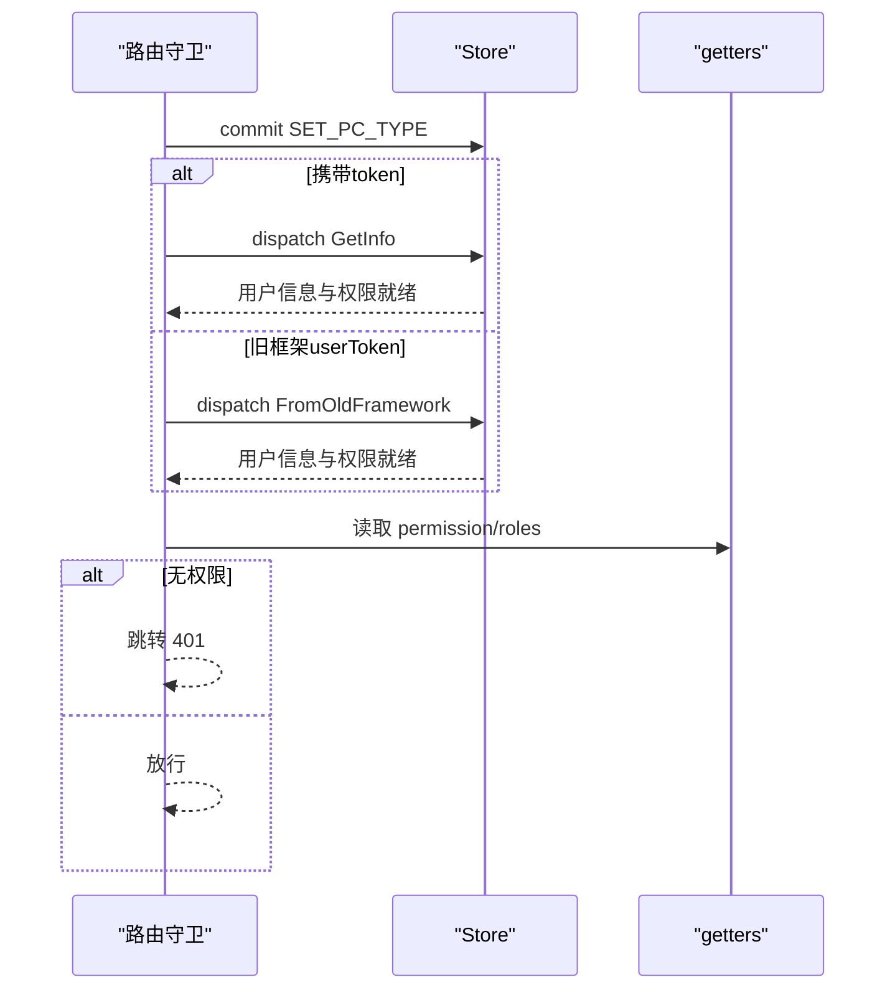
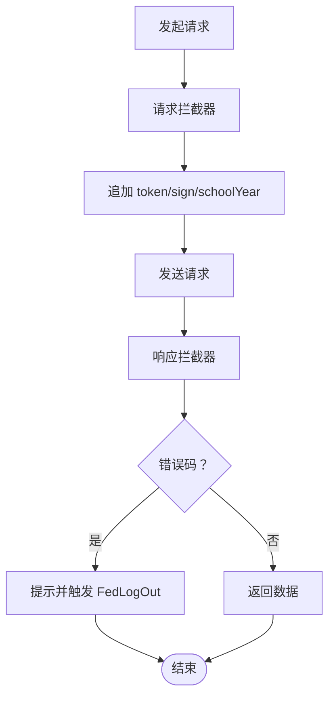
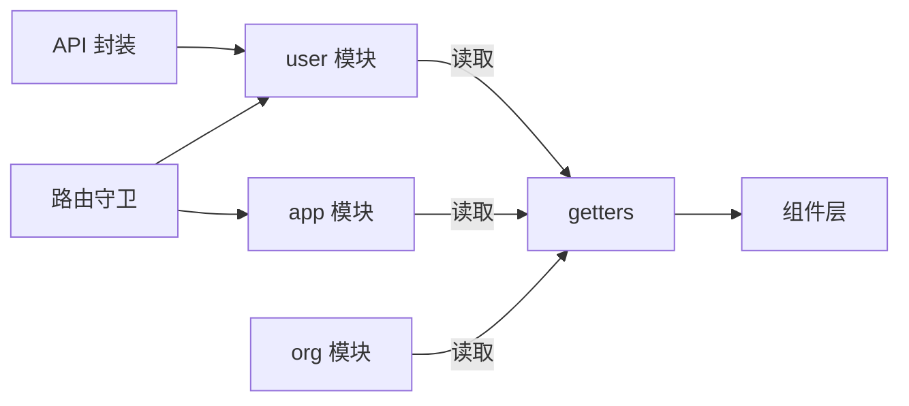

# 状态管理

<cite>
**本文引用的文件**
- [src/store/index.js](file://src/store/index.js)
- [src/store/modules/app.js](file://src/store/modules/app.js)
- [src/store/modules/user.js](file://src/store/modules/user.js)
- [src/store/modules/org.js](file://src/store/modules/org.js)
- [src/store/getters.js](file://src/store/getters.js)
- [src/main.js](file://src/main.js)
- [src/utils/fetch.js](file://src/utils/fetch.js)
- [src/components/AddressBook/AddressBook.vue](file://src/components/AddressBook/AddressBook.vue)
- [src/views/activity/activityAdd.vue](file://src/views/activity/activityAdd.vue)
- [src/store/errLog.js](file://src/store/errLog.js)
</cite>

## 目录
1. [引言](#引言)
2. [项目结构](#项目结构)
3. [核心组件](#核心组件)
4. [架构总览](#架构总览)
5. [详细组件分析](#详细组件分析)
6. [依赖分析](#依赖分析)
7. [性能考虑](#性能考虑)
8. [故障排查指南](#故障排查指南)
9. [结论](#结论)
10. [附录](#附录)

## 引言
本文件面向校园管理系统中的Vuex状态管理，系统性梳理模块化设计与职责划分，覆盖state、mutations、actions、getters的使用模式与最佳实践；阐述状态持久化策略、状态同步机制与异步处理流程；并提供组件中使用store的参考路径与调试、性能优化建议。

## 项目结构
- store入口集中注册模块与getters，形成清晰的模块边界与数据流入口。
- 模块按领域拆分：app负责应用配置与界面状态，user负责认证、权限与学校年份等用户相关全局状态，org负责组织架构相关状态。
- 组件通过mapGetters/mapActions等辅助工具访问store，API层通过封装的axios服务自动注入token与签名参数，确保请求一致性与安全性。

图表来源
- [src/store/index.js:10-17](file://src/store/index.js#L10-L17)
- [src/store/modules/app.js:3-25](file://src/store/modules/app.js#L3-L25)
- [src/store/modules/user.js:20-44](file://src/store/modules/user.js#L20-L44)
- [src/store/modules/org.js:4-9](file://src/store/modules/org.js#L4-L9)
- [src/store/getters.js:1-24](file://src/store/getters.js#L1-L24)

章节来源
- [src/store/index.js:1-20](file://src/store/index.js#L1-L20)
- [src/store/modules/app.js:1-54](file://src/store/modules/app.js#L1-L54)
- [src/store/modules/user.js:1-447](file://src/store/modules/user.js#L1-L447)
- [src/store/modules/org.js:1-34](file://src/store/modules/org.js#L1-L34)
- [src/store/getters.js:1-26](file://src/store/getters.js#L1-L26)

## 核心组件
- Store入口：集中注册app、user、org模块与getters，保证模块间解耦与可维护性。
- app模块：管理主题、分页参数、界面类型等应用级状态，提供变更mutation以响应页面交互。
- user模块：承载认证令牌、用户信息、角色、权限映射、学校年份列表与当前选择、组织部门列表等；提供登录、登出、权限拉取、学校年份拉取等actions。
- org模块：管理组织架构过滤参数与组织树结构，提供设置与更新的actions。
- getters：统一从user与org模块暴露派生状态，供组件层按需读取。

章节来源
- [src/store/index.js:3-16](file://src/store/index.js#L3-L16)
- [src/store/modules/app.js:3-51](file://src/store/modules/app.js#L3-L51)
- [src/store/modules/user.js:20-443](file://src/store/modules/user.js#L20-L443)
- [src/store/modules/org.js:4-31](file://src/store/modules/org.js#L4-L31)
- [src/store/getters.js:1-24](file://src/store/getters.js#L1-L24)

## 架构总览
- 数据流向：组件通过dispatch/actions发起异步请求，提交mutations同步状态，getters向组件暴露派生数据；API层在请求前自动注入token与签名参数，保障接口安全与一致性。
- 鉴权与权限：路由守卫在进入受保护路由前检查token与权限，必要时拉取用户信息与权限列表，再决定放行或跳转。
- 状态持久化：token存储于Cookie，部分配置与选择项存储于sessionStorage，确保刷新后仍可恢复关键状态。

图表来源
- [src/main.js:73-198](file://src/main.js#L73-L198)
- [src/store/modules/user.js:120-443](file://src/store/modules/user.js#L120-L443)
- [src/utils/fetch.js:66-169](file://src/utils/fetch.js#L66-L169)

章节来源
- [src/main.js:73-198](file://src/main.js#L73-L198)
- [src/utils/fetch.js:13-240](file://src/utils/fetch.js#L13-L240)

## 详细组件分析

### app模块：应用配置与界面状态
- 职责：维护主题、分页参数（食谱通知、打卡、作业管理）、界面类型（pcType）等应用级状态。
- 关键点：
  - 通过RECIPE_PAGE_CHANGE/CLOCK_PAGE_CHANGE/HOMEWORK_PAGE_CHANGE等mutation原子化更新分页状态。
  - SET_PC_TYPE用于标识运行环境（如独立窗口），影响权限判断与界面行为。
- 最佳实践：
  - 将与“页面交互”强相关的状态放入app模块，避免分散在多个模块。
  - mutation只做浅层赋值，保持state结构简单稳定。

图表来源
- [src/store/modules/app.js:26-47](file://src/store/modules/app.js#L26-L47)

章节来源
- [src/store/modules/app.js:1-54](file://src/store/modules/app.js#L1-L54)

### user模块：认证、权限与学校年份
- 职责：管理token、用户信息、角色、权限列表与名称映射、学校年份列表与当前选择、组织部门列表等。
- 关键点：
  - 登录/登出：通过commit SET_TOKEN/CLEAR_TOKEN与Cookies交互；登出同时清理权限与角色。
  - 权限：通过permissions与permissionNameMapping提供权限URL集合与描述映射，便于菜单与按钮级权限控制。
  - 学校年份：维护year/currentYear/selectedYear，支持切换与重置。
  - 异步：Login/GetInfo/FromOldFramework/SetInfo等actions串并联处理，确保在获取权限与学校年份后再放行。
- 最佳实践：
  - 所有异步请求均通过Promise封装，避免回调地狱。
  - 对第三方登录与旧框架迁移场景分别处理，保证兼容性。
  - 将地图密钥等一次性初始化逻辑放在登录后执行，减少重复请求。

图表来源
- [src/store/modules/user.js:120-173](file://src/store/modules/user.js#L120-L173)
- [src/store/modules/user.js:287-304](file://src/store/modules/user.js#L287-L304)
- [src/store/modules/user.js:305-325](file://src/store/modules/user.js#L305-L325)

章节来源
- [src/store/modules/user.js:1-447](file://src/store/modules/user.js#L1-L447)

### org模块：组织架构数据
- 职责：维护组织架构过滤参数与组织树结构，提供设置与更新的actions。
- 关键点：
  - SET_ORG_FILTER_PARAMS：记录筛选条件与操作状态。
  - SET_ORG_ANIZATIONALSTRUCTURE：保存组织树数据。
- 最佳实践：
  - 将与“组织树”相关的状态与业务操作参数分离，避免污染主数据结构。
  - 通过actions集中处理异步加载与缓存策略。

图表来源
- [src/store/modules/org.js:19-31](file://src/store/modules/org.js#L19-L31)

章节来源
- [src/store/modules/org.js:1-34](file://src/store/modules/org.js#L1-L34)

### getters：统一对外暴露
- 职责：从user与org模块聚合派生状态，供组件层按需读取。
- 关键点：
  - token、avatar、name、uid、email、introduction、auth_type、status、roles、setting、userInfo、schoolInfo、permissions、departs、orgFilterParams、permissionNameMapping、isStandalone、schoolYearList、selectedSchoolYear、isSelectedYearCurrent、currentSchoolYear等。
- 最佳实践：
  - 将复杂计算逻辑下沉至getters，组件仅做订阅，降低重复计算与耦合。

章节来源
- [src/store/getters.js:1-26](file://src/store/getters.js#L1-L26)

### 路由守卫与权限校验
- 职责：在进入受保护路由前检查token与权限，必要时拉取用户信息与权限列表。
- 关键点：
  - 白名单直通；携带token或旧框架userToken时，写入Cookie并拉取信息。
  - 通过store.getters.permission判断目标路由meta.permissionPath是否存在。
  - 设置pcType以区分嵌入与独立运行环境。
- 最佳实践：
  - 将权限判断前置到路由层，避免组件重复逻辑。
  - 对旧框架迁移场景单独处理，保证用户体验连贯。

图表来源
- [src/main.js:73-198](file://src/main.js#L73-L198)
- [src/store/getters.js:16-24](file://src/store/getters.js#L16-L24)

章节来源
- [src/main.js:73-198](file://src/main.js#L73-L198)
- [src/store/getters.js:16-24](file://src/store/getters.js#L16-L24)

### API层与状态同步
- 职责：在请求前自动注入token与签名参数，统一处理错误码并触发登出逻辑。
- 关键点：
  - 请求拦截器：自动追加token与sign；对特定接口追加schoolYear（归档场景）。
  - 响应拦截器：统一错误提示与登出处理；成功时返回原始或精简数据。
- 最佳实践：
  - 将token注入与签名生成逻辑集中在请求拦截器，避免各处重复。
  - 对不同业务域提供独立的axios实例，隔离配置差异。

图表来源
- [src/utils/fetch.js:66-169](file://src/utils/fetch.js#L66-L169)

章节来源
- [src/utils/fetch.js:13-240](file://src/utils/fetch.js#L13-L240)

### 组件中使用store的参考路径
- 读取token与用户信息：组件通过mapGetters或直接$store.getters访问token、userInfo等。
  - 参考路径：[src/components/AddressBook/AddressBook.vue:590-591](file://src/components/AddressBook/AddressBook.vue#L590-L591)
  - 参考路径：[src/views/activity/activityAdd.vue:228-239](file://src/views/activity/activityAdd.vue#L228-L239)
- 注入token到上传/导出等接口：在组件中拼接token参数，确保接口鉴权。
  - 参考路径：[src/components/ImportFile/index.vue:82-88](file://src/components/ImportFile/index.vue#L82-L88)
  - 参考路径：[src/components/ImportFile/index.vue:126](file://src/components/ImportFile/index.vue#L126)

章节来源
- [src/components/AddressBook/AddressBook.vue:590-591](file://src/components/AddressBook/AddressBook.vue#L590-L591)
- [src/views/activity/activityAdd.vue:228-239](file://src/views/activity/activityAdd.vue#L228-L239)
- [src/components/ImportFile/index.vue:82-88](file://src/components/ImportFile/index.vue#L82-L88)
- [src/components/ImportFile/index.vue:126](file://src/components/ImportFile/index.vue#L126)

## 依赖分析
- 模块内聚与耦合：
  - app与user相对独立，app仅持有界面与分页状态；user承担认证与权限，是跨页面共享的核心。
  - org与user解耦，仅在需要组织树的页面使用。
- 外部依赖：
  - Cookie用于token持久化；sessionStorage用于部分配置与选择项。
  - ElementUI、NProgress等UI与进度条库在main.js中统一引入。
- 循环依赖风险：
  - 当前结构未见循环依赖；若后续扩展，建议保持模块边界清晰，避免相互commit。

图表来源
- [src/store/index.js:10-17](file://src/store/index.js#L10-L17)
- [src/store/getters.js:1-24](file://src/store/getters.js#L1-L24)
- [src/utils/fetch.js:13-240](file://src/utils/fetch.js#L13-L240)
- [src/main.js:73-198](file://src/main.js#L73-L198)

章节来源
- [src/store/index.js:10-17](file://src/store/index.js#L10-L17)
- [src/store/getters.js:1-24](file://src/store/getters.js#L1-L24)
- [src/utils/fetch.js:13-240](file://src/utils/fetch.js#L13-L240)
- [src/main.js:73-198](file://src/main.js#L73-L198)

## 性能考虑
- 状态粒度与计算开销：
  - 将复杂计算下沉至getters，避免在组件中重复计算；对大数组排序与过滤尽量在actions中完成，减少渲染抖动。
- 异步并发：
  - 使用Promise.all并行拉取权限与学校年份，缩短首屏等待时间。
- 缓存策略：
  - 对权限列表与学校年份采用内存缓存；对token与地图密钥使用Cookie与sessionStorage组合，兼顾易用与安全。
- 请求拦截器优化：
  - 在请求拦截器中批量注入token与签名参数，减少重复逻辑；对特定接口启用归档参数，避免在组件中分散处理。

## 故障排查指南
- 登录后无权限或跳转401：
  - 检查路由守卫中permissionPath与store.getters.permission的匹配关系。
  - 确认dispatch GetPermission与GetSchoolYear是否成功返回。
- 接口报错或token过期：
  - 查看响应拦截器对错误码的处理，确认是否触发了FedLogOut与跳转。
  - 检查请求拦截器是否正确注入token与sign。
- 错误日志收集：
  - 生产环境通过全局错误处理器收集错误日志，便于定位问题。
  - 可结合errLog模块进行本地调试与上报。

章节来源
- [src/main.js:134-151](file://src/main.js#L134-L151)
- [src/utils/fetch.js:104-169](file://src/utils/fetch.js#L104-L169)
- [src/store/errLog.js:1-14](file://src/store/errLog.js#L1-L14)

## 结论
本系统采用模块化的Vuex设计，围绕认证与权限(user)、应用配置(app)、组织架构(org)三大领域划分状态，配合统一的getters与API拦截器，实现了清晰的职责边界与一致的异步处理流程。通过路由守卫前置权限校验与状态同步，确保了用户体验与安全性。建议在后续迭代中持续沉淀通用的异步处理模式与错误处理策略，进一步提升可维护性与性能。

## 附录
- 状态持久化策略：
  - token：Cookie（Admin-Token）
  - 地图密钥与独立运行标记：sessionStorage
  - 学校年份选择：sessionStorage(selectedSchoolYear)
- 状态同步机制：
  - 登录后并行拉取权限与学校年份，完成后放行。
  - 路由守卫根据pcType与权限动态调整导航。
- 异步状态处理：
  - 所有异步操作通过actions封装Promise，确保错误处理与并发控制。